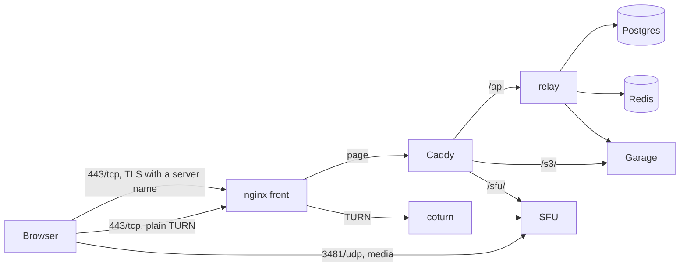

# Deploying Ambre

This directory holds what a host needs to run Ambre, and nothing that belongs to one hosting
provider. The rules it answers live in `specs/1-Foundations/ambre-spec-server.md`, section 3, "A
deployment runs on any host".

| File | What it holds |
| :--- | :--- |
| `Dockerfile` | the images of the relay, the SFU and the client, and the one-shot preparation of the object store |
| `compose/compose.yml` | the whole suite on one server (`SRV-310`) |
| `compose/setup.sh` | writes the `.env` of a new stack: its domain, its address and a fresh secret for each service |
| `compose/nginx.conf` | the TLS front on port 443 |
| `compose/Caddyfile` | the web server: the certificate, the client, and the routes to the relay, the object store and the SFU |
| `compose/garage.toml` | the object store |
| `compose/caddy_headers.py` | writes the headers file of a client build as Caddy directives |
| `chart/` | the Helm chart of a Kubernetes cluster (`SRV-309`), and `chart/README.md` says how to install it |

## Run Ambre on one server

The server needs Docker with the compose plugin, `openssl`, a public IPv4 address and a domain
whose DNS record points at that address. The firewall opens three ports:

| Port | Why |
| :--- | :--- |
| 80/tcp | the ACME challenge of the certificate, and the redirect to HTTPS |
| 443/tcp | the page, the relay, and TURN for a network that opens nothing else |
| 3481/udp | the media of a call, straight to the SFU |

In `deploy/compose/`:

```bash
./setup.sh ambre.example.org 203.0.113.7 admin@example.org
docker compose up -d --build
```

The first build compiles the relay, the SFU and the client, which takes 20 to 40 minutes. The suite
is then at `https://ambre.example.org`.

Keep `.env`. Each secret in it guards a store of the stack, and a new secret locks the stack out of
its own data. Back up the volumes `pgdata`, `garagemeta` and `garagedata`, and `.env` with them.
Redis keeps nothing that the relay cannot rebuild.

## How the stack is wired



* **One port 443 serves the page and TURN.** The front reads the first bytes of each connection. A
  TLS hello that names a server goes to Caddy, and anything else goes to coturn. The front opens no
  TLS session, so Caddy holds the one certificate.
* **The SFU runs on the network of the host.** It announces its own address as the one candidate
  of its media, so that address must be the public one (`CALL-141`). No load balancer stands in
  front of it.
* **The stores publish nothing.** Postgres and Redis listen on the network of the stack alone. The
  relay and the S3 API of Garage listen on the loopback of the host, for Caddy.
* **The object store sits under the origin of the page,** at `/s3/`. A presigned link then needs
  no CORS rule.

## Sign-in

The relay signs a user in through an identity provider: Google, or the OpenID Connect issuer of the
organization. Without one, no user can sign in.

| Provider | Variables in `.env` | Redirect address of the client |
| :--- | :--- | :--- |
| Google | `OIDC_GOOGLE_CLIENT_ID`, `OIDC_GOOGLE_CLIENT_SECRET` | `https://<domain>/signin/google` |
| an OpenID Connect issuer | `OIDC_ISSUER`, `OIDC_CLIENT_ID`, `OIDC_CLIENT_SECRET` | `https://<domain>/signin/oidc` |

`OIDC_ISSUER` is the exact `issuer` that the discovery document of the provider names, over
`https`. A Keycloak realm reads `https://id.example.org/realms/<realm>`, and an Authentik
application reads `https://id.example.org/application/o/<slug>/`. In the provider, register a
confidential client with the authorization code flow and the redirect address above, and grant it
the scopes `openid`, `email` and `profile`. The client must sign its identity tokens under an
asymmetric algorithm, such as RS256. The provider must verify the address of each user: the relay
refuses an address the provider has not verified.

The client build names the same issuer, offers it in place of Google, and follows a sign-in to its
host alone. So run `docker compose up -d --build` after a change of `OIDC_ISSUER`.

The stack runs no identity provider of its own. A provider served under the origin of the suite
would read what the client keeps on the device, and a second origin needs its own name and
certificate. An organization that leaves a provider outside the European Union already runs its
directory: name it here.

## The link key of a thread

The relay signs a receipt of each thread link under `THREAD_LINK_SEED`, and the client refuses to
erase a thread under a receipt that its link key verifies (`SYNC-330`). `setup.sh` draws the seed
and writes its public half as `THREAD_LINK_KEY`. The relay refuses to start under a seed of
another key (`SRV-364`).

The web image pins no key: its client holds an empty link key slot (`ZK-057`). At each start, the
one-shot service `web-files` copies the client into the volume `webfiles`. The one-shot service
`link-key`, of the init image, then writes `THREAD_LINK_KEY` into that copy, and `web` serves it
(`SRV-392`). The patch refuses an empty key, a malformed key and the development key, and `web`
then never starts: `docker compose logs link-key` says why. A client with an empty slot names no
thread, so keep the pair together.

An `.env` written before the link key lacks both values, and `docker compose` then stops. Draw a
pair as `setup.sh` does, add both lines, and run `docker compose up -d`. A new key needs no new
build: the next start patches it. Every receipt signed under the older key then counts as none.

To check the served client against the release manifest, set its key bytes to zero first with
`python3 scripts/link_key.py zero <file> <file>` (`ZK-091`).

## Web embeds

A Toile web embed loads a page of another site only when the deployment names that site. Set
`AMBRE_EMBED_SITES` in `.env` to the hosts or `https` origins it admits, split by spaces or commas,
for example `AMBRE_EMBED_SITES=www.youtube.com player.vimeo.com`. Then run
`docker compose up -d --build`: the build writes the sites into the policy of the page. Without the
variable, no embed loads (`SRV-312`). Each entry names one host: a wildcard such as `*.github.io`
fails the build, since it admits the page of any user of that host.

## The stack under test

`just selfhost-test` builds the images, starts the stack on this machine for `localhost` and runs
one test of the browser tier through the front. That stack signs in by a bare name, which the
client build allows only outside a release (`ZK-045`), and takes a certificate of Caddy's own
authority. Neither setting belongs in a deployment.
