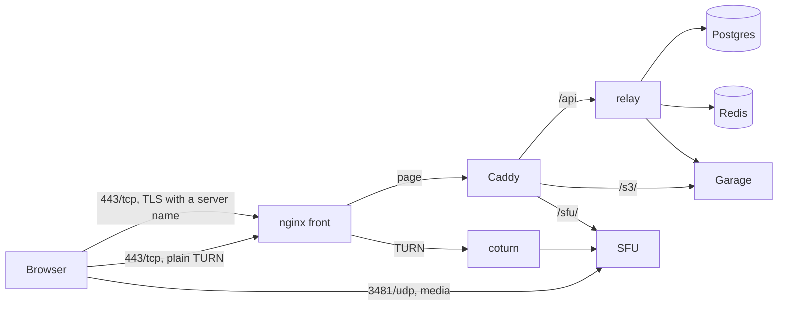

# Deploying Ambre

This directory holds what a host needs to run Ambre, and nothing that belongs to one hosting
provider. The rules it answers live in `specs/1-Foundations/ambre-spec-server.md`, section 3, "A
deployment runs on any host".

| File | What it holds |
| :--- | :--- |
| `Dockerfile` | the images of the relay, the SFU and the client, and the one-shot preparation of the object store |
| `compose/compose.yml` | the whole suite on one server (`SRV-310`) |
| `compose/setup.sh` | writes the `.env` of a new stack: its domain, its address and a fresh secret for each service |
| `compose/nginx.conf` | the TLS front on port 443 |
| `compose/Caddyfile` | the web server: the certificate, the client, and the routes to the relay, the object store and the SFU |
| `compose/garage.toml` | the object store |
| `compose/caddy_headers.py` | writes the headers file of a client build as Caddy directives |

## Run Ambre on one server

The server needs Docker with the compose plugin, `openssl`, a public IPv4 address and a domain
whose DNS record points at that address. The firewall opens three ports:

| Port | Why |
| :--- | :--- |
| 80/tcp | the ACME challenge of the certificate, and the redirect to HTTPS |
| 443/tcp | the page, the relay, and TURN for a network that opens nothing else |
| 3481/udp | the media of a call, straight to the SFU |

In `deploy/compose/`:

```bash
./setup.sh ambre.example.org 203.0.113.7 admin@example.org
docker compose up -d --build
```

The first build compiles the relay, the SFU and the client, which takes 20 to 40 minutes. The suite
is then at `https://ambre.example.org`.

Keep `.env`. Each secret in it guards a store of the stack, and a new secret locks the stack out of
its own data. Back up the volumes `pgdata`, `garagemeta` and `garagedata`, and `.env` with them.
Redis keeps nothing that the relay cannot rebuild.

## How the stack is wired



* **One port 443 serves the page and TURN.** The front reads the first bytes of each connection. A
  TLS hello that names a server goes to Caddy, and anything else goes to coturn. The front opens no
  TLS session, so Caddy holds the one certificate.
* **The SFU runs on the network of the host.** It announces its own address as the one candidate
  of its media, so that address must be the public one (`CALL-141`). No load balancer stands in
  front of it.
* **The stores publish nothing.** Postgres and Redis listen on the network of the stack alone. The
  relay and the S3 API of Garage listen on the loopback of the host, for Caddy.
* **The object store sits under the origin of the page,** at `/s3/`. A presigned link then needs
  no CORS rule.

## Sign-in

The relay signs a user in through an identity provider, and Google is the one it knows today. Set
`OIDC_GOOGLE_CLIENT_ID` and `OIDC_GOOGLE_CLIENT_SECRET` in `.env`, with
`https://<domain>/signin/google` as the redirect address of the client. Without them, no user can
sign in.

## Web embeds

A Toile web embed loads a page of another site only when the deployment names that site. Set
`AMBRE_EMBED_SITES` in `.env` to the hosts or `https` origins it admits, split by spaces or commas,
for example `AMBRE_EMBED_SITES=www.youtube.com player.vimeo.com`. Then run
`docker compose up -d --build`: the build writes the sites into the policy of the page. Without the
variable, no embed loads (`SRV-312`).

## The stack under test

`just selfhost-test` builds the images, starts the stack on this machine for `localhost` and runs
one test of the browser tier through the front. That stack signs in by a bare name, which the
client build allows only outside a release (`ZK-045`), and takes a certificate of Caddy's own
authority. Neither setting belongs in a deployment.
