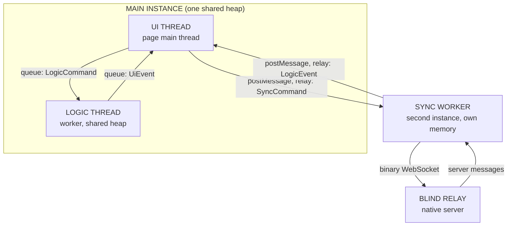

# AMBRE -- FEATURE: THE THREE-THREAD STACK

**Type:** Horizontal (framework)
**Implementation:** partial -- the two instances, the six queues and the crate graph all ship.
The failure path and the tab model are held by construction alone.

> How the client is split, and why. Three execution contexts, two WebAssembly instances, one crate
> graph that carries the separation and one page that boots them.

This document owns the stack. What travels on it is `ambre-spec-message-bus.md`, what may never
leave it is `ambre-spec-zero-knowledge.md`, and what each part costs is `ambre-spec-budgets.md`.

---

## 1. CONTRACT

The only mandatory read. Grammar and status values are normative in `ambre-spec-template.md`. The
prefix is `ARCH`.

### 1.1 The state

| ID | Kind | Statement (RFC 2119) | Sources | Mechanism | Gap | Status |
|---|---|---|---|---|---|---|
| `ARCH-002` | `INV` | The crate graph MUST stay acyclic. | this spec section 2 | crate-graph -- a cycle between two workspace crates fails to resolve, so the edit that would create one never builds | none | verified |
| `ARCH-004` | `INV` | Every cryptographic operation MUST run in the Sync worker. | README pillar "Zero-Knowledge"; `ambre-spec-zero-knowledge.md`, `ZK-002` | cargo-deny -- `deny.toml` grants `ambre-crypto` to `ambre-sync`, and to `ambre-logic` for one host-only fixture hash, so every other crate fails the CI job; `ambre_logic::dispatch::tests::a_sealed_export_hands_the_plaintext_to_sync_and_nothing_to_the_ui` -- the one Logic gesture that needs a seal hands it to the Sync worker | none | verified |
| `ARCH-012` | `INV` | The client MUST build against a shared memory with atomics enabled. | this spec section 2 | target-build -- the flags are scoped to the wasm target in `.cargo/config.toml`, and the threading runtime fails to link without them | none | verified |
| `ARCH-001` | `INV` | The client MUST run as two WebAssembly instances: one holding the UI and Logic threads over a single shared heap, one holding the Sync worker with its own memory. A macro sandbox is a frame outside both, and it holds none of their memory. | this spec section 2; `1-Foundations/ambre-spec-macros.md section 3` | ci-gate -- `scripts/crate_boundaries.py`, run by `just crate-boundaries` in the CI `lint` job, refuses a page that loads other than two Rust artefacts, an `ambre-sync` that builds no `cdylib`, a crate that depends on `ambre-sync`, a worker spawned outside `platform.rs` and a created frame with no `sandbox` | none | verified |
| `ARCH-003` | `INV` | The Logic thread MUST NOT declare a dependency on the render runtime or on the interface toolkit. | this spec section 2 | ci-gate -- `scripts/crate_boundaries.py`, run by `just crate-boundaries` in the CI `lint` job, refuses a line of `ambre-logic/Cargo.toml` that declares `ambre-canvas`, `wgpu`, `leptos` or another render or toolkit crate; cargo-deny -- `deny.toml` grants `wgpu` to `ambre-canvas` and `ambre-app`, and the CI `deny` job fails any other crate that takes it | none | verified |
| `ARCH-005` | `INV` | Every network call of the two instances MUST leave from the Sync worker. A macro sandbox calls on its own, held by the browser to the domains its user approved. | this spec section 2; `ZK-001`; `1-Foundations/ambre-spec-macros.md section 3` (`MACRO-010`) | ci-gate -- `scripts/crate_boundaries.py`, run by `just crate-boundaries` in the CI `lint` job, refuses a transport crate declared, or a network call written, outside the worker and the relay. The launcher's two reads of `UI-THREAD-004` are its stated exception | none | verified |
| `ARCH-006` | `INV` | The wire protocol types MUST have one definition, shared by the worker and the relay. | this spec section 2 | ci-gate -- `scripts/crate_boundaries.py`, run by `just crate-boundaries` in the CI `lint` job, refuses a type of `ambre-protocol` redeclared in `ambre-sync` or `ambre-server` | none | verified |
| `ARCH-007` | `INV` | The Main thread MUST drain the Logic to Sync queue once per frame, before it draws. | this spec section 2 | `ambre_canvas::frame::tests::each_tick_relays_once_before_it_draws`; ci-gate -- `scripts/crate_boundaries.py`, run by `just crate-boundaries` in the CI `lint` job, refuses a frame loop that does not run `pre_frame` as the relay of `drive_frame`, and a `pre_frame` that does not drain `logic_to_sync_rx` | none | verified |
| `ARCH-010` | `INV` | The engine MUST be created once per session. | this spec section 2 | `ambre_app::route::tests::path_doc_roundtrip`; ci-gate -- `scripts/crate_boundaries.py`, run by `just crate-boundaries` in the CI `lint` job, refuses a launcher that starts the Logic runtime other than once | none | verified |
| `ARCH-016` | `INV` | The engine MUST survive every route change. | this spec section 2 | `ambre_app::route::tests::a_route_walk_reuses_the_one_engine` -- each route change is a close, an open and a show; `::cross_kind_open_needs_reload` -- the one change allowed to end it | none | verified |
| `ARCH-011` | `INV` | Each browser tab MUST run a complete client of its own. | this spec section 2 | ci-gate -- `scripts/crate_boundaries.py`, run by `just crate-boundaries` in the CI `lint` job, refuses a line that names a `SharedWorker` or a service worker, and a worker spawned outside `platform.rs` | none | verified |
| `ARCH-014` | `INV` | The client MUST NOT rely on a queue disconnection to detect a thread failure. | this spec section 2 | ci-gate -- `scripts/crate_boundaries.py`, run by `just crate-boundaries` in the CI `lint` job, refuses a panic hook in `ambre-app/src/lib.rs` that does not call `ambre_canvas::signal_fatal`, and a Sync worker whose error event in `platform.rs` does not call it | none | verified |
| `ARCH-018` | `INV` | The launcher MUST hold integration and the shell alone: the logic of an application, what one of its commands does included, MUST live in that application's crate. | this spec section 2 | ci-gate -- `scripts/crate_boundaries.py`, run by `just crate-boundaries` in the CI `lint` job, which refuses a line of `ambre-app` naming a variant of an application's command or event, or one of its command ids | none | verified |
| `ARCH-017` | `INV` | The Logic thread MUST answer a view once per pass over the commands waiting on its inbound queues, not once per command. | this spec section 2 | `ambre_logic::pass_tests::a_burst_of_keystrokes_is_answered_once` | none | verified |
| `ARCH-027` | `INV` | The Logic thread MUST hand local persistence the delta an edit wrote, and a whole snapshot only when no snapshot of this session holds the log, the log grew past its bound, or the document closes. | this spec section 2 | `ambre_logic::pass_tests::a_burst_of_keystrokes_is_answered_once`; `ambre_logic::pass_tests::the_first_save_is_a_snapshot`; `ambre_logic::pass_tests::a_long_log_is_folded_into_a_snapshot`; `ambre_logic::pass_tests::a_document_closed_in_the_pass_keeps_its_last_edit` -- the close | none | verified |
| `ARCH-030` | `INV` | A document whose engine holds unfinished work MUST take one bounded step of it per pass, without waiting for a message. | this spec section 2; `TOILE-IO-028` | `ambre_logic::pass_tests::a_large_import_lands_over_several_passes` | none | verified |
| `ARCH-031` | `INV` | The Logic thread MUST finish a document's unfinished work before it merges a remote delta into that document or closes it. | this spec section 2; `TOILE-IO-028` | `ambre_logic::pass_tests::a_board_closed_mid_import_saves_it_whole`; `ambre_logic::pass_tests::a_remote_delta_mid_import_lands_the_import_first` | none | verified |
| `ARCH-020` | `INV` | The Main thread MUST NOT take a lock on a queue it shares with the Logic thread. | this spec section 2 | cargo-deny -- `deny.toml` bans the queue crate that locks from every client crate; lint-wall -- `crates/ambre-bus/clippy.toml` refuses a mutex, a read-write lock, a condition variable and a barrier in the crate that holds the queues | none | verified |
| `ARCH-021` | `INV` | A queue end the Main thread holds MUST NOT wait. | this spec section 2 | type-level -- `ambre_bus::conduit::Sender` and `ambre_bus::conduit::Receiver`, the two ends the launcher keeps, declare only operations that try, and the one end that parks goes to the Logic thread at spawn | none | verified |
| `ARCH-032` | `INV` | Every crate of the workspace MUST inherit the workspace lint table. | this spec section 2 | ci-gate -- `scripts/crate_boundaries.py`, run by `just crate-boundaries` in the CI `lint` job, refuses a root manifest without `[workspace.lints]` and a member that does not set `[lints]` `workspace = true` | none | verified |
| `ARCH-028` | `INV` | Code outside a test MUST NOT hold a path that panics: no unwrap, expect, panic, unreachable, todo, unimplemented, index or slice that can fail. | this spec section 2 | lint-wall -- the workspace lint table denies `unwrap_used`, `expect_used`, `panic`, `unreachable`, `todo`, `unimplemented` and `indexing_slicing`, and every crate inherits it (`ARCH-032`). `just lint` reads the host with every feature on, and `just lint-wasm` the wasm-only code, in the CI `lint` and `test-wasm` jobs. A boot site that cannot recover carries an `expect` attribute with its reason | none | verified |
| `ARCH-033` | `INV` | A field, parameter, return, constant, static, alias or associated type of an impl that the source writes outside a test and outside a macro body, in a file the walk of the primitive gate reads, and whose type holds a bare primitive, MUST be typed, or named by one line of the primitive allowlist with one category of its closed set. A primitive written as a generic argument is bare, whatever the parameter it fills. A generic newtype carries its representation through its marker, as `Px<S: Space>(S::Repr, ..)`, so a use writes no primitive and the impl of the marker's trait is the site. The set MUST NOT hold a category for a value still to type. | `ambre-spec-testing.md section 2`, the primitive gate | `ambre_primitives::allowlist::tests::a_site_no_line_names_fails_the_gate`; `::a_category_outside_the_closed_set_is_refused`; `::a_debt_line_is_refused`; `ambre_primitives::scan::tests::every_kind_of_site_is_read`; `::an_associated_type_an_impl_writes_is_a_site`; `::a_generic_newtype_names_its_marker_and_a_primitive_argument_stays_bare`; `::a_mod_inside_a_fn_body_fails_the_scan`; `::a_module_file_resolves_where_rustc_finds_it`; `::the_walk_records_each_file_it_reads_per_crate_root`; `::a_raw_path_attribute_is_followed_and_a_raw_cfg_attr_fails_the_scan`; `::a_file_a_path_attribute_loads_holds_its_modules_beside_it`; `::a_path_inside_a_cfg_attr_fails_the_scan_at_any_depth`; `::a_path_outside_the_crate_to_another_kind_or_under_target_fails_the_scan`; `::a_path_on_an_inline_module_or_off_a_string_literal_fails_the_scan`; `::an_alias_resolves_to_its_target_before_every_check`; `::an_alias_a_module_path_names_resolves_through_a_child_module_and_a_use`; `::an_alias_path_the_gate_cannot_place_fails_the_scan`; `::an_alias_argument_resolves_where_the_use_writes_it`; `::a_use_as_rename_is_undone_before_the_alias_lookup`; `::an_alias_chain_resolves_whole_and_a_cycle_fails_the_scan`; `::an_alias_that_opens_too_many_aliases_fails_the_scan_and_ends`; `::an_imported_name_that_is_no_alias_shadows_an_alias_of_that_name`; `::an_alias_parameter_takes_its_default_when_the_use_writes_none`; `::an_alias_argument_pairs_with_a_parameter_of_its_own_kind`; `::an_alias_parameter_takes_its_value_in_its_own_frame_only`; `::a_generic_parameter_or_a_block_item_shadows_an_alias_of_its_name`; `::an_alias_or_a_use_a_block_declares_fails_the_scan`; `::a_glob_chain_resolves_at_any_depth_and_a_glob_it_cannot_place_fails_the_scan`; `::a_glob_search_runs_once_per_module_and_name`; `::a_renamed_toolchain_primitive_is_read_through_an_import_chain`; `::an_extern_crate_rename_names_the_crate`; `::the_walk_records_the_literal_target_of_each_data_read_per_crate_root`; `::a_migrate_call_names_data_only_as_the_sqlx_macro`; `::a_mod_a_macro_declares_fails_the_scan_in_every_form`; `::an_inline_module_a_macro_writes_passes_and_its_path_child_fails`; `::an_inline_module_a_macro_can_reorder_fails_the_scan`; `::an_inline_module_after_a_metavariable_fails_the_scan`; `::an_unstable_feature_in_a_crate_root_fails_the_scan`; `ambre_primitives::depinfo::tests::a_dep_info_file_lists_its_dependencies`; `::a_path_that_holds_a_newline_fails_the_parser`; `::a_path_that_holds_a_backslash_fails_with_its_own_message`; `::an_artifact_with_no_test_flag_fails_closed`; `::a_missing_dep_info_names_how_to_rebuild_it`; `::a_file_a_product_build_reads_and_the_walk_does_not_is_refused`; `::a_file_only_a_test_build_reads_is_no_refusal_and_no_orphan`; `::a_file_no_compile_reads_is_refused_whatever_its_name`; `::a_crate_root_the_walk_does_not_start_from_is_refused`; `::a_file_a_product_build_reads_is_refused_whatever_its_name_unless_named_as_data`; `::a_data_file_that_parses_as_rust_items_is_refused`; `::the_orphan_check_covers_the_whole_root_but_a_nested_workspace`; `::a_manifest_that_declares_a_workspace_outside_the_nested_ones_is_refused`; `::each_nested_workspace_manifest_declares_a_workspace`; `::a_lever_in_a_cargo_config_is_refused`; `::a_lever_in_a_manifest_is_refused`; `::a_lever_on_a_line_of_the_justfile_is_refused`; `::a_lever_on_a_line_of_the_ci_workflow_is_refused`; `::a_manifest_that_renames_sqlx_to_another_package_is_refused`; `::a_patch_or_a_path_substitute_of_sqlx_is_refused`; `::a_rustc_key_in_a_cargo_config_is_refused`; `::a_rustc_wrapper_key_in_a_cargo_config_is_refused`; `::a_rustc_workspace_wrapper_key_in_a_cargo_config_is_refused`; `::an_include_key_in_a_cargo_config_is_refused`; `::an_env_table_in_a_cargo_config_is_refused`; `::a_lever_in_a_config_above_the_root_or_in_the_cargo_home_is_refused`; `::a_lever_in_a_flag_variable_of_the_environment_is_refused`; `::a_compiler_or_an_unstable_variable_of_the_environment_is_refused`; `::the_listing_leaves_out_the_root_git_and_target_alone`; `::a_loop_of_directory_links_ends_the_listing`; `::the_wasm_compiles_are_the_lines_of_lint_wasm`; `::a_real_compile_reads_the_files_the_walk_misses`; `::a_real_compile_refuses_a_data_file_the_walk_does_not_name`; `::a_real_dep_info_with_a_path_rustc_cannot_escape_fails_closed`; `::a_real_compile_refuses_a_mod_a_macro_declares_over_a_data_file`; ci-gate -- `crates/ambre-primitives`, run by `just primitives` in the CI `lint` job. The walk follows `mod` items from the crate roots, a raw `r#path` or `r#cfg_attr` read as the plain one, and a file a `#[path]` loads holds its modules beside it, as a `mod.rs` does. A `mod` keyword a macro holds fails the scan, raw or not: in a `macro_rules!` body, called or not, in a macro call and in an attribute. The inline form `mod name { .. }` passes in one place: the literal tokens of a `macro_rules!` transcriber, outside a call that the transcriber writes. A child `mod` it holds is read the same way. A macro can reorder the tokens of a call, so an inline module there fails, as it does in a matcher. A `#![feature]` in a crate root fails, one in a `cfg_attr` included, unless `FEATURE_ROOTS` names the root. A lever of the build configuration fails too: a `-Z` flag, `crate-attr` or `feature(`. The check reads each `rustflags` and `rustdocflags` value of each `.cargo/config.toml` and `.cargo/config` under the root, above it and in the cargo home. A `rustc`, `rustc-wrapper` or `rustc-workspace-wrapper` key of such a config fails at any depth. So do its `include` key and each `[env]` entry that `CONFIG_ENV` does not name, and it names none. A key of an `[unstable]` table fails unless `UNSTABLE` names it with its exact value, and it names `build-std` of the root config alone. A manifest fails on a `cargo-features` key and on a `rustflags` or `rustdocflags` key. It fails on a `sqlx` dependency that names another package or a `path` or `git` source, and on a `[patch]` or `[replace]` of `sqlx`. A config or a manifest that does not parse as TOML fails. Before any compile, the gate's own environment fails on a lever in a flag variable such as `RUSTFLAGS`, on any `CARGO_UNSTABLE_*` variable, and on any variable that names `rustc` or a wrapper. A literal tripwire reads each line of the `justfile` and of the CI workflow that is no comment. Shell quoting, a line continuation and a `${{ vars.* }}` pass it. A `#[path]` fails the scan when it sits inside a `cfg_attr` at any depth, is no string literal or sits on an inline module. It fails too when its file lies outside the crate, is not `.rs` or lies under a `target/` directory, which the walk leaves out. A `mod` inside a block fails the scan, since its items would merge with those of the module of the same path. rustc then holds the walk: the gate runs `cargo check` on the host with every package, target and feature, and on each wasm line of `lint-wasm`, and reads the dep-info of each unit of the workspace. A file a build that ships reads fails, whatever its name, unless the walk reads it from the same crate root or a walked file names it as data. Data is the file a string literal of an `include_str!` or an `include_bytes!` names beside its file, or a file of the directory a `sqlx::migrate!` names. A bare `migrate!` counts only in a module that imports the `sqlx` macro by a `use`. An `include!` file, a link and a data path a macro builds are each caught there. A data file that parses as Rust items fails too, as defence in depth. syn and rustc parse apart, so this guard is best effort, and the refusal of a `mod` a macro holds carries the rule. A test build reads any file, since the gate reads no test code, and a build script is held as a crate that ships. A crate root no walk starts from fails, and so does a `.rs` file under the workspace root that no compile reads, a test build included, whatever its name. The nested workspace `fuzz/`, which `NESTED_WORKSPACES` names, builds apart and is left out. Any other manifest that declares a workspace fails: a top-level `workspace` key of its TOML, in any spelling. The listing leaves out the `.git/` and `target/` of the root and the `target/` of `fuzz/`, and follows no link to a directory. A failed compile, a missing dep-info file and a unit with no test flag fail closed. So does a dep-info line the parser cannot read whole: a path with a newline, a backslash or a `:`. A build none of these compiles makes is `ARCH-050`, and a file a deliberate evasion hides from the walk is `ARCH-047`'s. A workspace alias of a module reads as its target, resolved through child modules, `use` items, renames, `extern crate` renames and globs. Each argument takes the place of the next parameter of its kind, and a parameter with no argument takes its default. A path that a `use ... as` gives to a primitive of the toolchain reads as that primitive. A generic parameter of an enclosing item, and an item an enclosing block declares, is no alias. A path that ends in the name of a workspace alias and that the gate cannot place, a glob `use` it cannot place, a site that names an alias a block declares, a path that starts with a name a block `use` or `extern crate` renames or imports for an alias, a rename or a primitive, a chain of more than 32 aliases and an expansion of more than 4096 fail the scan. A local binding is no site. A site a macro writes is `ARCH-043`, an alias of a foreign crate `ARCH-044`, and a `mod` that a foreign or a procedural macro writes `ARCH-050` | none | verified |
| `ARCH-034` | `INV` | The primitive allowlist MUST NOT hold a line that names no site. | `ambre-spec-testing.md section 2`, the primitive gate | `ambre_primitives::allowlist::tests::a_line_that_names_no_site_is_stale`; `::a_prune_removes_the_stale_lines_and_nothing_else`; `::a_prune_adds_no_line_for_a_new_site`; ci-gate -- `crates/ambre-primitives`, run by `just primitives` in the CI `lint` job | none | verified |
| `ARCH-035` | `INV` | Each line of the primitive allowlist MUST carry the category true of its site, and one site has exactly one. A `local` line MUST meet the four conditions of `ai/ambre-rust-style.md`. A site that spells an enum, or a struct that is no newtype, as a primitive MUST take its category from the reader of that spelling. A reader that decodes it back sets `newtype-inner` for a fieldless enum and `generic` for an enum that carries data or a struct that is no newtype. A person sets `free-text`. A trait method that is a type's own spelling MUST take the spelling's category, not `trait`. An error that echoes a refused value, or the count it gives of that value, MUST be `generic`, whatever shape its site has. | `ambre-spec-testing.md section 2`, the primitive gate | human-review -- the reviewer reads every line a change adds to `specs/1-Foundations/ambre-primitives.tsv`, against the site its key names | unheld -- `domain-meaning` -- the gate checks that the word is one of the set. It checks the shape of a `newtype-inner` or a `trait` site (`ARCH-036`), never the meaning a line claims | human-review |
| `ARCH-036` | `INV` | A `newtype-inner` line of the primitive allowlist MUST name the own representation of a type of the site's crate, or of a generic newtype through the associated type its marker writes. That is the field of a struct with exactly one field, a `PhantomData` marker apart. It MAY instead name the one field of a tuple variant with exactly one field. It MAY instead name a parameter of a `fn` that returns that struct or a fieldless enum, or the return of its method. An enum is fieldless when no variant outside a test `cfg` holds a field, and a variant written `V()` or `V {}` holds none. That `fn` MAY sit in an impl of a trait of the site's crate for such a type of another crate. A `newtype-inner` line MAY instead name an associated type that an impl of a workspace trait writes, when a struct of the workspace with exactly one field, declared outside a `fn` body, holds that associated type of that trait as its field. The trait of the impl and the trait the struct names MUST place on one declaration, written without generic arguments or a leading `::`, and the impl MUST sit outside a `fn` body. A `trait` line MUST name a signature of an impl of a trait the workspace does not declare, never an associated type, whose value the impl chooses. Its primitive MUST NOT be a generic argument the impl writes, nor the type the impl is for. It MAY instead name a closure type that names a type of a foreign crate. | `ambre-spec-testing.md section 2`, the primitive gate | `ambre_primitives::scan::tests::a_newtype_inner_line_holds_on_the_field_the_constructor_and_the_accessor`; `::a_newtype_inner_line_holds_on_the_associated_type_a_generic_newtype_holds`; `::a_newtype_inner_line_on_an_associated_type_needs_the_very_trait_the_newtype_reads`; `::a_trait_line_never_holds_on_an_associated_type`; `::a_trait_with_generic_arguments_holds_no_representation`; `::a_trait_path_with_a_leading_colon_holds_no_representation`; `::a_newtype_inner_line_holds_on_a_type_a_define_macro_writes`; `::a_newtype_inner_line_is_refuted_off_a_single_field_struct`; `::a_newtype_inner_line_is_refuted_in_an_impl_of_another_crate`; `::a_newtype_inner_line_reads_the_type_its_own_module_declares`; `::a_phantom_marker_is_no_field_of_a_newtype`; `::a_newtype_inner_line_holds_in_an_impl_the_orphan_rule_places_in_the_trait_crate`; `::a_newtype_inner_line_holds_on_the_codec_of_a_fieldless_enum`; `::an_enum_is_fieldless_when_no_variant_it_builds_with_holds_a_field`; `::a_newtype_inner_line_holds_on_the_one_field_of_a_tuple_variant`; `::a_newtype_inner_line_is_refuted_off_the_own_representation_of_an_enum`; `::a_newtype_inner_line_is_refuted_on_a_fieldless_enum_of_another_crate`; `::a_trait_line_holds_on_a_foreign_trait_and_a_foreign_closure`; `::a_trait_line_is_refuted_off_a_foreign_signature`; `::a_trait_line_is_refuted_on_an_impl_for_a_primitive`; `::a_trait_imported_under_another_name_is_the_workspace_trait`; `ambre_primitives::allowlist::tests::a_line_whose_site_refutes_its_category_is_reported`; ci-gate -- `crates/ambre-primitives`, run by `just primitives` in the CI `lint` job. A trait of one path segment is matched by name once a `use ... as` rename is undone, so a foreign trait that shares a workspace trait's name is refuted. That a closure type names a foreign type is a sign, not a proof, that a foreign signature requires it: `ARCH-042` holds the rest | none | verified |
| `ARCH-037` | `INV` | A `Deref` or `DerefMut` impl that the source or a `macro_rules!` body writes MUST NOT target a primitive, or a type that hands one out: a slice, an array, a reference, or a `Vec`, `Box`, `Rc`, `Arc` or `Cow` of one. Its target MUST NOT be a type parameter or a projection of one, bound or not. A target the gate cannot read, a `macro_rules!` body that writes such an impl and does not parse, and a call of any other macro whose tokens write such an impl, fail. No line of the primitive allowlist admits such an impl. | `ambre-spec-testing.md section 2`, the primitive gate; `ai/ambre-rust-style.md`, the two bans | `ambre_primitives::scan::tests::a_deref_to_a_primitive_is_refused_whatever_the_allowlist_says`; `::a_deref_target_is_read_through_paths_wrappers_aliases_generics_and_macros`; `::a_deref_a_macro_rules_body_writes_is_read_through_its_fragments_or_fails_closed`; `::a_deref_nested_in_a_constant_a_static_or_a_macro_constant_is_read`; `::a_generic_deref_target_fails_closed_bound_or_not`; `::a_deref_mut_takes_the_target_of_the_deref_in_its_own_module`; `::a_deref_any_macro_call_writes_fails_closed`; `::a_deref_to_an_associated_type_of_self_or_in_a_discriminant_is_read`; ci-gate -- `crates/ambre-primitives`, run by `just primitives` in the CI `lint` job. A path is read by its last segment and an alias by its target. A `DerefMut` takes the target of the `Deref` of the same type in its crate and module, and one whose `Deref` sits in another module fails closed. A `macro_rules!` body is read as items once each fragment metavariable reads as a token of its kind, and as tokens when it still does not parse. A call of any other macro, nested in a rule body or not, is read as tokens: one that writes `impl ... Deref` fails closed, since the gate expands no macro. Items nested in a constant or a static initialiser, or in an enum discriminant, are read. A target that names an associated type of `Self` fails closed. A generic target fails closed by design, so a bound that names a primitive refuses too: whether an instance makes it a primitive is resolved by rustc. An impl a procedural macro or a derive writes is `ARCH-043`, and a target that names an alias of a foreign crate `ARCH-044` | none | verified |
| `ARCH-038` | `INV` | A `local` line of the primitive allowlist MUST name a private site. A site that is `pub`, `pub(crate)`, `pub(super)` or `pub(in path)`, or sits in a trait impl, is not private. A field of a type of `ambre-bus`, or of a type that derives `Serialize`, `Deserialize` or `FromRow`, is not private either. | `ambre-spec-testing.md section 2`, the primitive gate; `ai/ambre-rust-style.md`, the `local` rule | `ambre_primitives::scan::tests::a_local_line_holds_on_a_private_site_only`; `::a_field_of_a_bus_type_is_not_private`; `::a_private_field_of_a_pub_struct_is_private_off_every_wire`; `ambre_primitives::allowlist::tests::a_privacy_refusal_holds_whatever_the_category`; ci-gate -- `crates/ambre-primitives`, run by `just primitives` in the CI `lint` job | none | verified |
| `ARCH-039` | `INV` | A field that is not private MUST NOT hold a `bool`, a wrapped one included. A `bool` in the signature of a callable type is not one it holds. The one field of a tuple variant with exactly one field MAY be a bare `bool`, the value its variant names. Its line MAY be `foreign-api` when the field mirrors a schema the workspace does not control. | `ambre-spec-testing.md section 2`, the primitive gate; `ai/ambre-rust-style.md`, the `bool` rule | `ambre_primitives::scan::tests::a_bool_field_that_is_not_private_is_refused`; `::the_one_bool_of_a_tuple_variant_is_the_value_it_names`; `::an_alias_resolves_to_its_target_before_every_check`; `ambre_primitives::allowlist::tests::a_bool_field_of_a_foreign_schema_holds_under_foreign_api`; ci-gate -- `crates/ambre-primitives`, run by `just primitives` in the CI `lint` job. That the schema is foreign is a claim of the note, which a reviewer holds (`ARCH-035`) | none | verified |
| `ARCH-040` | `INV` | A `bool` parameter that is not private MUST NOT take a literal in a call of the workspace that names its `fn`, a test included. A literal in parentheses, in a block or an `unsafe` block of one expression, behind `&` or `!`, under `Some`, in a tuple, an array, a repeat or a `vec!`, in a branch of an `if` or an arm of a `match`, and in a `view!` prop of a component count. So do a call through a re-export, a renamed dependency, a `use ... as` rename of the caller's module, and a `pub use ... as` rename of the crate of the `fn` or of a crate the caller reaches. A `trait` line is exempt, since the foreign signature fixes the type. | `ambre-spec-testing.md section 2`, the primitive gate; `ai/ambre-rust-style.md`, the `bool` rule | `ambre_primitives::scan::tests::a_literal_passed_to_a_bool_parameter_that_is_not_private_is_refused`; `::a_literal_that_matches_two_sites_refutes_both`; `::a_literal_reaches_a_pub_site_of_a_crate_it_depends_on`; `::a_literal_is_found_through_reexports_renames_macros_and_props`; `::a_literal_is_found_behind_a_reference_a_not_a_block_a_tuple_an_array_and_a_rename`; `::a_literal_in_a_macro_rules_body_is_read_once_each_metavariable_is_a_word`; `::a_literal_is_found_in_a_prop_expression_an_unsafe_block_and_a_branch`; `::a_literal_reaches_a_fn_under_the_name_a_pub_use_gives_it`; `::a_fn_rename_holds_in_its_own_module_only`; `ambre_primitives::allowlist::tests::a_trait_line_takes_no_literal_refusal`; ci-gate -- `crates/ambre-primitives`, run by `just primitives` in the CI `lint` job. A call matches by `fn` name and position, a prop by name. A macro body that does not parse as expressions is read as tokens, once each `$name` metavariable reads as a word. A `view!` prop value is read as the longest run of one to three tokens that parses as an expression. A valueless `view!` prop such as `<Toggle checked/>` passes the variable of that name, not a literal. The calls the gate cannot match are `ARCH-041`, a parameter a macro writes `ARCH-043`, and one whose type is an alias of a foreign crate `ARCH-044` | none | verified |
| `ARCH-041` | `INV` | A `bool` parameter that is not private MUST NOT take a literal through a call that does not name its `fn`: through a value, a closure or a trait object, or in code a macro writes. Nor MAY it take one in a shape the gate does not read as a literal: a block of more than one statement, the argument of a call other than `Some`, a field of a struct literal, a cast, or a `view!` prop value of more than three tokens. | `ambre-spec-testing.md section 2`, the primitive gate; `ai/ambre-rust-style.md`, the `bool` rule | human-review -- the reviewer reads each `bool` parameter a change makes reachable, and the calls that reach it | unheld -- `type-resolution` -- the gate matches a call by the name it writes. Which `fn` a value, a closure or a trait object calls is resolved by rustc, and so is the code a macro writes. A literal under a cast, a struct literal or a call other than `Some` is a value the gate does not follow | human-review |
| `ARCH-042` | `INV` | A `trait` line on a closure type or a function pointer type MUST name one that a foreign signature requires. | `ambre-spec-testing.md section 2`, the primitive gate; `ai/ambre-rust-style.md`, the `trait` category | human-review -- the reviewer reads each `trait` line a change adds on a callable type, against the foreign call that takes it | unheld -- `type-resolution` -- the gate sees that the callable names a type of a foreign crate. To which signature the value is passed is resolved by rustc | human-review |
| `ARCH-043` | `INV` | A field, parameter, return, constant, static, alias or `Deref` impl that a macro writes MUST obey `ARCH-033`, `ARCH-037`, `ARCH-039` and `ARCH-040` as one the source writes does. | `ambre-spec-testing.md section 2`, the primitive gate | human-review -- the reviewer reads each macro a change adds or changes, and the items its expansion writes | unheld -- `type-resolution` -- the gate expands no macro. It reads the `Deref` impls of a `macro_rules!` body, fails closed on any other macro call whose tokens write one (`ARCH-037`), and reads the calls a macro body writes as tokens (`ARCH-040`). It reads no other site a macro writes. What a procedural macro or a derive writes is resolved by rustc | human-review |
| `ARCH-044` | `INV` | A site whose type names an alias of a foreign crate MUST obey `ARCH-033`, `ARCH-039` and `ARCH-040` as the alias's target does. A `Deref` impl whose target names one MUST obey `ARCH-037` as that target does. | `ambre-spec-testing.md section 2`, the primitive gate | human-review -- the reviewer reads each foreign alias a change names in a site, against its target | unheld -- `type-resolution` -- the gate resolves the aliases of the workspace, and a primitive of the toolchain that a `use ... as` renames. A foreign path reads as itself, so a foreign alias of `i32`, such as `c_int` of the `ffi` module of `core`, hides the `i32` | human-review |
| `ARCH-045` | `INV` | Code outside a test MUST NOT write the name `expose`, `expose_mut` or `clone_secret` outside `ambre-crypto`, the Secret module of `ambre-core` and the secrets module of the relay (`ARCH-048`). The rule binds each crate root, and each module a `mod` item of the source declares. A module is test code by `cfg(test)`, by `cfg(all(test, ..))` or by a test macro alone, never by its name or by a feature. | `ambre-spec-zero-knowledge.md section 2`, the key separation; `ambre-spec-testing.md section 2`, the primitive gate | `ambre_primitives::secrets::tests::the_token_of_the_sync_worker_at_66bec579_is_refused`; `::every_reader_is_refused_outside_ambre_crypto_in_each_form`; `::another_file_of_ambre_core_is_no_secret_module`; `::the_credential_serde_reads_its_secret_in_the_secret_module_alone` -- the generic serde door of the credentials (`ARCH-047`) passes in the Secret module and is refused in another file; `::the_crypto_crate_reads_a_secret_and_the_secret_module_wipes_one`; `::a_name_inside_a_macro_or_an_attribute_is_refused_and_a_string_is_not`; `::test_code_is_never_refused`; `::another_build_of_the_code_is_refused`; `::a_refusal_names_its_rule`; `::an_include_is_refused_in_every_form`; `::an_include_is_refused_where_a_secret_is_read_too`; `::an_include_of_data_is_not_refused`; `ambre_primitives::scan::tests::a_secret_read_in_a_tests_module_with_no_test_cfg_is_refused`; `::a_tests_module_with_no_test_cfg_is_scanned`; `::a_feature_named_for_tests_is_no_test_build`; `::a_path_inside_a_cfg_attr_fails_the_scan_at_any_depth`; `::a_path_outside_the_crate_to_another_kind_or_under_target_fails_the_scan`; `::a_path_on_an_inline_module_or_off_a_string_literal_fails_the_scan`; `::a_plain_path_inside_the_crate_is_read_and_its_secret_read_refused`; `::a_raw_path_attribute_is_followed_and_a_raw_cfg_attr_fails_the_scan`; `::a_file_a_path_attribute_loads_holds_its_modules_beside_it`; `::a_dot_dot_out_of_the_relay_secrets_is_no_exemption`; `::a_link_out_of_the_relay_secrets_is_no_exemption`; `ambre_primitives::secrets::tests::an_exemption_holds_only_when_every_form_of_the_file_sits_in_it`; `ambre_primitives::depinfo::tests::a_real_compile_reads_the_files_the_walk_misses`; `::a_real_compile_refuses_a_data_file_the_walk_does_not_name`; `::a_real_dep_info_with_a_path_rustc_cannot_escape_fails_closed`; `::a_data_file_that_parses_as_rust_items_is_refused`; `::a_real_compile_refuses_a_mod_a_macro_declares_over_a_data_file`; `ambre_primitives::scan::tests::a_mod_a_macro_declares_fails_the_scan_in_every_form`; `::an_inline_module_a_macro_writes_passes_and_its_path_child_fails`; `::an_inline_module_a_macro_can_reorder_fails_the_scan`; `::an_inline_module_after_a_metavariable_fails_the_scan`; `::an_unstable_feature_in_a_crate_root_fails_the_scan`; `ambre_primitives::depinfo::tests::a_lever_in_a_cargo_config_is_refused`; `::a_lever_in_a_manifest_is_refused`; `::a_lever_on_a_line_of_the_justfile_is_refused`; `::a_lever_on_a_line_of_the_ci_workflow_is_refused`; `::a_lever_in_a_config_above_the_root_or_in_the_cargo_home_is_refused`; `::a_rustc_key_in_a_cargo_config_is_refused`; `::a_rustc_wrapper_key_in_a_cargo_config_is_refused`; `::a_rustc_workspace_wrapper_key_in_a_cargo_config_is_refused`; `::an_include_key_in_a_cargo_config_is_refused`; `::an_env_table_in_a_cargo_config_is_refused`; `::a_lever_in_a_flag_variable_of_the_environment_is_refused`; `::a_compiler_or_an_unstable_variable_of_the_environment_is_refused`; ci-gate -- `crates/ambre-primitives`, run by `just primitives` in the CI `lint` job. The gate reads names, since syn resolves no receiver: a method call, a path, a `use` item, a signature, an attribute and the tokens of a macro. So a method of another type that bears one of the three names is refused too, and fails closed. The gate reads each file the walk of `ARCH-033` reaches outside test code. A `path` it cannot follow fails the scan. So does a `mod` a macro holds, unless it is an inline module in the literal tokens of a `macro_rules!` transcriber, outside a call the transcriber writes. So no `mod` that plain code writes, in the source or in a `macro_rules!` of the workspace, compiles a data file the walk does not read. A lever of the build configuration that `ARCH-033` reads fails too, so no flag there enables syntax that the parse guard misreads. The dep-info check of `ARCH-033` fails a file a shipped build reads that the walk neither reads nor names as data, whatever its name. Its parse guard fails a data file that parses as Rust items, as defence in depth. Its parser fails closed on a line it cannot read whole. An exemption keys on the file the source names with each `..` undone, and on the file the disk holds with each link followed: a check applies when it applies to one, so neither form moves a file into an exemption. The gate reads no file an `include!` names, so it refuses the name `include` in each file it reads, the three places that read included. It refuses the name in a macro path, `std::include!` and `core::include!` too, in a `use` item that renames it, and in the tokens of a macro body. A foreign macro that splices a file under another name, or a foreign or procedural macro that writes a `mod`, is code a macro writes, `ARCH-047`'s. `include_str!` and `include_bytes!` splice data under other names, so the gate admits them, and the dep-info check holds what they read to data. The row binds the direct holder: a hand-written `Display`, `Clone` or `Serialize` impl on a type that holds a `Secret`, and a `serialize_with` or `deserialize_with` function that reads one, need `expose`, so this row refuses each. A type that holds a newtype with a serde form of its own derives it with no gated name, and `ARCH-047` holds that door. The row claims the name the source writes alone: a name a macro builds, and a file a deliberate evasion hides from the walk, are `ARCH-047`'s | none | verified |
| `ARCH-046` | `INV` | Code outside a test MUST NOT name the `zeroize` crate, its `Zeroize` or `ZeroizeOnDrop` trait or its `Zeroizing` wrapper outside the Secret module of `ambre-core`. A manifest MUST NOT rename that crate. The one exception is a foreign key type that wipes itself through the crate it comes from: `ed25519_dalek::SigningKey` and `x25519_dalek::StaticSecret`, which the Sync worker and the relay hold bare. | `ambre-spec-zero-knowledge.md section 2`, the key separation; `ambre-spec-testing.md section 2`, the primitive gate | `ambre_primitives::secrets::tests::the_token_of_the_sync_worker_at_66bec579_is_refused`; `::the_seed_text_of_the_relay_at_66bec579_is_refused`; `::a_wipe_derive_is_refused_in_ambre_crypto_too`; `::a_manual_wipe_is_refused_through_its_trait_and_its_call`; `::the_crypto_crate_reads_a_secret_and_the_secret_module_wipes_one`; `::a_dependency_that_renames_zeroize_is_refused`; `::test_code_is_never_refused`; `::the_relay_reads_a_secret_in_its_secrets_module_alone`; ci-gate -- `crates/ambre-primitives`, run by `just primitives` in the CI `lint` job. A derive, a bound, an impl, a `.zeroize()` call, a `use` item and a macro token count, in `ambre-crypto` and in the relay's secrets module too. So every type of the workspace that wipes itself does so through `ambre_core::Secret`. The two foreign key types name no `zeroize` item in the workspace: each wipes in its own `Drop`. `jsonwebtoken`'s `EncodingKey` is no such type: it keeps the PKCS#8 bytes of the relay's signing key unwiped for the life of the process (`ZK-019`) | none | verified |
| `ARCH-047` | `INV` | The value of a `Secret` MUST NOT leave `ambre-crypto`, the Secret module and the relay's secrets module through a door other than the three names of `ARCH-045` and the doors this row admits: a function that lends out the bare value to any caller, a trait impl that hands it out, code a macro or a derive writes, or code the gate does not read. The admitted doors are: the hand-written serde of `Passphrase`, `SecretString`, `SecretBytes` and `SecretToken`, and `impl<K: WireCredential> Serialize for Credential<K>` with its `Deserialize` twin, which the markers `AccessToken`, `RefreshToken`, `PresignedUrl`, `OidcCode` and `OidcState` each admit by one `impl WireCredential` line, a type that holds one deriving its serde with no gated name; the sinks of `ARCH-049`; `SecretToken::to_access_token`, which shares the wrapper; `MasterSeed::recovery_words`; `Credential<PresignedUrl>::object_address`, the address before the query; `SecretBytes::with_plaintext`, which lends the bytes with no copy to the code that reads them on the way to another form, while the wrapper keeps and wipes them; `SecretBytes::into_plaintext`, which moves the bytes out with no copy into a role that keeps them in the clear by design, and leaves the wrapper empty, while a wrapper another owner shares hands out a copy, and that owner keeps and wipes the original; and each function of the relay's secrets module, which hands its copy to one foreign call and is a sink of `ARCH-049` (`ARCH-048`). | `ambre-spec-zero-knowledge.md section 2`, the key separation | human-review -- the reviewer reads each item a change adds to `ambre-crypto`, to `crates/ambre-core/src/secret.rs` or to `crates/ambre-server/src/secrets/` that returns, lends or passes on a value read from a `Secret`, against the one use it serves. The reviewer reads each serialization of a type that holds a door newtype against the wire or the store it feeds. The reviewer reads every change for a deliberate evasion of the gate. A macro can build a gated name, a `mod` or a path. Build configuration, an environment or a wrapper can sit outside the forms `ARCH-033` checks. A recipe line can hide a lever from the literal tripwire. A proc or a foreign macro can write any of these | unheld -- `type-resolution` -- the gate reads names. Which value a function hands back, which type a serializer is handed, and what a macro or a derive writes, are resolved by rustc. The gate catches the accidental misuse of a contributor who writes plain code, and fails closed on each form it cannot follow. It does not hold a deliberate evasion by a committer, who can ship a build script or a dependency anyway. Five examples: a macro trick; build configuration, an environment or a wrapper outside the forms checked; a recipe line that shell quoting or a line continuation hides from the literal tripwire; a `${{ vars.* }}` in the CI workflow; a proc or a foreign macro. Review of every change holds them | human-review |
| `ARCH-048` | `INV` | In `ambre-server`, code outside a test MUST NOT call or declare `expose`, `expose_mut` or `clone_secret` outside `src/secrets/`, and that module MUST NOT name the `zeroize` crate. The rest of the relay reads a secret through the typed functions of that module alone, each a sink of `ARCH-049`. | `ambre-spec-zero-knowledge.md section 2`, the key separation; `ambre-spec-testing.md section 2`, the primitive gate | `ambre_primitives::secrets::tests::the_relay_reads_a_secret_in_its_secrets_module_alone`; `ambre_server::secrets::tests::a_store_key_keeps_the_pattern_it_had_before_the_wrapper`; `::an_oidc_secret_prints_nothing_and_reaches_the_provider_whole`; `ambre_primitives::scan::tests::a_dot_dot_out_of_the_relay_secrets_is_no_exemption`; `::a_link_out_of_the_relay_secrets_is_no_exemption`; ci-gate -- `crates/ambre-primitives`, run by `just primitives` in the CI `lint` job. The admission is the directory `src/secrets/` of the crate `ambre-server`, read on the path with each `..` undone and on the path with each link followed. No other crate gains it, and the module stays under `ARCH-046` and `ARCH-049`. What each function of the module hands on is `ARCH-047`'s | none | verified |
| `ARCH-049` | `INV` | Code outside a test MUST NOT name a sink that lends a secret to one foreign call outside the file that makes that call: `present_bearer` and `present_link` outside `crates/ambre-sync/src/http.rs`, and `present_state` outside `crates/ambre-app/src/signin.rs`. In the relay, the same holds for `refresh_key`, `oidc_state_key` and `present_stored` outside `src/redis_ops.rs`. It holds for `to_client_secret`, `to_pkce_verifier` and `authorization_code` outside `src/oidc.rs`, and for `decode_access` and `seed_key` outside `src/jwt.rs`. The Secret module, `ambre-crypto` and the file of the relay's `src/secrets/` that declares a sink are exempt. | `ambre-spec-zero-knowledge.md section 2`, the key separation; `ambre-spec-testing.md section 2`, the primitive gate | `ambre_primitives::secrets::tests::a_sink_is_named_in_the_file_that_makes_its_call_alone`; `::every_sink_has_its_name_and_its_file`; `::a_relay_sink_is_named_in_its_call_file_and_its_declaring_file_alone`; ci-gate -- `crates/ambre-primitives`, run by `just primitives` in the CI `lint` job. The gate reads names, as for `ARCH-045`, so another method of a sink's name fails closed. What the one caller does with the lent text is `ARCH-047`'s | none | verified |
| `ARCH-050` | `INV` | The primitive gate MUST read each file rustc compiles outside a test, under every target, `cfg` and feature set a build of the workspace uses, in the module rustc gives it. | `ambre-spec-testing.md section 2`, the primitive gate | human-review -- the reviewer reads each `cfg`, `cfg_attr` and macro call a change puts around a `mod` item or a `#[path]`, each call of a foreign or procedural macro that writes a `mod`, each build the change adds outside the compiles of `ARCH-033`, and each flag a build takes outside the sources the lever check of `ARCH-033` reads. A deliberate evasion of the gate is `ARCH-047`'s | unheld -- `type-resolution` -- the gate reads what rustc read in the compiles it runs: the host with every feature, and the wasm lines of `lint-wasm`. A file only another target, `cfg`, feature set or profile reads is resolved by rustc in that build alone. The orphan check catches a `.rs` one under the workspace root, outside the `.git/` and `target/` of the root and the nested workspace `fuzz/`, unless a compile reads it too, a test build for one. It never catches a file of another name, or one outside the root. The check compares files per crate root, never the module rustc gives each. It trusts the dep-info cargo deems fresh, so a `.d` file edited under `target/` is out of its reach. The scan refuses a `mod` a macro of the workspace holds outside an inline module of a transcriber, and reads no foreign macro. The lever check reads the cargo configs under the root, above it and in the cargo home, the manifests under the root and the gate's own environment. It reads the `justfile` and the CI workflow as a literal tripwire, which shell quoting, a line continuation and a `${{ vars.* }}` pass. A flag set elsewhere is out of its reach: in the environment of another job, or in a `--config` argument the tripwire does not see. The gate catches the accidental misuse of a contributor who writes plain code. A deliberate evasion by a committer is held by review (`ARCH-047`) | human-review |
| `ARCH-051` | `INV` | A generation MUST compare only to a generation of its own family, and its successor MUST NOT be smaller than it. | this spec section 2, the generations; `ai/ambre-rust-style.md`, the Generation rule | type-level -- `ambre_core::Generation` implements its equality and its order for one family alone; `ambre_core::generation::tests::a_counter_only_grows_and_saturates` | none | verified |
| `ARCH-052` | `INV` | An issuer MUST hand out each number of its family below `u64::MAX` at most once, and never the zero generation. It saturates at `u64::MAX`, which one number per millisecond reaches in half a billion years. | this spec section 2, the generations | type-level -- `ambre_core::Issuer` has no `Clone`; `ambre_core::generation::tests::an_issuer_hands_out_each_number_once_and_never_zero`; `::a_shared_issuer_counts_like_an_issuer` | none | verified |
| `ARCH-053` | `INV` | Code outside a test MUST NOT build a generation of a sealed family outside the module that holds its issue right. | this spec section 2, the generations | type-level -- the issue right has a private field, and only an open family has a successor of its own. The `compile_fail` doctests of `ambre_core::GenerationKind` show both forges refused | none | verified |
| `ARCH-054` | `INV` | A generation MUST have a serde form only when its family is open, and that form MUST be the bare number. | this spec section 2, the generations | type-level -- the serde impls bound the family by `ambre_core::generation::Wire`, which asks for an open right; `ambre_core::generation::tests::a_wire_family_round_trips_as_its_bare_number` | none | verified |
| `ARCH-055` | `INV` | A build other than a test build MUST NOT turn on the `testing` feature of `ambre-core`. | this spec section 2, the generations | `ambre_core::testing_feature::the_testing_feature_is_named_in_dev_dependencies_alone` -- every workspace manifest names it in a dev-dependency table alone; `::a_forward_or_a_normal_dependency_is_refused` | none | verified |
| `ARCH-056` | `INV` | An identifier of one entity kind MUST NOT stand where an identifier of another kind is expected. | `ai/ambre-rust-style.md`, the newtype rule and the Generation rule | type-level -- every identifier is the generic `Id<E>` over an uninhabited marker of the `id` module of `ambre-core`, so two kinds are two types. The first `compile_fail` doctest of that module shows the swap refused, and the doctest of the allowed forms compiles | none | verified |
| `ARCH-057` | `INV` | A fresh `Uuid` identifier MUST come from a mint alone, never from `Default`. | `ai/ambre-rust-style.md`, the newtype rule | type-level -- `Id<E>` implements no `Default`, so `Id::mint` is the one constructor of a fresh value. The second `compile_fail` doctest of the `id` module of `ambre-core` shows the default refused | none | verified |
| `ARCH-058` | `INV` | A `Uuid` identifier MUST give its `Uuid` back through a named accessor alone, never through a conversion. | `ai/ambre-rust-style.md`, the two bans of the newtype rule | type-level -- `Id<E>` implements no conversion into `Uuid`, so `Id::uuid` is the one way out. The third `compile_fail` doctest of the `id` module of `ambre-core` shows the conversion refused | none | verified |
| `ARCH-059` | `INV` | The element identifier of a Toile frame MUST hold the same text as the frame identifier. | `3-Toile/ambre-spec-toile-schema.md section 2` | type-level -- `From<Id<Frame>> for Id<Element>` in the `id` module of `ambre-core` moves the text over unchanged, and the doctest of the allowed forms compiles it; `ambre_core::id::tests::a_frame_is_the_element_of_the_same_text` | none | verified |
| `ARCH-060` | `INV` | Code MUST NOT convert an element identifier into a frame identifier except through the board, which answers one for a frame alone. | `3-Toile/ambre-spec-toile-schema.md section 2` | type-level -- no conversion leads from `Id<Element>` to `Id<Frame>`, and the fourth `compile_fail` doctest of the `id` module of `ambre-core` shows it refused. `Id::from_text` is the decode of a stored text, and the engine checks the kind again where the id lands; `ambre_toile::logic::state::presentation::frame_tests::only_an_existing_frame_reads_as_a_frame` | none | verified |
| `ARCH-013` | `CONC` | Two tabs on one document MUST converge as two users do. | this spec section 2 | `ambre_logic::authorship_tests::two_tabs_of_one_user_converge_as_two_users_do` -- two sessions of one user, one cell edited at once; `ambre_sync::updates::tests::each_open_draws_a_new_peer_and_a_repeated_open_keeps_it` -- each session its own PeerID; `ambre_server::ws::pubsub_hub::tests::a_frame_from_one_instance_reaches_a_subscriber_of_the_other` -- the relay fans out per connection, never per user | none | verified |

### 1.2 A thread fails

Something unrecoverable happens on one of the three. The two rules below are what stands between
that and a page that looks alive and answers nothing.

| ID | Kind | Statement (RFC 2119) | Sources | Mechanism | Gap | Status |
|---|---|---|---|---|---|---|
| `ARCH-009` | `POST` | A thread that detects an unrecoverable condition MUST emit a fatal event before it exits. | this spec section 2 | `ambre_logic::a_logic_thread_that_cannot_wait_emits_a_fatal_event`; `ambre_toile::ui::view::view_tests::a_fatal_event_latches_the_page_and_silences_the_view` | none | verified |
| `ARCH-008` | `POST` | A thread failure MUST reach the user out of band. | this spec section 2 | `ambre_toile::ui::view::view_tests::a_fatal_event_latches_the_page_and_silences_the_view`; `::a_vanished_logic_thread_latches_the_page` -- the page's fatal latch is set; `ambre_canvas::frame::tests::a_fatal_process_paints_its_screen_once_then_idles` -- the terminal screen | none | verified |
| `ARCH-029` | `FAIL` | A reader fed by the relay or by a user's file MUST refuse a malformed input as a typed error, never a panic. | this spec section 2; `SRV-100` | cargo-fuzz -- the seven targets under `fuzz/fuzz_targets/`, run by the CI `fuzz` job: the wire decode, the `.ambre` container, the formula parser, the Markdown reader, the sealed open path, and the Trame and Toile file readers | none | verified |
| `ARCH-015` | `FRAME` | A failing thread MUST NOT write to the document on its way out. | this spec section 2; derived | `ambre_logic::a_logic_thread_that_cannot_wait_emits_a_fatal_event` -- nothing reaches the relay or local persistence; ci-gate -- `scripts/crate_boundaries.py`, run by `just crate-boundaries` in the CI `lint` job, refuses a client build that does not abort on a panic, and a destructor in the Logic thread, an engine or the Sync worker | none | verified |

### 1.3 A message crosses a queue

The UI thread sends a command while the Logic thread is parked. Or the Logic thread answers into a
queue the relay has not drained yet, or the Sync worker awaits its own.

| ID | Kind | Statement (RFC 2119) | Sources | Mechanism | Gap | Status |
|---|---|---|---|---|---|---|
| `ARCH-022` | `POST` | A message sent to the Logic thread MUST wake it when it is parked. | this spec section 2 | `ambre_bus::conduit::tests::a_send_wakes_the_parked_worker` | none | verified |
| `ARCH-023` | `POST` | A send from the Logic thread on a full queue MUST complete once the Main thread takes a message, in order and with nothing dropped. | this spec section 2 | `ambre_bus::conduit::tests::a_full_send_resumes_when_the_receiver_takes_one` | none | verified |
| `ARCH-024` | `POST` | The last sender of a queue into the Logic thread, once dropped, MUST wake it and read as a disconnection after the messages it queued. | this spec section 2 | `ambre_bus::conduit::tests::the_last_sender_dropped_wakes_the_parked_worker`; `::the_last_sender_dropped_disconnects_after_its_messages` | none | verified |
| `ARCH-026` | `FRAME` | A message crossing a queue MUST NOT overtake one queued before it. | this spec section 2 | `ambre_bus::conduit::tests::messages_arrive_in_order` | none | verified |
| `ARCH-025` | `POST` | A message pushed onto a queue of the Sync worker MUST wake the task awaiting it. | this spec section 2 | `ambre_bus::conduit::tests::a_push_wakes_the_awaiting_task` | none | verified |

### 1.4 A document closes during a pass

The user types, then closes the document before the Logic thread has answered the keystrokes.

| ID | Kind | Statement (RFC 2119) | Sources | Mechanism | Gap | Status |
|---|---|---|---|---|---|---|
| `ARCH-019` | `FRAME` | Closing a document MUST NOT drop the snapshot an edit earlier in the same pass is owed. | this spec section 2 | `ambre_logic::pass_tests::a_document_closed_in_the_pass_keeps_its_last_edit` | none | verified |

* **Budget.** the whole of `ambre-spec-budgets.md`: this stack is what every row of that register
  measures. Its own two rows, the queue hop and the worker hop of `section 1`, are not measured.
* **Boundary.** none of its own: `ARCH-004` and `ARCH-005` are this document's side of `ZK-002` and
  `ZK-001`.
* **Verification.** 53 `verified`, 7 `human-review`. The build refuses a cycle, a misplaced
  cryptographic dependency, a missing atomics flag and a lock on a client queue. It refuses
  application logic in the launcher too, a failure path that waits on a queue, and a write on a
  failing thread's way out. Host tests hold the Logic pass, its unfinished work, the wake, the full
  queue, each queue's disconnection and two tabs of one user. Seven fuzz targets read random bytes
  from the relay or a file, a gate ties each primitive to a line, and a reviewer its category.

---

## 2. MODEL

**CRDT containers.** none. The stack carries documents; it stores none.

**Two instances, three threads.**

| Context | Where it runs | What it owns |
|---|---|---|
| UI thread | the page's own thread | drawing, input, accessibility, the interface, and the relay between Logic and Sync |
| Logic thread | a worker sharing the Main instance's heap | the documents, the engines, the dispatch |
| Sync worker | a second instance, with its own memory | the socket, the requests, the cryptography, the compression |

A document with macros adds a fourth context: a sandboxed frame on a domain of its own, outside both
instances. It speaks to Logic by message only (`ambre-spec-macros.md section 3`). It holds no key,
no document and no memory of the client, so the split above is unchanged.

**Why the split is not uniform.** The UI to Logic link carries scroll and typing, so it keeps shared
memory and moves typed values with no encoding. The Logic to Sync link carries network traffic,
where the network already dominates the latency. So it pays one encode and one copy, and buys the
worker a free event loop for its socket. A worker that shares the Main heap cannot have both: it
must either block its own stack to stay alive, or return and be collected.

**What the page creates at boot**, in order:

1. The Logic thread's doorbell, and six bounded queues, each of capacity 1024. Two run between
   UI and Logic and two between Logic and Sync. One carries document snapshots and deltas from Logic
   to the Main thread for the local store. One carries the content event stream on to the active view.
2. The Logic thread, as a worker over the same heap, holding the doorbell, the two receivers and
   the three senders it owns. It binds the doorbell before it first looks at a queue.
3. The Sync worker, as a separate artefact loaded through its own loader, so it is an ordinary
   browser worker rather than a thread.
4. The render loop on the Main thread. Each frame, before drawing, it drains the Logic to Sync
   queue and posts each message to the worker. Then it drains the events for the views, drains the
   persistence queue into the local store, and polls the route.

An embedded child adds one more queue, so its event stream never reaches its parent's view.

**The queues take no lock.** The browser refuses `Atomics.wait` on the page's main thread, and a
lock that finds itself contended ends in one. So every queue of the Main instance stands on a
bounded queue that takes no lock (`ARCH-020`), `crossbeam-queue`'s `ArrayQueue`. It is pure Rust,
with no dependency but its own utilities. The ends the Main thread holds only try, to push or to pop
(`ARCH-021`). A push that finds a slot still being written by the other thread spins for the few
instructions that write takes, and never sleeps.

**The Logic thread parks on a doorbell.** Every queue into it rings the bell on a push, and on
the drop of its last sender (`ARCH-022`, `ARCH-024`). Ringing unparks the thread, which is an
`Atomics.notify` and never waits. The thread parks only once both inbound queues are empty. A
ring that lands between its last look and its park is not lost: the park returns at once.

**The Sync worker awaits its queues.** It has one thread and an event loop, so it may not park. Its
queues have no bound, `crossbeam-queue`'s `SegQueue`, and its loop awaits them as a task. A push
wakes that task through an atomic waker, which takes no lock either (`ARCH-025`).

**Backpressure.** The Logic thread may block on a full outbound queue, which is the intended
signal: it parks, and the relay's next pop wakes it (`ARCH-023`). The UI thread never blocks: it
drops a lossy message and holds a lossless one for a later frame. The two classes and what each owes
are `ambre-spec-message-bus.md`.

**The Logic loop.** It parks while no message is queued and no work is unfinished (`ARCH-030`),
then applies every message already queued on both queues. Each document the pass wrote is owed
its layout and its save, and gets them once when the pass ends (`ARCH-017`). A burst of keystrokes
costs one layout, so the lag stays one pass whatever the typing rate. A pass takes only what waited
when it began, so a sender that never pauses cannot hold the answer back. A document closed during
the pass is answered first, so its last edit is saved (`ARCH-019`).

**The save.** The layout leaves first, since the keystroke waits on it. The save is the delta each
edit wrote, logged after the document's snapshot. A whole snapshot costs an export of the document.
So it is taken only to start the log, to fold it past 256 deltas, and at close (`ARCH-027`).

**Failure, in three paths.**

| Path | What happens | What the user gets |
|---|---|---|
| graceful | the thread emits a fatal event, then exits | the view latches an inert state and stops sending |
| a panic | the build aborts rather than unwinding, so no value is dropped and no queue ever reports a disconnection | the panic hook calls the page's fatal hook before the abort, and a terminal screen replaces the content |
| the Sync worker fails | its trap reaches the page as the worker's error event, and no queue closes | the error handler calls the page's fatal hook, and the same terminal screen replaces the content |

No path writes the document on its way out (`ARCH-015`). The abort runs no destructor, and the
graceful path emits its event before any state exists to flush.

The second path is why `ARCH-008` exists. A leaked sender lives in shared memory forever, so the
receiving side reads an empty queue rather than a closed one. A disconnection therefore means a
clean shutdown, and never a crash.

**One tab, one client.** Each tab instantiates the whole stack. Two tabs on one document are two
independent peers (`ARCH-013`). They converge through the relay, exactly as two users do. Each tab
sees its own edit at once, and the other tab's when the relay delivers it.

**No two-peer table here.** This document holds no document state of its own: what converges is each
application's, and the scenario tables are theirs.

**The crate graph is the boundary.** There is one binary per instance and no runtime check, so the
separation is carried by what each crate is allowed to declare.

| Crate | Depends on | Why the line is there |
|---|---|---|
| `ambre-core` | nothing of ours | the identifiers and the document kinds, shared by the client and the relay |
| `ambre-protocol` | `ambre-core` | the wire types, defined once (`ARCH-006`). Every payload in them is opaque |
| `ambre-crypto` | nothing of ours | the primitives and the key types, reachable from the Sync worker alone (`ARCH-004`) |
| `ambre-bus` | `ambre-core` | the four envelopes and the typed content plane (`ambre-spec-message-bus.md`) |
| `ambre-draw` | geometry, colour and text layout, plus `ambre-core` | the drawing abstraction, with no graphics and no document dependency |
| `ambre-commands` | `ambre-core` | the command identities, a leaf every application and the toolkit depend on |
| `ambre-canvas` | `ambre-draw` plus the graphics stack, and `ambre-commands` for the keys an input event carries | the content runtime of the UI thread. It names no application |
| `ambre-chrome` | the page framework, plus `ambre-commands` and `ambre-core` | the interface toolkit. It names no application either |
| each application crate | `ambre-bus`, `ambre-draw`, `ambre-canvas`, `ambre-chrome`, `ambre-commands` | one crate per application, holding its state, its view and its own interface. It knows neither the Logic runtime nor the worker |
| `ambre-logic` | `ambre-bus` plus the application crates | the Logic runtime, pure Rust with no browser glue (`ARCH-003`) |
| `ambre-sync` | `ambre-bus`, `ambre-protocol`, `ambre-crypto`, the transport crates | the Sync worker, and its own entry point |
| `ambre-app` | everything above except `ambre-sync` | the launcher: it mounts the interface, creates the queues, spawns both workers and relays between them. It integrates the applications and holds none of their logic (`ARCH-018`) |
| `ambre-server` | `ambre-core`, `ambre-protocol`, and one signature crate | the relay. It links nothing that could read a document (`ZK-004`) |

**What an application hands the shell.** A `CommandHandler` of `ambre-chrome`, its panels and
dialogs, and a relay (`ARCH-018`). The handler says what a command id does. The relay fills the
panels from each event and turns a panel's intent into a command. The launcher only sends.

Two consequences follow and neither is obvious. The launcher sits **downstream** of every
application, which is what lets the closed view registry name an application view without a cycle.
And the transitive graph does reach the graphics stack from the Logic runtime, through an
application crate. The boundary is carried by the **direct** dependencies and by what the runtime
path calls, never by the transitive closure.

**The toolchain.** The wasm target builds against a shared memory with atomics, bulk memory and
mutable globals, which needs a pinned nightly and a rebuilt standard library. The flags are scoped
to that target, so the relay and the host tests are unaffected. The page must be served
cross-origin isolated for the shared memory to exist at all, and the Sync worker inherits that
property from the page.

**Generations.** A timer, a request or a cache key carries the number it was armed, asked or
built under. Each kind is a family, and a family is a marker type. A generation is
`ambre_core::Generation<K>` over that marker, so two families never compare (`ARCH-051`). An issuer
is the one source of a family, and it never hands out a number twice (`ARCH-052`).

**The issue right.** An issuer opens on the `IssueRight` of its family. An open family takes `()`
as its right, and any crate counts it on. A sealed family takes a type with a private field, so
only its own module opens an issuer (`ARCH-053`).

**A wire family.** A family whose number crosses the bus or a store is a wire family. It is always
open, and its serde form is the bare number (`ARCH-054`). A test names a count through
`Generation::nth`, and only a test build turns on its feature (`ARCH-055`).

**Time.** A span of time is `TimeSpan<U>`. Its `TimeUnit` marker fixes the unit and the number:
`Ms`, `Sec` and `Ns` hold a `u64`, and `FracMs` holds the `f64` of the page clock. A point in time
is `Instant<C>`, distinct from `std::time::Instant`. Its `TimeBase` marker names the clock and the
epoch. An instant moves only by a span of its own unit.

**The time bases.** `Authored` is an author's untrusted wall clock. `UnixMs` and `UnixSec` are the
reader's own clock, and `PageLoad` is the page clock. An instant and a `LamportStamp` share
`StoredAsI64`, the signed integer a CRDT or a Postgres row keeps. Each type writes the bare number
of its unit on the wire and in the store.

**Code.** `crates/ambre-app/src/lib.rs` for the boot and the relay, and `crates/ambre-app/src/host/`
for the frame driver and the view registry. Then `crates/ambre-logic/src/lib.rs` for the Logic
runtime, `crates/ambre-sync/src/worker.rs` for the worker entry, `.cargo/config.toml` and
`Trunk.toml` for
the build.

---

## 3. SURFACE

The stack has no control of its own. What a user meets is what it guarantees them.

| Trigger | Behaviour |
|---|---|
| scrolling or typing | the answer comes from a thread that shares memory with the page, so no encoding sits in the path |
| a remote change arriving | it is opened and decompressed in a second instance, in parallel, so the interface never pauses for it |
| navigating from the home screen to a document | the page never reloads: the engine, its keys and its socket survive the move |
| a thread dying | the content is replaced by a terminal screen instead of freezing in place |
| opening the same document in two tabs | both edit, and both converge |

---

## 4. REJECTED ALTERNATIVES

| Decision | Rejected alternative | Why not |
| :--- | :--- | :--- |
| Shared memory to the Logic thread, message passing to the Sync worker | one uniform transport, every link by message passing and no shared memory anywhere | the two links have different budgets. Scroll and typing cannot afford an encode and a copy; network traffic already waits on the network. Pushing the first link onto message passing would pay serialization on the one path where it is the whole budget. |
| The Sync worker is its own instance | a shared-heap worker for the Sync side, with an asynchronous loop inside it | a shared-heap worker runs to completion: an asynchronous loop returns immediately, its handle is dropped and it is collected after the first poll. A worker cannot both block its stack to stay alive and keep an event loop free for a socket. A second instance has an ordinary event loop and no such conflict. |
| The Logic thread parks on a doorbell of its own | an asynchronous receive across a worker boundary | the asynchronous waker of a queue crate is scheduled on the sending worker, so it never wakes a consumer parked on another one. Parking the thread and unparking it from the sender crosses workers, and the main thread may unpark. |
| Every client queue is our own, over a lock-free queue | `flume`, or any queue crate that wakes its receiver under a lock | its queue sits behind a `std::sync::Mutex`. On the page's main thread a contended one spins briefly, then calls `Atomics.wait`, which the browser refuses: one keystroke probe run in three died on it. Its `spin` feature swaps the wait for a busy loop, which trades the crash for a main thread that can burn a frame on a lock the Logic thread holds. |
| The queues are `crossbeam-queue`'s `ArrayQueue` and `SegQueue` | a ring buffer written by hand over atomics | the bounded ring is the hard part, and it needs `unsafe`, which our code never carries. What is ours is the wake-up and the disconnection, which take atomics and `std::thread` alone. |
| The launcher owns the frame driver and the closed view registry | the view registry in the content runtime, upstream of the applications | a closed registry naming an application view must sit downstream of every application crate, so putting it upstream is the cycle this resolves. |
| One crate per application, deliberately monolithic | a crate per layer, with an application spread across three of them | the state, the view and the interface of one application share its whole vocabulary, and splitting them by layer is what produced the specification corpus this migration is undoing. |
| The Logic runtime is pure Rust with no browser glue | a Logic runtime that reaches the browser directly for storage or timing | it forfeits the whole engine being testable on the host under an ordinary test run, with no browser and no worker. That is a first-order property of the split, not a side effect. |
| The relay is in the same workspace as the client | a separate workspace for the server | the build flags are scoped by target, so a native member is unaffected, and one workspace gives one formatter, one lint pass and one CI job. |
| A panic aborts | unwinding on panic, and detecting the death through queue disconnection | unwinding across a shared heap with a leaked sender leaves the other threads reading a queue that will never close, so the disconnection the detection waits on never comes. Aborting is honest, and the fatal hook is what makes it visible. |
| One binary per instance, not one per application | a separate build per application | the applications share the render runtime, the interface toolkit and the engine, so splitting them would duplicate the heavy half of the download per application. |
| An application hands the shell one trait object | moving each command's logic into a free function of its crate, still called by the shell | the shell would still name each command it routes, so the next command would land in the shell again and nothing would stop it |
| No dependency-injection framework | a container that resolves the graph at run time | the registry is a map and the wiring is explicit in the launcher: two queues, a closure that builds a view, and a worker handle. |
| No fourth thread for import and export | a fourth thread for conversions | during an import the interface shows a waiting state, and a blocked Logic thread is the intended behaviour. The cost of a long conversion is paid by lazy loading, not by another thread. |

---

## 5. NOT BUILT, AND NOT YET RULED

* **The panic hook is driven by no test.** A fatal event and a dropped channel reach the page latch
  in a host test. A gate reads that the hook calls the latch, but no test panics a thread in a
  browser.
* **The relay cadence is unmeasured.** `ARCH-007` states one drain per frame ahead of the draw, and
  the budget rows for both hops read that no measurement exists.
* **The route poll runs every frame inside the launcher.** Its decision is `route::step`, which a
  test walks. The effects it applies, the document open and close and the render gate, run only in
  a browser. It exists because the interface framework requires a subtree that the engine handles
  cannot enter.
* **Three files at the workspace root cite a document the corpus does not have.** The build
  configuration, the workspace manifest and the toolchain file each name a migration note that was
  deleted. No resolver opens a file outside the corpus, the crates and the rules.

---

## 6. WHAT THIS DOCUMENT DOES NOT OWN

| Question | Owner |
|---|---|
| What travels on the queues, and what a full one means | `ambre-spec-message-bus.md` |
| What the relay may learn, and what may never leave sealed | `ambre-spec-zero-knowledge.md` |
| What every part of the stack is budgeted at | `ambre-spec-budgets.md` |
| How a document stays readable by a later binary | `ambre-spec-schema-version.md` |
| What the UI thread may hold, and what it may open | `ambre-spec-ui.md` |
| How the content is drawn, and what a frame costs | `ambre-spec-frame.md` |
| The interface components, and the shell around the surface | `ambre-spec-chrome.md` |
| The home screen, the routes and the sign-in | `ambre-spec-launcher.md` |
| What the Sync worker does once a message arrives | `ambre-spec-sync.md` |
| What the relay stores, and what it refuses | `ambre-spec-server.md` |
| How Ambre is verified, tier by tier and crate by crate | `ambre-spec-testing.md` |
