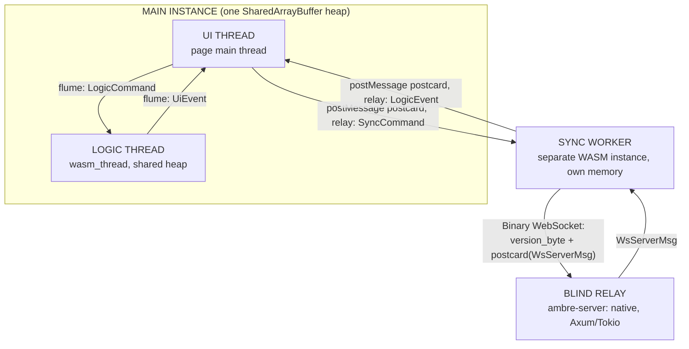
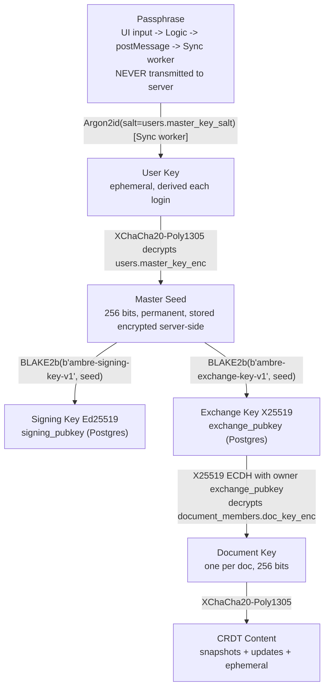

# AMBRE -- SPEC: GENERAL ARCHITECTURE
**Type:** Horizontal (Foundation)
**Status:** Draft
**Implementation:** partial

> Technical architecture of AMBRE: **two-instance model** -- a **Main** WASM instance (UI thread + Logic thread sharing one `SharedArrayBuffer` linear memory via `wasm_thread`, talking over **`flume`** typed Rust values) and a **separate Sync worker** (its own WASM instance/memory, reached over **`postMessage`** + `postcard`); crate breakdown and dependency boundaries, three-plane data plane (content / service / network), zero-knowledge security, performance budgets, and integration roadmap.

---

## 1. OBJECTIVES & CONSTRAINTS

* **Scope:** This spec defines AMBRE's client-server technical architecture: Rust workspace structure, responsibilities of each crate, data flow between the three execution contexts (UI / Logic / Sync), IPC transport, and dependency rules. It does not describe the internal implementation of components (those details are in specific specs like `ambre-spec-sync.md`).

> **Execution topology (read first).** The client splits into two WASM instances on a **latency-tiering** rationale:
> - **Main instance** -- one WASM binary (`ambre-app`) hosting the **UI thread** (page main thread) and the **Logic thread** (a `wasm_thread` Web Worker) sharing **one linear memory** (`SharedArrayBuffer`). UI <-> Logic talk over **`flume`** channels carrying **typed Rust values by move** (zero serialization), because that link is latency-critical (scroll/typing).
> - **Sync worker** -- a **separate WASM instance** (the `ambre-sync` cdylib, its **own** linear memory) running in a dedicated Web Worker. It is reached from Main over **`postMessage`** (`postcard`-encoded `SyncCommand`/`LogicEvent`, big payloads on a Transferable `ArrayBuffer`). The Main thread relays the Logic <-> Sync traffic. A message-passing hop is acceptable here because **network latency dominates** anyway, and it gives Sync a free JS event loop for the WebSocket/fetch.
>
> Why Sync is a separate instance rather than a shared-memory thread: `wasm_thread` is run-to-completion -- a worker that returns from its closure (which an async `spawn_local` Sync loop does immediately) gets its `Worker` handle dropped and is GC-terminated, killing the loop after the first poll. A worker cannot both block its Rust stack (to stay alive) and keep a free JS event loop (for the WebSocket). Giving Sync its own instance with a normal worker event loop resolves this cleanly, while UI <-> Logic keeps the copy-free `flume` shared-memory link.

* **Dependencies (global rules):**

| Rule | Rationale |
|-------|---------------|
| `ambre-server` depends ONLY on `ambre-core` + `ambre-protocol` + `ed25519-dalek` (direct) | The Blind Relay must not know document structures or application crypto types (`DocumentKey`, `MasterSeed`). The server's only crypto operation is Ed25519 signature verification on updates -- `ed25519-dalek` is pulled directly, bypassing `ambre-crypto`. |
| `ambre-bus` depends on `ambre-core` + `serde` | UI <-> Logic envelopes (`LogicCommand`/`UiEvent`) travel as **Rust values over `flume`** -- not serialized. But the Logic <-> Sync envelopes (`SyncCommand`/`LogicEvent` and the `Rest*` family they carry) cross the Sync-worker `postMessage` boundary, so they derive `Serialize`/`Deserialize` (postcard on that hop only). Still no `thiserror`/`tracing`/network deps; application payloads stay **typed** (`AppCommand`/`AppEvent`), only real network bytes (Loro CRDT deltas, channel messages) remain `Vec<u8>`. |
| `ambre-draw` depends on `kurbo`, `peniko`, `parley` + `ambre-core` only (no `wgpu`, no `krilla`) | `DrawSurface` trait and re-exports of geometric/typographic types. Light type dependencies (math, colors, text layout) -- no GPU dependency. The `ambre-core` dependency is a deliberate exception, scoped to the cross-app `peer::peer_color(&UserId)` helper (`ambre-spec-canvas.md section D`) so the canonical `UserId` newtype is preserved end-to-end through presence -- types only, no GPU/crypto. Concrete implementations (`WgpuSurface` on the UI side, `KrillaSurface` on the Logic side) live in consumer crates. |
| `ambre-commands` depends on **nothing UI-side** (leaf; `ambre-core` for ids/`Locale` as needed) | Shared command registry: `CommandId`, `Command`, `CommandState`, `CommandSource`, keybindings. Depended on by **every app crate** (which defines its commands) AND by `ambre-chrome` (which renders them). Distinct from `AppCommand`/`LogicCommand` IPC from `ambre-bus`: an invoked `Command` *produces* a `LogicCommand`. |
| `ambre-canvas` depends on `ambre-draw` (+ wgpu/swash + accesskit ; + web-sys/js-sys/wasm-bindgen(-futures)/tracing as **`cfg(wasm32)`-targeted** deps for `host`) | **Canvas render runtime** of the UI thread: `WgpuSurface`/`QuadRenderer`/`GlyphAtlas`, `TextCache`, the GPU primitives (`GpuState`/`bootstrap_gpu`/`RafControl`/`start_raf_loop`) + per-frame value types (`RepaintPlan`/`FrameStats`/`InputEvent`), generated `theme.rs`. **Does NOT depend on `leptos`.** `accesskit` is scoped to canvas **content** a11y. **No application dependency**: the frame DRIVER (`FrameHost`) and the closed `AppView` registry live **downstream in `ambre-app`** (section 6). Named `ambre-canvas` (medium, symmetrical to `ambre-chrome`); spec `ambre-spec-canvas.md`. |
| `ambre-chrome` depends on `leptos` + `ambre-commands` | **Shared, app-agnostic Leptos chrome toolkit**: `AppShell`, `CommandPalette`, `Dialog`/`Menu`/`Toolbar`/`Toast`/`ContextMenu`/`Sidebar`/`StatusBar` primitives, keybinding manager. Renders views over the registry -- **names no app** (same inversion as the `AppView` enum). App-**specific** chrome lives in the app crate, **not here**. |
| Each app crate (`ambre-trame`, ...) depends on `ambre-bus` + `ambre-draw` + `ambre-canvas` + `ambre-chrome` + `ambre-commands` + `leptos` (NOT `ambre-sync` or `ambre-logic`) | One crate per app, **deliberate monolith**, **no features**: `logic` (`*State` + handlers, Logic thread) + `ui` (`*View`, a variant of the launcher's closed `AppView`; inherent driver methods, content rendering on `ambre-canvas`) + `chrome` (**specific** Leptos components built on `ambre-chrome`) + `Command` definition (`CommandSource`). IPC types (`TrameCommand`/`TrameEvent`/`DisplayCell`) re-exported from `ambre-bus`. |
| `ambre-logic` depends on `ambre-bus` + the app crate(s) + `flume` + `tracing` | Logic thread runtime. **100% pure Rust, zero WASM glue**: fundamental types arrive via `ambre-bus` re-exports (no direct dep on `ambre-core`). Blocks on `flume::Selector` (UI + Sync-relay inputs). The panic hook + tracing subscriber are set up in `ambre-app`. |
| `ambre-sync` is a `cdylib`+`rlib` depending on `ambre-bus` + `ambre-protocol` + `ambre-crypto` + `flume` + `postcard` + `tracing` + `wasm-bindgen(-futures)` + `js-sys` + `web-sys` + `gloo-net`/`ruzstd`/`zeroize` (+ `console_error_panic_hook`/`tracing-wasm`, wasm-only) | **The Sync worker itself** -- its own WASM instance. `worker.rs` is the `#[wasm_bindgen(start)]` entry: it sets up the `postMessage` bridge (decode `SyncCommand`, encode `LogicEvent`) and runs the `flume`-`select!` loop. `flume` is internal-only (WS/HTTP callbacks -> select loop, same worker, so the waker fires). Wire encoding from `ambre-protocol`; crypto from `ambre-crypto`. |
| `ambre-app` depends on `ambre-bus` + `ambre-canvas` + `ambre-chrome` + `ambre-trame` + `ambre-logic` + `flume` + `postcard` + `wasm-bindgen(-futures)` + `wasm_thread` + `web-sys` | cdylib LAUNCHER (Main instance). **Mounts the Leptos `AppShell`**, creates the `flume` channels, spawns `ambre_logic::run` in a `wasm_thread` worker, **spawns the Sync worker via `web_sys::Worker`** (a separate artifact -- `ambre-app` does **NOT** depend on `ambre-sync`), relays Logic <-> Sync over `postMessage`, bootstraps the canvas and injects the active app's content view. |

* **Invariants:**
- **No dependency cycles**: the graph is acyclic and verifiable via `cargo tree`. It is the graph that carries the architecture boundaries (no longer binary separation).
- **The Logic thread touches neither GPU nor DOM**: `ambre-logic` has **no direct dependency** on `ambre-canvas`/`ambre-chrome`, and its **runtime path** never calls wgpu/leptos. (Transitively, `ambre-logic -> app crate -> ambre-canvas/ambre-chrome` makes wgpu/leptos *reachable* in the graph -- without consequence: single binary, the boundary is carried by **direct deps + runtime**, not by the transitive graph.) The Sync thread compiles neither UI nor CRDT as direct deps.
- **Golden rule -- Strict separation of concerns between threads:**
  - **UI Thread** (page's main thread): rendering (wgpu + QuadRenderer + GlyphAtlas + Parley/Swash), input capture, accessibility (AccessKit). **Zero API calls**, **zero WebSocket**, **zero crypto**, **zero compression**. Data arrives already display-ready (typed `AppEvent` values). Sole exception: **font** loading (static assets, same-origin). **New invariant: the UI thread must NEVER block** (it runs on the page's main thread).
  - **Logic Thread**: business logic (Loro CRDT, pagination, Trame formula engine, typed dispatch). **Zero network**, **zero crypto**, **zero compression**. No `DocumentKey`, `ciphertext`, `WsClientMsg`, `WebSocket` types in app crates. `SyncCommand` only carries `document_id` and raw CRDT payloads (`Vec<u8>`).
  - **Sync Thread**: **all** networking (HTTP, WebSocket, S3 presigned URLs), **all** crypto (`ambre-crypto`), **all** compression (`ruzstd`). Sole consumer of `ambre-crypto` and `ambre-protocol` client-side.
- **`ambre-protocol` is the single source of truth** for all network protocol types. Neither `ambre-sync` nor `ambre-server` redefine them.
- **The server never sees plaintext**: all types transiting through `ambre-protocol` are opaque blocks (ciphertext + public metadata).
- **postcard is used on two paths**: the network wire (`ambre-protocol`, WebSocket) and the **Main <-> Sync `postMessage` hop** (`SyncCommand`/`LogicEvent`). The **UI <-> Logic shared-memory path carries no postcard**: `flume` moves typed Rust values by move. JSON only for the REST API.
- **Toolchain:** pinned nightly + `-Z build-std` (rebuilding `std` with `+atomics`), `target-feature=+atomics,+bulk-memory,+mutable-globals`, link-args `--shared-memory/--max-memory/--import-memory` + TLS exports. See `rust-toolchain.toml` + `.cargo/config.toml`.

---

## 2. TECHNICAL DESIGN & STATE

### A. Workspace Structure

The workspace layout (`ambre/`):

- `Cargo.toml` -- root workspace (members below)
- `rust-toolchain.toml` -- pinned nightly, rust-src, wasm32 target
- `.cargo/config.toml` -- wasm32 rustflags: +atomics, --shared-memory, ..., build-std
- `crates/`
  - `ambre-core` -- fundamental types (Uuid/DocumentId/UserId/..., DocType, PublicKey, Role). Shared client + server.
  - `ambre-crypto` -- crypto primitives. WARNING: STUB (lib.rs ~6 lines, no real consumer).
  - `ambre-protocol` -- network types (Update/Snapshot/Ephemeral, Ws*Msg, Signaling*, encode/decode). SOURCE OF TRUTH (sync + server).
  - `ambre-bus` -- client IPC contract. Depends on ambre-core + serde/zeroize (+ kurbo/postcard/thiserror for the app content plane). No flume/tracing/network.
    - `lib.rs` -- flat re-exports of the per-app content plane + IPC_TEST_DOC_ID
    - `logic.rs` -- LogicCommand envelope + AppCommand dispatch sum
    - `ui.rs` -- UiEvent envelope + AppEvent dispatch sum
    - `command.rs` -- SyncCommand
    - `event.rs` -- LogicEvent
    - `rest.rs` -- RestCommand + RestEvent + RequestId + shared business types
    - `app/` -- per-app content plane (one module per document type):
      - `trame/` -- TrameCommand + TrameEvent + DisplayCell + style/clipboard/features
      - `toile.rs` -- ToileCommand + ToileEvent + Display* + model + Viewport
  - `ambre-draw` -- DrawSurface trait + kurbo/peniko/parley re-exports + peer::peer_color (dep: ambre-core, types only). No GPU dep.
  - `ambre-commands` -- shared command registry (CommandId/Command/CommandState/CommandSource/keybindings). Leaf, zero UI dep.
  - `ambre-canvas` -- canvas render runtime of the UI thread (NO leptos):
    - `render/` -- QuadRenderer, GlyphAtlas, WgpuSurface, 2-layer Layer model
    - `text_cache.rs` -- TextCache Parley
    - `view.rs` -- per-frame value types: RepaintPlan + FrameStats + InputEvent [GPU-agnostic]
    - `host.rs` -- GpuState + bootstrap_gpu + RafControl + start_raf_loop [cfg(wasm32)]
    - `theme.rs` -- canvas-side constant tokens, generated from tokens.ron; accesskit scoped to content
  - `ambre-chrome` -- shared, app-agnostic Leptos chrome toolkit: AppShell, CommandPalette, Dialog/Menu/Toolbar/Toast/ContextMenu/Sidebar/StatusBar, keybindings. Depends on leptos + ambre-commands. App-SPECIFIC chrome lives in app crates.
  - `ambre-trame` -- ALL of the Trame app (monolith, no features):
    - `logic.rs` -- TrameState + handlers, Logic thread
    - `ui/{grid,renderer,view}` -- TrameView = AppView::Trame variant, inherent driver methods, render on ambre-canvas
    - `chrome/` -- SPECIFIC Leptos components on ambre-chrome; Command via ambre-commands
  - `ambre-prose` / `ambre-toile` / `ambre-murmure` -- stubs (doc only, no logic).
  - `ambre-logic` -- Logic thread runtime: run(from_ui, to_ui, to_sync, from_sync), LogicState { docs: HashMap<Uuid, DocState>, ... }, match dispatch. 100% pure Rust.
  - `ambre-sync` -- Sync thread runtime: run(from_logic, to_logic), WS/crypto pipeline (placeholder).
  - `ambre-app` -- cdylib LAUNCHER: #[wasm_bindgen(start)], mounts Leptos AppShell (ambre-chrome):
    - `host.rs` -- closed AppView enum + FrameHost driver + run_with + DocSwitcher [cfg(wasm32)]; creates the 4 channels, spawns logic + sync, bootstraps the canvas + drives AppView.
  - `ambre-server` -- native Blind Relay (Axum). OUTSIDE workspace members (native target, not wasm32).
- `specs/`

> **`ambre-server` is in the root workspace `members`**: the server is a native target (Axum/Tokio) while other crates target `wasm32-unknown-unknown`, but rustflags (`+atomics`, `--shared-memory`) are scoped by target (`[target.wasm32-unknown-unknown]`) and do not affect native builds. `build-std` is not implicit: it only activates when `-Z build-std` is passed explicitly. Integrating the server in the workspace simplifies dependency management (shared `workspace = true`), tooling (unified `cargo fmt`, `cargo clippy`, `cargo check`), and CI (single workspace).

> **Build workflow:** **two** wasm-bindgen artifacts, both built by Trunk from one `index.html`: `ambre-app` (Main, the default `rel="rust"`) and `ambre-sync` (`rel="rust" href="../ambre-sync/Cargo.toml" data-type="worker" data-loader-shim="true"`), which emits `ambre-sync_loader.js` -- a classic worker loader (`importScripts` + `wasm_bindgen(...)`) that creates the worker's own shared memory and runs its `#[wasm_bindgen(start)]`. `ambre-app` spawns it with `new Worker("/ambre-sync_loader.js")`. Trunk also copies assets (`fonts/`). `filehash` is off, so the loader path is stable.

### B. Boundaries, Data Flow, and the Two-Instance Model

The client runs in **two WASM instances**:
- The **Main instance** (`ambre-app`) holds the **UI thread** (page main thread) and the **Logic thread** (a `wasm_thread` Web Worker), sharing **one linear memory** (`WebAssembly.Memory` `shared`, `SharedArrayBuffer`). They talk over **`flume`** channels carrying **typed Rust values by move**.
- The **Sync worker** (`ambre-sync`, a separate cdylib) is its **own** instance with its **own** memory, in a dedicated Web Worker, reached over **`postMessage`** (`postcard`). The Main thread relays Logic <-> Sync.



- **UI thread** (page main thread): chrome is Leptos DOM (`ambre-chrome`) -- AppShell/menus/dialogs; content is `host::run_with` -> `FrameHost` over `AppView` in the `<canvas>`, wgpu (`QuadRenderer`/`GlyphAtlas`/`WgpuSurface`), Parley/Swash, `requestAnimationFrame` -> `AppView::{update, plan_repaint, paint*}`. It never blocks (`try_send`/`try_recv`) and relays Logic <-> Sync.
- **Logic thread** (`wasm_thread`, shared heap): `ambre_logic::run` -> `LogicState { docs: ... }`, `ambre-trame` (`TrameState`) over `LoroDoc`; blocks on `flume::Selector(from_ui, from_sync)`.
- **Sync worker** (separate WASM instance, its own memory): `ambre_sync` `#[wasm_bindgen(start)]` (`worker.rs`) -> `SyncState`; `onmessage` decodes `SyncCommand` -> `handle_command`; a `flume` select loop (cmd + internal WS/HTTP events) on a free event loop; `web_sys::WebSocket`, `gloo-net` fetch, crypto/compression.
- **Blind relay** (`ambre-server`: native, Axum/Tokio): depends on `ambre-core` + `ambre-protocol` + `ed25519-dalek`.

**The three runtimes:**
| Entry point | Thread |
|---|---|
| `ambre_app::host::run_with(canvas_id, make_view, ...)` | UI thread (FrameHost over AppView) |
| `ambre_logic::run(from_ui, to_ui, to_sync, from_sync)` | Logic thread (flume) |
| `ambre_sync::run_wasm(cmd_rx, logic_sink, api_base)` | Sync worker (driven by worker.rs) |
The frame driver `host::run_with` and the closed `AppView` registry live in `ambre-app` (downstream of every app crate), so naming `TrameView` introduces no cycle. `ambre-canvas` stays app-agnostic: it owns only the GPU primitives + per-frame value types and does not depend on `ambre-trame`.

**Rationale for Logic/Sync separation:** decryption + decompression of a remote update (~0.5-2 ms on mobile) must not interrupt the Logic thread's response to P1 events (scroll). Sync being its own instance, these run in **true parallelism**; the only cost is the `postMessage` copy of the (already-byte) payload, made zero-copy for large ones via a Transferable `ArrayBuffer`.

**Rationale for the two-instance split (latency tiering -- section 6):** shared memory is kept where latency is critical (UI <-> Logic: scroll/typing, `flume` by move, no serialization) and message-passing is used where **network latency already dominates** (Logic <-> Sync). This also gives Sync a normal Web Worker event loop, which `wasm_thread` cannot (it is run-to-completion: a returning async worker is GC-terminated; see the Model note and section 6). Cost: COOP/COEP headers + nightly `-Z build-std`/`+atomics` for the Main instance (and the Sync worker, which compiles with the same flags and creates its own shared memory). Separation of concerns is carried by the **crate dependency graph**.

**Cross-origin isolation (consequence).** `crossOriginIsolated` is an agent-cluster property; a dedicated worker **inherits** it from the Main document, which is COI because UI <-> Logic uses `SharedArrayBuffer`. So the Sync worker is COI too and its network is under `COEP=credentialless` -- exactly as before, just relocated. **Auth is cookie-less**: the Sync worker holds an in-memory access JWT (`Authorization: Bearer` on REST, `?token=` on the WS) + a refresh token (see `ambre-spec-server.md section 3`, `ambre-spec-sync.md section 2.G`) -- precisely because a COI worker cannot reliably carry cookies onto the WebSocket. API + WebSocket still stay **same-origin** (Trunk proxy `/api`, `/ws` in dev; reverse-proxy in prod) for CORS simplicity; **S3/MinIO** is accessed via **presigned URLs** and must return **CORS + `Cross-Origin-Resource-Policy: cross-origin`** to be readable.

**Backpressure.** The `flume` UI <-> Logic channels are `bounded(CHANNEL_CAPACITY = 1024)` (created in `ambre_app::main`). **The Logic thread may block** on a full channel (intended backpressure); **the UI thread never blocks** -- `TrameView::send_command` uses `try_send` and **drops on `Full`** (a viewport request is superseded by the next via `version`), and `ScrollViewport` is **coalesced to <= 1 send per frame**. The Logic <-> Sync relay drains the Logic->Sync `flume` once per frame and `postMessage`s each command.

`ProseView` splits the **same two traffic classes** over the same bounded channels:
- **LOSSY** -- `ScrollViewport` and hit-test / viewport requests: `try_send`, **drop on `Full`**, coalesced to **<= 1 send per frame**, and superseded by the next via `version`. A dropped viewport request costs nothing: the following frame resends the current state.
- **LOSSLESS** -- editing commands (`InsertText`, `DeleteRange`, `ApplyMark`, `SplitBlock`, ...): these **must NEVER be silently dropped**, since a lost keystroke is unrecoverable data loss. A `Full` edit channel (capacity 1024) means the Logic thread is **stalled**, and the correct response is to **apply backpressure to input** -- surface a synchronous busy signal / stop accepting keystrokes -- rather than lose an edit. Dropping is a lossy-class-only policy; the lossless class fails at the call-site instead.

> **Resolved -- Sync no longer freezes.** Earlier the Sync thread froze: as a `wasm_thread` worker it returned from its closure (an async `spawn_local` loop does so immediately), so the Main thread dropped its `Worker` handle and the GC terminated it after the first poll. Sync is now a **separate WASM instance** in its own Web Worker with a normal, never-terminated event loop: its `#[wasm_bindgen(start)]` (`worker.rs`) sets `onmessage` (decode `SyncCommand` -> `flume` cmd channel) and `spawn_local`s a `flume`-`select!` loop over the command channel and the internal WS/HTTP `SyncEvent` channel. Both channels' producer and consumer live in **this** worker, so flume's async waker fires correctly (the old failure was strictly cross-worker, which no longer occurs). See section 6 and section 7 ARCH P1.

**"Thread failure" model.** Two paths:
- **Graceful**: a thread detecting an unrecoverable condition emits `UiEvent::FatalError { message }` **before** exiting. `TrameView::update` then switches to `fatal` state (no more sends, single log).
- **Non-graceful (panic)**: under WASM multi-thread, `panic=abort` (via `build-std` + `panic_abort`). WARNING: **Correction of a previous assertion:** `panic=abort` **does not unwind the stack**, so **no `Drop` runs** and **no `Sender` is dropped** -- the Logic thread's `Sender<UiEvent>` lives in **shared** memory and is **leaked** on abort. The UI therefore sees `Empty` forever, **never `Disconnected`**: we **cannot** rely on channel disconnection to detect a panic. Detection must go through an **out-of-band** signal: `panic::set_hook` (already set in `ambre-app`) must, in addition to logging, call a JS hook `ambreFatal(message)` (symmetrical to `ambreReady`) **before** the abort. *Still to be wired (section 7 ARCH P1).* Channel disconnection is, at best, only a **clean shutdown** signal (voluntary teardown).

**Per-tab isolation:** each tab instantiates its own complete application (Main instance: UI + Logic threads + 1 shared heap; plus its own Sync worker instance). Two tabs opening the same document are two independent CRDT clients -- convergence via the Blind Relay (same flow as two users). Loro handles this natively. Post-MVP optimization: inter-tab `BroadcastChannel`.

**Multi-document sync:** the Sync thread manages **N sync sessions in parallel** (`HashMap<DocumentId, SyncDocumentState>`) over a **single multiplexed WebSocket**. Required for embedded documents (a Toile can include a Prose + a Trame, each with its `DocumentKey` and `LoroDoc`). Demultiplexing by `document_id`. `OpenDocument` -> `Subscribe`, `CloseDocument` -> `Unsubscribe`. WS opened at `Unlock`, closed at `Logout`; reconnection -> automatic resubscribe.

**Embedded documents (Toile -> Prose/Trame):** MVP **editable in-place** (the Logic thread opens a full child `DocState`, applies its `RemoteUpdate`s **and** emits `SendUpdate` for it, role-gated; input routed to the focused embed -- see `ambre-spec-toile-logic.md section 2.I`). The nesting relationship is stored in the Toile's `LoroDoc` (encrypted content, server-invisible). No embedding Postgres table.

### C. Transport & Bootstrap (`ambre-app::main` + `ambre-sync::worker`)

`ambre-app/src/lib.rs` (`#[wasm_bindgen(start)]`) creates the `flume` channels, spawns Logic, and spawns + relays the Sync worker. The Sync worker has its own `#[wasm_bindgen(start)]` in `ambre-sync/src/worker.rs`.

**`ambre-app/src/lib.rs`** (`#[wasm_bindgen(start)]`), in order:

1. Create the four `flume::bounded` channels at `CHANNEL_CAPACITY = 1024`: UI->Logic (`LogicCommand`), Logic->UI (`UiEvent`), Logic->Sync (`SyncCommand`), Sync->Logic (`LogicEvent`).
2. Spawn the **Logic** thread (`wasm_thread`, shared memory) with the two receivers and two senders it owns.
3. Spawn the **Sync** worker -- a separate wasm artifact loaded through `ambre-sync_loader.js`, so it is a `web_sys::Worker`, not a `wasm_thread`.
4. Start the render loop on the main thread. **The Logic<->Sync ends that stay on the main thread are the relay**: each frame, before drawing, drain `logic_to_sync_rx` and post each command to the worker as postcard bytes, and drain `logic_to_ui_rx` into the view.

That relay is why Logic and Sync never share memory: the worker boundary is a postcard hop, while UI<->Logic passes typed values by move.

**`ambre-sync/src/worker.rs`** (`#[wasm_bindgen(start)]`) is the worker's own entry: grab the `DedicatedWorkerGlobalScope`, derive the API base from its location, build a `LogicSink` that postcard-encodes each event and posts it back, install `onmessage` to decode incoming commands into an unbounded channel, and spawn the async run loop on it.

**The Logic thread** blocks on `flume::Selector` over `from_ui` + `from_sync`, dispatches, and exits when **both** inputs disconnect (`Selector::wait` parks via flume's Atomics-backed blocking path, which crosses the UI/Logic worker boundary -- only flume's *async* waker failed cross-worker, and that path is gone). **The Sync worker** runs a `futures_util::select!` loop over its command channel and its internal `SyncEvent` channel, both fed from within the same worker, while its JS event loop stays free for the WebSocket/fetch. **View construction via closure**: `ambre_app::host::run_with<F, P>(...)` receives `F: FnOnce(f64,f64,_) -> AppView`; the driver lives in the launcher (not `ambre-canvas`), so it names `TrameView` directly through the `AppView::Trame` variant -- no cycle (section 6).

> **Hybrid evolution (UI Chrome -- see `ambre-spec-chrome.md`).** The threads/channels model above is **unchanged**; Leptos chrome is **additive on the UI thread**. The bootstrap evolves: `ambre-app` first mounts the Leptos `AppShell` (`ambre-chrome`) which owns the `<canvas id="ambre-canvas">` cell; `host::run_with` attaches to this canvas for the **content**, the `make_view` closure constructing the active app's `AppView`. The Leptos shell and the canvas rAF loop coexist on the same thread. (The closed `AppView` enum + `FrameHost` live in `ambre-app` -- section 6/section 7. Exact bootstrap to be frozen at POC, `ambre-spec-chrome.md section 7`.)

> **Persistent engine + `leptos_router` SPA shell (real client-side navigation).** The application is a **true SPA**: a **single** `<Router><AppRoot/></Router>` mount, and the *engine* (the Logic `wasm_thread`, the Sync worker, the wgpu surface) is created **once per session** and **outlives route changes**. Navigating `/` (landing list) <-> `/trame/<docid>` is client-side only -- **no full-page navigation**, so the Sync worker (and its in-memory keys + tokens) is **never respawned**. This fixed the root bug where a full-page nav respawned a key-less Sync worker, dropping the first `SendUpdate` so the document was never created server-side. Document switching swaps the canvas's active document **without** recreating the wgpu surface: `AppView::set_document(DocumentId)` (dispatched to the variant's inherent method) resets doc-scoped state while keeping the surface/channels/theme. **`!Send` constraint:** `<Router>` requires a `Send` subtree, so `!Send` handles (`Rc` command-state, the `DocSwitcher`) stay **outside** the Leptos tree; the canonical route source of truth is a **per-frame poll of `window.location`** inside `pre_frame` (which also drives `CloseDocument(prev)` / `OpenDocument(next)` and `raf` pause/resume), while shared `Wiring` reaches children via `provide_context`. The `pre_frame` relay runs **every** frame (Logic<->Sync relay, dispatcher, route poll); only the `render` is gated by `RafControl` (a modal/landing overlay freezes rendering, not the relay).

### D. Data Modeling -- Typed Data Plane (3 planes) & Interface Contracts

**No more `Vec<u8>` postcard on the UI <-> Logic path.** Application payloads are **typed Rust values**, in a **closed world** (sums over document types) defined **in `ambre-bus`** (no new crate). Client IPC breaks down into **three planes**:

| Plane | Carried by | Payload | Logic routing |
|---|---|---|---|
| **Content** | `LogicCommand::App` / `UiEvent::{Viewport,Presence}` | `AppCommand` / `AppEvent` (typed, closed) | by `DocumentId` to `DocState` |
| **Service** | `...::Rest { id, ... }` (4 directions) | `RestCommand` / `RestEvent` (**defined once**, `rest.rs`) | verbatim relay + state hooks |
| **Network** | `SyncCommand::Send*` / `LogicEvent::Remote*` + push | `Vec<u8>` (Loro network / encrypted bytes) | applied to CRDT / forwarded |

**Content plane (typed, closed).** `enum AppCommand { Trame(TrameCommand), ... }` (UI -> Logic); `enum AppEvent { Trame(TrameEvent), ... }` (Logic -> UI). Adding a document type = adding a variant (single edit point, **no trait-object, no `Box<dyn Any>`, no crate cycle**). **Composition** (embed Trame-in-Toile, sharing in a Rendez-Vous) needs **no** addition to these enums: the Logic `docs` registry is flat, so a child is addressed by its own `DocumentId` and nesting is a *view*-layer concern (see "Composition needs no recursion" below). Future plugins = variant `Plugin(Box<dyn Plugin>)`. What stays `Vec<u8>` (real **network** bytes): Loro CRDT payloads/snapshots and Murmure channel messages, on `SyncCommand`/`LogicEvent`.

**Style as one LWW register (cross-app pattern, normative).** A styled content unit's **whole style is one `postcard`-encoded binary LWW register**, keyed by the unit's stable id -- **never one register per attribute**. Trame stores it as-built in the per-sheet map `cellstyle_{sheet_id}` (key `"{row_uid}:{col_uid}"`, value = the full `StyleRecord` inline; `ambre-spec-trame-logic.md`); Toile stores it as the element's `"style"` register (value = the full `ElementStyle` inline; `ambre-spec-toile-logic.md section 2.E`). This is deliberate and shared: a per-attribute fan-out lets concurrent edits **tear** (a fill update racing a stroke update converges to a half-applied style, the defect enumerated in Trame `logic section 11 bis.F`), whereas one register makes every concurrent restyle resolve by **LWW on the single blob** -- all peers deterministically converge to one whole style. Any future app with formattable units (Prose runs excepted -- rich text is a sequence CRDT, not a single register) MUST follow this: the shared **chrome** format controls (`ambre-spec-chrome.md section 2.B`: `FontSizeSelect`, `FormatToggle`, `FontPicker`, `ColorPopover`) each emit **one changed field**, and the view folds it into a whole-register write -- they never address a per-attribute register. **Schema caveat (normative):** `postcard` decodes the blob whole and tolerates **no** missing/extra field, so any layout change makes a blob written by an older binary fall back to `Default` (`from_bytes` -> `unwrap_or_default`) -- a **silent** downgrade to the default style, not an error. Acceptable pre-1.0 (no persisted-format guarantee). The debt this created is discharged by the document-level mechanism below, which subsumes it: a register layout change **is** a schema change and bumps the document schema version, in **both** apps at once.

**Persisted schema versioning (normative, cross-app).** The style register above is one instance of a general failure: a persisted document written by an older binary is still a *valid* CRDT, so Loro imports it happily and the engine then reads containers that no longer mean what it expects. The result is a successful open of a wrong document -- silent loss, the worst available outcome. Every app therefore versions its persisted schema:

* **Where.** A root `LoroMap` named `meta`, key `schema_version` (`u32`), written by `DocState::new`. It is CRDT state like any other, so it travels with the document through **every** persistence path -- `.ambre` file, server snapshot, IndexedDB restore -- rather than only the one a given carrier happens to check.
* **Absent means 0.** A document written before the register existed is schema version 0. No document needs rewriting to adopt this.
* **Read rule.** At every **full-state** entry point (`DocState::import_snapshot`, and the snapshot leg of local restore), compare the document's `schema_version` against the app's compiled `SCHEMA_VERSION`:
  * equal -> proceed;
  * **older** -> run the app's migration chain, then proceed. Migrations live in the app crate that owns the schema (`ambre-trame`, `ambre-toile`, ...) -- the foundation owns the *protocol*, never the semantics;
  * **newer** -> refuse cleanly and non-destructively (`SchemaTooNew { found, supported }`), surfaced to the user as "update your client". Never a partial or best-effort read.
  This is deliberately the same shape as the `.ambre` container rule (`ambre-spec-docfile.md section 2.B`) so there is one mental model, not two. The two versions are **independent and both checked**: the container version guards the 22-byte header, the schema version guards what is inside it.
* **Deltas are out of scope.** A remote delta is a fragment, carries no version, and applies blind. See the limitation below.

**Limitation -- mixed-version live collaboration (stated, not solved).** The register solves *asynchronous* reads: an old file, an old snapshot, a stale local cache. It does **not** solve two peers on different client versions editing the same document concurrently, where each writes its own schema's containers and they diverge in meaning while converging as CRDTs. Two things bound this rather than fix it: the **Pure CSR pillar** means one deployment serves every client, so version skew is bounded by open-tab lifetime -- not by how long a user postpones an update, as it would be for the desktop client this project rejected; and a relay-side minimum-client-version gate is available without breaking Zero-Knowledge, since the server already authenticates sessions and needs no document content to enforce it. That gate is **owed to `ambre-spec-sync.md`** if and when live skew stops being tab-bounded. **A `.ambre` file on a user's disk has unbounded age**, which is exactly why the asynchronous half must be solved before files ship (`ambre-spec-docfile.md section 7`).

**Composition needs no recursion (normative).** The `docs` registry is **flat**: keyed by `DocumentId`, with an embedded child an ordinary entry opened by the ordinary `OpenDocument` path. A command for a child is addressed to the child's own id and reaches its `DocState` in one lookup, so there is no nesting to unwrap and no depth to bound. This holds because the *view* layer nests, not the *data* layer: `FrameHost` owns the child `AppView`, and that view emits `LogicCommand::App { document_id: child, .. }` on the same channel as any top-level view (`ambre-spec-toile-logic.md section 2.I`). What crosses into a focused child is a raw `InputEvent`, never a command -- a parent view cannot build a child's `AppCommand` without naming the child's view type, which is the cycle ARCH P2 resolved. A command for a document absent from the registry is dropped with a warning, never synthesised.

**Role gating (normative).** Each live `DocState` carries the caller's `Role` on **that** document, resolved by the Sync thread from the members response it already fetches at open and delivered on `DocumentReady` (`ambre-spec-sync.md` "SYNC P4"). The Logic dispatcher drops a mutating `AppCommand` when the role is not writable. This gate is **UX only** -- it exists so the UI does not let a user edit a document the server will refuse. **The server remains the sole authority** (it already rejects a read-only write on the WS `Update` path, `ambre-spec-server.md`); a client-side gate is not a security boundary, since the client is the attacker's own machine. Roles do **not** propagate through composition: an embedded child is opened by the ordinary `OpenDocument` path and carries its own role (`ambre-spec-toile-logic.md section 2.I`).

**Service plane (correlatable relay).** Almost all P3 traffic is pure relay: the UI requests an operation, Logic forwards it verbatim to Sync (REST/crypto/WS), the response flows back the same path. Rather than modeling each step as an enum variant in each of the 4 directions (the "P3 triplication": ~300 lines of 1:1 copying), the **service family is defined once** (`RestCommand`/`RestEvent` + `RequestId` in `rest.rs`) and **carried by thin envelopes** `...::Rest { id, ... }`:

| Envelope variant | Direction |
|---|---|
| `LogicCommand::Rest { id, cmd: RestCommand }` | UI -> Logic |
| `SyncCommand::Rest { id, cmd: RestCommand }` | Logic -> Sync |
| `LogicEvent::Rest { id, evt: RestEvent }` | Sync -> Logic |
| `UiEvent::Rest { id, evt: RestEvent }` | Logic -> UI |

The Logic thread's P3 dispatch reduces to **a single arm** (`Rest { id, cmd } => send_to_sync(Rest{...})`), preceded by a small `match &cmd` for the rare state-affecting ops (`Logout` clears `docs`, `DeleteDocument` removes the entry). Adding an op = one `RestCommand` variant + one `RestEvent` variant, edited in the same place. **`RequestId`** (newtype `u64`) is allocated by the **UI** via `RequestId::next()` (an `AtomicU64` shared between threads -- legal thanks to shared memory), **echoed unchanged** by Logic and Sync. Single home = the `Rest` envelope.

**Naming convention** -- by **destination + role** (`Command` = request to the downstream worker, `Event` = notification flowing back upwards); endpoints named by direction (`to_ui`/`from_ui`/..., no more `tx`/`rx`). Same suffix at both levels: `Command` travels in `Command`, `Event` in `Event`. The direction invariant is carried by the **type name** (`...Command` / `...Event`), which frees the per-app content plane to be grouped by app rather than by direction (see the layout note below).

| Flow | Type | File `ambre-bus/src/` |
|---|---|---|
| UI -> Logic | `LogicCommand` | `logic.rs` (envelope + `AppCommand` dispatch sum) |
| Logic -> UI | `UiEvent` | `ui.rs` (envelope + `AppEvent` dispatch sum) |
| Logic -> Sync | `SyncCommand` | `command.rs` |
| Sync -> Logic | `LogicEvent` | `event.rs` |
| (shared) | `RestCommand`/`RestEvent`/`RequestId` + business types | `rest.rs` |
| (per-app content plane) | `TrameCommand`+`TrameEvent`+`DisplayCell`+value types; `ToileCommand`+`ToileEvent`+`Display*`+model | `app/<name>.rs` (e.g. `app/trame/`, `app/toile.rs`) |

**`ambre-bus` layout -- envelopes by direction, content plane by app.** The four transport **envelopes** stay split by direction (each is bound to one channel hop). The typed per-app **content plane** is instead grouped **one module per document type** under `app/`: a document type's command enum, event enum and shared value / display types are co-located (`app/trame/` = `command`/`event`/`style`/`clipboard`/`features`; `app/toile.rs` = the whole Toile data plane). `AppCommand` (`logic.rs`) and `AppEvent` (`ui.rs`) are thin closed sums referencing `crate::app::<name>::...`. All per-app types are re-exported flat at the crate root (`ambre_bus::TrameCommand`, `ambre_bus::ToileEvent`, ...), so downstream crates are unaffected by the internal layout. *Rationale:* a per-app command and its event share the app's whole value-type vocabulary (styles, geometry); grouping by app keeps a document type in one place and stops the event side reaching across a direction boundary for shared types. *(Revised 2026-07: previously the content plane was also split by direction -- `logic.rs (+ TrameCommand)` / `ui.rs (+ TrameEvent, DisplayCell)` -- which scattered each app and forced `ui.rs` to reference `crate::logic::` value types.)*

**`Rest` vs explicit partition:**
- **In `RestCommand`/`RestEvent`** = **correlatable request/response** operations, **success responses only**: session, document CRUD, sharing, users, media, channels CRUD+sharing, unread, meetings.
- **Remain explicit on the envelope**: *control/content-send* (`OpenDocument`/`CloseDocument`, `OpenChannel`/`CloseChannel`, `SendChannelMessage` -- fire-and-forget); *server push* (`Remote*`, `ConnectionStatus`, `SyncWarning`, `MemberRevoked`, `Channel*`, `Meeting*Participant*`); *errors* (`AuthError`/`ApiError` -- response **or** spontaneous; correlation by `id` = future refinement).

#### Interface Contracts

**`ambre-core` -> all crates**

```rust
pub enum DocType { Prose = 0, Trame = 1, Toile = 2, Murmure = 3 } // identical server SQL value
pub struct PublicKey(pub [u8; 32]);   // Ed25519 or X25519 depending on context
// Typed identifiers (newtypes over Uuid v7): DocumentId, UserId, ChannelId, MeetingId, SnapshotId.
pub enum Role { Owner, Editor, Viewer }
```

**Rendez-Vous is not a DocType** (ephemeral meetings, dedicated table).

**`ambre-draw`** -- `DrawSurface` trait + `peer::peer_color(&UserId)` (cross-app peer color, source of truth, details in `ambre-spec-canvas.md section D`). Deps: kurbo/peniko/parley + ambre-core (types only, for `UserId`), no wgpu/krilla dep. Impls: `WgpuSurface` (`ambre-canvas::render`), `KrillaSurface` (PDF, future, Logic thread, lazy-loaded).

**`ambre-protocol` -> `ambre-sync` + `ambre-server` (SOURCE OF TRUTH)** -- `Update`/`Snapshot`/`Ephemeral` (with `commitment_tag` HMAC-SHA256 + `signature` Ed25519), `*PublicData`, `WsClientMsg`/`WsServerMsg` (multiplexed WS: `Subscribe`/`Unsubscribe`/`Update`/`Ephemeral`/`RequestMissing` + channel variants), `Signaling*`. Wire encoding `[version_byte: u8] [postcard(msg)]` (`encode_client_msg`/`decode_server_msg`) -- **only place where postcard remains client-side**.

```rust
pub struct Update {
    pub ciphertext: Vec<u8>, pub nonce: [u8; 24], pub public_data: UpdatePublicData,
    pub commitment_tag: [u8; 32], // HMAC-SHA256(doc_key, nonce||ciphertext||public_data) -- anti key-commitment
    pub signature: [u8; 64],      // Ed25519 over (nonce||ciphertext||public_data||commitment_tag)
}
pub struct UpdatePublicData { pub document_id: Uuid, pub pub_key: [u8;32], pub snapshot_id: Uuid, pub clock: u64 }
// Snapshot/SnapshotPublicData (parent_snapshot_proof BLAKE2b, parent_snapshot_update_clocks), Ephemeral/EphemeralPublicData: same.
```

> **`commitment_tag`**: XChaCha20-Poly1305 is not key-committing; HMAC binds the message to a specific key, preventing a compromised server from re-injecting a ciphertext into another context. **Snapshots**: via S3 presigned URLs (not WS); `SnapshotAvailable` notifies. **Signaling**: the server sees SDPs (who is calling whom) -- metadata leak accepted for MVP; E2EE media goes through SFrame.

**`ambre-bus` -> Logic / Sync / UI threads** -- the **4 envelopes** + the shared service plane. **Nothing is serialized here.** `Vec<u8>` only remain for real network bytes.

```rust
// -- UI -> Logic: logic.rs --------------------------------------------------
pub enum LogicCommand {
    App { document_id: DocumentId, command: AppCommand },          // content (P2)
    Rest { id: RequestId, cmd: RestCommand },                      // service (P3) relayed
    OpenDocument { document_id: DocumentId },                      // control (P3) fire-and-forget
    CloseDocument { document_id: DocumentId },
    OpenChannel { channel_id: ChannelId },
    CloseChannel { channel_id: ChannelId },
    SendChannelMessage { channel_id: ChannelId, payload: Vec<u8> }, // opaque payload (ambre-murmure)
}
pub enum AppCommand { Trame(TrameCommand) /* , Prose, Toile, ... ; future Plugin(Box<dyn Plugin>) */ }
pub enum TrameCommand {
    /// Monotonic `version`: UI discards any response older than the last accepted one.
    ScrollViewport { version: u64, row_start: u32, row_end: u32, col_start: u32, col_end: u32 },
}

// -- Logic -> UI: ui.rs -----------------------------------------------------
pub enum UiEvent {
    Viewport { document_id: DocumentId, event: AppEvent },         // content
    Presence { document_id: DocumentId, event: AppEvent },
    Rest { id: RequestId, evt: RestEvent },                        // service
    ConnectionStatus { document_id: DocumentId, connected: bool }, // push & status
    SyncWarning { document_id: DocumentId, code: u16, message: String },
    MemberRevoked { document_id: DocumentId, revoked_user_id: UserId },
    ChannelMessage { channel_id: ChannelId, payload: Vec<u8> },
    ChannelPresenceUpdate { channel_id: ChannelId, payload: Vec<u8> },
    ChannelConnectionStatus { channel_id: ChannelId, connected: bool },
    MeetingParticipantJoined { meeting_id: MeetingId, user_id: UserId },
    MeetingParticipantLeft { meeting_id: MeetingId, user_id: UserId },
    AuthError { message: String },
    ApiError { request: String, code: u16, message: String },
    /// Unrecoverable thread failure (GRACEFUL path). Panic, however, is
    /// panic=abort and does NOT manifest as a disconnect (cf. sec.2.B).
    FatalError { message: String },
}
pub enum AppEvent { Trame(TrameEvent) }
pub enum TrameEvent { ViewportData { version: u64, row_start: u32, col_start: u32, cells: Vec<DisplayCell> } }
pub struct DisplayCell { pub row: u32, pub col: u32, pub text: String } // flat, data-oriented

// -- Logic -> Sync: command.rs ----------------------------------------------
pub enum SyncCommand {
    Rest { id: RequestId, cmd: RestCommand },
    OpenDocument { document_id: DocumentId }, CloseDocument { document_id: DocumentId },
    SendUpdate   { document_id: DocumentId, payload: Vec<u8> },   // raw Loro CRDT delta
    SendSnapshot { document_id: DocumentId, payload: Vec<u8> },   // full state -> S3
    SendEphemeral{ document_id: DocumentId, payload: Vec<u8> },   // cursor/presence (encrypted by Sync)
    Reconnect    { document_id: DocumentId },
    OpenChannel  { channel_id: ChannelId }, CloseChannel { channel_id: ChannelId },
    SendChannelUpdate    { channel_id: ChannelId, payload: Vec<u8> },
    SendChannelEphemeral { channel_id: ChannelId, payload: Vec<u8> },
    Shutdown,
}

// -- Sync -> Logic: event.rs ------------------------------------------------
pub enum LogicEvent {
    Rest { id: RequestId, evt: RestEvent },
    RemoteUpdate   { document_id: DocumentId, payload: Vec<u8> },  // decrypted/decompressed -> LoroDoc::import
    RemoteSnapshot { document_id: DocumentId, payload: Vec<u8> },
    RemoteEphemeral{ document_id: DocumentId, from_user_id: UserId, payload: Vec<u8> }, // author resolved by Sync (spoof-proof, ambre-spec-sync.md section 3); payload = PresencePayload (no user_id)
    ConnectionStatus { document_id: DocumentId, connected: bool },
    SyncWarning { document_id: DocumentId, code: u16, message: String },
    SnapshotNeeded { document_id: DocumentId },                   // -> export_snapshot -> SendSnapshot
    MemberRevoked { document_id: DocumentId, revoked_user_id: UserId },
    ChannelRemoteUpdate { channel_id: ChannelId, payload: Vec<u8> },
    ChannelRemoteEphemeral { channel_id: ChannelId, from_user_id: UserId, payload: Vec<u8> }, // same spoof-proof rule as RemoteEphemeral
    ChannelConnectionStatus { channel_id: ChannelId, connected: bool },
    ChannelSnapshotNeeded { channel_id: ChannelId },
    MeetingParticipantJoined { meeting_id: MeetingId, user_id: UserId },
    MeetingParticipantLeft { meeting_id: MeetingId, user_id: UserId },
    AuthError { message: String }, ApiError { request: String, code: u16, message: String },
}

// -- Shared service plane: rest.rs -----------------------------------------
pub struct RequestId(pub u64); // allocated by UI (RequestId::next, shared AtomicU64), echoed by Logic/Sync
pub enum RestCommand {
    // Session
    Unlock { passphrase: Vec<u8> }, SetupAccount { passphrase: Vec<u8> },
    ChangePassphrase { current_passphrase: Vec<u8>, new_passphrase: Vec<u8> },
    RecoverAccount { recovery_words: String, new_passphrase: Vec<u8> }, Logout,
    // Document CRUD
    ListDocuments, CreateDocument { doc_type: DocType, name: String },
    DeleteDocument { document_id: DocumentId }, RenameDocument { document_id: DocumentId, name: String },
    // Sharing
    InviteToDocument { document_id: DocumentId, invitee_email: String, role: Role },
    RevokeFromDocument { document_id: DocumentId, user_id: UserId },
    ListDocumentMembers { document_id: DocumentId },
    UpdateDocumentMemberRole { document_id: DocumentId, user_id: UserId, role: Role },
    // Users / Media
    SearchUsers { query: String },
    UploadMedia { document_id: DocumentId, data: Vec<u8>, mime_type: String },
    DownloadMedia { document_id: DocumentId, content_hash: String },
    // Channels (CRUD & sharing) + unread
    ListChannels, CreateChannel { name: String }, DeleteChannel { channel_id: ChannelId },
    InviteToChannel { channel_id: ChannelId, invitee_email: String, role: Role },
    RevokeFromChannel { channel_id: ChannelId, user_id: UserId },
    ListChannelMembers { channel_id: ChannelId },
    UpdateChannelMemberRole { channel_id: ChannelId, user_id: UserId, role: Role },
    UpdateReadCursor { channel_id: ChannelId, last_seq: u64 }, GetUnreadCounts,
    // Meetings
    CreateMeeting { name: String }, JoinMeeting { meeting_id: MeetingId },
    LeaveMeeting { meeting_id: MeetingId }, EndMeeting { meeting_id: MeetingId },
}
pub enum RestEvent { // SUCCESS responses only (failures = AuthError/ApiError on the envelope)
    SessionReady { user_id: UserId, display_name: String, email: String },
    AccountSetupRequired, AccountCreated { recovery_words: String },
    PassphraseChanged, AccountRecovered, LoggedOut,
    DocumentList { documents: Vec<DocumentSummary> },
    DocumentCreated { document_id: DocumentId, doc_type: DocType }, // pure UI forward (no Logic hook)
    DocumentDeleted { document_id: DocumentId }, DocumentRenamed { document_id: DocumentId },
    InviteSent { document_id: DocumentId, user_id: UserId, display_name: String },
    RevocationComplete { document_id: DocumentId },
    DocumentMembers { document_id: DocumentId, members: Vec<MemberInfo> },
    MemberRoleUpdated { document_id: DocumentId, user_id: UserId, role: Role },
    UserSearchResults { users: Vec<UserInfo> },
    MediaUploaded { document_id: DocumentId, content_hash: String },
    MediaDownloaded { document_id: DocumentId, content_hash: String, data: Vec<u8> },
    ChannelList { channels: Vec<ChannelSummary> }, ChannelCreated { channel_id: ChannelId },
    ChannelDeleted { channel_id: ChannelId }, ChannelInviteSent { channel_id: ChannelId, user_id: UserId },
    ChannelRevocationComplete { channel_id: ChannelId },
    ChannelMembers { channel_id: ChannelId, members: Vec<MemberInfo> },
    ChannelMemberRoleUpdated { channel_id: ChannelId, user_id: UserId, role: Role },
    UnreadCounts { counts: Vec<UnreadCount> },
    MeetingCreated { meeting_id: MeetingId }, MeetingJoined { meeting_id: MeetingId },
    MeetingLeft { meeting_id: MeetingId }, MeetingEnded { meeting_id: MeetingId },
}
// Shared business types (rest.rs) -- zero crypto types, names already decrypted by Sync:
// DocumentSummary, MemberInfo, UserInfo, ChannelSummary, UnreadCount.
```

> **Typed document registry.** The document registry is `HashMap<DocumentId, DocState>` where `enum DocState { Trame(TrameState), ... }`, and dispatch is a **`match`** on `(DocState, AppCommand)` -- no trait-object, no `downcast`, no `Box<dyn Any>`. Logic sends on a bare `&flume::Sender<SyncCommand>`.

**Logic thread dispatch (`ambre-logic::LogicState`)**: `handle_logic_command` routes `App` to `docs[document_id]` (drop if unknown) -> `UiEvent::Viewport`; `Rest` -> single arm forward `SyncCommand::Rest` (+ hooks `Logout`/`DeleteDocument`); control -> counterpart `SyncCommand`, with `OpenDocument { doc_type }` pre-seeding the live `DocState` so UI edits route before any payload arrives. `handle_logic_event`: `Rest` -> forward `UiEvent::Rest` (pure forward, no state hook); `RemoteSnapshot`/`RemoteUpdate` apply to the already-seeded `DocState` (snapshot for an unopened doc is dropped); `SnapshotNeeded` -> `export_snapshot` -> `SendSnapshot`; pushes/errors forwarded explicitly.

### E. Crates and External Dependencies

**Server (`ambre-server`, native):** `rustis`, `sqlx`, `aws-sdk-s3`, `axum`/`tower`/`hyper`, `postcard`/`serde`/`serde_json`, `thiserror`/`tracing`, `ed25519-dalek` (direct).

**WASM client (two instances: `ambre-app` + `ambre-sync` worker):**
- `wasm_thread` -- spawns the **Logic** thread in the Main instance (Web Worker loading the same module + shared memory). NOT used for Sync (run-to-completion teardown -- section 6); Sync is a `web_sys::Worker` over a separate artifact.
- `flume` (features `async`, `select`) -- UI <-> Logic channels in the Main instance's shared heap (Logic blocks on `Selector`); also the Sync worker's internal WS/HTTP event bus.
- `postcard` -- encodes the `SyncCommand`/`LogicEvent` `postMessage` hop (in addition to the network wire).
- `wgpu` (+ `webgl`) + `swash` -- GPU rendering of **content** (UI thread). WebGL2 by default, WebGPU opt-in `?webgpu`.
- `parley` -- typographic layout (UI + Logic pagination). Fonts via same-origin `fetch()`.
- `leptos` -- **chrome DOM** (UI thread; shared `ambre-chrome` + app-specific chrome). `leptos_router` -- client-side SPA routing (`/`, `/trame/<docid>`) over the persistent engine, single `<Router>` mount. `nucleo-matcher` -- fuzzy palette.
- `accesskit` -- a11y of canvas **content** (scoped; chrome DOM is natively accessible). `kurbo`/`peniko` -- types (`ambre-draw` deps).
- `loro` -- CRDT (Logic). `petgraph` -- formula DAG (Trame). `rstar` -- R-Tree (Toile).
- `web-sys`/`js-sys`/`wasm-bindgen`/`wasm-bindgen-futures` -- browser glue (UI `host`, `Worker` spawn/relay on Main, `DedicatedWorkerGlobalScope` in the Sync worker).
- `gloo-net` (websocket+http) -- network (Sync). `ruzstd` -- compression. `zeroize` -- secrets.
- `tracing` + `tracing-wasm` + `console_error_panic_hook` -- logging + panic hook (set in `ambre-app`).
- Crypto (future, `ambre-crypto`): `chacha20poly1305`/`ed25519-dalek`/`x25519-dalek`/`blake2`/`argon2`.
- `krilla`/`docx-rs`/`html5ever`/`pulldown-cmark` -- import/export interop (lazy-loaded, Logic).
- `postcard` -- the network wire (`ambre-protocol`) **and** the Main <-> Sync `postMessage` hop.

---

## 3. SECURITY & CONFIDENTIALITY (ZERO-KNOWLEDGE)

**Blind Relay boundaries:**

| Component | Data seen by server | Never seen |
|-----------|----------------------------|-------------|
| `ambre-server` | `document_id`, `pub_key` (Ed25519), `clock`, `seq`, `snapshot_id`, `nonce` | CRDT content, Document Key, Master Seed, User Key, passphrase |

**Boundary invariants (`ZK`).** Grammar and status values: section 4 ("Invariants (normative)"). These constrain the boundary itself, so they live here rather than in one component's spec; `SYNC-*` and `SRV-*` refine them on each side.

| ID | Statement (RFC 2119) | Sources | Verification | Status |
|---|---|---|---|---|
| `ZK-001` | No CRDT payload MUST leave the client unless it has been AEAD-sealed with a `DocumentKey`. | pillar "E2EE"; `ambre-spec-sync.md section 3` | the nominal path only (`ambre_sync::pipeline::tests::roundtrip_update_small`); nothing forbids an unsealed send | unverified |
| `ZK-002` | No symmetric key material MUST be nameable in a wire type. | pillar "Zero-Knowledge" | crate graph: `ambre-protocol` depends on `ambre-core` alone; `deny.toml` refuses any dependant of `ambre-crypto` outside `ambre-sync` / `ambre-logic`, so the edit that would make a key type nameable fails CI | verified |
| `ZK-003` | Passphrase-to-key derivation (Argon2id) MUST run client-side only. | `ambre-spec-server.md section 3`; section 3 above | `deny.toml` bans `argon2` outside `ambre-crypto`; CI job `deny` | verified |
| `ZK-004` | The server process MUST NOT link a crate able to decrypt a document payload, derive a shared secret, or reconstruct a split secret. | section 3 "static verification"; `ambre-spec-server.md section 1` least-privilege note | `deny.toml` capability bans (`chacha20poly1305`, `x25519-dalek`, `argon2`, `ambre-crypto`, `loro`), CI job `deny`. The three unused declarations that violated this (`chacha20poly1305`, `x25519-dalek`, `sharks`) were dropped from `ambre-server` | verified |
| `ZK-005` | Presence and cursor data MUST be sealed with the `DocumentKey`; the relay MUST see only `document_id`, `pub_key` and `counter`. | `ambre-spec-sync.md section 3`; `ambre-spec-server.md section 3` | `ambre_sync::pipeline::tests::roundtrip_ephemeral`; `ambre_server::ws::handler::message::tests::forged_author_key_writes_no_presence` | verified |
| `ZK-006` | Logs and tracing spans MUST NOT carry ciphertext or plaintext payloads -- identifiers, lengths and sequence numbers only. | `ambre-spec-server.md section 3`; audit `C1` | none: the guarantee is a comment in `s3.rs` plus reviewer attention | human-review |
| `ZK-007` | What the relay may learn MUST be limited to `{document_id, pub_key, clock, seq, snapshot_id, nonce, blob size, timestamp, source IP}`; anything outside that set is a leak. | section 3 boundary table; `ambre-spec-sync.md section 3` accepted-leak note | none. A whitelist has no natural test -- candidate for an `insta` snapshot over the `WsClientMsg` / `WsServerMsg` shapes | unverified |
| `ZK-008` | A presigned S3 URL MUST be issued only after the ACL check, and MUST expire within 15 minutes. | `ambre-spec-server.md section 3` | TTL comes from `state.config.presigned_url_ttl_secs` (default 900 s) with no upper bound enforced; no test asserts a non-member is refused a URL | unverified |

**Static verification (mechanised, `deny.toml`):** `ambre-server` imports no type from `ambre-trame`/`ambre-bus`/`ambre-crypto`; it imports `ed25519-dalek` directly (not `ambre-crypto`). All `ciphertext` in `ambre-protocol` are opaque `Vec<u8>`.

**Key separation:**
- `DocumentKey` and `MasterSeed` (`ambre-crypto`) implement `ZeroizeOnDrop`. Never serialized in `ambre-protocol` or `ambre-bus`.
- The Logic <-> Sync `postMessage` hop carries **decrypted** CRDT deltas (`Vec<u8>`, postcard-encoded, large ones transferred). Internal boundary considered safe: structured-clone/transfer stays within the user's browser process (same origin). Trust rests on the process sandbox and the crate graph (the UI/Logic instance doesn't compile crypto; keys live only in the Sync instance's isolated memory -- a small isolation bonus of the split).
- Ephemeral presence data **encrypted** before sending (`Ephemeral` payload).

> **Secret transit through the Main instance (minor, documented).** The passphrase travels `UI -> Logic -> (postMessage) -> Sync`. Logic moves it without use; the per-frame relay then postcard-encodes it into a transient buffer for `postMessage`. `zeroize` is not yet wired on either the `ambre-bus` value (would impose a `zeroize` dep, violating `ambre-bus -> ambre-core` only) or that relay buffer. Zeroization remains the relay's / `ambre-sync`'s responsibility (section 7 ARCH P1). Assumed choice.

**Cryptography & key management.** All crypto operations execute in the **Sync thread** (sole consumer of `ambre-crypto`). Primitives: XChaCha20-Poly1305 (AEAD), Ed25519 (signature), X25519 (ECDH), BLAKE2b (derivation/hash), Argon2id (KDF passphrase), HMAC-SHA256 (`commitment_tag`).

**E2E key hierarchy (client-side):** Postgres fields (`master_key_enc`, `master_key_salt`, `doc_key_enc`, `org_master_key_enc`) are opaque blobs to the Blind Relay (see `ambre-spec-server.md section 2.A`).



**Document name confidentiality (normative).** A document's name is **E2E encrypted**, exactly like its content -- the server stores only an opaque blob and never sees a title in plaintext (Zero-Knowledge pillar). The name is **not** kept in a separate per-user index; it lives **per document**:
- **At rest:** `documents.name_enc BYTEA` server-side (`ambre-spec-server.md section 2`), the XChaCha20-Poly1305 ciphertext of the name under that document's **Document Key**.
- **Write path:** `RestCommand::CreateDocument { name }` / `RenameDocument { name }` carry the **plaintext** name up the bus (UI -> Logic -> Sync); the **Sync thread** (sole crypto consumer) encrypts it under the Document Key before `POST`/`PUT`. No plaintext name ever crosses the network boundary.
- **Read path:** `GET /documents` returns, per row, `name_enc` **together with** the caller's `doc_key_enc` (the Document Key ECDH-wrapped for them). The Sync thread unwraps the key, decrypts `name_enc`, and fills `DocumentSummary.name: Option<String>` -- the **single source of the displayed title** (launcher: `ambre-spec-chrome.md section 2.G`). This needs **no document open**: a shared, never-opened doc still shows its name from the list response alone (the same model Proton/CryptPad use). `name = None` when the row has no `name_enc` or the key is unavailable; the UI renders an "Untitled" placeholder.
- **Default = unnamed:** a new document is created with **no** `name_enc` (`name = None`); a placeholder ("Untitled") is a **render-time** affair (`ambre-spec-chrome.md section 2.G`) and is **never** written into `name_enc`. This keeps "named vs unnamed" decidable, avoids polluting the ciphertext, and sidesteps cross-device counter collisions (no server authority over names).

**TOFU:** on first invitation, the UI displays the fingerprint of the `exchange_pubkey` -- BLAKE2b-256 truncated to its **first 20 bytes**, base32-encoded (the normative form is `ambre-spec-server.md` "Public Key Trust Model (TOFU)"; UI surface in `ambre-spec-chrome.md section 2.H`). Accepted keys stored in `IndexedDB` (`trusted_keys`). Any subsequent divergence alerts. Limitation: substitution possible on first exchange if not verified out-of-band.

**Passphrase change:** new passphrase -> Argon2id -> new User Key -> re-encrypts `master_key_enc` only (Master Seed unchanged) -> `PUT /api/keys/master/rotate`. **Sharing / post-revocation rotation**: `ambre-spec-sync.md section 3` (15 steps). **Multi-device, Recovery Key (24-word BIP39), Org Recovery Key (post-MVP -- Shamir/Vault escrow via `OrgKeyStore` trait)**: unchanged by the two-instance model; tables (`organizations`, `org_recovery_log`) and routes (`POST /api/organizations/{id}/recover/{uid}`) in `ambre-spec-server.md section 2`.

```rust
// ambre-crypto/src/key_store.rs (target)
pub struct MasterSeed(pub [u8; 32]); // ZeroizeOnDrop, 24 BIP39 words (Recovery Key)
impl MasterSeed {
    pub fn derive_signing_key(&self) -> ed25519_dalek::SigningKey { /* separate BLAKE2b ctx */ }
    pub fn derive_exchange_key(&self) -> x25519_dalek::StaticSecret { /* separate BLAKE2b ctx */ }
}
```

---

## 4. QUALITY & TESTABILITY

> **Doctrine.** Reading generated code does not scale: a review forms an opinion, a verification proves a behaviour. A mechanism earns its place here **only when it permanently removes a class of code from the reading queue** -- otherwise it is one more thing to maintain and to read. Rust is what makes that trade cheap: types, the lint wall and property tests move whole categories out of human attention for good. Where no mechanism exists (the wgpu pipeline, the DOM glue), attention is spent **deliberately and said so**, never by default.

* **Invariants (normative).** Every spec declares its invariants in its section 1, one rule per entry, in this grammar:

```
ID:           SYNC-004
Statement:    The Sync worker MUST NOT emit a frame whose payload is not AEAD-sealed.
Sources:      ambre-spec-sync.md section 3 | README pillar "E2EE" | derived
Verification: ambre_sync::tests::outbound_frames_are_sealed
Status:       verified | unverified | human-review | qa-manual | unimplemented
```

  * **ID** -- stable prefix per spec (`SYNC`, `SRV`, `TRAME-FORMULA`, ...), never renumbered. It is the **join key** across spec, test name and audit finding: `security-audit.md` already numbers findings this way, so an invariant that closes a finding cites it in `Sources`, and the finding stops drifting from the code silently.
  * **Statement** -- RFC 2119 (MUST / MUST NOT / SHOULD / MAY). One rule per entry, no conjunctions.
  * **Falsifiability test** -- if the way to falsify it cannot be stated, it is an intention, not an invariant. Rejected: *"sync is secure"*. Accepted: *"no frame leaves the client with a plaintext payload"*.
  * **Verification** -- the concrete mechanism (test path, type-level construction, lint) or the explicit absence of one. `unverified` is a legitimate and valuable value; **silence about coverage is the failure mode**, not the absence of a test. A cited mechanism must **run in CI**: a test name that resolves to a `fn` behind a Cargo feature no job enables is the same claim as a name that resolves to nothing (`ambre-spec-testing.md section 7` records the six-month instance of exactly this).
  * **Status values.** `verified` -- something goes red if the rule breaks: a test, the compiler, a lint, `cargo deny`. `unverified` -- the code exists and nothing would go red. `human-review` -- nothing goes red automatically; a reviewer is expected to catch it, by decision. `qa-manual` -- caught by using the app. `unimplemented` -- **the code does not exist yet**; see the next bullet.
  * **Storage** -- invariants live in the spec of the component they constrain, next to the design that produced them, never in a central registry: they follow the code lifecycle and are read by whoever edits the component. The cross-spec status roll-up (what is `unverified` today) is reported in `ambre-spec-testing.md section 7`, which reports state, never intent.
  * **`unimplemented` -- rules written before the code (normative).** A rule for a component that does not exist yet **is** written, as a row, with `Status: unimplemented`. It is not held back until the code lands. A numbered, falsifiable statement is cheaper to read, cheaper to review and cheaper to revise than the paragraph of prose it replaces -- and it is the only form in which an unbuilt design can be checked against itself. Two rules make it safe:
    * **Counted apart.** `unimplemented` never joins the `unverified` total. `unverified` means *shipped code that nothing guards* -- a risk, requiring action. `unimplemented` means *nothing shipped* -- planned work, requiring none. Merging them destroys the only number the ledger exists to produce (`ambre-spec-testing.md section 7`).
    * **Bound to a Story.** Every `unimplemented` row cites in `Verification` the roadmap Story that will build it (`ambre-roadmap.md` Epic, or the spec's own phase), in the form `not built -- lands with <Story>`. That Story is not `[x]` until the row's `Status` has moved. Without the binding, `unimplemented` decays into the next `Draft`: true everywhere, informative nowhere -- and a row still saying "not built" six months after the code landed is the same drift the ledger was built to catch, pointing the other way.
  * **Extraction from existing code is a comparison, not a source.** The systems are already implemented; an invariant read off the code describes what the code *does*, not what it *should* do, and freezes current bugs into specification. The spec and the pillars (`README.md` "Core Principles") stay the anchor; the code is inventory. Three outcomes per invariant, all three useful: **code complies** (locked against regression), **code violates** (a bug found -- the highest-value outcome), **code constrains beyond the spec** (an undocumented decision to write down, or an accidental constraint to remove -- the most frequent).

* **Verification regime per component (normative).** The regime is chosen by the shape of the component, not by its importance:

| Component | Regime | Mechanism |
|---|---|---|
| `ambre-trame::formula` (parser, VM, DAG) | Pure properties | `proptest` on host: order independence, exactness, parser round-trip, cycle detection. No I/O, thousands of cases |
| CRDT state (`trame`, `toile`, later `prose`) | Reference model | 2-peer convergence via `MockSyncHandle` + `apply_remote`; incremental caches asserted against a full rebuild |
| `ambre-crypto` | Strict | round-trip, tampering, zeroize, `proptest` -- **plus line-by-line human review**. The one place where reading is the mechanism, by choice |
| ZK boundary (`ambre-sync`, `ambre-bus`, `ambre-server`) | Typing first, negative tests second | make plaintext **unrepresentable** at the transport boundary (`Ciphertext`, `SecretBytes`, `SecretString`); what the types cannot hold becomes a test asserting an absence |
| `ambre-server` (blind relay) | Model-based over the real services | never mock the database -- for a service that *is* persistence, mocking tests the mock. `#[sqlx::test]` per-test database; order of operations is what produces the bugs, and order is what is not enumerated by hand |
| `ambre-canvas` GPU pipeline, DOM glue | Assisted review + visual check | `qa-manual` via `/run`. Surface minimisation (the host-extraction seam below) is what keeps this surface small -- any rule that can live in pure Rust must live there, where it is verifiable |

* **Unit tests / host testability.** As the Logic thread is **100% pure Rust** (zero WASM glue), all command/event routing is exercised **on the host** (x86_64) with mock `flume` channels (flume builds natively): WASM rustflags are scoped `[target.wasm32-unknown-unknown]`, so `cargo test -p ambre-logic` runs natively. `ambre-sync` is likewise host-testable -- `SyncState` takes a `LogicSink` closure, so tests inject a `flume`-backed sink (`LogicSink::channel`) and drive `handle_command` directly, no worker needed. **This is a first-order benefit of the decomposition** (not just a dep graph property). `ambre-logic` has **9 tests** (`#[cfg(test)]`) building `LogicState` with two drainable receivers and verifying: P3 forward -> `SyncCommand` with **`id` echo**; field preservation; `App` routed / drop on unknown doc; `DocumentCreated` -> `RemoteSnapshot` -> live state promotion; `SnapshotNeeded` -> `SendSnapshot`; `Logout` clears `docs`; `CloseDocument` drop + forward. Extend to `ambre-sync` when its pipeline exits placeholder.

* **Test tiering (transverse, normative).** Three named tiers gate every crate:
  * **host** -- `cargo test --workspace` on x86_64. Pure logic, the default tier, zero external dependency. Reference tier (Logic/Sync/formula/CRDT handlers all land here thanks to the host-testable decomposition above).
  * **db** -- server integration behind a Cargo **feature `db`** on `ambre-server` (never a bare `#[ignore]`). Engraved pattern: `#[cfg_attr(not(feature = "db"), ignore = "needs postgres; run with --features db")]`. Requires `docker compose up postgres redis minio`; `#[sqlx::test]` provisions an ephemeral database per test. This replaces the current bare `#[ignore = "needs postgres"]` / `"needs redis"` so the ~20 already-written server tests actually run in CI.
  * **wasm** -- `wasm-bindgen-test` for every `cfg(target_arch = "wasm32")` surface: GPU (`ambre-canvas`), DOM/Leptos (`ambre-chrome`, `ambre-trame::chrome`). Run as `cargo test --target wasm32-unknown-unknown --features <chrome-test>` via the `wasm-bindgen-test-runner` (declared in `.cargo/config.toml`), wrapped by `wasm-pack test --headless --chrome`. **Why these are wasm-gated:** the `chrome` modules call `web-sys` / `wasm-bindgen` directly (real `document`, DOM events, clipboard), and those bindings **do not compile on the host target** -- the `cfg(target_arch = "wasm32")` gate is a compilation necessity, not a preference. Ambre is **pure CSR** (no Leptos SSR, see `README.md` "Core Principles" and "Rejected Alternatives"), so the DOM glue is inherently wasm-only. This tier is a **first-class, self-sufficient way to test the chrome**, including its presentation logic: a feature flag + wasm target is all it takes.
  * **Host-extraction is an optimization, not a requirement.** Because the wasm tier above already covers presentation logic end to end, extracting the *pure* parts out of the `cfg(wasm32)` gate into host-tested functions is a **recommended trade-off, not a rule**. Reasons to prefer it where cheap: the wasm tier is **slow** here (`-Z build-std` rebuilds `std` with `+atomics`/shared-memory, plus headless Chrome startup), `cargo-llvm-cov` coverage and `proptest` (thousands of iterations) run far better on host, and backtraces are richer. Reasons to skip it: thin glue not worth a refactor -- test it directly in wasm.
    * **What "extraction" means, concretely.** A Leptos component mixes three things: (1) DOM rendering (`view! { ... }`), (2) event wiring (`on:input`, `event_target_value`, clipboard) -- both irreducibly wasm -- and (3) **decision logic**: validating input, computing derived state, mapping a `TrameEvent` to view-state. Only (3) is pure Rust with no DOM dependency. Extraction = move (3) into a free `data -> data` function in a non-gated module, and have the component call it. The component shrinks to a shell wiring DOM input -> pure fn -> signal; the function gets a fast host `#[test]`. Example: pull the formula-bar's `=`/number/text classification out of the input handler into `fn classify_entry(raw: &str) -> EntryKind`, unit-test it on host, and reduce the handler to `set_kind.set(classify_entry(&event_target_value(&ev)))`. Push the `cfg(wasm32)` boundary as close to the DOM as possible. This is the same seam as the Logic side (`TrameState::handle_command` returns a pure `TrameOutcome`; the dispatcher performs the effect). **What does not extract:** anything intrinsically DOM -- popover positioning via `getBoundingClientRect`, focus, real keyboard selection -- stays in `wasm-bindgen-test`.
    * **Note for feature authors:** spreadsheet *behaviour* (cell merges, autofill, sort, filters) lives in the **Logic thread** (`ambre-trame::logic`, 100% pure Rust) and is fully **host-testable** today -- the wasm gate only covers the interaction glue that triggers it, and even rendering geometry is host-testable via the `RecordingSurface` mock `DrawSurface`.

* **GPU rendering: the same seam, already applied.** Rendering splits into two layers across the `DrawSurface` boundary (`ambre-draw`), the GPU analog of the DOM extraction above:
  * **"What to draw" -- host-testable, done.** App render code (`ambre-trame::render`, later Prose/Toile) never names wgpu; it emits abstract calls through `DrawSurface` (`fill_rect` / `stroke_line` / `draw_glyphs` / `push_clip`). Tests drive it against **`RecordingSurface`** (`ambre-draw`, feature `testing`) -- a mock `DrawSurface` that tessellates nothing and touches no GPU, recording the ordered `DrawOp` sequence. Assertions cover geometry, colours, clip balance, glyph-run counts, on **host** (`cargo test`), no browser. This is where the vast majority of render bugs live (mis-positioned cell, missing border, misplaced merge, unbalanced clip, wrong selection colour) and it is already wired (`render/tests.rs`).
  * **"How to draw it" -- not unit-tested, by design.** The real GPU pipeline (`ambre-canvas`: `QuadRenderer` / `WgpuSurface` / `GlyphAtlas` -- tessellation to vertex/index batches, WGSL shaders, atlas packing) requires a real `wgpu::Device` (`QuadRenderer::new(&device, format)`), so it does not run under bare `cargo test`. It is thin, stable plumbing **validated visually** (`/run`). Options if a specific case ever needs coverage -- a headless wgpu device (software adapter; heavy, driver-dependent, fragile given the known Mesa/Intel issues) or golden-image readback (brittle under AA/driver drift) -- are reserved for a precise critical need, not routine. Default: trust the `DrawSurface` contract + visual check.

* **CRDT convergence (normative).** Every collaborative CRDT state (Trame today; Prose/Toile later) must ship a **property-test of convergence**: `proptest`-generated sequences of operations interleaved across 2+ peers via `MockSyncHandle` + `apply_remote`, asserting identical final states once every delta has been exchanged. This generalizes `proptest` (already a workspace dependency) beyond `ambre-crypto` and is the realization of the "Prop-tests | determinism/convergence" matrix cells below.

* **Mechanism ladder (normative).** Ordered by cost of ownership, not by sophistication. Adopt from the top: an invariant held by the compiler needs no test, no run and no reading.

| Mechanism | Effect | Adopt when |
|---|---|---|
| Newtypes, enums, typestate, `#[must_use]` | the invariant holds if it compiles -- permanent, zero maintenance | always, and first choice for every ZK-boundary invariant |
| Lint wall: `[workspace.lints]`, `deny(unwrap_used, panic, indexing_slicing)`, `#![forbid(unsafe_code)]` in **every** crate | removes a whole scanning category from review | always. The "no `unsafe`" pillar is a claim until the lint enforces it crate by crate |
| `cargo-deny` (advisories, licences, duplicate versions) in CI | the supply chain of a crypto product, checked by machine | always |
| `proptest` | universal rules over an unenumerated input space | pure logic and reference models (formula engine, CRDT convergence, cache vs rebuild) |
| `cargo-fuzz` + `arbitrary` | robustness against hostile input | every decoder fed by the relay or by a file: postcard wire, `.ambre` container, formula parser, interop importers. The relay is untrusted **by design**, so this is not a hardening extra |
| `cargo-mutants` | verifies the tests themselves -- a surviving mutant is unverified code | periodically, starting with the crates whose test belts were generated fastest |
| `cargo-llvm-cov` (diff mode) | are the added lines exercised at all | CI gate, once the informative baseline exists |
| `criterion` with a CI threshold | a perf regression never appears in a diff; the section 5 budgets are otherwise unfalsifiable prose | every operation carrying a numbered budget in section 5 |
| `insta` snapshots | read consequences instead of code; reveals unintended blast radius | deterministic structured output (`RecordingSurface` op sequences, wire encodings). **Acceptance stays human** -- `cargo insta accept` accepts blindly, and delegating it rebuilds the original problem one level down |
| `loom`, `miri` | interleavings under the C11 model, UB under Stacked/Tree Borrows | **only if hand-written `unsafe` or lock-free atomics appear.** Measured 2026-08: zero `unsafe` in 17 crates, atomics are flags and counters. Not adopted; re-run `rg 'unsafe\|Ordering::' --stats` before revisiting |

* **Reading discipline.** Read: public signatures, property *names*, mutant reports, snapshot diffs, the `Verification` column. Do not read: function bodies and individual assertions already covered by a mechanism. A property is a specification sentence readable in three seconds; fifty assertions require reasoning by absence. Watch for **vacuous properties** -- `prop_assert!(result.is_ok())` proves nothing, and neither does a test that reimplements the function under test. Demand properties relating two independent paths: encode/decode, incremental vs full rebuild, peer A vs peer B. A found bug freezes into a named regression test, not into a property.

* **Measured coverage.** `cargo-llvm-cov` over the host tier produces an `lcov` baseline (published as a CI artifact). Informative threshold first (measure the baseline), regression target afterwards.

* **CI (normative).** `.github/workflows/ci.yml` with jobs: `lint` (`cargo fmt --check` + `cargo clippy --all-targets -D warnings`, host -- note the wasm `-A warnings` rustflag is scoped `[target.wasm32-unknown-unknown]`, so host clippy keeps every warning), `test-native` (the "host" tier -- `cargo test --workspace` + `cargo test -p ambre-server` on the native x86_64 target), `test-db` (postgres/redis/minio `services:` + `--features db`), `test-wasm` (`wasm-pack test --headless --chrome`), `coverage` (non-blocking). All native-building jobs install `libfontconfig1-dev` (the font stack links system fontconfig). Local/CI parity via a root `justfile` (`test-native` / `test-db` / `test-wasm` / `cov` / `lint`) reusing the exact CI invocations.

* **Realization & coverage debt:** the concrete per-crate wiring, the host-extraction seams actually used (`ambre-chrome` `key_from_dom`/`place_menu`, `ambre-app` `route`/`base64`/`tick_fps`), and the **deferred coverage debt** (notably the `ambre-app` end-to-end headless boot and the `ambre-chrome` `Dialog`/`ContextMenu` DOM-interaction tests) are tracked in `ambre-spec-testing.md`. `just test-wasm` covers `ambre-trame`, `ambre-chrome`, and `ambre-app`.

* **Per-crate strategy:**

| Crate | Unit tests | Integration tests | Prop-tests | Benchmarks |
|-------|----------------|---------------------|------------|------------|
| `ambre-core` | 100% of types | -- | -- | -- |
| `ambre-crypto` | Round-trip, tampering, zeroize | -- | yes (proptest) | yes (criterion) |
| `ambre-protocol` | Serialization round-trip | -- | yes (postcard roundtrip) | -- |
| `ambre-bus` | **Envelope construction + content-plane helpers (host, `tests/host.rs`): `to_tsv`, `has_decimals`, `RequestId`, Logic<->Sync postcard round-trips** | -- | -- | -- |
| `ambre-logic` | **Typed dispatch on host (9 tests, flume mock)** | -- | -- | -- |
| `ambre-sync` | Crypto pipeline, quarantine, rotation | `MockBlindRelay` + `MockWsTransport` (`tests/integration.rs`) | yes (clock monotonic) | yes (encrypt/decrypt 1KB) |
| `ambre-canvas` | TextCache, dirty/RepaintPlan; app render via `RecordingSurface` (mock `DrawSurface`, `ambre-draw` feature `testing`) | headless | -- | frame budget |
| `ambre-commands` | Registry lookup, keybindings, derived state (`CommandState`) | -- | -- | -- |
| `ambre-chrome` | **host: `key_from_dom`, `place_menu` (extracted).** Leptos components: reactive headless (`CommandStates`) + ARIA a11y, menu positioning (flip) | **`wasm-bindgen-test` (DOM): `CommandStates`, `ToastHost`, `AppShell` (`tests/chrome_ui.rs`); `Dialog`/`ContextMenu` interactions deferred (`ambre-spec-testing.md section 5`)** | -- | -- |
| `ambre-server` | Routes, ACL, Lua Redis | Docker Compose, feature `db` (`#[sqlx::test]` + redis) | yes (seq ordering) | yes (latency p99) |
| `ambre-trame` | `TrameState` handlers, formulas, cycle detection | via `ambre-logic` + chrome `wasm-bindgen-test` | yes (**2-peer convergence via `MockSyncHandle`** + recalc determinism) | yes (recalc 10k) |
| `ambre-app` | **wasm: `route`/`base64`/`tick_fps` (inline, the crate is `cfg(wasm32)`-only)** | End-to-end headless **(deferred -- needs a browser-automation harness, `ambre-spec-testing.md section 5`)** | -- | -- |

* **Mocks & environment:** native tests in `#[cfg(not(target_arch = "wasm32"))]`; WASM tests (GPU/DOM) via `wasm-bindgen-test`.

---

## 5. PERFORMANCE & RESOURCES

* **Per-operation budget (target: mobile hardware 2024):**

| Operation | Target (P95 mobile) | Ceiling | Thread | Method |
|-----------|-------------------|---------|--------|---------|
| `flume` send/receive UI <-> Logic (shared heap, by move) | < 1 us | -- | UI <-> Logic | benchmark |
| Logic <-> Sync `postMessage` (postcard encode + structured clone / transfer) | < 1 ms | -- | Main <-> Sync | benchmark |
| Scroll round-trip UI -> Logic -> UI (P1) | < 2 ms | -- | UI <-> Logic | benchmark e2e |
| Outbound encryption 1KB (compress+AEAD+HMAC+Ed25519) | < 200 us | < 500 us | Sync | criterion |
| Inbound decryption 1KB (verify+HMAC+AEAD+decompress) | < 350 us | < 1 ms | Sync | criterion |
| Full crypto round-trip (excluding network) | < 600 us | < 1.5 ms | Sync | criterion |
| Snapshot compression 100KB (ruzstd) | < 5 ms | -- | Sync | criterion |
| `doc.import()` Loro update (1KB delta) | < 2 ms | -- | Logic | criterion |
| Trame formula DAG recompute (10k cells) | < 50 ms | -- | Logic | custom benchmark |
| Scroll viewport response (P1, end-to-end) | < 15 ms | -- | Logic -> UI | benchmark e2e |

> UI <-> Logic stays zero-cost (`flume` by move, shared heap). The Logic <-> Sync `postMessage` hop adds a postcard encode + a structured clone (or zero-copy `ArrayBuffer` transfer for large payloads) -- bounded by the relay's per-frame cadence, well under the < 300 ms inter-user budget since network latency dominates that path. Crypto bottleneck: Ed25519 (~80-250 us).

* **Opening a large document -- a composite operation with no end-to-end target.** Every row above budgets one leg of it; none budgets the whole, and two legs are unbudgeted entirely. This is the one user-visible operation whose cost is currently unknown:

| Leg of an open | Stated budget | Owner |
|---|---|---|
| 1. Server read (snapshot + N deltas from S3/Postgres) | < 500 ms | `server section 5` |
| 2. Client AEAD open + zstd decompress of a full snapshot | **none** -- `sync section 5` budgets compression of 100 KB and inbound decryption per 1 KB | `sync section 5` |
| 3. `LoroDoc` import of a full snapshot | **none** -- `doc.import` above is < 2 ms for a **1 KB delta**, which says nothing about a 10 MB snapshot | here |
| 4. Engine rebuild after import | partial -- `SheetIndex` rebuild 10k rows < 10 ms (`trame-logic section 11`). Trame's `import_snapshot` triggers the **full reseed** (re-parse and recompile every formula of every sheet, `trame-logic section 11 bis.A`), unbudgeted and likely dominant at 100k cells; Toile's `SpatialIndex` **bulk load** is unbudgeted too | `trame-logic` / `toile-logic section 11` |
| 5. First painted frame | the frame budget, GPU-bound | `canvas section 5.A` |

> **This section sets the missing figure, once it can be measured.** Legs 2 to 5 are pure functions of a snapshot, so they are measurable on host with no network and no browser as soon as a large document exists; leg 1 needs the db tier. `ambre-spec-fixtures.md` (`FIXTURES P2`) builds the corpus and runs those benches. Inventing an "open in < X ms" target before then would produce a number with no basis, so this is recorded as a **known gap with an owner**, not as a budget.

* **WASM Impact.** **Two binaries**: `ambre-app` (UI + Logic: wgpu, loro, leptos -- the heavy one) and `ambre-sync` (crypto + protocol + gloo-net -- small, ~6.8 MB unoptimized, no wgpu/loro/leptos). Only crypto/protocol/serde are duplicated across the two; the heavy deps live once in `ambre-app`. The two wasm fetches are parallelizable. Total Main budget < 2 MB gzip; Prose interop stays **lazy-loaded**. Heaps: **two independent** `WebAssembly.Memory` (Main shared across UI+Logic; Sync its own), each max 4 GiB; `SyncState` < 1 MB, `LoroDoc` < 10 MB target, quarantine capped 1000 updates/doc, Trame DAG < 50 MB for 100k cells.

---

## 6. REJECTED ARCHITECTURAL DECISIONS

> This table documents the alternatives that were evaluated and **remain rejected**, so they are not re-proposed. The current architecture uses `SharedArrayBuffer` + `flume` (by move) for UI <-> Logic and `postMessage` for the Logic <-> Sync hop (Sync being a separate instance); the home-grown `sab_channel` is **not** used.

| Alternative | Rejected because |
|-------------|-------------|
| **Full shared-nothing (every link via `postMessage` + `postcard`, no shared memory anywhere)** | Would impose serialization + copy on the **latency-critical UI <-> Logic** path (scroll/typing). The architecture keeps shared memory + `flume` there (by move) and only pays `postMessage` on the Logic <-> Sync hop, where network latency dominates. Do not push UI <-> Logic onto `postMessage`. |
| **`wasm_thread` for the Sync worker (async event-loop worker in the Main instance)** | `wasm_thread` is **run-to-completion**: a worker that returns from its closure posts `ThreadComplete`, the Main thread drops its `Rc<Worker>` (`their_worker.take()`), and the GC terminates it. An async `spawn_local` Sync loop returns immediately, so it died after the first poll (froze: commands reached the queue, were never processed). A worker cannot both block its Rust stack (to stay alive) and keep a free JS event loop (for the WebSocket). Rejected in favor of making Sync its **own** WASM instance in a normal `web_sys::Worker` with a permanent event loop. |
| **`sab_channel` / `ambre-core-wasm` (home-grown `crossbeam_queue` + `Atomics` Waker)** | Built to fix the freeze by replacing flume's cross-worker async waker. **Removed**: the freeze's real cause was the `wasm_thread` teardown above, not the waker -- and once Sync is a separate instance, the only shared-memory link left is UI <-> Logic, where flume's **blocking** path (`Selector::wait`) always worked. Keeping a bespoke channel crate to duplicate flume was unjustified. Do not reintroduce it. |
| **`flume`'s async waker across Web Workers** | flume's `recv_async` waker is scheduled on the *sender* worker's executor, so it does **not** wake a consumer parked on another worker. This is why flume could not drive an async loop that received from a *different* worker. The architecture avoids it entirely: UI <-> Logic uses flume's **blocking** `Selector` (Atomics-backed, crosses workers fine), and the Sync worker's `recv_async` consumers are fed by producers in the **same** worker (its own onmessage + WS/HTTP callbacks). Do not rely on flume async wakers across a worker boundary. |
| **`AppController` / `CommandSink` (trait-objects) + registry `HashMap<Uuid, Box<dyn AppController>>`** | Replaced by the **typed data plane**: `enum DocState` + `HashMap<Uuid, DocState>` + `match` dispatch. No trait-object, no `downcast`. A trait-object would reintroduce a potential crate cycle (the closed enum resolves downstream, in `ambre-logic`) and would prevent simple host testability. |
| **`Box<dyn Any>` / `Vec<u8>` postcard for application payloads** | Replaced by `AppCommand`/`AppEvent` (closed typed sums). The compiler guarantees dispatch exhaustiveness; adding a doc type = one variant. `Vec<u8>` only remain for **real network bytes** (Loro deltas/snapshots, channel messages). |
| **Per-direction P3 enums (4 nearly identical enums, "triplication")** | ~300 lines of 1:1 copying prone to "wrong field copied" bugs. Replaced by the `RestCommand`/`RestEvent` family **defined once** and carried by the `...::Rest { id, ... }` envelope; P3 dispatch = a single arm. |
| **New crate for the typed data plane** | Unnecessary: `AppCommand`/`AppEvent` live in `ambre-bus` (upstream leaf). A dedicated crate would create a cycle or superfluous dependency. |
| **Injected effect-sink for edit outcome (towards Sync)** | Would reintroduce a trait-object (the inverse of removing `CommandSink`). Choice: **return typed outcome** (`TrameOutcome { display, update, ephemeral }`, domain bytes) decomposed by the Logic dispatcher -- preserves purity + host testability. |
| **Makepad** | `script_mod!` macro bypassing the Rust type system, incompatible with the security pillar (no homegrown `unsafe`). |
| **Single crate (`ambre-all`)** | Excessive compile times, violation of server/client separation. |
| **JSON for the network wire** | `postcard` ~10x more compact, faster parsing. (UI <-> Logic carries no serialization -- `flume` by move; the Logic <-> Sync hop uses `postcard`, not JSON.) |
| **`ambre-crypto` in `ambre-server`** | Least privilege: would expose `DocumentKey`/`MasterSeed` to the server. Direct `ed25519-dalek` suffices. |
| **Wire types redefined in `ambre-sync`/`ambre-server`** | Guaranteed divergence (`[u8; 32]` vs `Vec<u8>`). Single source of truth = `ambre-protocol`. |
| **`ambre-sync`/`ambre-logic` as direct dependency of apps** | Strong logic<->infra coupling. Apps only know `ambre-bus` IPC types. |
| **Logic + Sync merged (single thread)** | Decryption/decompression would block response to P1 events (scroll). Separation mandatory (< 15 ms). |
| **`AppView` closed enum *in `ambre-canvas`*** | Would create a cycle (`ambre-canvas` is upstream of the apps a closed enum naming `TrameView` must reference). **Resolved (section 7 ARCH P2):** the `AppView` enum + `FrameHost` + the rAF/run glue were moved **into `ambre-app`** (downstream of every app crate); `ambre-canvas` keeps the GPU primitives + per-frame value types and the `DocView` trait was removed. So the closed enum is adopted, just **in the launcher, not in `ambre-canvas`** -- putting it upstream here is what stays rejected. |
| **100% canvas UI (homemade widget framework) + Vello/Masonry/Xilem** | Rejected in favor of **hybrid UI** (Leptos DOM chrome + wgpu content, web-only). Details and related rejections: UI model (Masonry, Xilem, winit, WebGPU-only) in `ambre-spec-ui.md section 6`, chrome (egui, ribbon) in `ambre-spec-chrome.md section 6`, content (Vello) in `ambre-spec-canvas.md section 6`. The `ambre-canvas` GPU/text pipeline is **preserved**; only the widget framework was removed. |
| **One WebSocket per document** | Wastage (browser limits ~6 conns/origin, battery). Single multiplexed WS, Subscribe/Unsubscribe per doc. |
| **Separation `ambre-sync` / `ambre-network`** | The network layer is lightweight enough to stay in `ambre-sync`. Separating would create a cycle or complexity. |
| **Complex DI framework** | The document registry is a `HashMap`; injection (closure `make_view`, channels) is explicit in `ambre-app`. No DI framework. |
| **4th thread for import/export** | Unnecessary: during an import/export the UI shows a waiting screen; the Logic thread blocked (on a frozen `LoroDoc` version) is the intended behavior. WASM lazy loading, not an extra thread. |

---

## 7. INTEGRATION PLAN (ROADMAP)

> Detailed backlog of this spec; cross-cutting scheduling (milestones) lives in `specs/ambre-roadmap.md`.

### ARCH P0 -- Foundation
- [x] Workspace + `rust-toolchain.toml` (nightly, `rust-src`, `wasm32`) + `.cargo/config.toml` (`+atomics`, `--shared-memory`, `-Z build-std`).
- [x] Validated threading: Main instance (UI + Logic via `wasm_thread` + shared heap, `flume`) + separate Sync worker (`web_sys::Worker`, postMessage). IPC operational end-to-end (commands reach the Sync worker).
- [x] `ambre-core`; `ambre-protocol` (encode/decode, round-trip); `ambre-bus` (4 envelopes + service plane; serde on the Logic <-> Sync envelope); `ambre-draw`.
- [x] `ambre-crypto` (RustCrypto wrappers, `ZeroizeOnDrop`, prop-tests, benchmarks; `seal`/`open` envelope + primitives).

### ARCH P1 -- Threading & Sync
- [x] Decoupled runtimes (`ambre_canvas`/`ambre_logic`/`ambre_sync::run`), `ambre-app` launcher.
- [x] Backpressure (bounded channels), non-blocking UI sends + coalescing, `FatalError`, typed dispatch tested on host (9 tests).
- [x] `ambre-crypto` pipeline (+ `commitment_tag`) + causal quarantine by `snapshot_id` (`clock` ASC release, cap 900/1000).
- [x] `RestCommand::Unlock` + `SetupAccount`; `OpenDocument`/`CloseDocument` (multi-document).
- [x] Real multiplexed WebSocket.
- [x] Non-blocking Sync loop (`recv_async`/`select!` + WS via `JsFuture`/`spawn_local`) in a **separate Sync worker instance** (resolved the `wasm_thread` run-to-completion freeze; see section 6).
- [x] Anti-deadlock Logic <-> Sync: Logic -> Sync blocking (lossless), Sync -> Logic via `try_send` (on `Full`: stop reading WS -> TCP backpressure + `RequestMissing`).
- [x] Separate UI -> Logic traffic classes: lossy viewport (drop + coalescing) vs lossless edit/service (synchronous failure at call-site on `Full`).
  - Trame: `TrameView::send_command` -- lossy `ScrollViewport` (`try_send`, drop-on-`Full`, coalesced), lossless cell edits.
  - Prose (`ProseView`, same split): LOSSY = `ScrollViewport` + hit-test/viewport (`try_send`, drop-on-`Full`, coalesced <= 1/frame, superseded by `version`); LOSSLESS = editing commands (`InsertText`, `DeleteRange`, `ApplyMark`, `SplitBlock`, ...) which are **never** silently dropped -- a `Full` edit channel means Logic is stalled, so backpressure input (busy signal / stop accepting keystrokes) rather than lose an edit.
- [x] Consume `RequestId` on the UI side: `RequestRegistry<Tag>` generic in `ambre-canvas` (routes `UiEvent::Rest`, timeout/retry; `RequestId::next()` sole allocator).
- [x] `ambreFatal(message)` hook in `panic::set_hook` (before abort): UI surface for non-graceful panic.
- [x] `SnapshotRequired` -> `SnapshotNeeded` -> `SendSnapshot`. `MockBlindRelay`.
- [x] Client document lifecycle: URL routing (`/` landing, `/trame/<docid>`), client-generated
  `DocumentId`, `OpenDocument { doc_type }` 404-tolerant (local-only), lazy server creation on
  first edit (idempotent `POST /api/documents` with client id), per-document IndexedDB restore.
- [x] Cookie-less auth + persistent SPA engine: Bearer access JWT + refresh (client `AuthContext`, in-memory),
  single `<Router>` mount with the engine (Logic/Sync workers + canvas) living once per session, client-side
  navigation that never respawns the Sync worker. Live collaboration via the server PubSub hub + WS resilience
  (4401 silent reauth, backoff, resubscribe-on-onopen, pre-session buffer, genesis snapshot id). Details:
  `ambre-spec-server.md section 3/section 7`, `ambre-spec-sync.md section 2.G`.
- [x] Remove smoke-test scaffolding (`SMOKE_DOCUMENT_ID`, pre-seeded `DocState::Trame`,
  `pending_doc_types`). The real open-document flow (`OpenDocument { doc_type }` pre-seeds the live
  state) is the sole materialisation path; documents are no longer promoted lazily from a
  `DocumentCreated` hook, and headless tests use real `DocumentId::new()` fixtures.

### ARCH P2 -- Pilot Applications
- [x] `ambre-trame`: `TrameState` + `TrameView` (now the `AppView::Trame` variant; was an `impl DocView`), virtual-scroll grid, viewport smoke-test.
- [x] Hybrid UI migration: `ambre-commands` + `ambre-chrome` created and mounted by `ambre-app`; homemade widget framework removed, `ambre-canvas` slimmed to render runtime.
- [x] Trame editing: `TrameState::handle_command` returns `TrameOutcome { display, update, ephemeral }`, decomposed by the Logic dispatcher (lossless path; subsumes snapshot export off the hot path).
- [x] Extract Trame-specific chrome from `ambre-app` into `ambre-trame`'s `chrome` module.
  (wasm-only `chrome` module on `ambre-chrome`: `FormatBar`/`SelectionBar`, `COMMANDS`,
  `bind_keys`, `command_to_app`, `mirror_event`, `context_entries`, `status_label`,
  `DOC_TYPE`. The launcher names no command, button, or content event variant.)
- [x] `DocView` -> `AppView` switch (`FrameHost` moved out of `ambre-canvas`). The closed
  `AppView` enum + `FrameHost` + the rAF/run glue now live in `ambre-app`; `ambre-canvas`
  keeps the GPU primitives (`GpuState`/`bootstrap_gpu`/`RafControl`/`start_raf_loop`) and
  the per-frame value types. The `DocView` trait is removed; views expose inherent methods
  the `AppView` `match` dispatches to. (Landed ahead of multi-document/tabs.)
- [ ] `ambre-prose` (LoroText): second pilot validating the text/CRDT axis.
  `AppCommand::Prose` / `AppEvent::Prose` variants + `AppView::Prose` + `DocState::Prose`;
  `LoroText` sequence model; Parley pagination on the Logic thread (first real consumer
  of the "UI + Logic pagination" dep); `KrillaSurface` PDF export (lazy, Logic). Proves the
  typed data plane + `AppView` registry generalize beyond Trame's grid/formula model.

### ARCH P3 -- Blind Relay
- [x] `ambre-server`: REST routes, WS upgrade, ACL, Lua Redis. PostgreSQL/Valkey/MinIO. Snapshot via S3. E2E tests.

### ARCH P4 -- Finalization & Optimization
- [x] Full Trame formula engine (DAG, incremental recompute, cycle detection).
- [ ] Local Loro persistence (IndexedDB) + offline durability: persist Loro state, compact offline outbound queue, flush + `RequestMissing` on reconnect; passive badge fed by `ConnectionStatus`. *(deferred -- roadmap Epic `E5`.)*
- [x] Document Key rotation (15 steps), full CRUD/sharing/media. *(done in `ambre-spec-sync.md section 7 SYNC P3`.)*
- [ ] Hot path benchmarks. ZK audit (`cargo tree`). *(deferred -- roadmap Epic `E5`.)*
- [ ] Audit wasm-only warnings (`-A warnings` masks dead code on `ambre-app`/`ambre-canvas::host`/`ambre-sync`); confirm `CanvasRenderingContext2d`/`ImageData` are dead.

### ARCH P5 -- Test infrastructure (transverse)
> Cross-cutting test plumbing for the whole workspace. Scheduled as Epic `ET` in `specs/ambre-roadmap.md`. Settles the test debt of the delivered Trame MVP before stacking new apps.
- [x] CI GitHub Actions (`.github/workflows/ci.yml`): jobs `lint`, `test-native`, `test-db` (postgres/redis/minio services), `test-wasm` (wasm-pack + headless Chrome), `coverage` (non-blocking). Dep cache (`Swatinem/rust-cache`); the server is built for the native target explicitly. *(Each job calls a `just` recipe for CI/local parity. `lint` + `test-native` are live; `test-db` and `test-wasm` are written but commented out in the workflow -- re-enabled by their prerequisite ET stories (`db` feature gate; Leptos UI tests) so the first CI run stays green. `coverage` is non-blocking.)*
- [x] Feature `db` on `ambre-server` + replace the ~20 bare `#[ignore = "needs postgres/redis"]` with the `cfg_attr(not(feature = "db"), ignore = ...)` gate (section 4). The server tests (`#[sqlx::test]`) now run under `--features db` (86 pass against postgres/redis/minio, incl. the snapshot `covered_seq` round-trip); the `test-db` CI job is re-enabled. Migrated the stale auth tests from cookies to cookie-less Bearer JWT (`access_token` body) per ARCH P1.
- [x] `cargo-llvm-cov` host baseline + lcov artifact. *(`just cov` -> `cargo llvm-cov --workspace --lcov --output-path lcov.info`; non-blocking `coverage` CI job uploads the `lcov` artifact. Baseline verified locally: 253 tests pass, 103 source files in lcov.info.)*
- [x] Root `justfile` (`test-native` / `test-db` / `test-wasm` / `cov` / `lint`) for local/CI parity.
- [x] Close the `ambre-bus` / `ambre-chrome` / `ambre-app` coverage gaps (were 0 host tests on the shared chrome toolkit). `ambre-bus` host suite (`tests/host.rs`); `ambre-chrome` host extractions (`key_from_dom`, `place_menu`) + wasm belt (`CommandStates`/`ToastHost`/`AppShell`); `ambre-app` wasm helpers (`route`/`base64`/`tick_fps`). `just test-wasm` extended to `ambre-chrome` + `ambre-app`. Realization + remaining debt recorded in `ambre-spec-testing.md`. *(Remaining: `ambre-app` e2e headless boot, `ambre-chrome` `Dialog`/`ContextMenu` DOM interactions -- deferred, see that spec section 5.)*
- [x] Generalize `proptest` convergence beyond `ambre-crypto` (Trame first -- see `ambre-spec-trame-logic.md section 14`). *(`ambre-trame/src/logic/convergence_tests.rs`: `two_peers_converge_under_interleaved_ops` generates interleaved `SetCellText` / insert-delete row-column / `SortRange` / merge / `FillRange` streams routed across 2 peers, then exchanges full history both ways and asserts identical materialized grids -- text, formula results, merge geometry -- plus a reload-determinism check. Snapshots (not incremental deltas) carry the implicit-s0 history, matching the section 12 own-uid model. 256 cases per run.)*
> **Debt (deferred, deliberate).** CI service containers are declared inline as GA `services:` (image tags kept in sync with `docker-compose.yml` by comment), not shared with the dev compose. Rationale: GA `services:` gives runner-managed health-gating/teardown and keeps the whole CI env in one readable file; at 2 trivial services (postgres + redis) the drift risk is ~2 image tags. **`minio` is not declared in CI**: no db-tier test reaches a real bucket yet (the tests build the S3 client from an empty config), so the `services:` `command:`-override constraint -- which forced the `minio/minio` vs `bitnami/minio` divergence -- does not bite. The day an S3 path test lands, bring minio back; since GA `services:` cannot override a container `command`, prefer starting it via a manual `docker run minio/minio server /data` step (the official image) rather than a deprecated `bitnami/minio` tag. **Migrate to a layered compose (`docker-compose.base.yml` defining services + versions, `+ .ci.yml` / `+ .dev.yml` overrides, driven via `docker compose up --wait -f base -f ci`) once the test service stack stops being trivial** (init scripts, multiple volumes, secrets) **or** once "reproduce CI locally byte-identical" becomes an explicit goal -- that base file is the only clean single-source for both.

### ARCH P6 -- Composition & cross-app plane
> Four slices. The `doc_embed` element kind + spatial reference already landed with `toile-logic section 13` Phase 0; open here is the cross-app plane itself. **Neither presence nor role needs a server change** -- `GET /members` already returns each member's Ed25519 `signing_pub_key` **and** their role, and `handle_open_document` already fetches that response to unwrap the Document Key; both were simply discarded client-side. (The earlier "`GET /members` exposes only the exchange key" premise in `ambre-spec-sync.md` was wrong and is corrected there.)

- [ ] **Presence identity.** Build the per-document `signing_pub_key` -> `UserId` directory on `SyncDocumentState` from the members response already fetched at open, so `resolve_ephemeral_author` resolves instead of returning `None` and inbound `RemoteEphemeral` stops being dropped end-to-end. Unblocks the already-complete Logic-side presence path (`toile-logic section 7`, section 13 Phase 1). Rebuilt on membership change; an unknown author key is still dropped, never guessed. (`ambre-spec-sync.md` "SYNC P4".)
- [ ] **Role on `DocState`.** Resolve this client's own role from the same members response, carry it on `OpenDocumentReady` -> `DocumentReady`, store it beside each `DocState`, and drop mutating `AppCommand`s when it is not writable (section 2.D "Role gating"). UX only -- the server stays authoritative. A 404 local-only document is `Owner`.
- [ ] **Composition.** No bus variant and no dispatcher change: the `docs` registry is flat, so a child is addressed by its own `DocumentId` (section 2.D "Composition needs no recursion"). The work is all in the view layer. `ToileView`: focus as view-local state, publishing its visible embed rects + the focused one (`toile-logic section 2.I`); child `OpenDocument`/`CloseDocument` with close hysteresis. `FrameHost`: owns the child `AppView`s (`HashMap<DocumentId, AppView>`), paints each clipped over the parent's content pass, and maps the canvas `InputEvent` into the focused child's space before handing it to that child's `handle_input` -- `ambre-toile` can do neither itself without reintroducing the cycle ARCH P2 resolved (section 2.I "Render" / "Input focus"). Tighten `DocEmbed`'s bare `Uuid` to `DocumentId` at the same time. **Two costs the launcher must absorb:** `UiEvent` fan-out becomes per-document (today the relay pushes every event into one `view_tx` and `ToileView::update` drains it ignoring `document_id`), and a child view must be constructed against *dead* chrome signals -- the formula bar, status band, float bar and zoom chip are DOM singletons owned by the top-level document, and a child publishing into them would corrupt the parent's chrome.
- [x] **TOFU UI.** Fingerprint (BLAKE2b-256/20 bytes, base32), the `trusted_keys` IndexedDB store, and the two-phase pinned invite. Spec + backlog: `ambre-spec-chrome.md section 2.H` / `CHROME P5`.

### ARCH P7 -- Murmure & Rendez-Vous foundation
- [ ] `ambre-murmure` (channels, segments managed by Sync).
- [ ] Typed Murmure channel surface: replace the opaque `LogicCommand::SendChannelMessage { payload: Vec<u8> }` envelope with a typed `AppCommand::Murmure(MurmureCommand)` family, like the document surface (`AppCommand::Trame`). Murmure is currently a stub, so the command plane stays `Vec<u8>` for now. *(Note: only the command **envelope** becomes typed; the channel **message content** stays real network `Vec<u8>` per the content-plane rule above. Tracked in code: `crates/ambre-bus/src/logic.rs` `SendChannelMessage`.)*
- [ ] Meetings (WebRTC signaling).

### ARCH P8 -- Persisted schema versioning
> Mechanism specified in section 2.D ("Persisted schema versioning"). Discharges the pre-1.0 debt the style-register caveat left open, and is a **prerequisite of the user-facing `.ambre` export** (`ambre-spec-docfile.md section 7` / roadmap `EF`): once a document file leaves for a user's disk, its age is unbounded and beyond our reach to migrate.
- [ ] The `meta` / `schema_version` root register, written by `DocState::new` in every app; absent reads as 0.
- [ ] The read rule at every full-state entry point (`DocState::import_snapshot` and the snapshot leg of local restore): equal -> proceed, older -> migrate, newer -> `SchemaTooNew` refusal, non-destructive.
- [ ] Per-app migration chains in the app crates (`ambre-trame`, `ambre-toile`), plus the typed error surfaced to the chrome.
- [ ] **Freeze step in the bump checklist (normative).** Raising an app's `SCHEMA_VERSION` runs `just fixtures-freeze <name>` on one **named** artifact of that `doc_type` **in the same commit**: `handle_command` builds at the current version, so once the bump lands no generator can produce the outgoing one ever again (`ambre-spec-fixtures.md section 4`). Landing `ARCH P8` itself is such a bump -- the register starts being written that day -- so it also carries a full `just fixtures`, or the drift gate goes red across the whole corpus.
- [ ] **Belt:** a document at version N-1 migrates and matches a document built natively at N; a version N+1 document is refused without mutating the input; absent-register documents are read as 0 and migrate. Regression corpus = the frozen fixtures of `ambre-spec-fixtures.md section 4`.
