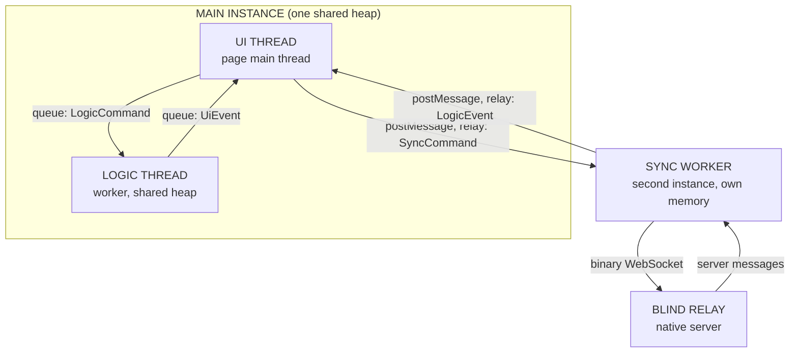

# AMBRE -- FEATURE: THE THREE-THREAD STACK

**Type:** Horizontal (framework)

> How the client is split, and why. Three execution contexts, two WebAssembly instances, one crate
> graph that carries the separation and one page that boots them.

This document owns the stack. What travels on it is `ambre-spec-message-bus.md`, what may never
leave it is `ambre-spec-zero-knowledge.md`, and what each part costs is `ambre-spec-budgets.md`.

---

## 1. CONTRACT

The only mandatory read. Grammar and status values are normative in `ambre-spec-template.md`. The
prefix is `ARCH`.

### 1.1 The state

| ID | Kind | Statement (RFC 2119) | Sources | Mechanism | Gap | Status |
|---|---|---|---|---|---|---|
| `ARCH-002` | `INV` | The crate graph MUST stay acyclic. | this spec section 2 | crate-graph -- a cycle between two workspace crates fails to resolve, so the edit that would create one never builds | none | verified |
| `ARCH-004` | `INV` | Every cryptographic operation MUST run in the Sync worker. The chunk seal of a call runs in the call worker, under the keys `CALL-004` allows. | README pillar "Zero-Knowledge"; `ambre-spec-zero-knowledge.md`, `ZK-002`; `ambre-spec-call-media.md section 3` (`CALL-003`) | cargo-deny -- `deny.toml` grants `ambre-crypto` to `ambre-sync`, to the call worker `ambre-call` for the chunk seal, and to `ambre-logic` for one host-only fixture hash, so every other crate fails the CI job; `ambre_logic::dispatch::tests::a_sealed_export_hands_the_plaintext_to_sync_and_nothing_to_the_ui` -- the one Logic gesture that needs a seal hands it to the Sync worker | none | verified |
| `ARCH-012` | `INV` | The client MUST build against a shared memory with atomics enabled. | this spec section 2 | target-build -- the flags are scoped to the wasm target in `.cargo/config.toml`, and the threading runtime fails to link without them | none | verified |
| `ARCH-001` | `INV` | The client MUST run as two WebAssembly instances: one holding the UI, Logic and converter threads over a single shared heap, one holding the Sync worker with its own memory. A macro sandbox is a frame outside both, and it holds none of their memory. During a call, a call worker adds a third instance, which holds the keys of that call alone. On the first conversion, the Logic thread adds the converter instance, which holds no key and no memory of the others (`ARCH-079`). The converter thread adds an instance of its own of each module it runs (`ARCH-097`). | this spec section 2; `1-Foundations/ambre-spec-macros.md section 3`; `1-Foundations/ambre-spec-call-media.md section 3` (`CALL-004`) | ci-gate -- `crates/ambre-primitives`, run by `just primitives` in the CI `lint` job, reads the graph `cargo metadata` resolves and refuses an `ambre-sync` that builds no `cdylib` and a crate that depends on it, a renamed or a test dependency included (`ambre_primitives::boundaries::tests::a_dependency_on_the_worker_and_a_worker_with_no_artefact_are_refused`). It refuses the same of the call worker `ambre-call` (`ambre_primitives::boundaries::tests::a_dependency_on_the_call_worker_and_a_call_worker_with_no_artefact_are_refused`); ci-gate -- the rustc driver of `crates/ambre-primitives`, run by `just primitives` in the CI `lint` job, reads each path once it resolves, so an alias, a re-export and a macro name what they reach. It refuses a worker spawned outside `platform.rs` (`ambre_primitives::driver::bounds::a_worker_spawned_through_an_alias_or_shared_through_a_re_export_is_refused`). It refuses a frame the browser or the toolkit creates in a file that never sets its `sandbox` (`ambre_primitives::driver::chrome::a_frame_the_toolkit_writes_or_concat_spells_is_refused_unless_its_file_sandboxes`, `ambre_primitives::driver::chrome::a_static_subtree_the_toolkit_writes_as_html_is_read_where_the_inert_element_takes_it`); ci-gate -- `scripts/crate_boundaries.py`, run by `just crate-boundaries` in the CI `lint` job, refuses a page that loads other than three Rust artefacts -- the launcher, the Sync worker and the call worker -- text neither tool reads | none | verified |
| `ARCH-003` | `INV` | The Logic thread MUST NOT declare a dependency on the render runtime or on the interface toolkit. | this spec section 2 | ci-gate -- `crates/ambre-primitives`, run by `just primitives` in the CI `lint` job, reads the graph `cargo metadata` resolves and refuses a dependency of `ambre-logic` on `ambre-canvas`, `wgpu`, `leptos` or another render or toolkit crate, a renamed one included (`ambre_primitives::boundaries::tests::a_thread_reaching_the_rendering_through_any_crate_is_refused`); cargo-deny -- `deny.toml` grants `wgpu` to `ambre-canvas` and `ambre-app`, and the CI `deny` job fails any other crate that takes it | none | verified |
| `ARCH-005` | `INV` | Every network call of the two instances MUST leave from the Sync worker. A macro sandbox calls on its own, held by the browser to the domains its user approved. The peer connection of a call leaves from the UI thread, and carries sealed chunks alone. | this spec section 2; `ZK-001`; `1-Foundations/ambre-spec-macros.md section 3` (`MACRO-010`); `1-Foundations/ambre-spec-call-media.md section 3` (`CALL-001`) | ci-gate -- the rustc driver of `crates/ambre-primitives`, run by `just primitives` in the CI `lint` job, reads each path once it resolves, so an alias, a re-export and a macro name what they reach. It refuses a network call outside the worker, the relay, the SFU and the belt (`ambre_primitives::driver::bounds::a_network_call_through_an_alias_or_a_macro_is_refused_outside_the_worker`); ci-gate -- `crates/ambre-primitives`, run by `just primitives` in the CI `lint` job, reads the graph `cargo metadata` resolves and refuses a transport crate declared outside them (`ambre_primitives::boundaries::tests::a_transport_crate_is_refused_outside_the_network_crates`). The launcher's two reads of `UI-THREAD-004` are its stated exception, and the call client of the UI thread, `crates/ambre-app/src/call.rs`, holds the peer connection | none | verified |
| `ARCH-006` | `INV` | The wire protocol types MUST have one definition, shared by the worker and the relay. | this spec section 2 | ci-gate -- the rustc driver of `crates/ambre-primitives`, run by `just primitives` in the CI `lint` job, records each type, alias and trait of `ambre-protocol`, `ambre-sync` and `ambre-server`, a private one and one a macro writes included (`ambre_primitives::driver::bounds::every_type_the_worker_declares_is_recorded_a_macro_written_one_included`). The judge refuses a type of the worker or the relay under the name of a public type of `ambre-protocol` (`ambre_primitives::boundaries::tests::a_wire_type_redeclared_by_the_worker_or_the_relay_is_refused`) | none | verified |
| `ARCH-070` | `INV` | The Sync worker MUST NOT depend on a crate that declares an application's content commands or events. | this spec section 2; `ambre-spec-message-bus.md`, `BUS-021` | ci-gate -- `crates/ambre-primitives`, run by `just primitives` in the CI `lint` job, reads the graph `cargo metadata` resolves and refuses a crate the Sync worker links, through any crate of the graph, that declares or drives an application (`ambre_primitives::boundaries::tests::a_thread_reaching_the_rendering_through_any_crate_is_refused`); ci-gate -- the rustc driver of `crates/ambre-primitives`, run by `just primitives` in the CI `lint` job, reads each path once it resolves, so an alias, a re-export and a macro name what they reach. It refuses a command or event enum of `ambre-bus` other than the envelopes and the service family, a macro-written one included (`BUS-032`, `ambre_primitives::driver::bounds::the_bus_and_the_worker_hold_no_application_message_behind_a_macro_or_a_re_export`) | none | verified |
| `ARCH-071` | `INV` | The render runtime MUST NOT depend on the crate that carries the protocol between the threads. | this spec section 2; `ambre-spec-message-bus.md` | ci-gate -- `crates/ambre-primitives`, run by `just primitives` in the CI `lint` job, reads the graph `cargo metadata` resolves and refuses a dependency of `ambre-canvas` on `ambre-bus`, its dev and target tables included, and a crate the renderer links that reaches it (`ambre_primitives::boundaries::tests::the_renderer_reaching_the_bus_is_refused`); cargo-deny -- `deny.toml` grants `ambre-bus` to the crates that speak the protocol, and the CI `deny` job fails any other crate that takes it | none | verified |
| `ARCH-007` | `INV` | The Main thread MUST drain the Logic to Sync queue once per frame, before it draws. | this spec section 2 | `ambre_canvas::frame::tests::each_tick_relays_once_before_it_draws`; ci-gate -- the rustc driver of `crates/ambre-primitives`, run by `just primitives` in the CI `lint` job, refuses a call of `drive_frame` whose relay calls no parameter of the function around it, and a call site of that function whose relay drains no receiver of `SyncCommand` (`ambre_primitives::driver::wiring::a_frame_relay_that_does_not_drain_the_sync_queue_is_refused`). The judge refuses a workspace where no relay drains (`ambre_primitives::boundaries::tests::a_second_start_or_a_missing_fact_of_the_wiring_is_refused`) | none | verified |
| `ARCH-072` | `INV` | The switchboard MUST decide in a module that names no browser API, interface toolkit or signal. That module MUST read no clock: the wiring passes each instant. The host tier MUST run that module's tests. | this spec section 2; `ambre-spec-testing.md section 5` | ci-gate -- the rustc driver of `crates/ambre-primitives`, run by `just primitives` in the CI `lint` job, reads each path once it resolves, so an alias, a re-export and a macro name what they reach. It refuses a path of `crates/ambre-app/src/switchboard.rs` above its tests that reaches a browser crate, the interface toolkit, a signal or a clock (`ambre_primitives::driver::wiring::the_switchboard_reaches_no_browser_or_clock_through_a_re_export_or_a_macro`). The judge fails closed when no compile reads that file (`ambre_primitives::boundaries::tests::a_closed_file_no_compile_reads_is_refused`); `ambre_app::switchboard::tests::a_refused_event_waits_and_arrives_in_order` -- the native tier runs the fan-out to a child; `ambre_app::switchboard::tests::a_murmure_member_key_goes_to_the_invitation_then_to_a_direct_message` -- and the purpose of a Murmure key; `ambre_app::switchboard::tests::an_invitee_key_asks_for_a_first_contact_and_for_a_change` -- and the prompt of an invitee's key; `ambre_app::switchboard::tests::the_header_follows_the_routed_document_alone` -- and the header status; `ambre_app::switchboard::tests::a_pinned_invitee_key_invites_at_the_instant_read` -- and the trusted-key path of the pin, under a clock the test sets; `ambre_app::switchboard::tests::the_perf_read_out_shows_one_snapshot_per_period` -- and the cadence of the perf read-out | none | verified |
| `ARCH-010` | `INV` | The engine MUST be created once per session. | this spec section 2 | `ambre_app::route::tests::path_doc_roundtrip`; ci-gate -- the rustc driver of `crates/ambre-primitives`, run by `just primitives` in the CI `lint` job, records each path of `ambre-app` that resolves to `ambre_logic::run`, an alias or a test included (`ambre_primitives::driver::wiring::every_start_and_every_failure_path_of_the_launcher_is_recorded`). The judge refuses a launcher that starts it other than once (`ambre_primitives::boundaries::tests::a_second_start_or_a_missing_fact_of_the_wiring_is_refused`) | none | verified |
| `ARCH-016` | `INV` | The engine MUST survive every route change. | this spec section 2 | `ambre_app::route::tests::a_route_walk_reuses_the_one_engine` -- each route change is a close, an open and a show; `::cross_kind_open_needs_reload` -- the one change allowed to end it | none | verified |
| `ARCH-011` | `INV` | Each browser tab MUST run a complete client of its own. | this spec section 2 | ci-gate -- the rustc driver of `crates/ambre-primitives`, run by `just primitives` in the CI `lint` job, reads each path once it resolves, so an alias, a re-export and a macro name what they reach. It refuses a `SharedWorker` or a service worker named, and a worker spawned outside `platform.rs` (`ambre_primitives::driver::bounds::a_worker_spawned_through_an_alias_or_shared_through_a_re_export_is_refused`); ci-gate -- `scripts/crate_boundaries.py`, run by `just crate-boundaries` in the CI `lint` job, refuses a page that names a shared worker | none | verified |
| `ARCH-014` | `INV` | The client MUST NOT rely on a queue disconnection to detect a thread failure. | this spec section 2 | ci-gate -- the rustc driver of `crates/ambre-primitives`, run by `just primitives` in the CI `lint` job, refuses a panic hook of `ambre-app` and an error handler of the Sync worker whose closure, read through the binding it comes from, does not call `ambre_canvas::signal_fatal` (`ambre_primitives::driver::wiring::every_start_and_every_failure_path_of_the_launcher_is_recorded`). The judge refuses a launcher with no such hook or handler (`ambre_primitives::boundaries::tests::a_second_start_or_a_missing_fact_of_the_wiring_is_refused`) | none | verified |
| `ARCH-018` | `INV` | The launcher MUST hold integration and the shell alone: the logic of an application, what one of its commands does included, MUST live in that application's crate. | this spec section 2 | ci-gate -- the rustc driver of `crates/ambre-primitives`, run by `just primitives` in the CI `lint` job, reads each path once it resolves, so an alias, a re-export and a macro name what they reach. It refuses a path of `ambre-app` above its tests that reaches a variant of an application's command or event, or one of its command ids (`ambre_primitives::driver::bounds::an_application_variant_or_command_id_under_an_alias_is_refused_in_the_launcher`) | none | verified |
| `ARCH-017` | `INV` | The Logic thread MUST answer a view once per pass over the commands waiting on its inbound queues, not once per command. | this spec section 2 | `ambre_logic::pass_tests::a_burst_of_keystrokes_is_answered_once` | none | verified |
| `ARCH-027` | `INV` | The Logic thread MUST hand local persistence the delta an edit wrote, and a whole snapshot only when no snapshot of this session holds the log, the log grew past its bound, or the document closes. | this spec section 2 | `ambre_logic::pass_tests::a_burst_of_keystrokes_is_answered_once`; `ambre_logic::pass_tests::the_first_save_is_a_snapshot`; `ambre_logic::pass_tests::a_long_log_is_folded_into_a_snapshot`; `ambre_logic::pass_tests::a_document_closed_in_the_pass_keeps_its_last_edit` -- the close | none | verified |
| `ARCH-030` | `INV` | A document whose engine holds unfinished work MUST take one bounded step of it per pass, without waiting for a message. | this spec section 2; `TOILE-IO-028` | `ambre_logic::pass_tests::a_large_import_lands_over_several_passes`; `ambre_logic::pass_tests::a_large_excel_import_lands_over_several_passes` -- a workbook; `ambre_logic::pass_tests::a_large_prose_import_lands_over_several_passes` -- a Prose import; `ambre_logic::pass_tests::a_large_prose_export_walks_over_several_passes` -- a Prose export; `ambre_logic::pass_tests::another_document_is_edited_between_two_prose_slices` -- another document is served between two slices | none | verified |
| `ARCH-031` | `INV` | The Logic thread MUST finish a document's unfinished work before it merges a remote delta into that document or closes it. | this spec section 2; `TOILE-IO-028` | `ambre_logic::pass_tests::a_board_closed_mid_import_saves_it_whole`; `ambre_logic::pass_tests::a_remote_delta_mid_import_lands_the_import_first` | none | verified |
| `ARCH-020` | `INV` | The Main thread MUST NOT take a lock on a queue it shares with the Logic thread. | this spec section 2 | cargo-deny -- `deny.toml` bans the queue crate that locks from every client crate; lint-wall -- `crates/ambre-bus/clippy.toml` refuses a mutex, a read-write lock, a condition variable and a barrier in the crate that holds the queues | none | verified |
| `ARCH-021` | `INV` | A queue end the Main thread holds MUST NOT wait. | this spec section 2 | type-level -- `ambre_bus::conduit::Sender` and `ambre_bus::conduit::Receiver`, the two ends the launcher keeps, declare only operations that try, and the one end that parks goes to the Logic thread at spawn | none | verified |
| `ARCH-032` | `INV` | Every crate of the workspace MUST inherit the workspace lint table. | this spec section 2 | ci-gate -- `crates/ambre-primitives`, run by `just primitives` in the CI `lint` job, reads the graph `cargo metadata` resolves and refuses a root manifest without `[workspace.lints]` and a member, a member a glob lists included, whose manifest does not set `lints.workspace = true` as TOML reads it (`ambre_primitives::boundaries::tests::a_member_that_does_not_inherit_the_lint_table_is_refused`) | none | verified |
| `ARCH-028` | `INV` | Code outside a test MUST NOT hold a path that panics: no unwrap, expect, panic, unreachable, todo, unimplemented, index or slice that can fail. | this spec section 2 | lint-wall -- the workspace lint table denies `unwrap_used`, `expect_used`, `panic`, `unreachable`, `todo`, `unimplemented` and `indexing_slicing`, and every crate inherits it (`ARCH-032`). `just lint` reads the host with every feature on, and `just lint-wasm` the wasm-only code, in the CI `lint` and `test-wasm` jobs. A boot site that cannot recover carries an `expect` attribute with its reason | none | verified |
| `ARCH-068` | `INV` | Code of the workspace MUST NOT silence a lint without the reason it is kept, and a silence whose reason is gone MUST fail the build. | this spec section 2 | lint-wall -- the workspace lint table denies the clippy lint `allow_attributes` and `unfulfilled_lint_expectations`, and every crate inherits it (`ARCH-032`). A kept site is an `expect` attribute with its `reason`. `just lint` reads the host with every feature on, and `just lint-wasm` the wasm-only code, both under `-D warnings`, in the CI `lint` and `test-wasm` jobs. The fuzz workspace inherits no table and runs no clippy | none | verified |
| `ARCH-069` | `INV` | A line that a pull request changes in the scope of `.cargo/mutants.toml` MUST fail a host test under each of its mutations, unless that file excludes the mutation with its reason. | `ambre-spec-testing.md section 2` | cargo-mutants -- `just mutants-diff`, run by the CI `mutants-diff` job on each pull request, fails on a mutation of a changed line that no host test fails on. The wasm and browser tiers do not run per mutation, so code they alone reach is excluded with that reason | none | verified |
| `ARCH-033` | `INV` | A field, parameter, return, constant, static, alias or associated type of an impl that the source or a macro of the workspace writes outside a test, in a unit a compile of the lint builds, and whose type holds a bare primitive once each alias is resolved, MUST be typed, or named by one line of the primitive allowlist with one category of its closed set. A primitive written as a generic argument is bare, whatever the parameter it fills. A default argument and a type spelled `Self` write none. A generic newtype carries its representation through its marker, as `Px<S: Space>(S::Repr, ..)`, so a use writes no primitive and the impl of the marker's trait is the site. The set MUST NOT hold a category for a value still to type. A `.rs` file under the workspace root, outside a nested workspace, MUST be read by a compile of the lint. | `ambre-spec-testing.md section 2`, the primitive gate | `ambre_primitives::driver::sites::every_kind_of_site_is_read`; `::test_code_is_not_read`; `ambre_primitives::driver::checks::each_file_rustc_reads_is_recorded`; `ambre_primitives::allowlist::tests::a_site_no_line_names_fails_the_gate`; `::a_category_outside_the_closed_set_is_refused`; `::a_debt_line_is_refused`; `ambre_primitives::files::tests::a_rust_file_no_compile_reads_is_refused`; `::a_stray_workspace_and_a_named_one_that_declares_none_are_refused`; `ambre_primitives::run::tests::the_lint_lines_read_as_cargo_check_with_their_flags`; `::a_line_the_gate_cannot_run_as_written_fails_closed`; `::a_recipe_with_no_compile_line_or_a_parameter_fails_closed`; `ambre_primitives::records::tests::a_record_the_judge_cannot_read_is_an_error`; ci-gate -- `crates/ambre-primitives`, run by `just primitives` in the CI `lint` job, through its rustc driver, whose fixture tests `just primitives-driver` runs in the same job. A unit cargo builds whose record the driver did not write fails the gate | none | verified |
| `ARCH-034` | `INV` | The primitive allowlist MUST NOT hold a line that names no site. | `ambre-spec-testing.md section 2`, the primitive gate | `ambre_primitives::allowlist::tests::a_line_that_names_no_site_is_stale`; `::a_prune_removes_the_stale_lines_and_nothing_else`; `::a_prune_adds_no_line_for_a_new_site`; ci-gate -- `crates/ambre-primitives`, run by `just primitives` in the CI `lint` job, through its rustc driver, whose fixture tests `just primitives-driver` runs in the same job | none | verified |
| `ARCH-035` | `INV` | Each line of the primitive allowlist MUST carry the category true of its site, and one site has exactly one. A line MUST NOT name a site that a family of `ambre-core`, an enum or a new newtype could type: the reviewer refuses it, and the change types the site. A `local` line MUST meet the four conditions of `ai/ambre-rust-style.md`. A site that spells an enum, or a struct that is no newtype, as a primitive MUST take its category from the reader of that spelling. A reader that decodes it back sets `newtype-inner` for a fieldless enum and `generic` for an enum that carries data or a struct that is no newtype. A person sets `free-text`. A trait method that is a type's own spelling MUST take the spelling's category, not `trait`. An error that echoes a refused value, or the count it gives of that value, MUST be `generic`, whatever shape its site has. | `ambre-spec-testing.md section 2`, the primitive gate | human-review -- the reviewer reads every line a change adds to `specs/1-Foundations/ambre-primitives.tsv`, against the site its key names | unheld -- `domain-meaning` -- the gate checks that the word is one of the set. It checks the shape of a `newtype-inner` or a `trait` site (`ARCH-036`), never the meaning a line claims | human-review |
| `ARCH-036` | `INV` | A `newtype-inner` line of the primitive allowlist MUST name the own representation of a type of the site's crate, or of a generic newtype through the associated type its marker writes. That is the field of a struct with exactly one field, a `PhantomData` marker apart. It MAY instead name the one field of a tuple variant with exactly one field. It MAY instead name a parameter of a `fn` that returns that struct or a fieldless enum, or the return of its method. An enum is fieldless when no variant outside a test `cfg` holds a field, and a variant written `V()` or `V {}` holds none. That `fn` MAY sit in an impl of a trait of the site's crate for such a type of another crate. A `newtype-inner` line MAY instead name an associated type that an impl of a workspace trait writes, when a struct of the workspace with exactly one field, declared outside a `fn` body, holds that associated type of that trait as its field. The trait of the impl and the trait the struct names MUST place on one declaration, written without generic arguments or a leading `::`, and the impl MUST sit outside a `fn` body. A `trait` line MUST name a signature of an impl of a trait the workspace does not declare, never an associated type, whose value the impl chooses. Its primitive MUST NOT be a generic argument the impl writes, nor the type the impl is for. It MAY instead name a closure type that names a type of a foreign crate. | `ambre-spec-testing.md section 2`, the primitive gate | `ambre_primitives::driver::sites::a_newtype_inner_claim_holds_on_the_representation_alone`; `::a_trait_claim_holds_on_a_foreign_signature_alone`; `ambre_primitives::allowlist::tests::a_line_whose_site_refutes_its_category_is_reported`; `::an_associated_type_holds_when_a_generic_newtype_holds_it`; ci-gate -- `crates/ambre-primitives`, run by `just primitives` in the CI `lint` job, through its rustc driver, whose fixture tests `just primitives-driver` runs in the same job. The driver reads each claim on the type rustc gives the site, so a rename of a trait or a type hides nothing | none | verified |
| `ARCH-084` | `INV` | A `math` line of the primitive allowlist MUST NOT name a site whose name ends on a unit. The name is the parameter of a parameter site, the `fn` of a return site, and the last segment of the item path otherwise. It splits on `_`, on a change of case and between letters and digits, and the last word is compared without case. The units are `ms`, `us`, `ns`, `sec`, `secs`, `millis`, `micros`, `nanos`, `bps`, `kbps`, `mbps`, `bits`, `bytes`, `hz` and `khz`. A unit before the last word passes, as in a ratio such as `bits_per_pixel`. | `ambre-spec-testing.md section 2`, the primitive gate; `ai/ambre-rust-style.md`, the unit quantity | `ambre_primitives::allowlist::tests::a_math_line_named_for_a_unit_is_refused`; `ambre_primitives::units::tests::a_name_that_ends_on_a_unit_is_found_in_every_case`; `::a_unit_before_the_last_segment_passes`; ci-gate -- `crates/ambre-primitives`, run by `just primitives` in the CI `lint` job. The judge reads the item path of each key, so the refusal holds on a line whose site is stale too | none | verified |
| `ARCH-037` | `INV` | A `Deref` or `DerefMut` impl that the source or a macro writes MUST NOT target a primitive, or a type that hands one out: a slice, an array, a reference, or a `Vec`, `Box`, `Rc`, `Arc` or `Cow` of one, each alias resolved. Its target MUST NOT be a type parameter or a projection, bound or not. A target the gate cannot read fails. No line of the primitive allowlist admits such an impl. | `ambre-spec-testing.md section 2`, the primitive gate; `ai/ambre-rust-style.md`, the two bans | `ambre_primitives::driver::checks::a_deref_to_a_primitive_is_refused`; ci-gate -- `crates/ambre-primitives`, run by `just primitives` in the CI `lint` job, through its rustc driver, whose fixture tests `just primitives-driver` runs in the same job | none | verified |
| `ARCH-038` | `INV` | A `local` line of the primitive allowlist MUST name a private site. A site that is `pub`, `pub(crate)`, `pub(super)` or `pub(in path)`, or sits in a trait impl, is not private. A field of a type of `ambre-bus`, or of a type that derives `Serialize`, `Deserialize` or `FromRow`, is not private either. | `ambre-spec-testing.md section 2`, the primitive gate; `ai/ambre-rust-style.md`, the `local` rule | `ambre_primitives::driver::sites::the_privacy_of_each_site_is_read_as_written`; `::a_serialised_or_bus_field_is_not_private`; `ambre_primitives::allowlist::tests::a_privacy_refusal_holds_whatever_the_category`; ci-gate -- `crates/ambre-primitives`, run by `just primitives` in the CI `lint` job, through its rustc driver, whose fixture tests `just primitives-driver` runs in the same job | none | verified |
| `ARCH-039` | `INV` | A field that is not private MUST NOT hold a `bool`, a wrapped one included. A `bool` in the signature of a callable type is not one it holds. The one field of a tuple variant with exactly one field MAY be a bare `bool`, the value its variant names. Its line MAY be `foreign-api` when the field mirrors a schema the workspace does not control. | `ambre-spec-testing.md section 2`, the primitive gate; `ai/ambre-rust-style.md`, the `bool` rule | `ambre_primitives::driver::sites::the_shape_of_a_bool_is_read_outside_callables`; `ambre_primitives::allowlist::tests::a_bool_field_of_a_foreign_schema_holds_under_foreign_api`; `::a_privacy_refusal_holds_whatever_the_category`; ci-gate -- `crates/ambre-primitives`, run by `just primitives` in the CI `lint` job, through its rustc driver, whose fixture tests `just primitives-driver` runs in the same job | none | verified |
| `ARCH-040` | `INV` | A `bool` parameter that is not private MUST NOT take a literal in a call of the workspace that names its `fn`, a test included. A literal in parentheses, in a block or an `unsafe` block of one expression, behind `&` or `!`, under `Some`, in a tuple, an array, a repeat or a `vec!`, in a branch of an `if` or an arm of a `match` counts. So does a prop of a component, which names its parameter. A call names its `fn` through any path or rename: a re-export, a renamed dependency or a `use ... as`. A call of a trait method names the trait item and the impl it reaches. A `trait` line is exempt, since the foreign signature fixes the type. | `ambre-spec-testing.md section 2`, the primitive gate; `ai/ambre-rust-style.md`, the `bool` rule | `ambre_primitives::driver::literals::a_literal_is_found_in_each_shape_the_rule_counts`; `::a_literal_reaches_the_fn_its_call_resolves_to`; `::a_parameter_site_carries_the_slot_its_calls_write`; `::a_test_build_writes_its_literals`; `::a_component_prop_reaches_its_parameter_by_name`; `ambre_primitives::allowlist::tests::a_literal_reaches_its_resolved_parameter_alone`; `::a_trait_line_takes_no_literal_refusal`; ci-gate -- `crates/ambre-primitives`, run by `just primitives` in the CI `lint` job, through its rustc driver, whose fixture tests `just primitives-driver` runs in the same job | none | verified |
| `ARCH-041` | `INV` | A `bool` parameter that is not private MUST NOT take a literal through a call that does not name its `fn`: through a value, a closure or a trait object, or in code a macro writes. Nor MAY it take one in a shape the gate does not read as a literal: a block of more than one statement, the argument of a call other than `Some`, a field of a struct literal, a cast, or a `view!` prop value of more than three tokens. | `ambre-spec-testing.md section 2`, the primitive gate; `ai/ambre-rust-style.md`, the `bool` rule | human-review -- the reviewer reads each `bool` parameter a change makes reachable, and the calls that reach it. `ambre_primitives::driver::literals::a_call_through_a_value_reaches_no_slot` shows the edge | unheld -- `type-resolution` -- the driver resolves each call that names its `fn`. Which `fn` a value, a closure or a trait object calls is decided at run time. A literal a macro writes, as the arms of `matches!`, is no token of the caller, and a literal in any other shape is a value the gate does not follow | human-review |
| `ARCH-042` | `INV` | A `trait` line on a closure type or a function pointer type MUST name one that a foreign signature requires. | `ambre-spec-testing.md section 2`, the primitive gate; `ai/ambre-rust-style.md`, the `trait` category | human-review -- the reviewer reads each `trait` line a change adds on a callable type, against the foreign call that takes it | unheld -- `type-resolution` -- the driver sees that the callable names a type of a foreign crate. To which signature a value of it is passed is decided where the value flows | human-review |
| `ARCH-043` | `INV` | A field, parameter, return, constant, static, alias or `Deref` impl that a macro of the workspace writes MUST obey `ARCH-033`, `ARCH-037`, `ARCH-039` and `ARCH-040` as one the source writes does. | `ambre-spec-testing.md section 2`, the primitive gate | `ambre_primitives::driver::sites::a_site_a_workspace_macro_writes_is_read`; `ambre_primitives::driver::checks::a_deref_to_a_primitive_is_refused`; ci-gate -- `crates/ambre-primitives`, run by `just primitives` in the CI `lint` job, through its rustc driver, whose fixture tests `just primitives-driver` runs in the same job. The driver reads the code each macro expands to, keyed at the call | none | verified |
| `ARCH-044` | `INV` | A site whose type names an alias of a foreign crate MUST obey `ARCH-033`, `ARCH-039` and `ARCH-040` as the alias's target does. A `Deref` impl whose target names one MUST obey `ARCH-037` as that target does. | `ambre-spec-testing.md section 2`, the primitive gate | `ambre_primitives::driver::sites::a_foreign_alias_reads_as_its_target`; ci-gate -- `crates/ambre-primitives`, run by `just primitives` in the CI `lint` job, through its rustc driver, whose fixture tests `just primitives-driver` runs in the same job. The driver reads the type rustc gives each site and each target, every alias resolved | none | verified |
| `ARCH-045` | `INV` | Code outside a test MUST NOT write the name `expose`, `expose_mut` or `clone_secret` outside `ambre-crypto`, the Secret module of `ambre-core` and the secrets modules of the relay and of the SFU (`ARCH-048`). The rule binds each crate root, and each module a `mod` item of the source declares. A module is test code by `cfg(test)`, by `cfg(all(test, ..))` or by a test macro alone, never by its name or by a feature. | `ambre-spec-zero-knowledge.md section 2`, the key separation; `ambre-spec-testing.md section 2`, the primitive gate | `ambre_primitives::driver::secrets::every_reader_is_refused_outside_the_modules_that_may_read`; `::test_code_reads_a_secret_freely`; ci-gate -- `crates/ambre-primitives`, run by `just primitives` in the CI `lint` job, through its rustc driver, whose fixture tests `just primitives-driver` runs in the same job. The driver reads each name a path, a method call or a declaration writes, in the code each macro expands to too | none | verified |
| `ARCH-046` | `INV` | Code outside a test MUST NOT name the `zeroize` crate, its `Zeroize` or `ZeroizeOnDrop` trait or its `Zeroizing` wrapper outside the Secret module of `ambre-core`. A manifest MUST NOT rename that crate. The one exception is a foreign key type that wipes itself through the crate it comes from: `ed25519_dalek::SigningKey` and `x25519_dalek::StaticSecret`, which the Sync worker and the relay hold bare. | `ambre-spec-zero-knowledge.md section 2`, the key separation; `ambre-spec-testing.md section 2`, the primitive gate | `ambre_primitives::driver::secrets::a_name_of_the_zeroize_crate_is_refused_outside_the_secret_module`; `ambre_primitives::files::tests::a_renamed_zeroize_crate_is_refused`; ci-gate -- `crates/ambre-primitives`, run by `just primitives` in the CI `lint` job, through its rustc driver, whose fixture tests `just primitives-driver` runs in the same job. The driver reads an item of the crate by the crate it comes from, so a rename hides none | none | verified |
| `ARCH-047` | `INV` | The value of a `Secret` MUST NOT leave `ambre-crypto`, the Secret module and the secrets modules of the relay and of the SFU through a door other than the three names of `ARCH-045` and the doors this row admits: a function that lends out the bare value to any caller, a trait impl that hands it out, code a macro or a derive writes, or code the gate does not read. The admitted doors are: `impl<K: WireConfidential> Serialize for Confidential<K>` with its `Deserialize` twin, which the markers `Passphrase`, `RecoveryWords` and `Plaintext` each admit by one `impl WireConfidential` line, a sealed trait; `impl<K: WireCredential> Serialize for Credential<K>` with its `Deserialize` twin, which the markers `AccessToken`, `RefreshToken`, `PresignedUrl`, `OidcCode`, `OidcState`, `CallAdmission` and `TurnPassword` each admit by one `impl WireCredential` line, a type that holds one deriving its serde with no gated name; the sinks of `ARCH-049`; `MasterSeed::recovery_words`; `Credential<PresignedUrl>::object_address`, the address before the query; `Confidential<Plaintext>::with_plaintext`, which lends the bytes with no copy to the code that reads them on the way to another form, while the wrapper keeps and wipes them; `Confidential<Plaintext>::into_plaintext`, which moves the bytes out with no copy into a role that keeps them in the clear by design, and leaves the wrapper empty, while a wrapper another owner shares hands out a copy, and that owner keeps and wipes the original; `KeyHandoff::to_port`, which writes a sender key of a call into a `Confidential<Plaintext>` for the port between the Sync worker and the call worker alone (`CALL-064`); each function of the relay's secrets module, which hands its copy to one foreign call and is a sink of `ARCH-049` (`ARCH-048`); and each function of the SFU's secrets module, which hands the text to one foreign call inside that module: the HMAC of a TURN credential, or the hex decoder of an admission. | `ambre-spec-zero-knowledge.md section 2`, the key separation | human-review -- the reviewer reads each item a change adds to `ambre-crypto`, to `crates/ambre-core/src/secret.rs`, to `crates/ambre-server/src/secrets/` or to `crates/ambre-sfu/src/secrets/` that returns, lends or passes on a value read from a `Secret`, against the one use it serves. The reviewer reads each serialization of a type that holds a door newtype against the wire or the store it feeds. The reviewer reads every change for a deliberate evasion of the gate. A macro can build a gated name, a `mod` or a path. Build configuration, an environment or a wrapper can sit outside the forms `ARCH-033` checks. A recipe line can hide a lever from the literal tripwire. A proc or a foreign macro can write any of these | unheld -- `type-resolution` -- the gate reads names, in the code each macro expands to. Which value a function hands back, and which type a serializer is handed, flow at run time. The gate catches the accidental misuse of a contributor who writes plain code. It does not hold a deliberate evasion by a committer, who can ship a build script or a dependency anyway. Two examples: a function that lends the bare value out under another name; a build outside the compiles of the lint. Review of every change holds them | human-review |
| `ARCH-048` | `INV` | In `ambre-server` and in `ambre-sfu`, code outside a test MUST NOT call or declare `expose`, `expose_mut` or `clone_secret` outside `src/secrets/`, and that module MUST NOT name the `zeroize` crate. The rest of the relay reads a secret through the typed functions of that module alone, each a sink of `ARCH-049`. The rest of the SFU reads none: it calls the functions that mint a TURN credential and read an admission. | `ambre-spec-zero-knowledge.md section 2`, the key separation; `ambre-spec-testing.md section 2`, the primitive gate | `ambre_primitives::driver::secrets::every_reader_is_refused_outside_the_modules_that_may_read`; `ambre_server::secrets::tests::a_store_key_keeps_the_pattern_it_had_before_the_wrapper`; `::an_oidc_secret_prints_nothing_and_reaches_the_provider_whole`; ci-gate -- `crates/ambre-primitives`, run by `just primitives` in the CI `lint` job. The admission is the directory `src/secrets/` of the crates `ambre-server` and `ambre-sfu`, read on the path with each `..` undone and on the path with each link followed. No other crate gains it, and the module stays under `ARCH-046` and `ARCH-049`. What each function of the module hands on is `ARCH-047`'s | none | verified |
| `ARCH-049` | `INV` | Code outside a test MUST NOT name a sink that lends a secret to one foreign call outside the file that makes that call: `present_bearer` and `present_link` outside `crates/ambre-sync/src/http.rs`, and `present_state` outside `crates/ambre-app/src/signin.rs`. In the relay, the same holds for `refresh_key`, `oidc_state_key` and `present_stored` outside `src/redis_ops.rs`. It holds for `to_client_secret`, `to_pkce_verifier` and `authorization_code` outside `src/oidc.rs`, and for `decode_access` and `seed_key` outside `src/jwt.rs`. The Secret module, `ambre-crypto` and the file of the relay's `src/secrets/` that declares a sink are exempt. | `ambre-spec-zero-knowledge.md section 2`, the key separation; `ambre-spec-testing.md section 2`, the primitive gate | `ambre_primitives::driver::secrets::a_sink_is_named_in_the_file_that_makes_its_call_alone`; ci-gate -- `crates/ambre-primitives`, run by `just primitives` in the CI `lint` job, through its rustc driver, whose fixture tests `just primitives-driver` runs in the same job | none | verified |
| `ARCH-050` | `INV` | The primitive gate MUST read each file rustc compiles outside a test, under the target, `cfg` and feature set of each compile of the lint, in the module rustc gives it. Each feature a manifest declares MUST be on in one of those compiles, unless a line of the feature exclusions names it with its reason. | `ambre-spec-testing.md section 2`, the primitive gate | structural -- the gate runs each compile line of `lint` and `lint-wasm` through its rustc driver, so it reads what rustc reads; `ambre_primitives::driver::checks::each_file_rustc_reads_is_recorded`; `ambre_primitives::run::tests::the_lint_lines_of_the_workspace_parse`; `ambre_primitives::features::tests::a_feature_every_compile_leaves_off_is_refused`; `::an_excluded_feature_passes_with_its_reason`; `::an_exclusion_of_a_feature_a_compile_turns_on_is_stale`; ci-gate -- `crates/ambre-primitives`, run by `just primitives` in the CI `lint` job, through its rustc driver, whose fixture tests `just primitives-driver` runs in the same job | none | verified |
| `ARCH-051` | `INV` | A sequence number MUST compare only to a sequence number of its own family, and its successor MUST NOT be smaller than it. | this spec section 2, the sequences; `ai/ambre-rust-style.md`, the Generation rule | type-level -- `ambre_core::Seq` implements its equality and its order for one family alone; `ambre_core::seq::tests::a_counter_only_grows_and_saturates` | none | verified |
| `ARCH-052` | `INV` | An issuer MUST hand out each number of its family below `u64::MAX` at most once, and never the zero number. It saturates at `u64::MAX`, which one number per millisecond reaches in half a billion years. | this spec section 2, the sequences | type-level -- `ambre_core::Issuer` has no `Clone`; `ambre_core::seq::tests::an_issuer_hands_out_each_number_once_and_never_zero`; `::a_shared_issuer_counts_like_an_issuer` | none | verified |
| `ARCH-053` | `INV` | Code outside a test MUST NOT build a sequence number of a sealed family outside the module that holds its issue right. | this spec section 2, the sequences | type-level -- the issue right has a private field, and only an open family has a successor of its own. The `compile_fail` doctests of `ambre_core::SeqKind` show both forges refused | none | verified |
| `ARCH-054` | `INV` | A sequence number MUST have a serde form only when its family is open, and that form MUST be the bare number. | this spec section 2, the sequences | type-level -- the serde impls bound the family by `ambre_core::seq::Wire`, which asks for an open right; `ambre_core::seq::tests::a_wire_family_round_trips_as_its_bare_number` | none | verified |
| `ARCH-055` | `INV` | A build other than a test build MUST NOT turn on the `testing` feature of `ambre-core`. | this spec section 2, the sequences | `ambre_core::testing_feature::the_testing_feature_is_named_in_dev_dependencies_alone` -- every workspace manifest names it in a dev-dependency table alone; `::a_forward_or_a_normal_dependency_is_refused` | none | verified |
| `ARCH-056` | `INV` | An identifier of one entity kind MUST NOT stand where an identifier of another kind is expected. | `ai/ambre-rust-style.md`, the newtype rule and the Generation rule | type-level -- every identifier is the generic `Id<E>` over an uninhabited marker of the `id` module of `ambre-core`, so two kinds are two types. The first `compile_fail` doctest of that module shows the swap refused, and the doctest of the allowed forms compiles | none | verified |
| `ARCH-057` | `INV` | A fresh `Uuid` identifier MUST come from a mint alone, never from `Default`. | `ai/ambre-rust-style.md`, the newtype rule | type-level -- `Id<E>` implements no `Default`, so `Id::mint` is the one constructor of a fresh value. The second `compile_fail` doctest of the `id` module of `ambre-core` shows the default refused | none | verified |
| `ARCH-058` | `INV` | A `Uuid` identifier MUST give its `Uuid` back through a named accessor alone, never through a conversion. | `ai/ambre-rust-style.md`, the two bans of the newtype rule | type-level -- `Id<E>` implements no conversion into `Uuid`, so `Id::uuid` is the one way out. The third `compile_fail` doctest of the `id` module of `ambre-core` shows the conversion refused | none | verified |
| `ARCH-059` | `INV` | The element identifier of a Toile frame MUST hold the same text as the frame identifier. | `3-Toile/ambre-spec-toile-schema.md section 2` | type-level -- `From<Id<Frame>> for Id<Element>` in the `id` module of `ambre-core` moves the text over unchanged, and the doctest of the allowed forms compiles it; `ambre_core::id::tests::a_frame_is_the_element_of_the_same_text` | none | verified |
| `ARCH-060` | `INV` | Code MUST NOT convert an element identifier into a frame identifier except through the board, which answers one for a frame alone. | `3-Toile/ambre-spec-toile-schema.md section 2` | type-level -- no conversion leads from `Id<Element>` to `Id<Frame>`, and the fourth `compile_fail` doctest of the `id` module of `ambre-core` shows it refused. `Id::from_text` is the decode of a stored text, and the engine checks the kind again where the id lands; `ambre_toile::logic::state::presentation::frame_tests::only_an_existing_frame_reads_as_a_frame` | none | verified |
| `ARCH-061` | `INV` | A `Scale` MUST join only a pair of pixel spaces that `ambre-core` declares: document to view, CSS to device, board to view. | `ai/ambre-rust-style.md`, the arithmetic of the newtype rule; `ambre-spec-high-density.md` | type-level -- `ambre_core::Scale` bounds its source by the sealed `ambre_core::ScalesTo`, so a pair outside the three names no type. The `compile_fail` doctests of `ambre_core::ScalesTo` show four such pairs refused, and a board zoom refused by `Px<Doc>::zoomed`; `ambre_core::scale::tests::a_board_length_scales_into_the_view_with_the_bits_of_the_bare_arithmetic` | none | verified |
| `ARCH-064` | `INV` | An instant the relay stamped MUST NOT stand where an author's instant is expected. | this spec section 2, the time bases; `ai/ambre-rust-style.md`, the newtype rule | type-level -- `Relayed` is a `TimeBase` marker of its own, so the two instants are two types. The first `compile_fail` doctest of `ambre_core::Relayed` shows an author's instant refused | none | verified |
| `ARCH-065` | `INV` | An instant the relay stamped MUST meet the reader's clock through one named method alone. | this spec section 2, the time bases; `ARCH-064` | type-level -- `Instant::age_at` is the one method that takes both clocks, and the second `compile_fail` doctest of `ambre_core::Relayed` shows `since` refused across them; `ambre_core::span::tests::a_relayed_instant_ages_on_the_readers_clock_and_never_below_zero` -- the span it gives, zero when the reader's clock runs behind | none | verified |
| `ARCH-062` | `INV` | A struct that the source or a macro of the workspace writes outside a test, with exactly one field once each `PhantomData` marker is set apart, MUST NOT hold that field as a primitive of the census list of `ambre-spec-newtypes.md` section 1, unless one line of the newtype exceptions file names it with a reason. A struct of `ambre-core` that declares a type or a const parameter is a family, and this rule skips it. A generic struct of another crate is under this rule. Such a newtype MUST be an instance of a generic family of `ambre-core` instead. The file MUST NOT hold a line that names no such struct. | `ambre-spec-newtypes.md section 1`; `ai/ambre-rust-style.md`, the newtype rule | `ambre_primitives::driver::checks::a_single_field_struct_over_a_primitive_is_counted`; `::a_field_over_an_associated_type_is_counted_through_its_instances`; `ambre_primitives::newtypes::tests::a_listed_newtype_with_a_reason_passes`; `::a_newtype_no_line_names_is_refused`; `::a_newtype_over_an_associated_type_takes_its_line`; `::a_line_that_names_no_newtype_is_stale`; `::a_line_that_breaks_the_format_is_refused`; `::a_missing_header_or_file_is_refused`; `::a_prune_removes_the_stale_lines_and_nothing_else`; ci-gate -- `crates/ambre-primitives`, run by `just primitives` in the CI `lint` job, through its rustc driver, whose fixture tests `just primitives-driver` runs in the same job. The census reads the type rustc gives the field, every alias resolved. It reads a field over an associated type of a parameter as each type an impl in the compile, or an equality bound of the struct, gives it. A struct a foreign macro writes takes its field from that crate and is out of it | none | verified |
| `ARCH-063` | `INV` | Each line of the newtype exceptions file MUST give a reason true of its newtype, which names why no generic family of `ambre-core` fits it. | `ambre-spec-newtypes.md section 1` | human-review -- the reviewer reads every line a change adds to `specs/1-Foundations/ambre-newtypes.tsv`, against the newtype its key names, the reasons of `ambre-spec-newtypes.md section 1` and the families of its section 2 | unheld -- `domain-meaning` -- the gate checks that a reason is written, never that it is true | human-review |
| `ARCH-066` | `INV` | A module-level `type` alias of the workspace, test code included, MUST NOT stand for an instance of a generic family of `ambre-core` alone. That holds once a path, a reference, parentheses or another alias of the workspace is set apart. | `ambre-spec-newtypes.md section 3`, the row `A name` | `ambre_primitives::driver::checks::an_alias_of_a_generic_struct_of_core_is_recorded`; `ambre_primitives::aliases::tests::an_alias_of_a_bare_family_is_refused`; `::an_alias_of_a_generic_struct_that_is_no_family_passes`; `::a_family_the_core_declares_as_no_generic_struct_is_refused`; `::a_missing_spec_or_an_empty_table_is_refused`; `::the_families_are_the_names_of_the_table_of_section_2`; ci-gate -- `crates/ambre-primitives`, run by `just primitives` in the CI `lint` job, through its rustc driver, whose fixture tests `just primitives-driver` runs in the same job | none | verified |
| `ARCH-067` | `INV` | A module-level `type` alias whose target holds an instance of a generic family of `ambre-core` in a tuple, a container or a closure MUST stay only where that target, written out at one of its uses, fails `clippy::type_complexity`. Its doc comment MUST say so in one line. | `ambre-spec-newtypes.md section 3`, the row `A name` | human-review -- the reviewer writes out at its uses each such alias a change adds, and runs clippy: the alias stays only when the type complexity lint of clippy refuses one use. The lint is never allowed or expected to keep an alias out | unheld -- `type-resolution` -- the gate runs no clippy on a type written out at a use, so it cannot score one | human-review |
| `ARCH-073` | `INV` | Code outside a test MUST NOT hand a newtype it unwrapped to a workspace callee that takes a primitive. A line of `specs/1-Foundations/ambre-unwrap.tsv` MAY excuse the key of such a site, with a count of sites and a reason. An unwrap is an accessor of the newtype, a `.0` that is not private, or a `to_string` that prints its content. A conversion into a primitive, `into` or `String::from`, is an unwrap too. The tuple struct of a newtype is a workspace callee, as its `new` is. The module of the newtype, its own impl and an impl of a conversion trait that names it are exempt. A named conversion, an associated `fn` of one newtype parameter that returns `Self`, is exempt for that parameter. A parameter `impl Into<T>` with `T` foreign hands its argument to a foreign call. The report reads each receiver and each callee with its type, so no site is ambiguous. The report fails on a missing or malformed file. A strict report also fails on a key no line names, on a key with more sites than its count, and on a stale line. | `ai/ambre-rust-style.md`, the newtype rule; `ambre-spec-testing.md section 2`, the primitive gate | `ambre_primitives::driver::unwrap::an_unwrap_handed_to_a_workspace_callee_is_refused`; `::test_code_is_not_read`; `ambre_primitives::unwraps::tests::the_allowlist_names_each_defect_of_its_lines`; `::report_mode_passes_on_refusals_and_strict_mode_fails`; `::a_missing_or_malformed_allowlist_fails_both_modes`; `::strict_mode_holds_each_line_to_its_count`; ci-gate -- `crates/ambre-primitives`, run by `just primitives` in the CI `lint` job, through its rustc driver, whose fixture tests `just primitives-driver` runs in the same job | none | verified |
| `ARCH-074` | `INV` | A gate under `scripts/` MUST exit non-zero on a breach when run with no flag, and a generator under `scripts/` MUST leave its target unchanged when run with no flag. A generator writes only under `--write`, or under `--fetch` for the one that downloads its source. | `ambre-spec-testing.md section 2`, the gate rung of the ladder | ci-gate -- `scripts/test_gates.py`, run by `just test-scripts` in the CI `lint` job, gives every script of `scripts/` a role, refuses a gate that reads a `--check` flag, runs each gate with no flag on one planted breach and fails it on exit 0, and runs each generator with no flag on a stale target that must stay as it was | none | verified |
| `ARCH-075` | `INV` | Every build, CI job, nested workspace and tool that the repository runs MUST use the toolchain of the root `rust-toolchain.toml`. That file MUST pin a dated nightly. Another file MUST NOT name a toolchain or a channel. A move of the pinned date MUST land with a story row of `ambre-roadmap.md` that names the new date. | this spec section 2, the toolchain; `ARCH-012` | ci-gate -- `scripts/toolchain_pin.py`, run by `just toolchain-pin` in the CI `lint` job, reads every tracked file outside `vendor/`. It refuses a root `channel` other than `nightly-YYYY-MM-DD` and a second toolchain file at any depth. It refuses a `+toolchain` argument, `RUSTUP_TOOLCHAIN`, `--toolchain`, a rustup verb that selects or installs a toolchain, and a Rust container image. That covers scripts, recipes, hooks, workflows, manifests, Rust sources, the shell fences of Markdown and each inline span of Markdown that starts with a command word. A Rust test file may quote a command line as data, and is held to the override, the flag, the verbs and a lone `"+toolchain"` argument. A workflow `toolchain:` input or Rust install action fails, and so does a manifest `rust-version`. The gate reads the pin at `origin/main`, or at the parent on a push of `main`. A date moved since then fails unless a story row of the roadmap or the journal names the new `nightly-YYYY-MM-DD`, and a base the gate cannot read fails with an error that names the fetch to run. The tests of `scripts/test_toolchain_pin.py` plant each one | none | verified |
| `ARCH-095` | `INV` | A figure of `CEILINGS`, `MODULE_BUDGETS` or `BUDGET` in `scripts/wasm_size.py` MUST NOT rise above its value on `origin/main` unless a story row of `ambre-roadmap.md` or of the journal names the new figure and the cut tried first. A name absent at `origin/main` MUST be compared with the figure of the old name that the alias table of `scripts/ceiling_raise.py` maps it from. An artefact new since `origin/main` and in no alias MAY land when a story row names the artefact and its figure. A lowered figure MAY land with no row. | `ambre-spec-budgets.md section 5`; `ARCH-075`; `ARCH-096` | ci-gate -- `scripts/ceiling_raise.py`, run by `just ceiling-raise` in the CI `lint` job, reads the three literals at `origin/main`, or at the parent on a push of `main`, and in the work tree. A figure that rose fails unless a story row names the new figure, with or without digit separators, and the word `cut`. A renamed artefact meets the base figure of its old name. A new artefact fails unless a story row names it and its figure, and an aliased name the base holds under neither name fails. A head without one of the three literals fails. The error says what to write. A base the gate cannot read fails with an error that names the fetch to run. Whether the cut named was tried is read in review, as the story of a toolchain bump is. The tests of `scripts/test_ceiling_raise.py` plant each case | none | verified |
| `ARCH-096` | `INV` | The raw wasm of each artefact MUST NOT exceed its ceiling of `CEILINGS` in `scripts/wasm_size.py`. The brotli of Main plus Sync MUST stay under `BUDGET`, and the brotli of each converter module and of the call worker under its figure of `MODULE_BUDGETS`. | `ambre-spec-budgets.md section 5` | ci-gate -- `scripts/wasm_size.py`, run by `just size` in the CI `size` job over `trunk build --release`, reads the raw wasm and its brotli copy of each artefact in `dist/`. `scripts/test_wasm_size.py` plants a raw figure over its ceiling, a brotli figure over a module budget and a first download over the budget, each with the other unit within its limit | none | verified |
| `ARCH-076` | `INV` | A field, parameter, return, constant, static or alias that a macro of a foreign crate writes from a type the source hands it MUST obey `ARCH-033`, `ARCH-039` and `ARCH-040` as one the source writes does. | `ambre-spec-testing.md section 2`, the primitive gate | human-review -- the reviewer reads each call of a foreign macro a change adds or changes, and the types it hands the macro | unheld -- `domain-meaning` -- a foreign macro writes sites from its own signatures, as a serde visitor or a props builder does, and from the tokens the source hands it. Which of them carries a type the workspace chose is a reader's call. The driver reads the body a Leptos component holds as the component's own | human-review |
| `ARCH-077` | `INV` | A build of the workspace outside the compiles of the lint MUST read no file outside a test that those compiles do not read. | `ambre-spec-testing.md section 2`, the primitive gate | human-review -- the reviewer reads each build a change adds outside the compiles of `lint` and `lint-wasm`, and each `cfg` that only such a build sets | unheld -- `type-resolution` -- the gate reads what rustc reads in the compiles of the lint. A file only another target, `cfg`, set of features or profile reads is read by rustc in that build alone | human-review |
| `ARCH-087` | `INV` | Each image of `docker-compose.yml` and each `services:` image of `.github/workflows/ci.yml` MUST name an exact release and an `@sha256:` digest. An exact release has three numeric components, or two for Postgres, which numbers a release `major.minor`. | `ambre-spec-testing.md section 4` | ci-gate -- `scripts/service_pins.py`, run by `just service-pins` in the CI `lint` job, reads both files. It refuses an image with no digest of 64 hexadecimal digits, an image with no tag, `latest`, and a tag with fewer components than the release, such as `8-alpine`. A `v` before the version and a variant after a hyphen pass. The tests of `scripts/test_service_pins.py` plant each one | none | verified |
| `ARCH-088` | `INV` | Each `services:` image of a job of `.github/workflows/ci.yml` MUST be the image that `docker-compose.yml` names for the service of the same name, digest included. | `ambre-spec-testing.md section 4` | ci-gate -- `scripts/service_pins.py`, run by `just service-pins` in the CI `lint` job, refuses a CI service whose image differs from the compose image in version or in digest, and a CI service the compose file lacks. The tests of `scripts/test_service_pins.py` plant each one | none | verified |
| `ARCH-105` | `INV` | Each step of `.github/workflows/ci.yml` that installs a browser or a WebDriver server through a `browser-actions` action MUST name an exact version of it. An exact version has four numeric components for Chrome, two or three for Firefox, and three for geckodriver. | `ambre-spec-testing.md section 4` | ci-gate -- `scripts/service_pins.py`, run by `just service-pins` in the CI `lint` job, reads each step of `setup-chrome`, `setup-firefox` and `setup-geckodriver`. It refuses a step with no version input, a channel such as `latest` or `stable`, and a version with fewer components. The tests of `scripts/test_service_pins.py` plant each one | none | verified |
| `ARCH-106` | `INV` | The crate table of this spec MUST carry one row per workspace member. Each row MUST name the direct dependencies on members that `cargo metadata` resolves, with their qualifiers, and no other. The crate map of `README.md` MUST name every member and no other crate. | this spec section 2, the crate graph | ci-gate -- `scripts/crate_table.py`, run by `just crate-boundaries` in the CI `lint` job, reads `cargo metadata --no-deps` and both tables. It refuses a member with no row, a row that names no member, and an edge that is missing, extra or qualified otherwise. A dev dependency is out of the table. The tests of `scripts/test_crate_table.py` plant each one, and accept the tables of the tree | none | verified |
| `ARCH-089` | `INV` | A build other than the bench build of `scripts/instructions.py` MUST NOT turn on the `fixed-hash-key` feature of `ambre-core`. | this spec section 2, the hash key; `ambre-spec-testing.md section 2` | type-level -- the feature is a `compile_error!` on wasm32 in `ambre_core::hash`; `ambre_core::fixed_hash_key_feature::the_fixed_hash_key_is_named_by_the_instruction_benches_alone` -- no workspace manifest turns it on, and of the recipes, the CI, the shell wrappers and the scripts, only `scripts/instructions.py` names it; `::a_manifest_that_turns_the_feature_on_is_refused`; `ambre_core::hash::tests::the_key_of_the_process_is_not_the_fixed_key` | none | verified |
| `ARCH-013` | `CONC` | Two tabs on one document MUST converge as two users do. | this spec section 2 | `ambre_logic::authorship_tests::two_tabs_of_one_user_converge_as_two_users_do` -- two sessions of one user, one cell edited at once; `ambre_sync::updates::tests::each_open_draws_a_new_peer_and_a_repeated_open_keeps_it` -- each session its own PeerID; `ambre_server::ws::pubsub_hub::tests::a_frame_from_one_instance_reaches_a_subscriber_of_the_other` -- the relay fans out per connection, never per user | none | verified |

### 1.2 A thread fails

Something unrecoverable happens on one of the three. The two rules below are what stands between
that and a page that looks alive and answers nothing.

| ID | Kind | Statement (RFC 2119) | Sources | Mechanism | Gap | Status |
|---|---|---|---|---|---|---|
| `ARCH-009` | `POST` | A thread that detects an unrecoverable condition MUST emit a fatal event before it exits. | this spec section 2 | `ambre_logic::a_logic_thread_that_cannot_wait_emits_a_fatal_event`; `ambre_toile::ui::view::view_tests::a_fatal_event_latches_the_page_and_silences_the_view` | none | verified |
| `ARCH-008` | `POST` | A thread failure MUST reach the user out of band. | this spec section 2 | `ambre_toile::ui::view::view_tests::a_fatal_event_latches_the_page_and_silences_the_view`; `::a_vanished_logic_thread_latches_the_page` -- the page's fatal latch is set; `ambre_canvas::frame::tests::a_fatal_process_paints_its_screen_once_then_idles` -- the terminal screen | none | verified |
| `ARCH-029` | `FAIL` | A reader fed by the relay or by a user's file MUST refuse a malformed input as a typed error, never a panic. | this spec section 2; `SRV-100` | cargo-fuzz -- the seven targets under `fuzz/fuzz_targets/`, run by the CI `fuzz` job: the wire decode, the `.ambre` container, the formula parser, the Markdown reader, the sealed open path, and the Trame and Toile file readers | none | verified |
| `ARCH-015` | `FRAME` | A failing thread MUST NOT write to the document on its way out. | this spec section 2; derived | `ambre_logic::a_logic_thread_that_cannot_wait_emits_a_fatal_event` -- nothing reaches the relay or local persistence; ci-gate -- the rustc driver of `crates/ambre-primitives`, run by `just primitives` in the CI `lint` job, reads the panic strategy of each client unit on the wasm target, and its judge refuses one that unwinds. The driver refuses a destructor in the Logic thread, an engine or the Sync worker, a macro's included (`ambre_primitives::driver::rules::a_destructor_a_macro_writes_into_the_logic_thread_is_refused`, `ambre_primitives::views::tests::a_client_build_that_unwinds_or_a_run_that_read_none_is_refused`) | none | verified |

### 1.3 A message crosses a queue

The UI thread sends a command while the Logic thread is parked. Or the Logic thread answers into a
queue the relay has not drained yet, or the Sync worker awaits its own.

| ID | Kind | Statement (RFC 2119) | Sources | Mechanism | Gap | Status |
|---|---|---|---|---|---|---|
| `ARCH-022` | `POST` | A message sent to the Logic thread MUST wake it when it is parked. | this spec section 2 | `ambre_bus::conduit::tests::a_send_wakes_the_parked_worker` | none | verified |
| `ARCH-023` | `POST` | A send from the Logic thread on a full queue MUST complete once the Main thread takes a message, in order and with nothing dropped. | this spec section 2 | `ambre_bus::conduit::tests::a_full_send_resumes_when_the_receiver_takes_one` | none | verified |
| `ARCH-024` | `POST` | The last sender of a queue into the Logic thread, once dropped, MUST wake it and read as a disconnection after the messages it queued. | this spec section 2 | `ambre_bus::conduit::tests::the_last_sender_dropped_wakes_the_parked_worker`; `::the_last_sender_dropped_disconnects_after_its_messages` | none | verified |
| `ARCH-026` | `FRAME` | A message crossing a queue MUST NOT overtake one queued before it. | this spec section 2 | `ambre_bus::conduit::tests::messages_arrive_in_order` | none | verified |
| `ARCH-025` | `POST` | A message pushed onto a queue of the Sync worker MUST wake the task awaiting it. | this spec section 2 | `ambre_bus::conduit::tests::a_push_wakes_the_awaiting_task` | none | verified |

### 1.4 A document closes during a pass

The user types, then closes the document before the Logic thread has answered the keystrokes.

| ID | Kind | Statement (RFC 2119) | Sources | Mechanism | Gap | Status |
|---|---|---|---|---|---|---|
| `ARCH-019` | `FRAME` | Closing a document MUST NOT drop the snapshot an edit earlier in the same pass is owed. | this spec section 2 | `ambre_logic::pass_tests::a_document_closed_in_the_pass_keeps_its_last_edit` | none | verified |

### 1.5 The converter modules

What every build and every session holds of the modules, before any file is converted.

| ID | Kind | Statement (RFC 2119) | Sources | Mechanism | Gap | Status |
|---|---|---|---|---|---|---|
| `ARCH-078` | `INV` | The Main instance and the Sync worker MUST NOT link a format converter that a converter module holds: today the CSV reader and writer, the PDF writer, the Markdown parser, the HTML tree builder, the SVG reader, the WebP decoder and the JPEG decoder. | this spec section 2, the converter modules; `ambre-spec-budgets.md section 5` | ci-gate -- `scripts/converter_boundary.py`, run by `just converter-boundary` in the CI `lint` job, reads the graph `cargo tree` resolves for each instance on the wasm target and refuses `csv`, `krilla`, `ambre-pdf`, `pulldown-cmark`, `html5ever`, `usvg`, `roxmltree`, `image-webp` and `zune-jpeg` in it (`scripts/test_converter_boundary.py`, `scripts/test_gates.py`) | none | verified |
| `ARCH-085` | `INV` | A converter module MUST link the converters of its own family alone. | this spec section 2, the converter modules; `ambre-spec-budgets.md section 5` | ci-gate -- `scripts/converter_boundary.py`, run by `just converter-boundary` in the CI `lint` job, reads the graph `cargo tree` resolves for `ambre-convert` with each family's feature alone on the wasm target, and refuses a converter of another family in it (`scripts/test_converter_boundary.py`) | none | verified |
| `ARCH-079` | `INV` | A converter module MUST reach no capability: the Logic thread MUST answer each function the module imports with a trap, and refuse a module that imports anything else. | this spec section 2, the converter modules; README pillar "Zero-Knowledge" | `ambre_convert::loader::wasm_tests::a_module_that_imports_a_memory_is_refused`; `::a_call_out_of_the_module_traps_into_an_error`; `::bytes_that_are_no_module_are_refused` -- run by `just test-wasm` in the browser | none | verified |
| `ARCH-080` | `INV` | The Sync worker MUST fetch each converter module from the page's origin, under the name its family and its digest give. It MUST hand the Logic thread only bytes whose BLAKE2b-256 digest equals the digest its build carries for that family. | this spec section 2, the converter modules; `ARCH-004`; `ARCH-005`; README pillar "Security" | `ambre_sync::converter::tests::bytes_of_another_digest_never_reach_the_logic_thread`; `::the_module_is_named_by_its_digest_beside_the_worker`; `::each_family_names_a_file_of_its_own`; `ambre_crypto::tests::the_module_digest_is_blake2b_256` -- the worker's digest is the build script's; ci-gate -- `scripts/test_trunk_post_build.py`, run by `just test-scripts` in the CI `lint` job, refuses a served copy whose name or bytes its digest does not name | none | verified |
| `ARCH-097` | `INV` | A JPEG decode MUST run on the converter thread, in the images module, and never on the Logic thread. | this spec section 2, the converter thread; `ambre-spec-budgets.md section 1` | ci-gate -- `ARCH-078` keeps the JPEG decoder out of Main, so no thread of it can decode; `ambre_logic::dispatch::tests::a_jpeg_decodes_on_the_converter_thread_and_the_logic_thread_never_waits` -- a Toile drop; `ambre_logic::channels::tests::a_jpeg_preview_decodes_on_the_converter_thread_or_shows_none` -- a Murmure preview; `ambre_prose::logic::pictures::tests::a_jpeg_that_arrives_waits_for_the_converter_thread_then_shows` -- a Prose page; `ambre_belt::converter::tests::a_jpeg_drop_lands_through_the_converter_thread` -- run by `just test-browser` on the Trunk build, the thread spawned in the page | none | verified |

### 1.6 A file is converted

The user exports a deck as a PDF, imports a CSV file or pastes a web page. No module of that
format's family has loaded yet in this session.

| ID | Kind | Statement (RFC 2119) | Sources | Mechanism | Gap | Status |
|---|---|---|---|---|---|---|
| `ARCH-081` | `POST` | A command that needs a converter module MUST run once the module of its family loads, in arrival order. The first such command of a family MUST ask the Sync worker once for that family. A load that fails MUST answer each waiting command of its family with the reason, and the next command of the family MUST ask again. Past 16 waiting commands of one family, a command MUST be answered at once. | this spec section 2, the converter modules | `ambre_logic::dispatch::tests::the_first_conversion_asks_for_the_converter_once_and_the_rest_wait`; `::a_refused_converter_answers_each_waiting_command_and_the_next_asks_again`; `::a_command_past_the_waiting_limit_is_told_to_try_again`; `::a_csv_export_converts_once_the_module_lands`; `::each_family_waits_on_its_own_module`; `::an_svg_import_waits_on_the_images_module`; `::a_refused_images_module_fails_each_waiting_jpeg_and_the_next_asks_again` -- the jobs of the converter thread wait and fail alike | none | verified |
| `ARCH-086` | `POST` | A paste of HTML another application wrote MUST wait on the markup module. A paste whose markup module fails to load MUST land its plain text. | this spec section 2, the converter modules; `features/ambre-spec-prose-clipboard.md` | `ambre_logic::dispatch::tests::an_html_paste_waits_on_the_markup_module_and_lands_formatted`; `::a_paste_whose_markup_module_fails_lands_its_plain_text`; `ambre_prose::logic::conversion::tests::a_paste_of_ambre_bytes_waits_on_no_module` | none | verified |
| `ARCH-082` | `POST` | In the served build, a CSV import and a PDF export MUST complete through the converter modules the Sync worker fetched. | this spec section 2, the converter modules | `ambre_belt::converter::tests::a_csv_import_and_a_pdf_export_run_through_the_fetched_module` -- run by `just test-browser` on the Trunk build, served in front of a relay | none | verified |
| `ARCH-083` | `FRAME` | Loading a converter module MUST NOT hand the Sync worker any byte of the file a command converts. | this spec section 2, the converter modules; `ZK-001` | type-level -- `SyncCommand::FetchConverter` carries one field, the family, a fieldless `enum`; `ambre_logic::dispatch::tests::an_import_hands_sync_a_delta_and_never_the_file` -- every command the import sends, the fetch included, is read for the file's bytes | none | verified |

### 1.7 A conversion runs off the Logic thread

A JPEG picture arrives in a Prose page, a Murmure preview or a Toile drop. Main links no JPEG
decoder, and a decode of a photograph takes far longer than a slice of the Logic thread.

| ID | Kind | Statement (RFC 2119) | Sources | Mechanism | Gap | Status |
|---|---|---|---|---|---|---|
| `ARCH-098` | `POST` | The Logic thread MUST NOT wait for the answer of a job it hands the converter thread. | this spec section 2, the converter thread | `ambre_logic::dispatch::tests::a_jpeg_decodes_on_the_converter_thread_and_the_logic_thread_never_waits` -- the command returns with the job in flight, and nothing lands before the thread answers | none | verified |
| `ARCH-101` | `POST` | The answer of a job MUST wake a parked Logic thread. | this spec section 2, the converter thread; `ARCH-022` | `ambre_logic::converter_thread::tests::an_answer_wakes_the_parked_logic_thread_and_the_thread_ends_with_its_link` -- a real thread, and a Logic thread parked on its own bell | none | verified |
| `ARCH-102` | `POST` | The converter thread MUST answer each job once, a job of a module it lacks included. | this spec section 2, the converter thread | `ambre_logic::converter_thread::tests::jobs_past_the_flight_bound_wait_and_each_is_answered_once`; `::a_job_of_a_module_the_thread_lacks_is_answered_unavailable` | none | verified |
| `ARCH-103` | `POST` | Past 8 jobs in flight, a job MUST wait in the Logic thread, and leave oldest first. | this spec section 2, the converter thread; `ambre-spec-budgets.md section 6` | `ambre_logic::converter_thread::tests::jobs_past_the_flight_bound_wait_and_each_is_answered_once` | none | verified |
| `ARCH-104` | `FRAME` | A job in flight MUST NOT change the document that asked for it. | this spec section 2, the converter thread | `ambre_toile::logic::state::import::tests::a_jpeg_waits_for_its_thumbnail_then_lands_where_it_was_dropped` -- the board holds no element until the answer; `ambre_prose::logic::pictures::tests::a_jpeg_from_a_file_is_written_then_decoded_off_the_logic_thread` -- the decode writes nothing past the block the address wrote | none | verified |
| `ARCH-099` | `POST` | After a job, the converter thread MUST drop an instance whose memory spans more than 64 MiB and load it again from its bytes. | this spec section 2, the converter thread; `ambre-spec-budgets.md section 6` | `ambre_logic::converter_thread::tests::a_footprint_past_the_bound_resets_the_module_and_the_host_never_does` -- the decision; `ambre_convert::loader::wasm_tests::the_footprint_is_the_span_of_the_module_memory` -- the span the decision reads, run by `just test-wasm` in the browser; `ambre_logic::converter_thread::wasm_tests::a_module_grown_past_the_bound_is_loaded_again` -- a module that grows its memory on each run comes back at its first span, run by `just test-wasm` in the browser | none | verified |
| `ARCH-100` | `FAIL` | A converter thread that never started or is gone MUST fail each job sent to it, or in flight on it, as a module that did not load. It MUST NOT be a fatal error of the client. | this spec section 2, the converter thread; `ARCH-008` | `ambre_logic::dispatch::tests::a_converter_thread_gone_fails_each_job_and_nothing_is_fatal`; `::a_converter_thread_lost_mid_job_fails_it_at_the_next_pass` | none | verified |

### 1.8 A thread logs

Code of the Main instance emits a `tracing` event or opens a span, on the Main thread or on the
Logic thread. The two threads share one instance, so they share one subscriber.

| ID | Kind | Statement (RFC 2119) | Sources | Mechanism | Gap | Status |
|---|---|---|---|---|---|---|
| `ARCH-090` | `POST` | The Main instance MUST print an event whose target starts with `ambre` up to the level of its build: DEBUG in a debug build, INFO in a release build. It MUST print an event of any other target at WARN and above alone. | this spec section 2, the log subscriber; `ambre-spec-budgets.md section 1` | `ambre_app::console_trace::tests::our_targets_print_at_the_build_level_and_a_dependency_at_warn`; `::a_release_build_drops_our_debug_events`; `::the_level_hint_is_the_build_level` -- the native tier drives the subscriber `lib.rs` installs, built for each `Build` | none | verified |
| `ARCH-091` | `POST` | Each event the Main instance prints MUST be one console line of three segments, each opened by a `%c` directive. The segments MUST be the level word in its colour, then the file and line of the callsite, then the message and each field as `name = value;`. | this spec section 2, the log subscriber | `ambre_app::console_trace::tests::an_event_prints_one_styled_line_of_level_origin_message_and_fields`; `::each_level_word_takes_the_colour_the_layer_drew`; `::an_event_without_a_message_prints_its_fields_alone` -- the native tier reads the line the subscriber hands its sink; `ambre_app::console_trace::wasm_tests::a_printed_line_reaches_console_log_with_its_three_styles` -- run by `just test-wasm` in the browser, the line and its three styles reach `console.log` | none | verified |
| `ARCH-092` | `POST` | In a debug build, each event the Main instance prints MUST leave a performance mark, then a measure from that mark labelled with its level, its module and its text. A release build MUST leave neither. | this spec section 2, the log subscriber | `ambre_app::console_trace::tests::a_debug_build_marks_each_event_with_a_measure_of_its_text`; `::a_release_build_leaves_no_timing_mark`; `ambre_app::console_trace::wasm_tests::a_debug_build_leaves_its_measure_in_the_browser_profile` -- run by `just test-wasm` in the browser | none | verified |
| `ARCH-094` | `FRAME` | An event the Main subscriber drops MUST NOT format its message or its fields. | this spec section 2, the log subscriber; `ambre-spec-budgets.md section 1` | `ambre_app::console_trace::tests::a_dropped_event_formats_nothing` -- a field whose `Debug` counts its calls, on a dependency event at INFO and on our event at DEBUG in a release build | none | verified |
| `ARCH-093` | `FAIL` | A span of the Main instance that the filter keeps MUST print one console line that names the span and refuses it. The events inside a refused span MUST still print. A span the filter drops MUST print nothing. | this spec section 2, a span is refused | `ambre_app::console_trace::tests::a_span_opened_on_the_client_prints_a_line_that_refuses_it`; `::a_span_the_filter_drops_prints_nothing` -- the native tier drives the subscriber `lib.rs` installs | none | verified |

* **Budget.** the whole of `ambre-spec-budgets.md`: this stack is what every row of that register
  measures. Its own two rows, the queue hop and the worker hop of `section 1`, are not measured.
* **Boundary.** none of its own: `ARCH-004` and `ARCH-005` are this document's side of `ZK-002` and
  `ZK-001`.
* **Verification.** 98 `verified`, 8 `human-review`. The build refuses a cycle, a misplaced
  cryptographic dependency, a missing atomics flag and a lock on a client queue. It refuses
  application logic in the launcher, a failure path that waits on a queue, and a write on a failing
  thread's way out. Host tests hold the Logic pass, its unfinished work, the wake, the full queue,
  each queue's disconnection and two tabs of one user. Seven fuzz targets read random bytes from the
  relay or a file, a gate ties each primitive to a line, and a reviewer its category.

---

## 2. MODEL

**CRDT containers.** none. The stack carries documents; it stores none.

**Two instances, four threads.**

| Context | Where it runs | What it owns |
|---|---|---|
| UI thread | the page's own thread | drawing, input, accessibility, the interface, and the relay between Logic and Sync |
| Logic thread | a worker sharing the Main instance's heap | the documents, the engines, the dispatch |
| Sync worker | a second instance, with its own memory | the socket, the requests, the cryptography, the compression |
| Call worker | a third instance during a call, with its own memory | the sender keys and the chunk seal of one call (`ambre-spec-call-media.md`) |
| Converter thread | a worker sharing the Main instance's heap, from boot | the conversions the Logic thread hands it and never waits on: today a JPEG decode (this section, the converter thread) |
| Converter module | an instance inside the Logic worker per format family, from the first conversion of that family, each with its own memory. The converter thread holds an instance of its own of each module it runs | the file formats of its family: no key, no document, no import (this section, the converter modules) |

A document with macros adds a fourth context: a sandboxed frame on a domain of its own, outside both
instances. It speaks to Logic by message only (`ambre-spec-macros.md section 3`). It holds no key,
no document and no memory of the client, so the split above is unchanged.

**The converter modules.** Every file format Ambre reads or writes costs every user its download,
and the first download sits a few kilobytes under its ceiling (`ambre-spec-budgets.md section 5`).
A Cargo feature cannot defer a converter: the build emits one wasm artefact per instance. So the
converters live in artefacts of their own, one per format family, which a user fetches on the first
conversion of that family. A user who never converts downloads none, and a user who exports a CSV
never downloads the PDF writer (`ARCH-085`).

| Family | Module | Reads | Writes | Today |
|---|---|---|---|---|
| Tables | `ambre-convert-tables` | CSV | CSV | built |
| PDF | `ambre-convert-pdf` | -- | PDF | built |
| Markup | `ambre-convert-markup` | Markdown, HTML | -- | built |
| Images | `ambre-convert-images` | SVG, WebP, JPEG | -- | built |
| Office | `ambre-convert-office` | DOCX, xlsx, ODS, ODT; PPTX next; then ODP | DOCX, xlsx, PPTX, ODS, ODT | built, over the package layer `ambre-opc`. Its `Archive` holds the zip and the bounds of a hostile package, which every office codec shares. Each format reads its own index over it: `Package` the OPC content types and relationships, `odf::OdfPackage` the `mimetype` entry and the manifest |

| Question | Answer |
|---|---|
| Where a module runs | inside the Logic worker, as an instance with its own memory. The Logic thread runs the conversions, so they stay client-side and off the UI thread: the worker blocks on the conversion, as it blocks on any command. A JPEG decode alone runs on the converter thread, in an instance of its own (the converter thread, below). |
| How it is built | `scripts/converter_build.py`, the `pre_build` hook of Trunk, builds the crate once per family, with that family's feature alone, single-threaded, into `target/converter/`. It writes each module's BLAKE2b-256 digest beside it. |
| How it is named | the post-build hook serves it as `ambre-convert-<family>-<16 hex digits>.wasm`, the head of its digest. A release thus caches for good, like every hashed file. |
| How it is fetched | the Logic thread cannot fetch, so on the first command of a family, it asks the Sync worker once for that family (`ARCH-081`). The worker fetches the module from the page's origin, as it makes every network call (`ARCH-005`). Each family loads and waits on its own: a slow PDF module never holds a CSV import. |
| How it is checked | the Sync worker's build carries one digest per family: `build.rs` reads them. The worker compares the fetched bytes against the digest of their family before any reach the Logic thread (`ARCH-080`). The check is the worker's, as every cryptographic operation is (`ARCH-004`). The page names the worker, so the trust root is the one TOFU already accepts. |
| What it may reach | nothing. The Logic thread compiles the bytes and answers each imported function with a trap (`ARCH-079`). A module computes on its own memory, and holds no key, no socket and no document. |
| How it talks | four exports, each taking or giving a 32-bit number: reserve an input buffer, run, and read the answer's address and length. A request crosses as postcard bytes of `ambre_convert::Conversion`, and an answer as `Result<Converted, String>`. A conversion names its family, and a loaded module refuses another family's request before it crosses. |
| What crosses | bytes in, and records, a tree or file bytes out. The CSV records; the bytes of a CSV, PDF, Markdown or Word file; the blocks of a pasted HTML document; the drawing of an SVG file; Prose's intermediate form of a Markdown or a Word document, which crosses both ways. The PDF request is a recorded draw list, `ambre_draw::list::PrintDocument`, with each font face once. The PowerPoint request is the postcard bytes of the deck Toile mapped, `ambre_pptx::model::Deck`, which the Office module alone decodes. |
| How the host tier tests it | the Logic thread links every engine in place on the host, and the loader calls it with the same request and answer bytes. The host tier thus runs the interface the browser runs. |

**The converter thread.** A photograph decodes in hundreds of milliseconds, and a slice of the Logic
thread holds 4 ms (`ambre-spec-budgets.md section 1`). So a JPEG decode runs on a third thread of
the Main instance, which the page spawns at boot beside the Logic thread (`ARCH-097`). The thread
loads its own instance of the images module from the bytes the Logic thread hands it. An instance is
never shared between two threads.

| Question | Answer |
|---|---|
| What it runs | a `Conversion`, through the loader the Logic thread uses. Today the JPEG decode alone. The envelope names no format, so the `Every conversion runs off the Logic thread` Story (`ambre-roadmap.md` E5) moves the others with no new message |
| How a job reaches it | the Logic thread sends the module's bytes once, then each job under a ticket, on a queue that rings the thread's own bell. It never waits for the answer (`ARCH-098`), and the thread answers each job once (`ARCH-102`) |
| How the answer comes back | on a queue that rings the Logic thread's bell, so a parked Logic thread wakes (`ARCH-101`). The next pass hands the answer to the document or the channel that asked |
| What crosses | the file in, and the samples out at the size the caller asked, as a `Vec` on the shared heap. The hop between the two threads copies no byte; the copy out of the module's memory runs on the converter thread |
| Where each bound runs | the caller reads the header on the Logic thread and refuses an edge past its bound before any job leaves. It computes the size it wants. The module holds the header and the decoder to the bound again, decodes three bytes a pixel, scales to the size and turns the picture by its EXIF orientation when asked |
| How many at once | 8 jobs in flight. The rest wait in the Logic thread, oldest first (`ARCH-103`) |
| Its memory | a WebAssembly memory never shrinks. After a job, an instance past 64 MiB is dropped and loaded again (`ARCH-099`, `ambre-spec-budgets.md section 6`) |
| A first use | the job waits on the module like a command does (`ARCH-081`). A module that does not load answers each waiting job with the reason, and the next job asks again |
| Offline | a module fetched once is cached for good under its hashed name, so it loads offline. A first use offline fails each job as a module that did not load: Prose shows the picture failed and asks again on the reader's retry, Murmure shows no preview, Toile refuses the drop (`PROSE-FEAT-331`, `MURMURE-627`, `TOILE-IO-132`) |

**A module parses; the application maps.** A reader in a module answers a format-level tree in
the terms of its format, never an application's model. A module therefore links no application
crate, and so no CRDT and no document. Toile maps the SVG drawing onto its elements, with its own
limits, clamps and report. A writer runs the other way. Toile maps its board onto the PowerPoint
deck and builds the report, and the module writes the deck it receives.

Prose is the exception, for the budget of Main. The Office module maps a Word package onto Prose's
intermediate form and back, and the markup module does the same for Markdown. The markup module
also reads the HTML half of a paste into the blocks of Prose's copy, whose marks Prose checks
again. The form and the blocks live in the leaf crate `ambre-prose-form`, which links no CRDT and
no document, so a module still holds none.

Each tree is flat, an arena or a list, so postcard never recurses on the Logic thread, whatever the
file nests. The intermediate form is the one exception, because it nests a list item and a table
cell. The reader caps the nesting of a part, so postcard recurses a bounded depth.

**The paste waits too.** Prose reads the HTML half of a paste through the markup module. So the
first paste of a web page in a session waits on its fetch (`ARCH-086`). A paste of Ambre's own
bytes reads no HTML and waits on nothing. A paste whose module does not load lands its plain text:
the user loses the formatting and keeps the words.

**A family joins the list.** The first story of a family adds these, in one change:

1. its variant of `ambre_core::ConverterFamily`;
2. its Cargo feature of `ambre-convert`, and the engine behind it;
3. its name in `scripts/converter_build.py`, `scripts/trunk_post_build.py` and the Sync worker's
   `build.rs`, and its arm of the Sync worker's digest match;
4. its converters in `scripts/converter_boundary.py`, and its ceiling in `scripts/wasm_size.py`;
5. its row of `ambre-spec-budgets.md section 5`.

The loader reads no format, so it never changes. A codec joins a family that already exists, as
DOCX joins xlsx in Office. It adds its `Conversion` variants and an arm of the family's engine, and
nothing else.

The Main instance keeps the request types, the trees and the loader. Every reader and writer the
modules hold links into its module alone (`ARCH-078`). Prose's Markdown writer still links into
Main: it writes text from Prose's intermediate form and links no third-party crate.

**Why not a glue file.** wasm-bindgen writes JavaScript glue to start a module, and the glue
starts it with a promise. The Logic thread runs no browser event loop, so it would never see the
promise settle. Four numbers need no glue: the loader calls the raw exports synchronously.

**Why the split is not uniform.** The UI to Logic link carries scroll and typing, so it keeps shared
memory and moves typed values with no encoding. The Logic to Sync link carries network traffic,
where the network already dominates the latency. So it pays one encode and one copy, and buys the
worker a free event loop for its socket. A worker that shares the Main heap cannot have both: it
must either block its own stack to stay alive, or return and be collected.

**What the page creates at boot**, in order:

1. The Logic thread's doorbell, and six bounded queues, each of capacity 1024. Two run between
   UI and Logic and two between Logic and Sync. One carries document snapshots and deltas from Logic
   to the Main thread for the local store. One carries the content event stream on to the active view.
2. The Logic thread, as a worker over the same heap, holding the doorbell, the two receivers and
   the three senders it owns. It binds the doorbell before it first looks at a queue.
3. The converter thread, as a worker over the same heap, holding its end of two queues of
   capacity 16. A thread that does not start is no fatal error: every job fails as a module that did
   not load (`ARCH-100`).
4. The Sync worker, as a separate artefact loaded through its own loader, so it is an ordinary
   browser worker rather than a thread.
5. The render loop on the Main thread. Each frame, before drawing, it drains the Logic to Sync
   queue and posts each message to the worker. Then it drains the events for the views, drains the
   persistence queue into the local store, and polls the route.

An embedded child adds one more queue, so its event stream never reaches its parent's view.

**The log subscriber.** The page installs one `tracing` subscriber at boot, before the panic hook:
`crates/ambre-app/src/console_trace.rs`. The Logic thread shares the Main instance, so it shares the
subscriber. Each event the filter keeps becomes one console line (`ARCH-090`, `ARCH-091`). An event
the filter drops costs no formatting (`ARCH-094`). A debug build also stamps a performance mark and
a measure (`ARCH-092`).

**Why a subscriber of our own.** It replaced the `tracing-subscriber` registry and the
`tracing-wasm` layer to hold the ceiling of Main (`ambre-spec-budgets.md section 5`). The Sync
worker is a separate instance and keeps `tracing-wasm`.

**A span is refused.** No client code opens a span today, and the subscriber keeps no span tree. A
span the filter keeps prints one line that names it and refuses it (`ARCH-093`). So a span added
later fails loudly instead of silently. The other choice was to print the span with its fields
when it opens.

**Why the refusal.** The two cost about the same in Main. On 2026-11-11, over `2fc5618`, the
refusal read 2 731 533 bytes of brotli and the print 2 731 582. The method was `cargo build
--profile wasm-release`, `wasm-bindgen` 0.2.122, then Python brotli at quality 11. The refusal is
cheaper by 49 bytes. It also states that no span tree exists, where the print draws half of one.

**The queues take no lock.** The browser refuses `Atomics.wait` on the page's main thread, and a
lock that finds itself contended ends in one. So every queue of the Main instance stands on a
bounded queue that takes no lock (`ARCH-020`), `crossbeam-queue`'s `ArrayQueue`. It is pure Rust,
with no dependency but its own utilities. The ends the Main thread holds only try, to push or to pop
(`ARCH-021`). A push that finds a slot still being written by the other thread spins for the few
instructions that write takes, and never sleeps.

**The Logic thread parks on a doorbell.** Every queue into it rings the bell on a push, and on
the drop of its last sender (`ARCH-022`, `ARCH-024`). Ringing unparks the thread, which is an
`Atomics.notify` and never waits. The thread parks only once both inbound queues are empty. A
ring that lands between its last look and its park is not lost: the park returns at once.

**The Sync worker awaits its queues.** It has one thread and an event loop, so it may not park. Its
queues have no bound, `crossbeam-queue`'s `SegQueue`, and its loop awaits them as a task. A push
wakes that task through an atomic waker, which takes no lock either (`ARCH-025`).

**Backpressure.** The Logic thread may block on a full outbound queue, which is the intended
signal: it parks, and the relay's next pop wakes it (`ARCH-023`). The UI thread never blocks: it
drops a lossy message and holds a lossless one for a later frame. The two classes and what each owes
are `ambre-spec-message-bus.md`.

**The Logic loop.** It parks while no message is queued and no work is unfinished (`ARCH-030`),
then applies every message already queued on both queues. Each document the pass wrote is owed
its layout and its save, and gets them once when the pass ends (`ARCH-017`). A burst of keystrokes
costs one layout, so the lag stays one pass whatever the typing rate. A pass takes only what waited
when it began, so a sender that never pauses cannot hold the answer back. A document closed during
the pass is answered first, so its last edit is saved (`ARCH-019`).

**The save.** The layout leaves first, since the keystroke waits on it. The save is the delta each
edit wrote, logged after the document's snapshot. A whole snapshot costs an export of the document.
So it is taken only to start the log, to fold it past 256 deltas, and at close (`ARCH-027`).

**Failure, in three paths.**

| Path | What happens | What the user gets |
|---|---|---|
| graceful | the thread emits a fatal event, then exits | the view latches an inert state and stops sending |
| a panic | the build aborts rather than unwinding, so no value is dropped and no queue ever reports a disconnection | the panic hook calls the page's fatal hook before the abort, and a terminal screen replaces the content |
| the Sync worker fails | its trap reaches the page as the worker's error event, and no queue closes | the error handler calls the page's fatal hook, and the same terminal screen replaces the content |
| the converter thread is missing | it did not start, or it ended and closed its queues | each job fails as a module that did not load, at the next pass: a picture shows failed, a drop is refused. The client lives on (`ARCH-100`) |

No path writes the document on its way out (`ARCH-015`). The abort runs no destructor, and the
graceful path emits its event before any state exists to flush.

The second path is why `ARCH-008` exists. A leaked sender lives in shared memory forever, so the
receiving side reads an empty queue rather than a closed one. A disconnection therefore means a
clean shutdown, and never a crash.

**One tab, one client.** Each tab instantiates the whole stack. Two tabs on one document are two
independent peers (`ARCH-013`). They converge through the relay, exactly as two users do. Each tab
sees its own edit at once, and the other tab's when the relay delivers it.

**No two-peer table here.** This document holds no document state of its own: what converges is each
application's, and the scenario tables are theirs.

**The crate graph is the boundary.** There is one binary per instance and no runtime check, so the
separation is carried by what each crate is allowed to declare.

The table names each direct dependency on a crate of the workspace, as its manifest declares it.
A dev dependency is out of the table: no shipped binary links it. A qualifier follows an edge that
cargo resolves on one target alone, or only under a feature: `(wasm only)`, `(host only)`,
`(build only)` or `(optional)`. The table differs from the graph in four cases:

1. a member has no row;
2. a row names a crate that is no member;
3. a row omits an edge, or names an edge cargo does not resolve;
4. an edge carries another qualifier than the manifest gives it.

The gate of `ARCH-106` refuses each difference, and holds the crate map of `README.md` to the same
members.

| Crate | Depends on | Why the line is there |
|---|---|---|
| `ambre-core` | nothing of ours | the identifiers and the document kinds, shared by the client and the relay |
| `ambre-protocol` | `ambre-core` | the wire types, defined once (`ARCH-006`). Every payload in them is opaque |
| `ambre-crypto` | `ambre-core` | the primitives and the key types. `deny.toml` grants it to the Sync worker, the call worker and one host-only fixture of the Logic runtime (`ARCH-004`) |
| `ambre-bus` | `ambre-core`, `ambre-protocol` | the four envelopes, generic over the document command and event they carry and over the channel plane, and the value types shared by nature: the grid, the find query, the channel types of the service plane (`ambre-spec-message-bus.md`) |
| `ambre-draw` | geometry, colour and text layout, plus `ambre-core` | the drawing abstraction, with no graphics and no document dependency |
| `ambre-commands` | `ambre-core` | the command identities, a leaf every application and the toolkit depend on |
| `ambre-canvas` | `ambre-draw` and `ambre-core` plus the graphics stack, and `ambre-commands` for the keys an input event carries | the content runtime of the UI thread. It names no application, and no protocol between the threads (`ARCH-071`): a view converts what it reads off the bus into a type of the canvas |
| `ambre-chrome` | the page framework, plus `ambre-commands` and `ambre-core` | the interface toolkit. It names no application either |
| `ambre-crdt` | `ambre-core` and the CRDT engine | the map handles typed by the keys of one schema, written once for every application. It joins the two crates no other shared crate may join, since `ambre-core` reaches the relay and the Sync worker (`ZK-004`, `SYNC-011`) |
| `ambre-opc` | `ambre-core` | the package layer of the office formats: the zip archive and the bounds of a hostile package, under the OPC or the OpenDocument index |
| `ambre-docx` | `ambre-core`, `ambre-opc` (optional) | the Word model, and its codec behind the `codec` feature |
| `ambre-odt` | `ambre-core`, `ambre-docx`, `ambre-opc` (optional) | the OpenDocument text codec, which reads into the Word model |
| `ambre-xlsx` | `ambre-core`, `ambre-opc` (optional) | the spreadsheet model, and its Excel and OpenDocument codecs behind the `codec` feature |
| `ambre-pptx` | `ambre-core`, `ambre-opc` (optional) | the PowerPoint deck model, and its writer behind the `codec` feature |
| `ambre-pdf` | `ambre-core`, `ambre-draw` | the drawing surface over the PDF writer, which the PDF module alone links (`ARCH-085`) |
| `ambre-prose-form` | `ambre-core`, `ambre-docx` | Prose's intermediate form and the Word mapping over it. A leaf with no CRDT and no document, so the Office module links it (this section, the converter modules) |
| `ambre-convert` | `ambre-core`, `ambre-docx` (optional), `ambre-draw`, `ambre-odt` (optional), `ambre-pdf` (optional), `ambre-pptx`, `ambre-prose-form`, `ambre-xlsx` | the request types, the loader and the engine of each family behind its feature. Main links the loader alone (`ARCH-078`) |
| `ambre-trame` | `ambre-bus`, `ambre-canvas`, `ambre-chrome` (wasm only), `ambre-commands`, `ambre-convert`, `ambre-core`, `ambre-crdt`, `ambre-draw`, `ambre-xlsx` | the spreadsheet application: its state, its view, its own interface and its message vocabulary (`BUS-032`). Like every application crate, it knows neither the Logic runtime nor the worker |
| `ambre-prose` | `ambre-bus`, `ambre-chrome` (wasm only), `ambre-commands`, `ambre-convert`, `ambre-core`, `ambre-crdt`, `ambre-draw`, `ambre-prose-form` | the word processor. It draws through `ambre-draw` and links no render runtime |
| `ambre-toile` | `ambre-bus`, `ambre-canvas`, `ambre-chrome` (wasm only), `ambre-commands`, `ambre-convert`, `ambre-core`, `ambre-crdt`, `ambre-draw`, `ambre-pptx` | the whiteboard and its presentations |
| `ambre-murmure` | `ambre-bus`, `ambre-canvas`, `ambre-chrome` (wasm only), `ambre-commands`, `ambre-core`, `ambre-crdt`, `ambre-draw` | the secure messaging |
| `ambre-logic` | `ambre-bus`, `ambre-convert`, `ambre-core`, `ambre-crypto` (optional), `ambre-draw`, `ambre-murmure`, `ambre-prose`, `ambre-toile`, `ambre-trame` | the Logic runtime, pure Rust with no browser glue (`ARCH-003`). It declares the content sums over every application's vocabulary. Its `fixtures` feature alone takes `ambre-crypto`, for one host-only hash |
| `ambre-sync` | `ambre-bus`, `ambre-core`, `ambre-crypto`, `ambre-protocol`, the transport crates | the Sync worker, and its own entry point |
| `ambre-call` | `ambre-core`, `ambre-crypto` | the call worker: the chunk seal of one call, under the keys the Sync worker hands it (`ambre-spec-call-media.md`) |
| `ambre-app` | `ambre-bus`, `ambre-canvas`, `ambre-chrome`, `ambre-core`, `ambre-draw`, `ambre-logic`, `ambre-murmure`, `ambre-prose`, `ambre-protocol`, `ambre-toile`, `ambre-trame` | the launcher: it mounts the interface, creates the queues, spawns both workers and relays between them. It integrates the applications and holds none of their logic (`ARCH-018`). It links neither `ambre-sync` nor `ambre-crypto` |
| `ambre-server` | `ambre-core`, `ambre-protocol`, and one signature crate | the relay. It links nothing that could read a document (`ZK-004`) |
| `ambre-sfu` | `ambre-core`, `ambre-protocol` | the selective forwarding unit of a call. It forwards sealed chunks and opens none |
| `ambre-belt` | nothing of ours | the browser tier, test-only: it drives the served build, and its tests alone link the workspace |
| `ambre-primitives` | nothing of ours | the host-only gate of the primitives and the crate boundaries. It reads the workspace through rustc and `cargo metadata`, and links none of it |

**What an application hands the shell.** A `CommandHandler` of `ambre-chrome`, its panels and
dialogs, and a relay (`ARCH-018`). The handler says what a command id does. The relay fills the
panels from each event and turns a panel's intent into a command. The launcher only sends.

Two consequences follow and neither is obvious. The launcher sits **downstream** of every
application, which is what lets the closed view registry name an application view without a cycle.
And the transitive graph does reach the graphics stack from the Logic runtime, through an
application crate. The boundary is carried by the **direct** dependencies and by what the runtime
path calls, never by the transitive closure.

**The toolchain.** The wasm target builds against a shared memory with atomics, bulk memory and
mutable globals, which needs a pinned nightly and a rebuilt standard library. The flags are scoped
to that target, so the relay and the host tests are unaffected. The page must be served
cross-origin isolated for the shared memory to exist at all, and the Sync worker inherits that
property from the page.

**One pin.** The rebuilt standard library takes `-Z build-std`, so the whole workspace builds on
nightly, the relay and the host tests included. The root `rust-toolchain.toml` pins one dated
nightly, and no other file names a toolchain or a channel (`ARCH-075`). Two compilers in one
repository disagree on lints, on `std` and on the dep-info the primitive gate reads. A nested
workspace, `fuzz/` today, carries no toolchain file. Rustup looks for the file in the current
directory and then in each parent, so the nested workspace reads the root pin.

**Why the directory lookup.** A copy per nested workspace is a second statement that a bump must
remember. A symbolic link breaks on a checkout with `core.symlinks` off. The lookup needs neither,
and the gate refuses a second file at any depth. A directory override that rustup holds on a contributor's
machine outranks the file. That machine is outside the repository, and CI sets no override.

**A bump.** The date moves only by a decision, and the decision is a story of its own in
`ambre-roadmap.md`. That row names the new date and the reason for the move. The gate compares
the pin with the pin of the default branch, and refuses a moved date that no story row names.
The bump commit changes the `channel` line alone and runs the full belt on the new compiler:

1. `just lint` and `just lint-wasm`;
2. `just test-native`, `just test-db`, `just test-wasm` and the browser tier;
3. `just size` and `just instructions`, since codegen moves with the compiler;
4. `just primitives`, and a build of every target of `just fuzz`.

A belt that fails on the new date fixes the code in the same story, or the date stays.

**Sequences.** A sequence number is a number one issuer hands out going up, each once. A timer,
a request or a cache key carries the number it was armed, asked or built under. The relay numbers
each update, and an author numbers its own deltas.

**A family.** Each kind is a family, and a family is a marker type. A sequence number is
`ambre_core::Seq<K>` over that marker, so two families never compare (`ARCH-051`). An issuer is
the one source of a family, and it never hands out a number twice (`ARCH-052`).

**The issue right.** An issuer opens on the `IssueRight` of its family. An open family takes `()`
as its right, and any crate counts it on. A sealed family takes a type with a private field, so
only its own module opens an issuer (`ARCH-053`).

**A wire family.** A family whose number crosses the bus or a store is a wire family. It is always
open, and its serde form is the bare number (`ARCH-054`). A test names a count through
`Seq::nth`, and only a test build turns on its feature (`ARCH-055`).

**The hash key.** Every hash table of an application hashes through `ambre_core::hash`: foldhash
under a key drawn once per process from `getrandom` (`TRAME-292`, `TOILE-293`). So does the undo
history of `ambre-crdt` (`UNDO-014`). A peer chooses the
keys, so a key it can learn lets it force collisions. The `fixed-hash-key` feature swaps in
foldhash's fixed key, so a count of instructions repeats from run to run. The bench build of
`scripts/instructions.py` alone turns it on, and every shipped build keeps the random key
(`ARCH-089`).

**Time.** A span of time is `TimeSpan<U>`. Its `TimeUnit` marker fixes the unit and the number:
`Ms`, `Sec` and `Ns` hold a `u64`, and `FracMs` holds the `f64` of the page clock. `Day` holds the
signed `i64` of a spreadsheet calendar, and `FracDay` its `f64`. A unit a clock reads is a
`ClockUnit`, and only such a unit converts to a `Duration`; a day is none.

A point in time is `Instant<C>`, distinct from `std::time::Instant`. Its `TimeBase` marker names
the clock and the epoch. An instant moves only by a span of its own unit.

**The time bases.** `Authored` is an author's untrusted wall clock. `Relayed` is the relay's
clock, as it stamps a row. `UnixMs` and `UnixSec` are the reader's own clock, and `PageLoad` is
the page clock. `SheetDay` counts a spreadsheet date in whole days from 1899-12-30, and
`SheetDateTime` adds the time of day. The seal keeps both in `ambre-core`, though only Trame reads
them.

An `Instant<Relayed>` never stands for an `Instant<Authored>`. It meets the reader's clock at
`Instant::age_at` alone, for a display (`ARCH-064`, `ARCH-065`).

An instant and a `LamportStamp` share `StoredAsI64`, the signed integer a CRDT or a Postgres row
keeps. Each type writes the bare number of its unit on the wire and in the store.

**Counts and lens.** A count is `Count<K>`: how many things of one kind, addressing nothing. Its
`CountKind` marker fixes the width, a `u32` or a `u64`, and serde writes the bare number at that
width. A len is `Len<A>`, an extent in the index space of an axis, beside `Pos<A>`. A len is never
a `Length`: a length is geometric, as `Px<S>` measures it.

**The capabilities of a family.** A family opts in to what it needs, and no other family gets it.
`Before` steps back one number, `CountsSince` counts the gap between two numbers as a `Count`, and
`SeqColumn` writes the number to a signed 64-bit column. `Seq<Relay>` is the seq of the sequencer,
and `Seq<DeltaAuthor>` is the clock of a delta. A `LamportStamp` is no sequence number, since many
peers issue stamps and two may share one.

**Code.** `crates/ambre-app/src/lib.rs` for the boot and the frame loop, and `crates/ambre-app/src/host/`
for the frame driver and the view registry. Each concern the frame loop drives has its own module
beside `lib.rs`: `chrome_mirror.rs`, `murmure_mirror.rs`, `route_binding.rs`, `tab_title.rs`,
`persist.rs` and `anchor.rs`. Then `crates/ambre-logic/src/lib.rs` for the Logic
runtime, `crates/ambre-sync/src/worker.rs` for the worker entry, `.cargo/config.toml` and
`Trunk.toml` for
the build.

---

## 3. SURFACE

The stack has no control of its own. What a user meets is what it guarantees them.

| Trigger | Behaviour |
|---|---|
| scrolling or typing | the answer comes from a thread that shares memory with the page, so no encoding sits in the path |
| a remote change arriving | it is opened and decompressed in a second instance, in parallel, so the interface never pauses for it |
| navigating from the home screen to a document | the page never reloads: the engine, its keys and its socket survive the move |
| a thread dying | the content is replaced by a terminal screen instead of freezing in place |
| opening the same document in two tabs | both edit, and both converge |

---

## 4. REJECTED ALTERNATIVES

| Decision | Rejected alternative | Why not |
| :--- | :--- | :--- |
| Shared memory to the Logic thread, message passing to the Sync worker | one uniform transport, every link by message passing and no shared memory anywhere | the two links have different budgets. Scroll and typing cannot afford an encode and a copy; network traffic already waits on the network. Pushing the first link onto message passing would pay serialization on the one path where it is the whole budget. |
| The Sync worker is its own instance | a shared-heap worker for the Sync side, with an asynchronous loop inside it | a shared-heap worker runs to completion: an asynchronous loop returns immediately, its handle is dropped and it is collected after the first poll. A worker cannot both block its stack to stay alive and keep an event loop free for a socket. A second instance has an ordinary event loop and no such conflict. |
| The Logic thread parks on a doorbell of its own | an asynchronous receive across a worker boundary | the asynchronous waker of a queue crate is scheduled on the sending worker, so it never wakes a consumer parked on another one. Parking the thread and unparking it from the sender crosses workers, and the main thread may unpark. |
| Every client queue is our own, over a lock-free queue | `flume`, or any queue crate that wakes its receiver under a lock | its queue sits behind a `std::sync::Mutex`. On the page's main thread a contended one spins briefly, then calls `Atomics.wait`, which the browser refuses: one keystroke probe run in three died on it. Its `spin` feature swaps the wait for a busy loop, which trades the crash for a main thread that can burn a frame on a lock the Logic thread holds. |
| The queues are `crossbeam-queue`'s `ArrayQueue` and `SegQueue` | a ring buffer written by hand over atomics | the bounded ring is the hard part, and it needs `unsafe`, which our code never carries. What is ours is the wake-up and the disconnection, which take atomics and `std::thread` alone. |
| The launcher owns the frame driver and the closed view registry | the view registry in the content runtime, upstream of the applications | a closed registry naming an application view must sit downstream of every application crate, so putting it upstream is the cycle this resolves. |
| One crate per application, deliberately monolithic | a crate per layer, with an application spread across three of them | the state, the view and the interface of one application share its whole vocabulary, and splitting them by layer is what produced the specification corpus this migration is undoing. |
| The Logic runtime is pure Rust with no browser glue | a Logic runtime that reaches the browser directly for storage or timing | it forfeits the whole engine being testable on the host under an ordinary test run, with no browser and no worker. That is a first-order property of the split, not a side effect. |
| The relay is in the same workspace as the client | a separate workspace for the server | the build flags are scoped by target, so a native member is unaffected, and one workspace gives one formatter, one lint pass and one CI job. |
| A panic aborts | unwinding on panic, and detecting the death through queue disconnection | unwinding across a shared heap with a leaked sender leaves the other threads reading a queue that will never close, so the disconnection the detection waits on never comes. Aborting is honest, and the fatal hook is what makes it visible. |
| One binary per instance, not one per application | a separate build per application | the applications share the render runtime, the interface toolkit and the engine, so splitting them would duplicate the heavy half of the download per application. |
| An application hands the shell one trait object | moving each command's logic into a free function of its crate, still called by the shell | the shell would still name each command it routes, so the next command would land in the shell again and nothing would stop it |
| No dependency-injection framework | a container that resolves the graph at run time | the registry is a map and the wiring is explicit in the launcher: two queues, a closure that builds a view, and a worker handle. |
| One dated nightly for the whole workspace | stable for the host and the relay, nightly for the wasm target alone | two compilers give two lint sets and two `std`, and a host build no longer proves what the wasm build compiles. The primitive gate reads the dep-info of both lines, so it would read two compilers too. |
| A dated `channel`, moved by a story | a floating `nightly` channel | each fresh runner takes a new compiler, so a red build carries no change of ours to blame, and two contributors build on two compilers. |
| Nested workspaces read the root file through the rustup lookup | a toolchain file per nested workspace, copied or linked | a copy is a second date a bump must remember, and a link breaks on a checkout without symbolic links. |
| The converters live in a module fetched on demand | raising the ceiling of Main for each converter that lands | the import and export stories each cost hundreds of kilobytes of brotli: DOCX, xlsx, HTML, ODS, PNG. Every user would download all of them, and most never convert. |
| The converter module is a third artefact | a Cargo feature that leaves a converter out | the build emits one wasm artefact per instance, so a feature either ships the converter to every user or to none. |
| One module per format family | one module for every format | a user who exports a CSV would download the PDF writer, and the office formats of the next stories would push the one module past any budget a first export can wait on. |
| The OpenDocument formats join the Office family | a module of their own | the two families share the zip reader with deflate, about 159 KB of brotli, and the XML parser. A user who opens a `.docx` and an `.ods` would download them twice; a user who never opens an OpenDocument file pays for a codec it never runs, which weighs less than the stack it shares. |
| One module per family | one module per format | DOCX, xlsx and PPTX share the ZIP reader and the XML parser, and so do the OpenDocument formats: a module per format would ship them three times. |
| A module answers a format-level tree | a module that links the application crate and answers its commands | the module would compile the CRDT engine and the whole vocabulary of the application, and a reader could emit a command. |
| The converter instance of a conversion the Logic thread waits on lives in the Logic worker | a worker of its own for every conversion at once | an import shows a waiting state and the Logic thread blocks on it, as on any command. The `Every conversion runs off the Logic thread` Story (`ambre-roadmap.md` E5) moves them, since a key typed in another document still waits behind a whole module call. |
| A JPEG decode runs on a converter thread of the Main instance | the decode in the images module, on the Logic thread | a photograph of 4032 by 3024 pixels decodes in about 235 ms on the host, sixty times the slice a key typed in another document waits behind (`ambre-spec-budgets.md section 1`). Moving the decoder out of Main moves none of that time off the Logic thread. |
| The converter thread shares the Main heap | a worker of its own instance, spoken to by message | its answer would cross the page's main thread as a message and land in the Logic heap through one more copy, and the main thread would relay it in its frame. A thread of the Main instance hands the samples over as a pointer on the shared heap. |
| The Sync worker fetches the module and checks its digest | the UI thread fetches it, as it fetches the fonts | the UI thread may open a network path only for the reads `UI-THREAD-004` names, and every cryptographic check runs in the Sync worker (`ARCH-004`). |
| The digest is compiled into the Sync worker | the digest in a meta of the page | the page is asked again on every visit, while the worker is named by its content. A digest compiled into the worker cannot drift from the worker that checks it. |
| The loader calls four raw exports | the JavaScript glue wasm-bindgen writes | the glue starts the module with a promise, and the Logic thread runs no event loop to settle it. |
| The raw module, with its wasm-bindgen describe exports | the module processed by the wasm-bindgen command | the command strips about 8 KB of brotli, and the hook runs before Trunk fetches the command on a fresh runner. Each import of the raw module is a trap, so the two reach the same nothing. |

---

## 5. NOT BUILT, AND NOT YET RULED

* **The panic hook is driven by no test.** A fatal event and a dropped channel reach the page latch
  in a host test. A gate reads that the hook calls the latch, but no test panics a thread in a
  browser.
* **The relay cadence is unmeasured.** `ARCH-007` states one drain per frame ahead of the draw, and
  the budget rows for both hops read that no measurement exists.
* **The route poll runs every frame, in `route_binding.rs`.** Its decision is `route::step`, which
  a test walks. The effects it applies, the document open and close and the render gate, run only in
  a browser. It exists because the interface framework requires a subtree that the engine handles
  cannot enter.
* **The switchboard applies its decisions in a browser alone.** `switchboard.rs` takes them on the
  host (`ARCH-072`). They cover the view fan-out, the header status, the busy notice, the prompt of
  a fetched key and the answers of the service plane. The request of a trusted key and the perf
  cadence take an instant the wiring reads. The closure that applies them runs only in a browser, as
  do the chrome mirrors, the Murmure pane and the local store link. The hop to the Sync worker and
  the frame read-out stay in the closure.
* **Three files at the workspace root cite a document the corpus does not have.** The build
  configuration, the workspace manifest and the toolchain file each name a migration note that was
  deleted. No resolver opens a file outside the corpus, the crates and the rules.

---

## 6. WHAT THIS DOCUMENT DOES NOT OWN

| Question | Owner |
|---|---|
| What travels on the queues, and what a full one means | `ambre-spec-message-bus.md` |
| What the relay may learn, and what may never leave sealed | `ambre-spec-zero-knowledge.md` |
| What every part of the stack is budgeted at | `ambre-spec-budgets.md` |
| How a document stays readable by a later binary | `ambre-spec-schema-version.md` |
| What the UI thread may hold, and what it may open | `ambre-spec-ui.md` |
| How the content is drawn, and what a frame costs | `ambre-spec-frame.md` |
| The interface components, and the shell around the surface | `ambre-spec-chrome.md` |
| The home screen, the routes and the sign-in | `ambre-spec-launcher.md` |
| What the Sync worker does once a message arrives | `ambre-spec-sync.md` |
| What the relay stores, and what it refuses | `ambre-spec-server.md` |
| The audio and video of a call, and the worker that seals them | `ambre-spec-call-media.md` |
| How Ambre is verified, tier by tier and crate by crate | `ambre-spec-testing.md` |
