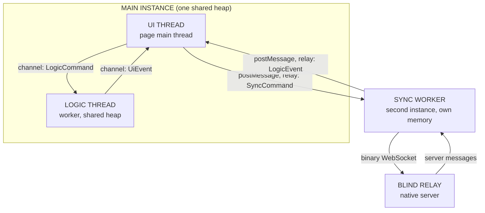

# AMBRE -- FEATURE: THE THREE-THREAD STACK

**Type:** Horizontal (framework)
**Implementation:** partial -- the two instances, the six channels and the crate graph all ship.
The failure path and the tab model are held by construction alone.

> How the client is split, and why. Three execution contexts, two WebAssembly instances, one crate
> graph that carries the separation and one page that boots them.

This document owns the stack. What travels on it is `ambre-spec-message-bus.md`, what may never
leave it is `ambre-spec-zero-knowledge.md`, and what each part costs is `ambre-spec-budgets.md`.

---

## 1. CONTRACT

The only mandatory read. Grammar and status values are normative in `ambre-spec-template.md`. The
prefix is `ARCH`.

### 1.1 The state

| ID | Kind | Statement (RFC 2119) | Sources | Verification | Gap | Status |
|---|---|---|---|---|---|---|
| `ARCH-002` | `INV` | The crate graph MUST stay acyclic. | this spec section 2 | crate-graph -- a cycle between two workspace crates fails to resolve, so the edit that would create one never builds | none | verified |
| `ARCH-004` | `INV` | Every cryptographic operation MUST run in the Sync worker. | README pillar "Zero-Knowledge"; `ambre-spec-zero-knowledge.md`, `ZK-002` | cargo-deny -- `deny.toml` grants `ambre-crypto` to `ambre-sync`, and to `ambre-logic` for one host-only fixture hash, so every other crate fails the CI job | none | verified |
| `ARCH-012` | `INV` | The client MUST build against a shared memory with atomics enabled. | this spec section 2 | target-build -- the flags are scoped to the wasm target in `.cargo/config.toml`, and the threading runtime fails to link without them | none | verified |
| `ARCH-001` | `INV` | The client MUST run as two WebAssembly instances: one holding the UI and Logic threads over a single shared heap, one holding the Sync worker with its own memory. | this spec section 2 | none | unheld -- the page loads two artefacts, and nothing refuses a third or a merge of the two; lands with the `The thread-separation belts` Story (`ambre-roadmap.md` E9) | untested |
| `ARCH-003` | `INV` | The Logic thread MUST NOT declare a dependency on the render runtime or on the interface toolkit. | this spec section 2 | none | unheld -- `ambre-logic` declares neither, and no capability ban refuses the line that would add one; lands with the `The thread-separation belts` Story (`ambre-roadmap.md` E9) | untested |
| `ARCH-005` | `INV` | Every network call MUST leave from the Sync worker. | this spec section 2; `ZK-001` | none | unheld -- the transport crates are declared by `ambre-sync` alone, and the launcher's same-origin reads are the stated exception of `UI-THREAD-004`; lands with the `The thread-separation belts` Story (`ambre-roadmap.md` E9) | untested |
| `ARCH-006` | `INV` | The wire protocol types MUST have one definition, shared by the worker and the relay. | this spec section 2 | none | unheld -- both crates depend on `ambre-protocol` and neither redeclares a type, and nothing refuses a local copy; lands with the `The thread-separation belts` Story (`ambre-roadmap.md` E9) | untested |
| `ARCH-007` | `INV` | The Main thread MUST drain the Logic to Sync channel once per frame, before it draws. | this spec section 2 | none | unheld -- the relay runs in the per-frame hook, ahead of the gate that can freeze the render, and no test drives a frame; lands with the `The thread-separation belts` Story (`ambre-roadmap.md` E9) | untested |
| `ARCH-010` | `INV` | The engine MUST be created once per session. | this spec section 2 | `ambre_app::route::tests::path_doc_roundtrip` -- the parsing the per-frame route poll rests on | partial -- nothing counts the constructions, so a second engine on the same session reads as the first; lands with the `The thread-separation belts` Story (`ambre-roadmap.md` E9) | untested |
| `ARCH-016` | `INV` | The engine MUST survive every route change. | this spec section 2 | `ambre_app::route::tests::cross_kind_open_needs_reload` -- the one route change that is allowed to end it | partial -- nothing holds the lifetime across an ordinary route change; lands with the `The thread-separation belts` Story (`ambre-roadmap.md` E9) | untested |
| `ARCH-011` | `INV` | Each browser tab MUST run a complete client of its own. | this spec section 2 | none | unheld -- two tabs load the same two artefacts twice, and nothing refuses a design that shared one worker between them, which is the shortcut this rule exists to close; lands with the `The thread-separation belts` Story (`ambre-roadmap.md` E9) | untested |
| `ARCH-014` | `INV` | The client MUST NOT rely on a channel disconnection to detect a thread failure. | this spec section 2 | none | unheld -- the panic hook fires before the abort, so the notice does not wait on a channel, and nothing refuses a second detection path that would. A disconnection arrives late, or never, because a wedged thread holds its end open; lands with the `The thread-separation belts` Story (`ambre-roadmap.md` E9) | untested |
| `ARCH-013` | `CONC` | Two tabs on one document MUST converge as two users do. | this spec section 2 | none | unheld -- convergence is covered per application by the two-peer belt, which drives two engines in one process. Nothing drives two tabs, and the two differ in exactly the place that matters: one relay, two sessions, one identity; lands with the `The thread-separation belts` Story (`ambre-roadmap.md` E9) | untested |

### 1.2 A thread fails

Something unrecoverable happens on one of the three. The two rules below are what stands between
that and a page that looks alive and answers nothing.

| ID | Kind | Statement (RFC 2119) | Sources | Verification | Gap | Status |
|---|---|---|---|---|---|---|
| `ARCH-009` | `POST` | A thread that detects an unrecoverable condition MUST emit a fatal event before it exits. | this spec section 2 | none | unheld -- each view latches an inert state when it receives one, and nothing drives the path; lands with the `The thread-separation belts` Story (`ambre-roadmap.md` E9) | untested |
| `ARCH-008` | `POST` | A thread failure MUST reach the user out of band. | this spec section 2 | none | unheld -- the panic hook calls the page's fatal hook before the abort, and the terminal screen on the drawing surface is wired to it, and no test drives either; lands with the `The thread-separation belts` Story (`ambre-roadmap.md` E9) | untested |
| `ARCH-015` | `FRAME` | A failing thread MUST NOT write to the document on its way out. | this spec section 2; derived | none | unheld -- the fatal path emits an event and stops, so a half-applied operation is not flushed today. Nothing holds it, and a thread failing mid-write is the one moment the document can be left in a state no peer will ever converge to; lands with the `The thread-separation belts` Story (`ambre-roadmap.md` E9) | untested |

* **Budget.** the whole of `ambre-spec-budgets.md`: this stack is what every row of that register
  measures. Its own two rows are the channel hop and the worker hop of `section 1`, and neither is
  measured.
* **Boundary.** none of its own: `ARCH-004` and `ARCH-005` are this document's side of `ZK-002` and
  `ZK-001`.
* **Verification.** 3 `verified`, 13 `untested`. What holds is what the build can refuse: a cycle,
  a cryptographic dependency in the wrong crate, a missing atomics flag. Everything else, the
  failure path and the tab model included, is held by the code having been written that way.

---

## 2. MODEL

**CRDT containers.** none. The stack carries documents; it stores none.

**Two instances, three threads.**

| Context | Where it runs | What it owns |
|---|---|---|
| UI thread | the page's own thread | drawing, input, accessibility, the interface, and the relay between Logic and Sync |
| Logic thread | a worker sharing the Main instance's heap | the documents, the engines, the dispatch |
| Sync worker | a second instance, with its own memory | the socket, the requests, the cryptography, the compression |

**Why the split is not uniform.** The UI to Logic link carries scroll and typing, so it keeps shared
memory and moves typed values with no encoding. The Logic to Sync link carries network traffic,
where the network already dominates the latency. So it pays one encode and one copy, and buys the
worker a free event loop for its socket. A worker that shares the Main heap cannot have both: it
must either block its own stack to stay alive, or return and be collected.

**What the page creates at boot**, in order:

1. Six bounded channels, each of capacity 1024. Two run between UI and Logic and two between Logic
   and Sync. One carries document snapshots from Logic to the Main thread for the local store. One
   carries the content event stream on to the active view.
2. The Logic thread, as a worker over the same heap, holding the two receivers and two senders it
   owns.
3. The Sync worker, as a separate artefact loaded through its own loader, so it is an ordinary
   browser worker rather than a thread.
4. The render loop on the Main thread. Each frame, before drawing, it drains the Logic to Sync
   channel and posts each message to the worker. Then it drains the events for the views, drains the
   snapshot channel into the local store, and polls the route.

An embedded child adds one more channel, so its event stream never reaches its parent's view.

**Backpressure.** The Logic thread may block on a full outbound channel, which is the intended
signal. The UI thread never blocks: it drops a lossy message and reports a full channel for a
lossless one. The two classes and what each owes are `ambre-spec-message-bus.md`.

**Failure, in two paths.**

| Path | What happens | What the user gets |
|---|---|---|
| graceful | the thread emits a fatal event, then exits | the view latches an inert state and stops sending |
| a panic | the build aborts rather than unwinding, so no value is dropped and no channel ever reports a disconnection | the panic hook calls the page's fatal hook before the abort, and a terminal screen replaces the content |

The second path is why `ARCH-008` exists. A leaked sender lives in shared memory forever, so the
receiving side reads an empty channel rather than a closed one. A disconnection therefore means a
clean shutdown, and never a crash.

**One tab, one client.** Each tab instantiates the whole stack. Two tabs on one document are two
independent peers that converge through the relay, exactly as two users do.

**The crate graph is the boundary.** There is one binary per instance and no runtime check, so the
separation is carried by what each crate is allowed to declare.

| Crate | Depends on | Why the line is there |
|---|---|---|
| `ambre-core` | nothing of ours | the identifiers and the document kinds, shared by the client and the relay |
| `ambre-protocol` | `ambre-core` | the wire types, defined once (`ARCH-006`). Every payload in them is opaque |
| `ambre-crypto` | nothing of ours | the primitives and the key types, reachable from the Sync worker alone (`ARCH-004`) |
| `ambre-bus` | `ambre-core` | the four envelopes and the typed content plane (`ambre-spec-message-bus.md`) |
| `ambre-draw` | geometry, colour and text layout, plus `ambre-core` | the drawing abstraction, with no graphics and no document dependency |
| `ambre-commands` | `ambre-core` | the command identities, a leaf every application and the toolkit depend on |
| `ambre-canvas` | `ambre-draw` plus the graphics stack | the content runtime of the UI thread. It names no application |
| `ambre-chrome` | the page framework plus `ambre-commands` | the interface toolkit. It names no application either |
| each application crate | `ambre-bus`, `ambre-draw`, `ambre-canvas`, `ambre-chrome`, `ambre-commands` | one crate per application, holding its state, its view and its own interface. It knows neither the Logic runtime nor the worker |
| `ambre-logic` | `ambre-bus` plus the application crates | the Logic runtime, pure Rust with no browser glue (`ARCH-003`) |
| `ambre-sync` | `ambre-bus`, `ambre-protocol`, `ambre-crypto`, the transport crates | the Sync worker, and its own entry point |
| `ambre-app` | everything above except `ambre-sync` | the launcher: it mounts the interface, creates the channels, spawns both workers and relays between them |
| `ambre-server` | `ambre-core`, `ambre-protocol`, and one signature crate | the relay. It links nothing that could read a document (`ZK-004`) |

Two consequences follow and neither is obvious. The launcher sits **downstream** of every
application, which is what lets the closed view registry name an application view without a cycle.
And the transitive graph does reach the graphics stack from the Logic runtime, through an
application crate. The boundary is carried by the **direct** dependencies and by what the runtime
path calls, never by the transitive closure.

**The toolchain.** The wasm target builds against a shared memory with atomics, bulk memory and
mutable globals, which needs a pinned nightly and a rebuilt standard library. The flags are scoped
to that target, so the relay and the host tests are unaffected. The page must be served
cross-origin isolated for the shared memory to exist at all, and the Sync worker inherits that
property from the page.

**Code.** `crates/ambre-app/src/lib.rs` for the boot and the relay, and `crates/ambre-app/src/host/`
for the frame driver and the view registry. Then `crates/ambre-logic/src/lib.rs` for the Logic
runtime, `crates/ambre-sync/src/worker.rs` for the worker entry, `.cargo/config.toml` and
`Trunk.toml` for
the build.

---

## 3. SURFACE

The stack has no control of its own. What a user meets is what it guarantees them.

| Trigger | Behaviour |
|---|---|
| scrolling or typing | the answer comes from a thread that shares memory with the page, so no encoding sits in the path |
| a remote change arriving | it is opened and decompressed in a second instance, in parallel, so the interface never pauses for it |
| navigating from the home screen to a document | the page never reloads: the engine, its keys and its socket survive the move |
| a thread dying | the content is replaced by a terminal screen instead of freezing in place |
| opening the same document in two tabs | both edit, and both converge |

---

## 4. REJECTED ALTERNATIVES

| Decision | Rejected alternative | Why not |
| :--- | :--- | :--- |
| Shared memory to the Logic thread, message passing to the Sync worker | one uniform transport, every link by message passing and no shared memory anywhere | the two links have different budgets. Scroll and typing cannot afford an encode and a copy; network traffic already waits on the network. Pushing the first link onto message passing would pay serialization on the one path where it is the whole budget. |
| The Sync worker is its own instance | a shared-heap worker for the Sync side, with an asynchronous loop inside it | a shared-heap worker runs to completion: an asynchronous loop returns immediately, its handle is dropped and it is collected after the first poll. A worker cannot both block its stack to stay alive and keep an event loop free for a socket. A second instance has an ordinary event loop and no such conflict. |
| The blocking channel path is used across the worker boundary | an asynchronous receive across a worker boundary | the asynchronous waker of the channel crate is scheduled on the sending worker, so it never wakes a consumer parked on another one. The blocking path is backed by atomics and crosses workers correctly, and inside the Sync worker every producer is local anyway. |
| No channel crate of our own | a hand-written queue over atomics, duplicating the channel crate | one was written to work around the freeze above, and the freeze had a different cause. Once the Sync worker moved out, the only shared-memory link left is the one where the existing crate always worked. |
| The launcher owns the frame driver and the closed view registry | the view registry in the content runtime, upstream of the applications | a closed registry naming an application view must sit downstream of every application crate, so putting it upstream is the cycle this resolves. |
| One crate per application, deliberately monolithic | a crate per layer, with an application spread across three of them | the state, the view and the interface of one application share its whole vocabulary, and splitting them by layer is what produced the specification corpus this migration is undoing. |
| The Logic runtime is pure Rust with no browser glue | a Logic runtime that reaches the browser directly for storage or timing | it forfeits the whole engine being testable on the host under an ordinary test run, with no browser and no worker. That is a first-order property of the split, not a side effect. |
| The relay is in the same workspace as the client | a separate workspace for the server | the build flags are scoped by target, so a native member is unaffected, and one workspace gives one formatter, one lint pass and one CI job. |
| A panic aborts | unwinding on panic, and detecting the death through channel disconnection | unwinding across a shared heap with a leaked sender leaves the other threads reading a channel that will never close, so the disconnection the detection waits on never comes. Aborting is honest, and the fatal hook is what makes it visible. |
| One binary per instance, not one per application | a separate build per application | the applications share the render runtime, the interface toolkit and the engine, so splitting them would duplicate the heavy half of the download per application. |
| No dependency-injection framework | a container that resolves the graph at run time | the registry is a map and the wiring is explicit in the launcher: two channels, a closure that builds a view, and a worker handle. |
| No fourth thread for import and export | a fourth thread for conversions | during an import the interface shows a waiting state, and a blocked Logic thread is the intended behaviour. The cost of a long conversion is paid by lazy loading, not by another thread. |

---

## 5. NOT BUILT, AND NOT YET RULED

* **Nothing refuses a third instance, or a merge of the two.** `ARCH-001` describes the shape the
  build happens to have.
* **The failure path has never been driven.** The panic hook, the page hook and the terminal screen
  are each wired, and no test crosses them. The one path a user meets on the worst day is the one
  path nothing exercises.
* **Nothing refuses a transport crate in the wrong place.** `ARCH-005` holds because only the worker
  declares one. The capability bans cover cryptography and the engine, not the network.
* **The relay cadence is unmeasured.** `ARCH-007` states one drain per frame ahead of the draw, and
  the budget rows for both hops read that no measurement exists.
* **Two tabs are never tested together.** `ARCH-011` rests on the convergence belt of each
  application, which drives two peers in one process and not two tabs.
* **The route poll runs every frame and is owned by nothing.** It drives the document open and
  close, and the render gate. It exists because the interface framework requires a subtree that the
  engine handles cannot enter.
* **Three files at the workspace root cite a document the corpus does not have.** The build
  configuration, the workspace manifest and the toolchain file each name a migration note that was
  deleted. No resolver opens a file outside the corpus, the crates and the rules.

---

## 6. WHAT THIS DOCUMENT DOES NOT OWN

| Question | Owner |
|---|---|
| What travels on the channels, and what a full one means | `ambre-spec-message-bus.md` |
| What the relay may learn, and what may never leave sealed | `ambre-spec-zero-knowledge.md` |
| What every part of the stack is budgeted at | `ambre-spec-budgets.md` |
| How a document stays readable by a later binary | `ambre-spec-schema-version.md` |
| What the UI thread may hold, and what it may open | `ambre-spec-ui.md` |
| How the content is drawn, and what a frame costs | `ambre-spec-frame.md` |
| The interface components, and the shell around the surface | `ambre-spec-chrome.md` |
| The home screen, the routes and the sign-in | `ambre-spec-launcher.md` |
| What the Sync worker does once a message arrives | `ambre-spec-sync.md` |
| What the relay stores, and what it refuses | `ambre-spec-server.md` |
| How Ambre is verified, tier by tier and crate by crate | `ambre-spec-testing.md` |
