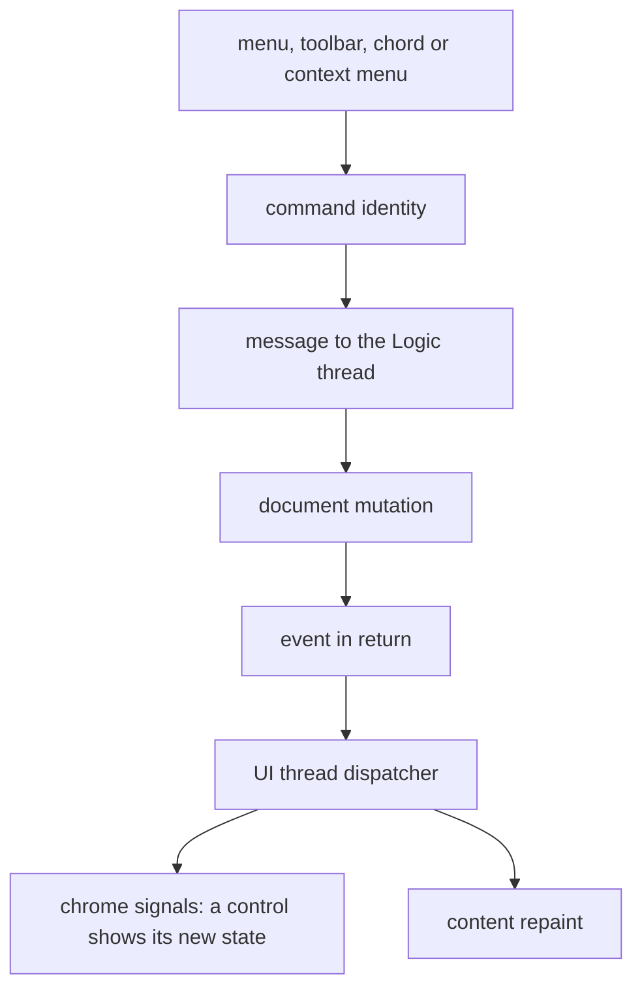

# AMBRE -- FEATURE: THE COMMAND MODEL

**Type:** Horizontal (framework)
**Implementation:** implemented -- the identity, the description every view derives from, the chord
resolution and the state store all ship. Both applications carry the four.

> Everything the user can ask for has one name. A menu entry, a toolbar button, a keyboard chord
> and a context menu are four ways of asking for the same thing. They agree because they name it
> the same way.

The name is a string, and it lives in a crate that depends on nothing. It is what every view, every
chord table and every mapping to the Logic thread agrees on.

---

## 1. CONTRACT

The only mandatory read. Stated in user terms: no container, no type, no function. Grammar and
status values are normative in `ambre-spec-template.md`. The prefix is `UI-THREAD`, shared with
`ambre-spec-ui.md`, `ambre-spec-clipboard.md` and `ambre-spec-design-tokens.md`.

### 1.1 The state

| ID | Kind | Statement (RFC 2119) | Sources | Verification | Gap | Status |
|---|---|---|---|---|---|---|
| `UI-THREAD-011` | `INV` | Copy, cut and paste MUST resolve through shared identities, in every application. | this spec section 2 | `ambre_trame::ui::commands::tests::the_clipboard_intents_carry_the_shared_identity`; `ambre_toile::ui::commands::tests::the_clipboard_intents_carry_the_shared_identity` -- each reads the shared identity off its own application's table; `ambre_commands::tests::the_keymap_binds_no_browser_serviced_chord`; `ambre_trame::ui::commands::tests::the_keymap_binds_no_clipboard_chord` -- the other half, that no chord table decodes them a second time | none | verified |
| `UI-THREAD-035` | `INV` | The legacy copy, cut and paste chords MUST name the same identities as the modern ones. | this spec section 2; section 4, row 5 | `ambre_trame::ui::commands::tests::the_clipboard_intents_carry_the_shared_identity`; `ambre_toile::ui::commands::tests::the_clipboard_intents_carry_the_shared_identity` -- each asserts both chord families of the three intents against the one shared identity, so a legacy chord naming a second command fails | none | verified |
| `UI-THREAD-019` | `INV` | A command MUST carry one description of its label, its icon, its chord and its grouping. | this spec section 2 | `ambre_trame::ui::commands::tests::every_command_has_a_label`; `ambre_toile::ui::commands::tests::every_exposed_identity_is_described` -- each walks its application's table and fails on a command whose label is empty | partial -- the other three quarters of the description are unread. No test asserts that a command carries an icon, a chord or a grouping, so a table entry declaring none passes both; lands with the `The shared document-tool belts` Story (`ambre-roadmap.md` E9) | untested |
| `UI-THREAD-036` | `INV` | Every view of a command MUST take what it shows from that description, and never declare a label of its own. | this spec section 2 | `chrome_ui::the_toolbar_announces_the_registry_labels` -- the DOM belt queries the rendered `aria-label` of eleven identities against the registry title, so a literal written into Trame's format bar fails | partial -- nothing covers any other surface. `ambre_trame::ui::commands::tests::every_layout_row_resolves_in_the_registry` and `ambre_toile::ui::menu_bar::tests::every_dropdown_row_is_described` assert only that a laid-out identity resolves, which a view rendering its own label still satisfies; lands with the `The shared document-tool belts` Story (`ambre-roadmap.md` E9) | untested |
| `UI-THREAD-026` | `INV` | A chord MUST resolve to at most one command. | this spec section 2 | type-level -- the chord table is a map keyed by the chord, so a second command bound to a chord replaces the first rather than joining it, and a table holding two commands on one chord does not exist | none | verified |
| `UI-THREAD-037` | `INV` | Two commands MUST NOT declare the same default chord. | this spec section 2; derived | `ambre_toile::ui::palette::tests::tool_chords_are_distinct` -- the eight tool chords of one application | partial -- seeding keeps the last command seen and reports nothing, so a collision silently drops one from the keyboard, and every other declared table is unread; lands with the `The shared document-tool belts` Story (`ambre-roadmap.md` E9) | untested |
| `UI-THREAD-027` | `INV` | The crate that owns command identity MUST depend on no user-interface framework. | this spec section 2 | crate-graph -- its dependency table is empty, so a framework type has no path into it and the crate builds and tests on the host | none | verified |
| `UI-THREAD-028` | `INV` | One chord table MUST serve every platform: the primary accelerator MUST fold the control and the command modifiers. | this spec section 2 | type-level -- a chord's modifier set carries one accelerator bit and no way to name the control and the command keys apart, so no table can declare one platform's chord; `ambre_commands::keybinding::tests::the_control_key_and_the_command_key_fold_into_one_chord` -- the fold itself, which is the one function that still reads the two bits | none | verified |

### 1.2 Resolve a chord

The user presses a chord. The table answers with a command, or with nothing.

| ID | Kind | Statement (RFC 2119) | Sources | Verification | Gap | Status |
|---|---|---|---|---|---|---|
| `UI-THREAD-038` | `POST` | A chord the table binds MUST resolve to the command it was bound to. | this spec section 2 | `ambre_commands::tests::keymap_resolves_default_bindings` -- it seeds from a command table and asserts the bound chord answers with that command's identity | none | verified |
| `UI-THREAD-039` | `FRAME` | Resolving a chord MUST NOT change the table. | derived | type-level -- the resolve takes the table by shared reference and the map has no interior mutability, so a resolution that binds, rebinds or drops an entry does not compile | none | verified |
| `UI-THREAD-040` | `FAIL` | A chord the table does not bind MUST resolve to no command. | this spec section 3, row 5 | `ambre_commands::tests::keymap_resolves_default_bindings` -- two of its assertions ask for an unbound chord and a bound chord under an extra modifier, and both must answer with nothing | none | verified |

### 1.3 Rebind a chord

The chord table accepts a new binding for a chord that may already carry one.

| ID | Kind | Statement (RFC 2119) | Sources | Verification | Gap | Status |
|---|---|---|---|---|---|---|
| `UI-THREAD-041` | `POST` | A rebinding MUST report the command it displaced. | this spec section 2 | `ambre_commands::tests::rebinding_reports_the_displaced_command` -- its first assertion reads back the displaced identity, which is what a conflict notice would show | none | verified |
| `UI-THREAD-042` | `FRAME` | A rebinding MUST NOT change the command any other chord resolves to. | derived | none | unheld -- the rebinding test reads the rebound chord alone, so an insert reaching a neighbouring entry would pass; lands with the `The shared document-tool belts` Story (`ambre-roadmap.md` E9) | untested |

* **Budget.** none: resolving a chord is one hash lookup and building a menu walks a table of tens
  of entries, neither of which `ambre-spec-budgets.md` budgets. What a command costs once invoked is
  charged to the operation it produces.
* **Boundary.** none: an identity is a string in memory. It reaches no relay, holds no key and
  opens no socket, and the payload it produces is sealed by the thread that sends it
  (`ambre-spec-zero-knowledge.md`).
* **Verification.** 9 `verified`, 4 `untested`, 0 `unimplemented`. The host tier holds every rule
  that is pure data: resolution, refusal, displacement, isolation, the fold and the browser's own
  chords. What is loose is the collision nobody refuses, the frame condition of a rebinding, and the
  description. Its tests walk a label and never an icon, a chord or a grouping.

---

## 2. MODEL

**CRDT containers.** none. A command is an affordance of the interface. What it produces is a
document operation, and that operation is the only thing the document ever sees.

**The two layers, and why they are two.**

| Layer | Crate | Is |
|---|---|---|
| the identity a view names | `ambre-commands` | a user-interface affordance: a stable namespaced string |
| the payload the Logic thread reads | `ambre-bus` | the inter-thread message an invoked command produces |

Invoking a command **produces** a message; it is not one. Folding the two would put the keyboard
and the document schema in one type.

**The shapes.**

```rust
/// Stable namespaced identifier, for example "prose.format.bold".
pub struct CommandId(pub &'static str);

/// The description every view of a command derives from (`UI-THREAD-019`).
pub struct Command {
    pub id: CommandId,
    pub title: fn(&Locale) -> String,
    pub icon: Option<IconId>,
    /// Every chord it answers, the announced one first (`UI-THREAD-011`).
    pub keybindings: &'static [KeyBinding],
    pub category: CommandCategory,
}

/// One accelerator bit, and no way to name the control and the command keys
/// apart: one table serves every platform (`UI-THREAD-028`).
pub struct Modifiers { pub primary: bool, pub alt: bool, pub shift: bool }

/// Runtime state, derived from the application's state on each query and never stored.
pub struct CommandState { pub enabled: bool, pub visible: bool, pub toggled: bool }

/// What an application implements so the chrome lists commands without knowing which
/// application it is.
pub trait CommandSource { type Context; }
```

**What is built.** Each application exposes its commands and a function that fills a shared chord
table; the launcher calls both and names no command itself. Two applications declare 68 identities
between them -- 26 and 42.

**Both applications describe their commands, and every view derives.** A table holds a `Command`
per affordance -- label, icon, default chord, category. Trame's context menu, its format toolbar and
its chord defaults read it. Toile's context menu, menu bar, zoom cluster, tool palette and floating
selection bar read the same table. Nine of Toile's labels had been written twice, once for the menu
bar and once for the right-click menu. Trame's toolbar repeated eleven more.

**A control that backs no command keeps its own words**, having no description to read. Underline,
strikethrough, wrap and the decimal steppers emit a `StylePatch` and name no identity.
`CommandSource` is constructed nowhere: the palette is its first reader.

**The chord.** A chord is a modifier set plus a logical key, normalized so a letter is compared in
one case. The table is a map from chord to identity, seeded from the declared defaults and
rebindable. It reports what a rebinding displaced, so a conflict can be shown to the user
(`UI-THREAD-041`). A chord carries at most one command because the table is keyed by it
(`UI-THREAD-026`), and nothing refuses two commands declaring the same default (`UI-THREAD-037`).

**One accelerator, one table.** The modifier set carries `primary`, and the control key and the
command key both fold into it where a browser event becomes a chord. A table therefore cannot name
one machine's accelerator, and one table serves every platform (`UI-THREAD-028`). A chord is
written "Ctrl+K", which the fold makes true everywhere: a machine whose accelerator is the command
key answers the control key as well.

**A command may answer several chords.** A description carries a list, the announced chord first.
Redo answers `Ctrl+Shift+Z` and `Ctrl+Y`; each clipboard intent answers a modern chord and a legacy
one. The lists the applications share -- undo, redo, cut, copy, paste -- are declared in the
identity crate. The pair is decided once, and no application binds an alias beside its table.

**The clipboard is described here and decoded by the browser.** Cut, copy and paste carry one
identity each, shared by every application and prefixed by none, because the intent belongs to no
application. Their chords are declared so a surface announces them, and the seeding leaves them out
of the table (`UI-THREAD-011`). The browser raises the three events itself, on the modern and the
legacy chords alike (`ambre-spec-text-input.md`, `CHROME-021`).

**One direction only.** A trigger names an identity, the identity produces a message, and the
message mutates the document. The event comes back, and the chrome reads the state the Logic thread
reported. No view sets its own toggle from the click that raised it (`ambre-spec-chrome.md`,
`CHROME-010`).



**Code.**

* `crates/ambre-commands/src/lib.rs` -- the identity, the description, the state, the chord table,
  and `shared`: the clipboard identities and the chord lists every application takes;
* `crates/ambre-commands/src/keybinding.rs` -- the chord, the logical key and the fold;
* `crates/ambre-chrome/src/command.rs` -- the reactive state store and the browser translation;
* `crates/ambre-trame/src/ui/commands.rs` -- Trame's descriptions and its context-menu layouts,
  host-compiled so a test reaches a label without a browser;
* `crates/ambre-trame/src/chrome/commands.rs` -- the menu rows built from them, the chord bindings
  and the inbound event mirrors. `crates/ambre-trame/src/chrome/icons.rs` -- `IconId` to the icon
  asset, which keeps one application's icon set out of the shared crate;
* `crates/ambre-toile/src/ui/commands.rs` -- Toile's descriptions, over the identities that stay
  beside the resolver of each surface (`ui::menu`, `ui::menu_bar`, `ui::palette`, `ui::find`).
  `crates/ambre-toile/src/chrome/icons.rs` -- the same handle-to-asset map as Trame's.

---

## 3. SURFACE

| Trigger | Behaviour |
|---|---|
| a menu entry or a toolbar button | names an identity; the launcher maps it to a message |
| a keyboard chord | translated to a chord, resolved in the table, then the same path |
| a context menu entry | the same path, on the selection under the pointer |
| the command palette | searches every identity the active application declares (`ambre-spec-chrome.md`, `CHROME-008`) |
| a chord that no table binds | nothing happens, and no message is sent |
| a key the model does not name | rejected before it reaches a command (`ambre-spec-chrome.md`, `CHROME-005`) |

A control shows enabled, visible and toggled as the Logic thread reported them. A command that
changes nothing does not refresh them.

---

## 4. REJECTED ALTERNATIVES

| Decision | Rejected alternative | Why not |
| :--- | :--- | :--- |
| The identity is a namespaced string, not an enumeration | one enumeration of every command in the shared crate | it would name every command of every application in a crate that must stay a leaf, and an application could not add a command without touching it. The launcher has to resolve a command without knowing which application declared it |
| The identity crate depends on nothing | putting the identity beside the chrome components that consume it | the crate is depended on by every application and by the chrome toolkit at once, so any dependency it takes is taken by both sides of the interface. An empty dependency table also makes it testable on the host, which is where its tests run today |
| The registry is filled before the next surface is written | filling it after those surfaces, once 68 commands have become several hundred | a label at the view is copied once per view, so every surface still unwritten pays the duplication again: the palette, which can borrow no label from any menu, and the whole Prose toolbar |
| Runtime state is derived on each query, never stored on the description | caching enabled and toggled on the command | a stored state is a second copy of what the document already knows, and the two agree until one path forgets to refresh. Deriving is the same rule `UI-THREAD-003` states for every piece of interface state |
| Copy, cut and paste ride the browser's events | decoding the three chords in the keyboard path beside every other command | the browser raises them with the clipboard attached, and decoding the chords again means guessing when the browser will also act. What the chords must agree on is the identity they name, so the table describes the three intents and the seeding refuses to bind their chords |
| The two accelerator keys fold, they are not mapped per platform | reading the platform at boot and translating each table entry into the local accelerator | a table that names one platform's accelerator is a table per platform, and the second one is written by whoever notices the first is wrong. The price is that a Mac's own control chords reach the same command as its command chords, which costs a text navigation the operating system offers and no application here implements |
| The shared chords live in the identity crate, not in an application | each application declaring the alias beside its own table, which is where the Ctrl+Y alias sat | the pair `Ctrl+Shift+Z` and `Ctrl+Y` is one decision, and an application that declares it a second time is where the two drift apart. The crate that owns what a chord is owns which chords the universal operations answer |
| The title is a function of the locale, on the description | a static label on the description | it makes a command untranslatable, and a title is read by every view |
| The title is a function of the locale, on the description | a translation table in the shared crate | it makes the leaf own the languages, which is exactly the dependency the crate is kept free of. A function keeps the title where every view derives it from without either cost |

---

## 5. NOT BUILT, AND NOT YET RULED

* **A chord is written with the control key, on every platform.** The fold makes the rendering
  true rather than idiomatic: a Mac shows "Ctrl+K" for a chord the command key also answers.
  Writing the platform glyph is a chrome concern, and no surface asks for it.
* **The two declared tables have no common namespace rule.** The identities read
  `trame.<area>.<verb>` and `toile.<area>.<verb>` by habit, the three shared clipboard identities
  read `clipboard.<verb>`, and nothing refuses a fourth shape.
* **Nothing rules on which operations are shared beyond the clipboard.** Undo and redo share their
  chords and keep an identity per application, which is the state the two surfaces need today. No
  document says where that line is.
* **Nothing supplies the active language.** A description carries `title: fn(&Locale) -> String`,
  and the argument is the reader's own, ruled out of the document by `ambre-spec-locale.md`,
  `LOCALE-003`. Where the client reads it from is still unwritten. Trame's table answers both
  variants with the English label it shows today, so the function is a shape with one language
  behind it.
* **Nothing rules on a user rebinding.** The table accepts one and reports the displacement. No
  document says where a rebinding is stored, whether it survives a reload, or how a conflict is
  shown.
* **A command declared by no menu is unreachable.** The palette lists what the application
  declares, so an identity in the list with no entry anywhere is reachable. An identity that is in
  neither is invisible, and nothing detects it.
* **Nothing rules on a chord while an edit session is open.** The inline editor consumes keys and
  the chord path also sees them, and which one wins is decided per application.

---

## 6. WHAT THIS DOCUMENT DOES NOT OWN

| Question | Owner |
|---|---|
| The components a command is shown in: the menu, the toolbar, the palette, the context menu | `ambre-spec-chrome.md` |
| How a browser key event becomes a modelled key at all | `ambre-spec-chrome.md`, `CHROME-005` |
| Why a control never sets its own toggle | `ambre-spec-chrome.md`, `CHROME-010` |
| The keyboard path a text editor consumes before any chord | `ambre-spec-text-input.md` |
| The message an invoked command produces, and its transport | `ambre-spec-architecture.md section 2` |
| What copy, cut and paste actually carry | `ambre-spec-clipboard.md` |
| Which language a document's content is formatted in | `ambre-spec-locale.md` |
| The commands each application declares | each application's feature documents |
