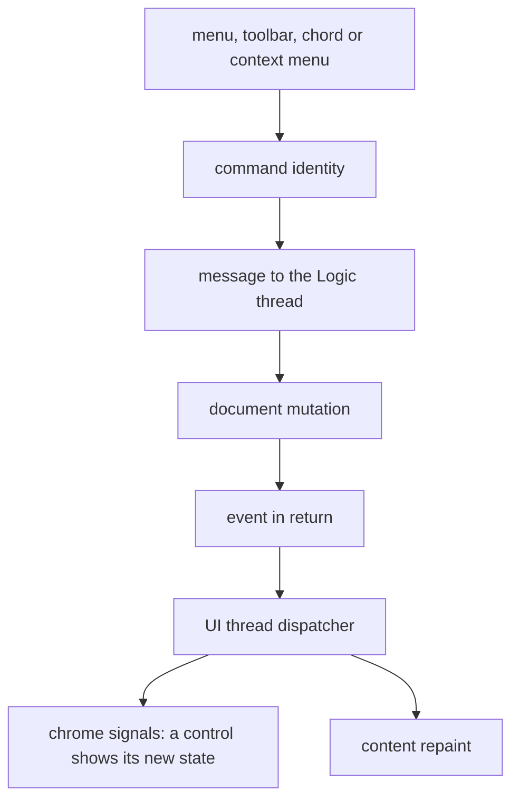

# AMBRE -- FEATURE: THE COMMAND MODEL

**Type:** Horizontal (framework)
**Implementation:** partial -- the identity, the chord resolution and the state store ship; the
description a menu, a palette and a keyboard would all read does not.

> Everything the user can ask for has one name. A menu entry, a toolbar button, a keyboard chord
> and a context menu are four ways of asking for the same thing, and they agree because they name
> it the same way.

The name is a string, it lives in a crate that depends on nothing, and it is what every view, every
chord table and every mapping to the Logic thread agrees on.

---

## 1. CONTRACT

The only mandatory read. Stated in user terms: no container, no type, no function. Grammar and
status values are normative in `ambre-spec-template.md`. The prefix is `UI-THREAD`, shared with
`ambre-spec-ui.md`, `ambre-spec-clipboard.md` and `ambre-spec-design-tokens.md`.

| ID | Statement (RFC 2119) | Sources | Verification | Status |
|---|---|---|---|---|
| `UI-THREAD-011` | Copy, cut and paste MUST resolve through shared identities, on the modern and the legacy chords alike, in every application. | this spec section 2 | not built -- lands with `One keymap` (`ambre-roadmap.md` E8). The three intents ride the browser's own events today and no chord table names them, so the legacy set reaches whatever the browser decides to raise | unimplemented |
| `UI-THREAD-019` | A command MUST be described once -- its label, its icon, its chord, its grouping -- and every view of it MUST be derived from that description; a view MUST NOT declare one of its own. | this spec section 2 | not built -- lands with `One command registry` (`ambre-roadmap.md` E8). A label belongs to the menu entry that shows it, so a command in two menus has two labels and a command in no menu has none | unimplemented |
| `UI-THREAD-026` | A chord MUST resolve to at most one command, and a rebinding MUST report the command it displaced. | this spec section 2 | `ambre_commands::tests::keymap_resolves_default_bindings`, `::rebinding_reports_the_displaced_command`; `ambre_toile::ui::palette::tests::tool_chords_are_distinct` drives a real application's table and fails on a collision | verified |
| `UI-THREAD-027` | The crate that owns command identity MUST depend on no user-interface framework. | this spec section 2 | type-level: its dependency table is empty, so a framework type has no path into it and the crate builds and tests on the host | verified |
| `UI-THREAD-028` | One chord table MUST serve every platform: the primary accelerator MUST fold the control and the command modifiers. | this spec section 2 | none, and **the rule fails today**: the browser event is translated with the two modifiers kept apart, and every table in the suite declares the control one, so no chord resolves on a machine whose accelerator is the command key -- section 5 | unverified |

* **Budget.** none: resolving a chord is one hash lookup and building a menu is a walk over a table
  of tens of entries, and `ambre-spec-budgets.md` budgets neither. What a command
  costs once it is invoked is charged to the operation it produces.
* **Boundary.** none: an identity is a string in memory. It reaches no relay, holds no key and
  opens no socket, and the payload it produces is sealed by the thread that sends it
  (`ambre-spec-zero-knowledge.md`).
* **Verification.** 2 `verified`, 1 `unverified`, 2 `unimplemented`. What is held is the part that
  is pure data: the resolution, the collision report and the crate's isolation, all on the host
  tier. What is loose is the one place the model meets the browser, and it is the place it is
  wrong.

---

## 2. MODEL

**CRDT containers.** none. A command is an affordance of the interface; what it produces is a
document operation, and that operation is the only thing the document ever sees.

**The two layers, and why they are two.**

| Layer | Crate | Is |
|---|---|---|
| the identity a view names | `ambre-commands` | a user-interface affordance: a stable namespaced string |
| the payload the Logic thread reads | `ambre-bus` | the inter-thread message an invoked command produces |

Invoking a command **produces** a message; it is not one. Folding the two would put the keyboard
and the document schema in one type.

**The shapes.**

```rust
/// Stable namespaced identifier, for example "prose.format.bold".
pub struct CommandId(pub &'static str);

/// The description every view of a command derives from (`UI-THREAD-019`).
pub struct Command {
    pub id: CommandId,
    pub title: fn(&Locale) -> String,
    pub icon: Option<IconId>,
    pub default_keybinding: Option<KeyBinding>,
    pub category: CommandCategory,
}

/// Runtime state, derived from the application's state on each query and never stored.
pub struct CommandState { pub enabled: bool, pub visible: bool, pub toggled: bool }

/// What an application implements so the chrome lists commands without knowing which
/// application it is.
pub trait CommandSource { type Context; }
```

**What is built.** Each application exposes a list of identities and a function that fills a shared
chord table; the launcher calls both and names no command itself. Two applications declare 68
identities between them -- 26 and 42. Today a label and an icon sit at the view: a menu entry pairs
an identity with the words it shows.

**The description is the target state.** Nothing constructs `Command` or `CommandSource` outside
their own tests. A label at the view lives in as many places as the command has views, nothing finds
a command no menu shows, and every surface still to be written pays that duplication again
(`UI-THREAD-019`).

**The chord.** A chord is a modifier set plus a logical key, normalized so a letter is compared in
one case. The table is a map from chord to identity, seeded from the declared defaults and
rebindable, and it reports what a rebinding displaced so a conflict can be shown to the user
(`UI-THREAD-026`).

**One direction only.** A trigger names an identity, the identity produces a message, the message
mutates the document, the event comes back, and the chrome reads the state the Logic thread
reported. No view sets its own toggle from the click that raised it (`ambre-spec-chrome.md`,
`CHROME-010`).



**Code.**

* `crates/ambre-commands/src/lib.rs` -- the identity, the description, the state, the chord table;
* `crates/ambre-commands/src/keybinding.rs` -- the chord and the logical key;
* `crates/ambre-chrome/src/command.rs` -- the reactive state store and the browser translation;
* `crates/ambre-trame/src/chrome/commands.rs`, `crates/ambre-toile/src/ui/menu.rs` -- the two
  declared tables and their chord bindings.

---

## 3. SURFACE

| Trigger | Behaviour |
|---|---|
| a menu entry or a toolbar button | names an identity; the launcher maps it to a message |
| a keyboard chord | translated to a chord, resolved in the table, then the same path |
| a context menu entry | the same path, on the selection under the pointer |
| the command palette | searches every identity the active application declares (`ambre-spec-chrome.md`, `CHROME-008`) |
| a chord that no table binds | nothing happens, and no message is sent |
| a key the model does not name | rejected before it reaches a command (`ambre-spec-chrome.md`, `CHROME-005`) |

A control shows enabled, visible and toggled as the Logic thread reported them. A command that
changes nothing does not refresh them.

---

## 4. DECISIONS

| Decision | Rationale | Rejected alternative |
|---|---|---|
| The identity is a namespaced string, not an enumeration | the launcher must resolve a command without knowing which application declared it, and a closed enumeration in a shared crate would name every command of every application. A string keeps the crate a leaf and lets an application add a command without touching it | one enumeration of every command in the shared crate |
| The identity crate depends on nothing | it is depended on by every application and by the chrome toolkit at once, so any dependency it takes is taken by both sides of the interface. An empty dependency table also makes it testable on the host, which is where its tests run today | putting the identity beside the chrome components that consume it |
| The registry is filled before the next surface is written | a label at the view is copied once per view, so every surface still unwritten pays the duplication again: the palette, which can borrow no label from any menu, and the whole Prose toolbar. `One command registry` carries it at the MVP milestone | filling it after those surfaces, once 68 commands have become several hundred |
| Runtime state is derived on each query, never stored on the description | a stored state is a second copy of what the document already knows, and the two agree until one path forgets to refresh. Deriving is the same rule `UI-THREAD-003` states for every piece of interface state | caching enabled and toggled on the command |
| Copy, cut and paste ride the browser's events | the browser raises them with the clipboard attached, and decoding the chords again means guessing when the browser will also act. What the chords must agree on is the identity they name, which is why the rule stands as an unbuilt row rather than as a second decoder | decoding the three chords in the keyboard path beside every other command |
| The title is a function of the locale, on the description | a translation table in the identity crate makes the leaf own the languages, and a string constant makes a command untranslatable. A function keeps the crate free of both, and keeps the title where every view derives it from | a static label on the description, or a translation table in the shared crate |

---

## 5. NOT BUILT, AND NOT YET RULED

* **No chord resolves on a machine whose accelerator is the command key.** The browser event is
  translated with the control and command modifiers kept apart, deliberately, so the chrome can map
  either one; nothing maps them. Every table in the suite declares the control modifier, so the
  command modifier resolves to nothing (`UI-THREAD-028`, and the `One keymap` Story).
* **Nothing reads a chord table back at the application level.** Trame binds both redo chords and
  no test asserts it (`2-Trame/features/ambre-spec-trame-undo.md`, `TRAME-121`). Toile's tool
  chords are the one table a test drives.
* **The two declared tables have no common namespace rule.** The identities read
  `trame.<area>.<verb>` and `toile.<area>.<verb>` by habit, and nothing refuses a third shape.
* **Nothing rules on a user rebinding.** The table accepts one and reports the displacement, and no
  document says where a rebinding is stored, whether it survives a reload, or how a conflict is
  shown.
* **A command declared by no menu is unreachable.** The palette lists what the application
  declares, so an identity in the list with no entry anywhere is reachable; an identity that is in
  neither is invisible, and nothing detects it.
* **Nothing rules on a chord while an edit session is open.** The inline editor consumes keys and
  the chord path also sees them, and which one wins is decided per application.

---

## 6. WHAT THIS DOCUMENT DOES NOT OWN

| Question | Owner |
|---|---|
| The components a command is shown in: the menu, the toolbar, the palette, the context menu | `ambre-spec-chrome.md` |
| How a browser key event becomes a modelled key at all | `ambre-spec-chrome.md`, `CHROME-005` |
| Why a control never sets its own toggle | `ambre-spec-chrome.md`, `CHROME-010` |
| The keyboard path a text editor consumes before any chord | `ambre-spec-text-input.md` |
| The message an invoked command produces, and its transport | `ambre-spec-architecture.md section 2` |
| What copy, cut and paste actually carry | `ambre-spec-clipboard.md` |
| The commands each application declares | each application's feature documents |
