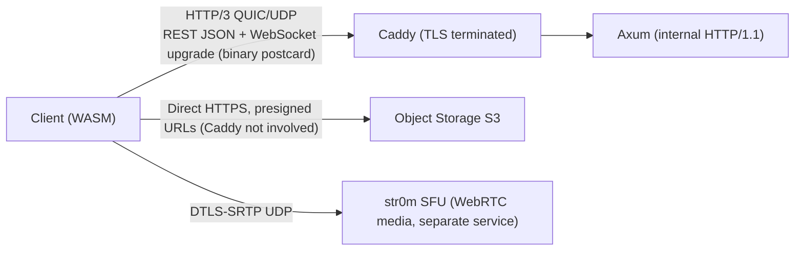
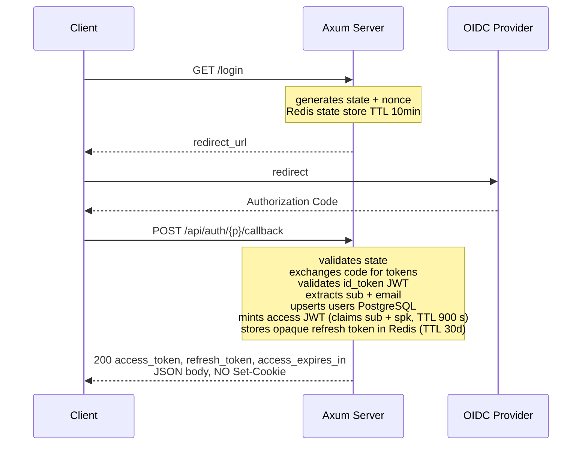
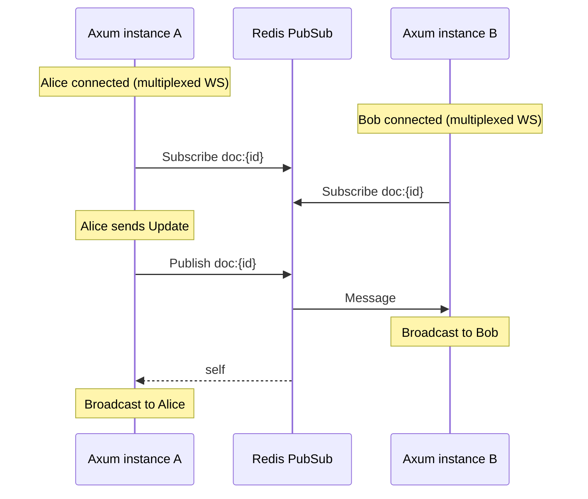

# AMBRE -- SPEC: Server (Blind Relay)
**Type:** Horizontal (Layer/Engine)
**Status:** Draft
**Implementation:** partial

> The AMBRE server is a **Blind Relay**: it routes, sequences, and persists encrypted blobs without ever accessing plaintext content. It exposes a REST API + WebSocket via Axum (Tokio), serialized in Postcard (binary) for real-time messages. It makes no business decisions on content -- only metadata, ACLs, and sequencing are visible to it.

---

## 1. OBJECTIVES & CONSTRAINTS

**Scope:** The server exclusively handles:
- OIDC authentication and session management
- Metadata storage and retrieval (PostgreSQL)
- The ephemeral and real-time layer (Redis/Valkey)
- Routing and sequencing of encrypted blobs to/from Object Storage (S3)
- Generation of presigned URLs for direct client -> S3 access
- WebRTC signaling relay (meetings)
- Inter-client WebSocket broadcast via Redis PubSub

It does **not** handle:
- Content encryption/decryption (Sync WASM thread domain)
- CRDT logic (Logic WASM thread domain)
- Cryptographic key management in plaintext (never transmitted to the server)
- Content compression (opaque -- version byte in ciphertext)

**Dependencies:**

| Crate | Rationale |
|---|---|
| `axum` | Mature async HTTP framework, native Tokio integration |
| `tokio` | Async runtime |
| `sqlx` | Compile-time verified SQL queries, native async |
| `rustis` | Multiplexed async Redis client (RESP3, Clone-able `Client` without pool) |
| `aws-sdk-s3` | Official S3 SDK for presigned URLs |
| `openidconnect` | OIDC Rust client, PKCE flows |
| `ed25519-dalek` | Ed25519 signature verification on updates -- **server's only crypto operation** |
| `postcard` | Compact binary serialization for WebSocket messages |
| `serde` / `serde_json` | REST serialization (JSON) |
| `uuid` | UUIDv7 for identifiers |
| `tracing` + `tracing-subscriber` | Structured logging, Loki export via Promtail |
| `thiserror` | Typed errors mapped to HTTP |
| `tower` + `tower-http` | Middlewares (CORS, compression, timeout, rate limiting) |
| `axum-extra` | Typed headers (`Authorization: Bearer`) |
| `jsonwebtoken` | OIDC id_token validation **and** our own access-token mint/verify (EdDSA) |

> **`ambre-crypto` intentionally absent.** The server only needs to verify Ed25519 signatures -- direct `ed25519-dalek` suffices. Importing `ambre-crypto` would expose `DocumentKey`, `MasterSeed` in the server process without any legitimate need (violation of the least privilege principle).

> **Wire types imported from `ambre-protocol`.** `ambre-server` imports `WsClientMsg`, `WsServerMsg`, `UpdatePublicData`, `EphemeralPublicData` from `ambre-protocol` -- no local redefinition.

**Invariants:** grammar and status values in `ambre-spec-architecture.md section 4`; the boundary-level rules these refine are `ZK-001..ZK-008` in `ambre-spec-architecture.md section 3`.

| ID | Statement (RFC 2119) | Sources | Verification | Status |
|---|---|---|---|---|
| `SRV-001` | The server MUST NOT store or log plaintext document content. | `ZK-001`, `ZK-006`; section 3 Boundary Audit | none beyond `ZK-006`: reviewer attention plus the explicit "never log the blob" rule in `s3.rs` | human-review |
| `SRV-002` | An S3 presigned URL MUST NOT be issued before the PostgreSQL ACL check for the requesting user. | `ZK-008`; section 3 | role refusals are covered (`ambre_server::routes::tests::media_confirm_upload_denied_to_viewer`, `::rotate_key_denied_to_editor`); **no test asserts a non-member is refused a URL** | unverified |
| `SRV-003` | Every authenticated route MUST validate the access JWT (EdDSA signature + expiry) before touching PostgreSQL. | section 1 | `ambre_server::jwt::tests::expired_token_is_rejected`, `::wrong_key_is_rejected`, `::mint_then_verify_roundtrips`; `routes::tests::unauth_endpoints_return_401` | verified |
| `SRV-004` | A snapshot MUST be reachable only through the document it belongs to. | audit `C4` | `ambre_server::s3::tests::snapshot_key_validation_scopes_to_document`; `db::content::get_snapshot` filters on `id AND document_id` | verified |
| `SRV-005` | A non-member MUST receive no document metadata -- not even `owner_id` or `doc_type`. | audit `H2`; section 3 Boundary Audit | `ambre_server::routes::tests::get_document_hidden_from_non_member` | verified |
| `SRV-006` | Per `(document, client)` the `clock` MUST increase strictly, validated and assigned atomically in a single Redis round trip. | section 1, section 2.A | `ambre_server::redis_ops::lua_tests::sequential_clock_succeeds`, `::duplicate_clock_rejected`, `::clock_mismatch_rejected`, `::independent_clients_have_independent_clocks`, `::lua_script_contains_key_validation` -- **db tier, and behind `--features test-helpers`**: until `just test-db` carried that feature these five compiled in no CI job at all (`ambre-spec-testing.md section 7`) | verified |
| `SRV-007` | Every update, snapshot and ephemeral frame MUST carry a valid Ed25519 signature by the key in the token's `spk` claim; an unsigned or forged frame MUST have no side effect. | section 1, section 3 | `ambre_server::ws::handler::message::tests::invalid_signature_is_rejected`, `::unsigned_ephemeral_is_rejected`, `::forged_author_key_writes_no_presence`, `::tampered_ciphertext_rejects_signature`; `routes::tests::create_snapshot_rejects_forged_author` | verified |
| `SRV-008` | A `viewer` MUST produce no write, and a non-owner MUST NOT rotate a document key. | section 2.B | `ambre_server::ws::handler::message::tests::viewer_role_delta_writes_no_pending`; `routes::tests::media_confirm_upload_denied_to_viewer`, `::rotate_key_denied_to_editor` | verified |
| `SRV-009` | A refresh token MUST be consumable exactly once, including under concurrent use. | section 3 Token Model | `ambre_server::redis_ops::redis_integration_tests::refresh_consume_rejects_a_replayed_token`, `::only_one_racing_caller_claims_a_refresh_token` (db tier) | verified |
| `SRV-010` | An oversized frame MUST be rejected without partial side effects. | section 6 Error Handling | `ambre_server::ws::handler::message::tests::oversized_delta_writes_no_pending`, `::oversized_ephemeral_writes_no_presence` | verified |
| `SRV-011` | An organization or a document MUST NOT be left without an owner. | section 2.B | `ambre_server::routes::orgs::tests::owner_cannot_demote_last_owner`, `::owner_cannot_remove_last_owner`; `routes::tests::owner_can_leave_when_another_owner_remains` | verified |
| `SRV-012` | The server MUST perform no cryptographic operation beyond Ed25519 verification and minting its own access tokens. | section 1 dependency note (least privilege) | `deny.toml` capability bans + CI job `deny` (see `ZK-004`); `ambre-server` no longer links AEAD, X25519 or Shamir | verified |
| `SRV-013` | The rate limiter MUST fail closed on the auth tier. | section 3 Network Security; audit `M6` | `ambre_server::middleware::rate_limit::tests::only_auth_tier_fails_closed` | verified |
| `SRV-014` | Application code MUST contain no `unsafe`. | pillar "Security" | measured zero `unsafe` workspace-wide, but `ambre-server` carries no `#![forbid(unsafe_code)]` | unverified |

---

## 2. TECHNICAL DESIGN & STATE

### A. Data Modeling

#### PostgreSQL Schema

```sql
-- Users (OIDC profile + public crypto keys)
CREATE TABLE users (
    id              UUID PRIMARY KEY DEFAULT gen_random_uuid(),
    oidc_provider   TEXT NOT NULL,
    oidc_subject    TEXT NOT NULL,
    email           TEXT NOT NULL,
    display_name    TEXT NOT NULL,
    master_key_enc  BYTEA NOT NULL,          -- Master Seed encrypted by User Key (Argon2 client-side, Sync thread)
    master_key_salt BYTEA NOT NULL,          -- Argon2 salt to derive User Key client-side (Sync thread)
    signing_pubkey  BYTEA NOT NULL,          -- Ed25519 public key (signature verification)
    exchange_pubkey BYTEA NOT NULL,          -- X25519 public key (doc_key_enc encryption)
    recovery_hint   TEXT,                    -- first chars of Recovery Key (non-secret)
    org_id          UUID REFERENCES organizations(id),
    org_master_key_enc BYTEA,               -- Master Seed encrypted with Org Public Key (escrow)
    created_at      TIMESTAMPTZ NOT NULL DEFAULT now(),
    updated_at      TIMESTAMPTZ NOT NULL DEFAULT now(),
    UNIQUE (oidc_provider, oidc_subject)
);

-- Organizations (enterprise feature)
CREATE TABLE organizations (
    id               UUID PRIMARY KEY DEFAULT gen_random_uuid(),
    name             TEXT NOT NULL,
    org_pubkey       BYTEA NOT NULL,          -- X25519 organization public key
    shamir_threshold SMALLINT NOT NULL DEFAULT 3,
    shamir_total     SMALLINT NOT NULL DEFAULT 5,
    created_at       TIMESTAMPTZ NOT NULL DEFAULT now()
);

CREATE TABLE organization_members (
    org_id           UUID NOT NULL REFERENCES organizations(id) ON DELETE CASCADE,
    user_id          UUID NOT NULL REFERENCES users(id) ON DELETE CASCADE,
    role             TEXT NOT NULL CHECK (role IN ('owner', 'admin', 'member')),
    shamir_share_enc BYTEA,
    created_at       TIMESTAMPTZ NOT NULL DEFAULT now(),
    PRIMARY KEY (org_id, user_id)
);

CREATE TABLE org_recovery_log (
    id             UUID PRIMARY KEY DEFAULT gen_random_uuid(),
    org_id         UUID NOT NULL REFERENCES organizations(id),
    target_user_id UUID NOT NULL REFERENCES users(id),
    recovered_by   UUID NOT NULL REFERENCES users(id),
    reason         TEXT,
    created_at     TIMESTAMPTZ NOT NULL DEFAULT now()
);

-- Documents (metadata only -- content in S3)
-- doc_type: canonical French names, aligned with DocType enum in ambre-core
CREATE TABLE documents (
    id         UUID PRIMARY KEY DEFAULT gen_random_uuid(),
    owner_id   UUID NOT NULL REFERENCES users(id),
    doc_type   TEXT NOT NULL CHECK (doc_type IN ('prose', 'trame', 'toile', 'murmure')),
    name_enc   BYTEA,                        -- E2EE encrypted name (ciphertext under the Document Key; opaque to the server)
                                             -- GET /documents returns name_enc TOGETHER WITH the caller's doc_key_enc
                                             -- (from document_members) so the client decrypts the title without opening
                                             -- the document. Source of DocumentSummary.name. See ambre-spec-architecture.md section 3.
    created_at TIMESTAMPTZ NOT NULL DEFAULT now(),
    updated_at TIMESTAMPTZ NOT NULL DEFAULT now()
);

-- Document ACLs
CREATE TABLE document_members (
    document_id UUID NOT NULL REFERENCES documents(id) ON DELETE CASCADE,
    user_id     UUID NOT NULL REFERENCES users(id) ON DELETE CASCADE,
    role        TEXT NOT NULL CHECK (role IN ('owner', 'editor', 'viewer')),
    doc_key_enc BYTEA NOT NULL,              -- Document Key, static-ECDH-wrapped FOR member's X25519 pubkey BY invited_by's key
    invited_by  UUID REFERENCES users(id),   -- the wrapper of doc_key_enc (inviter, self at creation, or rotator after rotation);
                                             -- recipient unwraps via ECDH against THIS user's exchange key, not its own
    created_at  TIMESTAMPTZ NOT NULL DEFAULT now(),
    PRIMARY KEY (document_id, user_id)
);

-- Snapshot index (blobs in S3)
CREATE TABLE snapshots (
    id                   UUID PRIMARY KEY DEFAULT gen_random_uuid(),
    document_id          UUID NOT NULL REFERENCES documents(id) ON DELETE CASCADE,
    author_pubkey        BYTEA NOT NULL,
    parent_hash          BYTEA,              -- BLAKE2b hash of parent snapshot
    parent_snapshot_proof BYTEA,            -- Full BLAKE2b chain (from ambre-protocol)
    update_clocks        JSONB NOT NULL,     -- {"pub_key_hex": clock, ...}
    s3_key               TEXT NOT NULL,
    covered_seq          BIGINT NOT NULL DEFAULT 0, -- highest delta seq folded in;
                                                    -- clients gate RequestMissing on it
    created_at           TIMESTAMPTZ NOT NULL DEFAULT now()
);

-- Delta index (blobs in S3)
CREATE TABLE updates (
    id          UUID PRIMARY KEY DEFAULT gen_random_uuid(),
    document_id UUID NOT NULL REFERENCES documents(id) ON DELETE CASCADE,
    author_pubkey BYTEA NOT NULL,
    snapshot_id UUID NOT NULL,      -- opaque client-side base tag; NO FK to
                                    -- snapshots(id): the server never dereferences
                                    -- it, and a document's first deltas reference a
                                    -- base snapshot the client invents and never
                                    -- uploads (see migration drop_updates_snapshot_fk)
    clock       BIGINT NOT NULL,
    seq         BIGINT NOT NULL,
    s3_key      TEXT NOT NULL,
    created_at  TIMESTAMPTZ NOT NULL DEFAULT now(),
    UNIQUE (document_id, author_pubkey, clock)
);
CREATE INDEX idx_updates_delta_sync ON updates (document_id, seq);

-- Media (content-addressable)
CREATE TABLE media (
    id          TEXT PRIMARY KEY,            -- BLAKE2b-256 hex of content
    document_id UUID NOT NULL REFERENCES documents(id) ON DELETE CASCADE,
    uploaded_by UUID NOT NULL REFERENCES users(id),
    mime_type   TEXT NOT NULL,
    size_bytes  BIGINT NOT NULL,
    s3_key      TEXT NOT NULL,
    created_at  TIMESTAMPTZ NOT NULL DEFAULT now()
);

-- Channels (Murmure messaging)
CREATE TABLE channels (
    id         UUID PRIMARY KEY DEFAULT gen_random_uuid(),
    owner_id   UUID NOT NULL REFERENCES users(id),
    name_enc   BYTEA,
    created_at TIMESTAMPTZ NOT NULL DEFAULT now()
);

CREATE TABLE channel_members (
    channel_id      UUID NOT NULL REFERENCES channels(id) ON DELETE CASCADE,
    user_id         UUID NOT NULL REFERENCES users(id) ON DELETE CASCADE,
    role            TEXT NOT NULL CHECK (role IN ('owner', 'admin', 'member')),
    channel_key_enc BYTEA NOT NULL,
    joined_at       TIMESTAMPTZ NOT NULL DEFAULT now(),
    PRIMARY KEY (channel_id, user_id)
);

-- "Last read message" cursors (navigation metadata -- unencrypted)
CREATE TABLE channel_read_cursors (
    user_id    UUID NOT NULL REFERENCES users(id) ON DELETE CASCADE,
    channel_id UUID NOT NULL REFERENCES channels(id) ON DELETE CASCADE,
    last_seq   BIGINT NOT NULL DEFAULT 0,
    updated_at TIMESTAMPTZ NOT NULL DEFAULT now(),
    PRIMARY KEY (user_id, channel_id)
);

-- Meetings (ephemeral -- state in Redis, minimal Postgres archiving)
-- MVP: name in plaintext (meetings are ephemeral, not a critical secret)
-- Post-MVP: ephemeral MeetingKey to encrypt the name
CREATE TABLE meetings (
    id         UUID PRIMARY KEY DEFAULT gen_random_uuid(),
    creator_id UUID NOT NULL REFERENCES users(id),
    name       TEXT,                             -- MVP: plaintext. Post-MVP: name_enc BYTEA + MeetingKey
    status     TEXT NOT NULL DEFAULT 'active' CHECK (status IN ('active', 'ended')),
    created_at TIMESTAMPTZ NOT NULL DEFAULT now(),
    ended_at   TIMESTAMPTZ
);
```

#### Redis/Valkey Structure

```text
# Auth: stateless access JWT (EdDSA / Ed25519) -- NO server-side session record.
# The access token carries claims { sub: user_id, spk: signing_pubkey_hex, iat, exp }
# (TTL 900 s). The WS update hot path reads signing_pubkey from the verified token
# claim (spk) -- no Redis/PostgreSQL lookup per update.
#
# Refresh tokens: opaque (UUIDv4), revocable, rotated on each use (TTL 30d).
refresh:{refresh_token}        -> HASH { user_id, signing_pubkey_hex }

# Global per-document sequence (SecSync seq)
doc:{doc_id}:seq               -> STRING (monotonic INCR)

# Per-client per-document clocks (SecSync clock)
doc:{doc_id}:clocks            -> HASH { pub_key_hex: clock_value }

# Delta buffer before S3 flush (drained by the global flusher)
doc:{doc_id}:pending           -> LIST of serialized blobs { seq, s3_key, ciphertext_size }

# Compaction lock (SET NX, TTL 30 s)
doc:{doc_id}:compact_lock      -> STRING

# Messaging segment seal lock
channel:{channel_id}:seal      -> STRING (SET NX, TTL 30 s)

# Global per-channel sequence (SecSync seq -- same pattern as documents)
channel:{channel_id}:seq       -> STRING (monotonic INCR)

# Per-client per-channel clocks
channel:{channel_id}:clocks    -> HASH { pub_key_hex: clock_value }

# Channel delta buffer before S3 flush
channel:{channel_id}:pending   -> LIST of serialized blobs { seq, s3_key, ciphertext_size }

# Per-channel presence (encrypted blobs, same pattern as documents)
channel:{channel_id}:presence  -> HASH { pub_key_hex: presence_enc_b64 }

# Active WebSocket sessions per channel
# Populated at SubscribeChannel, cleaned at UnsubscribeChannel or multiplexed WS disconnect
channel:{channel_id}:sessions  -> HASH { connection_id: "1" }

# Document broadcast PubSub
channel doc:{doc_id}           -> PUB/SUB (postcard-serialized WsServerMsg)

# Channel broadcast PubSub (same pattern as documents)
channel chan:{channel_id}      -> PUB/SUB (postcard-serialized WsServerMsg)

# Per-user broadcast PubSub (server-initiated pushes not tied to an open doc)
# Every WS connection subscribes to its own user:{user_id} channel for the whole
# session. Used for events the recipient cannot yet be a doc-subscriber of --
# for example WsServerMsg::DocumentShared on a fresh invite (the invitee does not know
# the document_id yet, so doc:{doc_id} could not reach them).
channel user:{user_id}         -> PUB/SUB (postcard-serialized WsServerMsg)

# Per-document presence
# IMPORTANT: presence data (cursor, selection) are encrypted blobs
# sent by the client in WsClientMsg::Ephemeral. The server stores the opaque blob.
# It never sees the cursor or the name in plaintext.
doc:{doc_id}:presence          -> HASH { pub_key_hex: presence_enc_b64 }
                                  presence_enc = ciphertext of the Ephemeral payload
                                  MVP: periodic sweep (last_seen > 15 s via auxiliary field)
                                  Valkey 8+: HEXPIRE 15 s per field

# (removed) doc:{doc_id}:sessions -- a per-document connection registry was
# specced but never consumed: live delivery runs entirely through the doc:{doc_id}
# PubSub channel + the in-process PubSubHub, which never reads such a hash. It was
# dropped to save two hot-path Redis writes per (un)subscribe. If targeted routing
# is ever needed (for example force-disconnect on revoke), reintroduce it WITH a TTL.

# Reverse lookup user -> open documents
user:{user_id}:open_docs       -> SET { doc_id_1, doc_id_2 }

# Active meeting participants (non-sensitive metadata: joined_at, audio, video, screen)
meeting:{meeting_id}:participants -> HASH { user_id: JSON{joined_at, audio, video, screen} }

# Meeting signaling PubSub
channel meeting:{meeting_id}   -> PUB/SUB
```

> **Presence and Zero-Knowledge:** The value stored in `doc:{doc_id}:presence` is the opaque `Ephemeral.ciphertext` payload -- the server never sees a participant's cursor, selection, or display name. Only `pub_key_hex` (the client's Ed25519 public key) is in plaintext, needed for the expiration sweep.

**Atomic clock validation + seq assignment.** Run as one Redis server-side script
(executed atomically) so a peer's per-clock check and the sequence bump cannot
interleave with another peer's. Keys and arguments:

```text
KEYS[1] = doc:{id}:clocks   (HASH pub_key_hex -> last accepted clock)
KEYS[2] = doc:{id}:seq      (INT monotonic sequence)
ARGV[1] = pub_key_hex       ARGV[2] = incoming clock

1. current  := clocks[pub_key_hex] or 0
2. if incoming != current + 1: fail CLOCK_MISMATCH:{current}   (gap or replay)
3. clocks[pub_key_hex] := incoming
4. return INCR seq                                             (the assigned seq)
```

The exact script lives in the source (`ambre-server`); the invariant it upholds is
the monotonic per-`pub_key` clock (`SYNC-008` counterpart) and a single global
sequence.

#### S3 Object Storage Hierarchy

Object storage layout (`{env}-ambre/`):

- `documents/{doc_id}/`
  - `snapshots/{snapshot_id}` -- encrypted full CRDT state
  - `deltas/{seq:010}` -- encrypted delta (zero-padded -> lexicographic sort)
  - `media/{content_hash}` -- encrypted blob (BLAKE2b-256, content-addressable)
- `channels/{channel_id}/`
  - `meta/`
    - `snapshots/{snapshot_id}`
    - `deltas/{seq:010}`
  - `segments/{seg_id}/`
    - `snapshot` -- sealed segment: single immutable file
    - `deltas/{seq:010}`
  - `media/{content_hash}`

Conventions: `doc_id`, `channel_id`, `snapshot_id`, `seg_id` -> UUIDv7. `seq` -> zero-padded 10 digits. `content_hash` -> BLAKE2b-256 hex (64 chars).

### B. Interface Contract (API)

#### Network Topology & Transport



Axum never sees QUIC. Caddy absorbs TLS/QUIC termination and proxies in HTTP/1.1.

#### WebSocket Serialization

**Binary** WebSocket messages, serialized via `postcard`. Leading version byte:

Each WS frame is a leading version byte (`0x01`) followed by the postcard-encoded message.
`encode_ws_msg` prepends the byte and appends the postcard bytes; `decode_ws_msg` dispatches on
the first byte (`0x01` -> decode the rest; other -> `UnsupportedVersion`; empty -> `EmptyFrame`).
`ambre-server` (WS codec).

```rust
// Types are imported from ambre-protocol -- not redefined here
use ambre_protocol::{WsClientMsg, WsServerMsg};

fn encode_ws_msg(msg: &WsServerMsg) -> Vec<u8> { /* ... */ }
fn decode_ws_msg(data: &[u8]) -> Result<WsClientMsg, WsError> { /* ... */ }
```

The REST API uses **JSON** (Content-Type: application/json). Binary fields (keys, ciphertexts) are **base64url** encoded.

#### WebSocket Types -- imported from `ambre-protocol`

```rust
// ambre-server imports these types, does not redefine them.
// Source of truth: ambre-protocol/src/ws.rs

// pub_key is always fixed [u8; 32] -- never Vec<u8>
// WsClientMsg::Ephemeral has a signature field: [u8; 64] to authenticate the sender
use ambre_protocol::{
    WsClientMsg,      // Subscribe, Unsubscribe, Update, Ephemeral (with signature), RequestMissing,
                      // SubscribeChannel, UnsubscribeChannel, ChannelUpdate, ChannelEphemeral
    WsServerMsg,      // Subscribed, Update (with seq), Ephemeral, MissingUpdates, SnapshotRequired,
                      // SnapshotAvailable, KeyRotationRequired, DocumentShared (pushed on user:{id}),
                      // ChannelSubscribed, ChannelUpdate, ChannelEphemeral, Error
    UpdatePublicData, // document_id, pub_key: [u8; 32], snapshot_id, clock
    EphemeralPublicData, // document_id, pub_key: [u8; 32], counter
    SignalingClientMsg,
    SignalingServerMsg,
};
```

#### Axum Structure -- AppState & Router

```rust
// rustis::client::Client is Clone (internal Arc) -- no pool needed
#[derive(Clone)]
pub struct AppState {
    pub db:           sqlx::PgPool,
    pub redis:        rustis::client::Client,  // RESP3 multiplexed, Clone-able
    pub s3:           aws_sdk_s3::Client,
    pub s3_bucket:    String,
    pub oidc_clients: Arc<HashMap<String, OidcClient>>,
    pub config:       Arc<Config>,
    pub jwt:          Arc<JwtKeys>,    // EdDSA mint/verify -- seed from JWT_SIGNING_SEED (ephemeral if absent, dev)
    pub pubsub:       PubSubHub,       // single shared PubSubStream + in-process fan-out (see sec.7)
}

pub fn api_router() -> Router<AppState> { /* routes below, ambre-server/src/router.rs */ }
```

The route table (method(s) `path` -> handler module), grouped by resource:

```text
auth        GET  /auth/{provider}/login          -> auth::oidc_login
            POST /auth/{provider}/callback        -> auth::oidc_callback
            POST /auth/setup                      -> auth::setup_account
            POST /auth/dev/login                  -> auth::dev_login   (DEV_MODE, deterministic keys)
            GET  /auth/config                     -> auth::auth_config
            POST /auth/refresh                    -> auth::refresh     (rotate refresh token, mint access JWT)
            POST /auth/logout                     -> auth::logout      (revoke refresh token)
            GET  /auth/me                         -> auth::me
keys        PUT|GET /keys/master                  -> keys::store_master | keys::get_master
            PUT  /keys/master/rotate              -> keys::rotate_master
users       GET  /users/search                    -> users::search
            GET  /users/{id}/pubkeys              -> users::pubkeys
documents   POST|GET /documents                   -> docs::create | docs::list
            GET|DELETE|PATCH /documents/{id}      -> docs::get | docs::delete | docs::update
            GET|POST /documents/{id}/snapshot     -> sync::doc_get_snapshot | doc_create_snapshot
            POST /documents/{id}/snapshot/upload-url   -> sync::doc_snapshot_upload_url
            POST /documents/{id}/snapshot/download-url -> sync::doc_snapshot_download_url
            GET|POST /documents/{id}/deltas       -> sync::doc_get_deltas | doc_push_deltas
            POST /documents/{id}/share            -> share::doc_invite
            DELETE /documents/{id}/share/{uid}    -> share::doc_revoke
            GET  /documents/{id}/members          -> share::doc_list_members
            PATCH /documents/{id}/members/{uid}   -> share::doc_update_role
            POST /documents/{id}/rotate-key       -> share::doc_rotate_key
            POST /documents/{id}/media/upload-url      -> media::doc_upload_url
            POST /documents/{id}/media/download-url    -> media::doc_download_url
            POST /documents/{id}/media            -> media::doc_confirm_upload
channels    POST|GET /channels                    -> channels::create | channels::list
            GET|DELETE|PATCH /channels/{id}       -> channels::get | delete | update
            POST|GET /channels/{id}/members       -> channels::invite | list_members
            DELETE|PATCH /channels/{id}/members/{uid} -> channels::revoke | update_role
            POST /channels/{id}/rotate-key        -> channels::rotate_key
            GET|POST /channels/{id}/meta/snapshot -> sync::chan_meta_get_snapshot | chan_meta_create_snapshot
            POST /channels/{id}/meta/snapshot/upload-url   -> sync::chan_meta_snapshot_upload_url
            POST /channels/{id}/meta/snapshot/download-url -> sync::chan_meta_snapshot_download_url
            GET  /channels/{id}/meta/deltas       -> sync::chan_meta_get_deltas
            GET|POST /channels/{id}/segments/{seg_id}/snapshot -> sync::seg_get_snapshot | seg_create_snapshot
            POST /channels/{id}/segments/{seg_id}/snapshot/upload-url   -> sync::seg_snapshot_upload_url
            POST /channels/{id}/segments/{seg_id}/snapshot/download-url -> sync::seg_snapshot_download_url
            GET|POST /channels/{id}/segments/{seg_id}/deltas -> sync::seg_get_deltas | seg_push_deltas
            POST /channels/{id}/segments/{seg_id}/seal -> sync::seg_seal
            PUT  /channels/{id}/read-cursor       -> channels::update_read_cursor
            GET  /channels/unread                 -> channels::unread_counts
            POST /channels/{id}/media/upload-url       -> media::chan_upload_url
            POST /channels/{id}/media/download-url     -> media::chan_download_url
            POST /channels/{id}/media             -> media::chan_confirm_upload
meetings    POST /meetings                        -> meetings::create
            GET|DELETE /meetings/{id}             -> meetings::get | meetings::end
            POST /meetings/{id}/join              -> meetings::join
            POST /meetings/{id}/leave             -> meetings::leave
orgs        POST /organizations                   -> orgs::create
            GET|PATCH|DELETE /organizations/{id}  -> orgs::get | update | delete
            POST|GET /organizations/{id}/members  -> orgs::add_member | list_members
            DELETE|PATCH /organizations/{id}/members/{uid} -> orgs::remove_member | update_member_role
            POST /organizations/{id}/recover/{uid} -> orgs::recover_master_key
ws          GET  /ws                              -> ws::upgrade                    (multiplexed docs + channels)
            GET  /ws/meetings/{meeting_id}        -> ws::meeting_signaling_upgrade  (SDP/ICE signaling)
```

**Notes on key routes:**

- **`GET /api/ws`**: single multiplexed WebSocket per client session. Documents and channels share this connection. The handler maintains a `HashSet<Uuid>` of subscribed documents and channels. Dynamic Subscribe/Unsubscribe. Meetings keep a separate endpoint (`GET /api/ws/meetings/{id}`) because SDP/ICE signaling has an ephemeral lifecycle without a Subscribe pattern. **Auth:** the browser `WebSocket` API forbids custom headers, so the access JWT travels in the **`?token=<jwt>`** query parameter (validated like a Bearer header). On an invalid/expired token the handler closes with application code **4401** so the client can refresh and reconnect silently (see sec.7). Each connection is assigned a server-generated `connection_id` (UUIDv4) -- the stateless access token carries no connection identity.
- **`GET /api/documents`**: returns for each document `{ id, doc_type, name_enc, role, doc_key_enc, updated_at }` -- the `document_members` join includes `doc_key_enc` for the current user in the response. The Sync thread can decrypt all names in a single fetch, without N round-trips.
- **`POST /api/documents/{id}/media`** and **`POST /api/channels/{id}/media`**: confirmation routes after S3 upload. Body: `{ content_hash, mime_type, size_bytes }`. The server verifies ACL, inserts into the Postgres `media` table. Called by the Sync thread after successful S3 PUT.
- **`POST /api/.../media/upload-url`**: generates a presigned PUT URL (TTL 15 min) after ACL verification. No Postgres insertion -- the INSERT is done by the confirmation route above.
- **`GET /api/documents/{id}/members`**: returns each member as `{ user_id, email, display_name, role, signing_pub_key, exchange_pub_key, doc_key_enc, wrapper_exchange_pub_key }`. `wrapper_exchange_pub_key` is the exchange key of `invited_by` (resolved via a `LEFT JOIN`), against which the recipient performs the ECDH unwrap of `doc_key_enc` -- **not** its own `exchange_pub_key`. Falls back to the member's own key for legacy rows with a null `invited_by`.
- **`POST /api/documents/{id}/share`**: after inserting the membership, publishes `WsServerMsg::DocumentShared { document_id, doc_type }` on `user:{invitee_id}` (sec.7) so the invitee's open sessions refresh their list live.
- **`POST /api/documents/{id}/rotate-key`**: replaces every `doc_key_enc` **and sets `invited_by` to the rotator** (the new wrapper of record), inside one Postgres transaction. The `WsServerMsg::KeyRotationRequired` broadcast is emitted **at the end** of this route, not on `DELETE /share`. The new `doc_key_enc` values are in the database before other clients fetch them.

#### Blind Relay Flow -- Update Sequence

On `WsClientMsg::Update { ciphertext, nonce, public_data, signature }` from the client (WASM Sync thread), the Axum WS handler:

1. Validates the access JWT (`?token=` at upgrade): claims `{ sub, spk }`; `signing_pubkey` read from the verified `spk` claim -- no Redis/PostgreSQL lookup.
2. Verifies `document_id` is in this connection's subscription set (in-memory `HashSet<Uuid>` per connection, populated by Subscribe).
3. Verifies the PostgreSQL ACL: `user_id in document_members` (role in editor|owner); result cacheable in Redis TTL 60 s by `{user_id, doc_id}`.
4. Verifies the Ed25519 signature (direct ed25519-dalek): a valid sign over `(ciphertext || nonce || postcard(public_data))`, and `public_data.pub_key == session signing_pubkey_hex`.
5. Runs a Redis Lua script (atomic): validates the sequential clock, assigns a global seq.
6. Pushes to `doc:{id}:pending` (LIST) -- `{ seq, ciphertext_bytes }`; flushed to S3 by the global flusher (see below).
7. Publishes to the Redis PubSub channel `doc:{doc_id}`: payload `postcard(WsServerMsg::Update { seq, ... })`.
8. Broadcasts `WsServerMsg::Update { seq, ... }` to all connected clients via local PubSub subscriptions to this Axum instance.

#### Snapshot Flow -- Upload/Download via S3 Presigned URLs

Snapshots do **not** transit via WebSocket (they can be multiple MB). The `Snapshot` type in `ambre-protocol` defines the S3 blob format (ciphertext + nonce + public_data + commitment_tag + signature, postcard-serialized).

**Upload snapshot (compaction initiator)** -- client (WASM Sync thread):

1. Encrypts the snapshot -> postcard blob (full `Snapshot`).
2. `POST /api/documents/{id}/snapshot/upload-url` -- server verifies ACL (owner/editor), generates a presigned PUT URL (TTL 15 min).
3. PUTs directly to S3 (opaque blob -- Caddy not involved).
4. `POST /api/documents/{id}/snapshot` with body `{ snapshot_id, author_pubkey, parent_hash, parent_snapshot_proof, update_clocks, s3_key, covered_seq }`, where `covered_seq` is the author's high-water `last_seq` at snapshot time. The server INSERTs into `snapshots` PostgreSQL (incl. `covered_seq`) and publishes `doc:{doc_id}` -> `WsServerMsg::SnapshotAvailable { snapshot_id }`. Delta purge is NOT done here: the hourly compaction job trims the updates index to `seq <= MIN(covered_seq)` of a document's retained snapshots -- the only GC now that `updates.snapshot_id` has no FK cascade.

**Download snapshot (on open, and on `SnapshotAvailable`)** -- client (WASM Sync thread):

1. On open: `GET /api/documents/{id}/snapshot` -> `{ snapshot_id, s3_key, covered_seq }` (404 when never snapshotted -> full delta replay from seq 0). Or: receives `WsServerMsg::SnapshotAvailable { snapshot_id }`.
2. `POST /api/documents/{id}/snapshot/download-url` with body `{ snapshot_id }` -- server verifies ACL, generates a presigned GET URL (TTL 15 min).
3. GETs directly from S3 -> postcard blob.
4. `postcard::from_bytes` -> `Snapshot` -> decryption -> `LogicEvent::RemoteSnapshot`.
5. Cold-start gating: set `last_seq = covered_seq`, then `RequestMissing { after_seq: covered_seq }` so only deltas NOT folded into the snapshot are replayed (not the whole history since genesis).

> **Replay fan-out.** `handle_request_missing` rehydrates each delta from S3 (or the
> Redis pending list). These fetches run **concurrently** (`join_all`), then the batch is
> re-sorted by `seq`: a serial `.await` per object turned an open into N sequential S3
> round-trips, which dominated cold start on documents with many small deltas.

> **Empty replay MUST still answer.** When the client's downloaded snapshot already
> covers every delta (the common F5-on-an-existing-document case), its post-open
> `RequestMissing { after_seq: covered_seq }` matches **no** newer rows in the durable
> index. The server MUST nonetheless send **one empty `MissingUpdates`** for that first,
> empty page -- it must not return silently. The client gates its hydration-complete
> signal (`DocumentReady`, which dismisses the loading overlay) on **receiving** a
> `MissingUpdates`; silence leaves the overlay spinning forever. The rule is scoped to the
> **first** page only: a later empty page simply ends the paged replay (earlier pages
> already released the client). The other early returns -- not subscribed, replay throttle
> (`REPLAY_MIN_INTERVAL`), membership recheck failed -- are deliberate and send nothing.

#### Async S3 Flush -- Global Model

The "one task per active document" model is rejected (see section 8). The flusher is a **single global Tokio task** per Axum instance:

`global_s3_flusher` is spawned once at startup: every 15 s it iterates the `doc:*:pending` keys
with a non-blocking rustis `SCAN` (cursor loop, 100 at a time) and flushes each in parallel
(`tokio::spawn` per doc). `flush_doc_pending` does `LRANGE -> parallel S3 upload -> INSERT into
PostgreSQL -> LTRIM`; it is idempotent (a crash between `LRANGE` and `LTRIM` re-flushes next
cycle, and S3 duplicates collapse on the zero-padded-seq key). `ambre-server` (S3 flusher).

```rust
async fn global_s3_flusher(state: AppState) { /* ... */ }
async fn flush_doc_pending(state: &AppState, pending_key: &str) { /* ... */ }
```

This model has O(1) Tokio tasks instead of O(active_documents). Redis SCAN is non-blocking. Flush latency stays <= 15 s + SCAN duration.

---

## 3. SECURITY & CONFIDENTIALITY (ZERO-KNOWLEDGE)

### Boundary Audit

| Data | What the server sees | Never seen |
|---|---|---|
| Document content | Opaque ciphertext | Plaintext text, numbers, images |
| Document names | `name_enc` (encrypted blob) | Plaintext name |
| Document keys | `doc_key_enc` (X25519 encrypted) | Plaintext Document Key |
| Master Seed | `master_key_enc` (encrypted client-side User Key Argon2) | Master Seed, passphrase |
| Pubkeys | `signing_pubkey` (Ed25519), `exchange_pubkey` (X25519) | Private keys |
| Presence | Opaque ciphertext (`presence_enc`) | Cursor, selection, plaintext name |
| Signatures | Ed25519 signature per message | -- |
| Network metadata | Source IP, timestamps, blob sizes | -- |
| Auth | access JWT claims (`sub`, `spk`), refresh token -> `user_id`, `signing_pubkey_hex` | Symmetric keys, passphrase |

### Zero-Knowledge Invariants

Formalized as `ZK-001..ZK-008` (`ambre-spec-architecture.md section 3`) and `SRV-001..SRV-014` (section 1 above), which carry the verification mechanism and the status of each rule. They are not restated here: two copies of the same rule drift, and the copy without a `Verification` column is the one that gets believed.

### Public Key Trust Model (TOFU)

`GET /api/users/search?email` and `GET /api/users/{id}/pubkeys` return `exchange_pubkey` + `signing_pubkey`. A compromised server could substitute these keys (server MITM attack).

**MVP Countermeasure -- TOFU with out-of-band fingerprint:**
- On first invitation, the client displays the BLAKE2b-256 fingerprint (first 20 bytes, base32 encoded) of the fetched `exchange_pubkey`.
- The inviter can verify this fingerprint out-of-band with the invitee (SMS, in person).
- Accepted keys are stored in IndexedDB (`trusted_keys: HashMap<UserId, [u8; 32]>`). Any subsequent divergence triggers a "key changed" UI alert.
- **Documented and displayed limit in the UI:** without out-of-band verification, protection relies on trust in the server.
- **V2:** Key Transparency Log (append-only, Merkle-auditable).

### Authentication -- OIDC



Providers: Google, GitHub, Microsoft, Apple.

> **Why JWT + refresh and not a cookie session.** The client is a cross-origin-isolated SPA whose Sync **worker** owns the network. The browser `WebSocket` API cannot attach cookies/headers reliably across the worker boundary, and a stateless EdDSA access token lets the WS hot path read `signing_pubkey` straight from the verified `spk` claim (no Redis/PG round-trip per update). Revocation is preserved by keeping the **refresh** token server-side (Redis, revoked at logout). See sec.8 (the prior "stateless JWT rejected" decision is reversed: the *refresh* token is the revocable part).

### Token Model -- Access JWT + Refresh

```rust
/// Access-token claims (EdDSA / Ed25519). Verified on every authenticated
/// request; `spk` carries the hex Ed25519 signing pubkey so the WS update path
/// needs no DB lookup. iat/exp in Unix seconds.
pub struct Claims { pub sub: String, pub spk: String, pub iat: u64, pub exp: u64 }

pub struct AuthSession {
    pub user_id:        Uuid,
    pub signing_pubkey: [u8; 32], // Ed25519 -- from the verified `spk` claim
}
```

- **Access token** -- EdDSA JWT, TTL 900 s (`ACCESS_TTL_SECS`). Signed with `JwtKeys` derived from `JWT_SIGNING_SEED`. **Multi-instance deployments MUST set the same seed** so any instance can verify a token minted by another; absent (dev), an ephemeral key is generated and all tokens die on restart -- the client recovers via the 4401 reconnect path (sec.7).
- **Refresh token** -- opaque UUIDv4, stored `refresh:{token}` -> `{ user_id, signing_pubkey_hex }` (TTL 30d, `REFRESH_TTL_SECS`). `POST /api/auth/refresh` validates and **rotates** it (old token consumed, new minted) and returns a fresh access JWT. `POST /api/auth/logout` deletes it.
- **Dev login** (`POST /api/auth/dev/login`, gated by `DEV_MODE`) -- upserts a user whose keypair is **deterministically derived from the username** (BLAKE2b), so the same `?user=alice` always reauthenticates to the same identity without OIDC. Disabled in production.

### Bearer Authentication (extractor)

```rust
/// Axum extractor: parses `Authorization: Bearer <jwt>`, verifies signature +
/// expiry, returns AuthSession. Rejects missing/invalid/expired tokens with 401
/// (the client's REST wrapper then refreshes once and retries -- see ambre-spec-sync.md).
async fn from_request_parts(parts, state) -> Result<AuthSession, AppError> { /* ... */ }
```

It reads the bearer token, verifies it with `state.jwt`, and builds `AuthSession { user_id,
signing_pubkey }` from the `sub`/`spk` claims -- any missing/invalid step is `Unauthorized`.

The WebSocket upgrade reuses the same verification on the `?token=` query parameter (browser WS cannot send an `Authorization` header).

### Document Key Rotation -- Server Side

The full flow is specified in `ambre-spec-sync.md` section 3. The initiator client calls both routes in sequence. Server responsibilities:

1. `DELETE /api/documents/{id}/share/{uid}` -> `DELETE FROM document_members WHERE document_id = $1 AND user_id = $2`. No broadcast here -- the new keys are not yet in the database.
2. `POST /api/documents/{id}/rotate-key` with body `[{ user_id, doc_key_enc }]` for all remaining members. Atomic PostgreSQL transaction: `UPDATE document_members SET doc_key_enc = $new WHERE document_id = $id AND user_id = $uid` for each `(user_id, doc_key_enc)` in the list. Verification: the `user_id`s in the list must all be in `document_members` (the revoked member was already deleted in step 1 -- their key cannot be re-encrypted). Then broadcast `WsServerMsg::KeyRotationRequired { revoked_user_id }` via PubSub -- at this point the new `doc_key_enc` values are in the database, so there is no race, and other clients fetching `GET /members` receive the new keys.

### Network Security & Headers

```rust
// HSTS
.layer(SetResponseHeaderLayer::overriding(
    header::STRICT_TRANSPORT_SECURITY,
    HeaderValue::from_static("max-age=63072000; includeSubDomains; preload"),
))
// Minimal CSP -- adjust based on used OIDC providers
.layer(SetResponseHeaderLayer::overriding(
    header::CONTENT_SECURITY_POLICY,
    HeaderValue::from_static("default-src 'self'"),
))
```

> **WARNING -- COOP/COEP Note (REQUIRED).** The client's **Main** instance shares a **linear memory** (`SharedArrayBuffer`) between its UI and Logic threads (`wasm_thread`); the separate Sync worker inherits cross-origin isolation from it -- see `ambre-spec-architecture.md section 2.B`. `SharedArrayBuffer` requires the page to be **cross-origin isolated**, so the headers `Cross-Origin-Opener-Policy: same-origin` and `Cross-Origin-Embedder-Policy: require-corp` (or `credentialless`) **must** be served on the main HTML document (and the worker bootstrap). Consequence to document for self-hosting: any embedded cross-origin resource must carry appropriate `Cross-Origin-Resource-Policy` / CORS, otherwise it is blocked. This is the accepted cost of copy-free typed `flume` transport across threads.

TLS via **rustls** (Caddy as terminator). No OpenSSL in the Axum chain.

> **Operational: `?token=` in logs (M15).** The WS upgrade carries the access JWT as a `?token=` query parameter (the browser `WebSocket` API forbids custom headers). A bearer credential in a URL lands in reverse-proxy access logs, browser history, and `Referer`. Mitigations: (1) the server's own `TraceLayer` span records only the URI **path**, never the query string; (2) the reverse proxy (Caddy) **MUST** strip or redact the `token` query parameter from its access logs; (3) the access token is short-lived (`ACCESS_TTL_SECS`, default 900 s) to bound the exposure window. A future hardening is a one-time WS ticket (short-TTL Redis nonce minted over an authenticated POST, exchanged in the query) so the long-lived JWT never appears in a URL.

> **Operational: CORS (M17).** `CORS_ALLOWED_ORIGINS` is a comma-separated allow-list of the self-hoster's origins; CORS is **default-deny**. The permissive `allow_origin(Any)` fallback is only reachable behind `DEV_MODE` and is logged at startup, so a production deployment cannot accidentally ship a wildcard origin.

---

## 4. QUALITY & TESTABILITY

### Unit Tests

**Axum handlers**: `axum::test_helpers` with test `PgPool` (`sqlx::test`, rollbacked transactions) and mock `rustis::client::Client` or local Redis instance.

**Redis Lua script**: tested against local Valkey in CI. Cases: valid clock, invalid clock (CLOCK_MISMATCH), first update (current = 0), concurrency with two simultaneous clients.

**Postcard serialization**: round-trip on all `WsClientMsg` / `WsServerMsg` variants -- imported from `ambre-protocol`.

**ACL**: each handler tested with owner, editor, viewer, non-member -> HTTP code verification.

**Ed25519 signature verification**: update with valid signature -> accepted. Invalid signature -> 422. `pub_key` not matching session's `signing_pubkey` -> 422.

### Prop-Testing / Fuzzing

`cargo-fuzz` on:
- `decode_ws_msg`: any arbitrary binary input -> `Err`, never panic.
- Request parameter parsing (`after_seq`, UUIDs): no panic on malformed input.

`proptest`: property "seq is strictly increasing" regardless of clock arrival order on the Lua script.

### Environment

```yaml
# docker-compose.yml (local dev)
services:
  postgres:
    image: postgres:16-alpine
    environment: { POSTGRES_DB: ambre_dev, POSTGRES_PASSWORD: dev }
  valkey:
    image: valkey/valkey:8-alpine   # v8+ for per-field HEXPIRE
  minio:
    image: minio/minio
    command: server /data --console-address ":9001"
```

CI: `cargo test` with `DATABASE_URL` pointing to test PostgreSQL. `#[cfg(feature = "test-helpers")]` exposes helpers to create users/documents without going through OIDC.

### Benchmarks

| Endpoint | Target (p99) | Tool |
|---|---|---|
| WS Update (receive + validate + broadcast) | < 5 ms | criterion + tokio-test |
| Redis Lua script (clock validation) | < 1 ms | Direct Redis benchmark |
| S3 presigned URL | < 50 ms | integration |
| GET deltas (100 entries) | < 20 ms | k6 |

---

## 5. PERFORMANCE & RESOURCES

| Operation | Target | Potential bottleneck |
|---|---|---|
| WS Update receive + broadcast | < 5 ms p99 | Lua Redis + PubSub |
| S3 presigned URL generation | < 50 ms | S3 SDK (network I/O) |
| Document cold start (snapshot + N deltas) | < 500 ms | S3 + Postgres read |
| OIDC auth callback | < 200 ms | Provider token exchange |
| Global S3 flush batch (15 s cycle) | < 2 s for 1000 deltas | Parallel S3 upload |
| Presence sweep MVP (30 s) | < 10 ms | Redis SCAN |

**Horizontal scalability:** the server is stateless at the application level. State is in Redis (PubSub, refresh tokens, presence, pending deltas, clocks/seq) and PostgreSQL. Multiple Axum instances coexist behind Caddy. Redis PubSub ensures WebSocket broadcasts reach clients on any instance.

**Memory:** no in-process blob cache. Buffer `LIST doc:{id}:pending` in Redis. Average delta ~1 KB. 15 s buffer on an active document ~ 50 deltas x 1 KB = ~50 KB per open document.

---

## 6. ERROR HANDLING

```rust
use thiserror::Error;
use axum::http::StatusCode;
use axum::response::{IntoResponse, Response};

#[derive(Error, Debug)]
pub enum AppError {
    #[error("Unauthorized")]
    Unauthorized,
    #[error("Forbidden: insufficient role")]
    Forbidden,
    #[error("Session expired")]
    SessionExpired,
    #[error("Not found: {resource}")]
    NotFound { resource: &'static str },
    #[error("Conflict: {detail}")]
    Conflict { detail: String },
    #[error("Clock mismatch: expected {expected}, got {got}")]
    ClockMismatch { expected: u64, got: u64 },
    #[error("Invalid signature")]
    InvalidSignature,
    #[error("Snapshot required: too many pending deltas")]
    SnapshotRequired,
    #[error("Compaction lock held")]
    CompactionLockHeld,
    #[error("Unknown OIDC provider: {0}")]
    UnknownProvider(String),
    // Infrastructure errors -- 500 to the client, detail in logs
    #[error("Database error: {0}")]
    Database(#[from] sqlx::Error),
    #[error("Redis error: {0}")]
    Redis(String),
    #[error("S3 error: {0}")]
    S3(String),
    #[error("Postcard decode error: {0}")]
    Decode(#[from] postcard::Error),
    #[error("OIDC error: {0}")]
    Oidc(String),
}

impl IntoResponse for AppError {
    fn into_response(self) -> Response { /* status + JSON body per the table below */ }
}
```

`into_response` logs the error, maps the variant to an `(HTTP status, code)` pair, and returns
`{ "error": code, "message": ... }` -- infra variants (`Database`/`Redis`/`S3`) return a generic
message, never a stack trace; all other variants surface their `Display` text.

```text
Unauthorized | SessionExpired  -> 401 UNAUTHORIZED
Forbidden                      -> 403 FORBIDDEN
NotFound                       -> 404 NOT_FOUND
Conflict                       -> 409 CONFLICT
ClockMismatch                  -> 409 CLOCK_MISMATCH
SnapshotRequired               -> 409 SNAPSHOT_REQUIRED
CompactionLockHeld             -> 409 COMPACTION_LOCK_HELD
InvalidSignature               -> 422 INVALID_SIGNATURE
UnknownProvider                -> 400 UNKNOWN_PROVIDER
Database | Redis | S3 | *      -> 500 INTERNAL_ERROR   (generic message)
```

**WebSocket errors**: sent via `WsServerMsg::Error { code, message }` before close, postcard-serialized. **Auth failure at upgrade** is signalled with the application close code **4401** ("unauthorized", in the 4000-4999 user range) rather than a generic drop, so the client distinguishes an expired/rotated token (refresh + reconnect silently) from a network blip (plain backoff) -- see `ambre-spec-sync.md section 2.G`.

---

## 7. REAL-TIME NOTIFICATIONS

### PubSub Architecture

**Multiplexed WebSocket:** Each WebSocket connection (`GET /api/ws`) maintains a `HashSet<Uuid>` of subscribed documents and a `HashSet<Uuid>` of subscribed channels. Redis PubSub subscribe/unsubscribe is dynamic: the server subscribes to the Redis channel `doc:{doc_id}` or `chan:{channel_id}` on `Subscribe`/`SubscribeChannel`, and unsubscribes on `Unsubscribe`/`UnsubscribeChannel` or disconnect. Meetings keep a separate WebSocket endpoint (`GET /api/ws/meetings/{id}`) because their ephemeral lifecycle (SDP/ICE signaling) does not follow the Subscribe/Unsubscribe pattern.

**Per-user channel (`user:{user_id}`):** in addition to the dynamic per-document/per-channel subscriptions, every connection subscribes to **its own** `user:{user_id}` channel for the whole session (registered right after the connection is established, unsubscribed on disconnect). It carries server-initiated pushes the recipient could not otherwise receive because they are **not yet** a subscriber of the relevant document. The first case is **`WsServerMsg::DocumentShared { document_id, doc_type }`**, published to `user:{invitee_id}` when a document is shared (`POST /documents/{id}/share`): the invitee does not know `document_id` yet, so a `doc:{doc_id}` broadcast could never reach them. The client refreshes its document list and notifies the user -- no polling. (Contrast: `KeyRotationRequired` rides `doc:{doc_id}` because the affected members are already subscribed.)

**PubSub hub (in-process fan-out -- single Redis subscription per channel per instance).** WARNING: `rustis` keeps subscriptions **connection-global**: a `Client` holds `HashMap<channel, (_, PubSubSender)>` -- **one** sender per channel per connection. Two WebSockets on the same `doc:X` over the shared client therefore collide ("already subscribed"), so a per-WS `PubSubStream` is **impossible** for collaboration. The server runs a single `PubSubHub` task (spawned once at boot, cloned into every `AppState`): it owns **one** `PubSubStream` on the shared RESP3 connection, ref-counts the Redis `SUBSCRIBE` per channel (subscribe on the first interested connection, unsubscribe when the last leaves), and **fans out in-process** -- on each Redis message it clones the (already postcard-encoded `WsServerMsg`) payload to every locally interested WS via an `mpsc` sink keyed by `connection_id`. The handler calls `pubsub.subscribe(channel, connection_id, outbound_tx)` / `unsubscribe(...)`. Binary payloads are published as `RefBulkString` (a raw `&[u8]` makes rustis panic, which would 1006-drop the publisher and trigger a reconnect storm).



### Event Types

| Event | Redis Channel | Recipients |
|---|---|---|
| `Update` | `doc:{id}` | All connected members except sender |
| `Ephemeral` (encrypted presence) | `doc:{id}` | Same |
| `SnapshotRequired` | `doc:{id}` | All connected members |
| `SnapshotAvailable` | `doc:{id}` | All connected members except sender |
| `KeyRotationRequired` | `doc:{id}` | All except revoked member |
| `ParticipantJoined/Left` | `meeting:{id}` | All participants |
| Signaling (Offer/Answer/ICE) | `meeting:{id}` | Targeted recipient only |

### Heartbeat and Presence (MVP)

The client sends a `WsClientMsg::Ephemeral` (encrypted payload) every ~10 s. The server:
1. `HSET doc:{id}:presence {pub_key_hex} {presence_enc_b64}` in Redis
2. Forwards to all other clients via PubSub (the blob is opaque -- pure relay)

Sweep every 30 s: purge entries whose `last_seen > 15 s` (auxiliary field `doc:{id}:presence_ts:{pub_key_hex}` -> TTL 15 s).

**Valkey 8+ migration:** `HEXPIRE doc:{id}:presence {pub_key_hex} 15` on each heartbeat. No more sweep timer.

### Offline Notifications

No push notifications in MVP. The client queries `GET /api/channels/unread` on reconnect. `unread_count = max_seq_in_channel - last_seq_user` (`channel_read_cursors` table).

---

## 8. REJECTED ARCHITECTURAL DECISIONS

| Technology / Approach | Reason |
|---|---|
| **`ambre-crypto` as a dependency of `ambre-server`** | Violates least privilege: exposes `DocumentKey`, `MasterSeed`, Argon2 in the server process. The only crypto operation needed is Ed25519 verification -- direct `ed25519-dalek` suffices. |
| **Redefining wire types in `ambre-server`** | `ambre-protocol` is the source of truth. Redefining locally creates guaranteed divergence (for example, `pub_key: Vec<u8>` vs `[u8; 32]` observed in the original). |
| **`deadpool_redis` / `redis-rs`** | Replaced by `rustis` (native RESP3 client, multiplexed, Clone-able `Client` without pool). |
| **`doc_type` with English names** | `spreadsheet`, `document`, `whiteboard` diverge from application names. Canonical French names: `prose`, `trame`, `toile`, `murmure`. |
| **Plaintext Redis presence** | `doc:{id}:presence` stored `name`, `color`, `cursor` as plaintext JSON -- ZK violation. Replaced by `presence_enc` (opaque Ephemeral ciphertext). |
| **S3 flush: one Tokio task per active document** | Not scalable to >1000 active documents (1000 dormant tasks). Replaced by a single global flusher with Redis SCAN. |
| **PostgreSQL lookup of `signing_pubkey` per update** | Adds a PostgreSQL query on the hot path (every WS update). `signing_pubkey` travels in the verified access-token `spk` claim. |
| **Axum with native QUIC (quinn)** | Caddy as HTTP/3 terminator is lower operational risk. Axum only sees internal HTTP/1.1. |
| **SSE instead of WebSockets** | Unidirectional (server -> client). The client must send real-time updates. |
| **One WebSocket per document/channel** | Connection waste (5 WS for a Toile with 4 embedded documents). Browser limits (~6 connections per origin). Messages already carry `document_id` in `publicData` -- the server demultiplexes. Single multiplexed WS per session with Subscribe/Unsubscribe, single endpoint `GET /api/ws`. Meetings keep a separate endpoint (ephemeral signaling). |
| **gRPC / Protobuf** | No native WASM browser support without grpc-web proxy. Postcard + WebSocket is simpler. |
| **External message broker (NATS, Kafka)** | Over-engineering for MVP. Redis PubSub suffices. NATS JetStream migration possible in V2. |
| **Cookie sessions (Redis `session:{id}`, HttpOnly + CSRF double-submit)** | **WARNING -- Reversed.** The COI SPA's Sync worker owns the network and cannot reliably attach cookies to the WebSocket; cookies also forced CSRF protection on every mutating route. Replaced by **Bearer access JWT (EdDSA, TTL 900 s) + opaque revocable refresh token (Redis, TTL 30d)**. Revocation is preserved (refresh deleted at logout); the WS hot path reads `signing_pubkey` from the `spk` claim with no lookup. CSRF middleware removed (no ambient credential to forge). |
| **Stateless JWT as the *sole* token (no refresh)** | A bare stateless JWT is not revocable before `exp`. Kept the **refresh** token server-side in Redis (rotated on use, revoked at logout) as the revocable part; only the short-lived access token is stateless. |
| **ORM (Diesel, SeaORM)** | Diesel blocks native async. SeaORM obscures critical queries. sqlx with compile-time check is the right abstraction level. |
| **S3 blobs proxied by the server** | The server must not see the content. Presigned URLs: direct upload/download client -> S3. |
| **`WsClientMsg::Ephemeral` without signature** | Without a signature, any client could forge a presence message on behalf of another. `signature: [u8; 64]` is mandatory (defined in `ambre-protocol`). |

---

## 9. INTEGRATION PLAN (ROADMAP)

> Detailed backlog of this spec; cross-cutting scheduling (milestones) lives in `specs/ambre-roadmap.md`.

### SRV P0 -- Core (Functional Blind Relay)

- [x] Full PostgreSQL schema with sqlx migrations (`doc_type` in French names)
- [x] OIDC auth (Google first)
- [x] Auth: access JWT (EdDSA, `jsonwebtoken`) + opaque revocable refresh token (Redis, rotated on `/auth/refresh`, revoked at logout) + `AuthSession` Bearer extractor; `signing_pubkey` carried in the `spk` claim (no per-update lookup). Dev login (`/auth/dev/login`, deterministic keys from username, `DEV_MODE`). WS authenticated via `?token=`, close code 4401 on invalid/expired.
- [x] Documents CRUD + basic ACL
- [x] `GET /api/documents` with inline `doc_key_enc` (`document_members` join)
- [x] Single multiplexed WebSocket (`GET /api/ws`): per-document Subscribe/Unsubscribe, Update + Ephemeral + MissingUpdates + SnapshotRequired + SnapshotAvailable. HashSet<Uuid> of subscriptions per connection. Dynamic Redis PubSub.
- [x] Redis Lua script (clock + seq)
- [x] Global S3 flusher (single Tokio task, Redis SCAN) -- *flusher loop + SCAN done; S3 upload wired*
- [x] S3 presigned URLs (snapshots + media)
- [x] Snapshot routes: `GET /snapshot` (latest id + s3_key + `covered_seq`), `POST /snapshot` (confirm + insert + `SnapshotAvailable` broadcast), `POST /snapshot/upload-url`, `POST /snapshot/download-url`. `snapshots.covered_seq` column gates the client replay.
- [x] `RequestMissing` replay rehydrates deltas from S3/Redis **concurrently** (`join_all` + re-sort by seq), not serially.
- [x] Media routes: upload-url + download-url + confirmation POST
- [x] Typed error handling (`thiserror` -> HTTP)
- [x] Structured logging (`tracing` -> JSON -> Promtail -> Loki)

### SRV P1 -- Channels + Meetings

- [ ] Channels CRUD + members + ACL
- [ ] Channel Redis keys (seq, clocks, pending, presence, sessions, PubSub)
- [x] SubscribeChannel/UnsubscribeChannel on the existing multiplexed WS (same SecSync protocol, same connection)
- [ ] Channel presigned URLs (meta snapshots + segment snapshots + media + confirmation POST)
- [ ] Segments: sealing, history
- [ ] Unread tracking (PostgreSQL cursors)
- [ ] Meetings: creation, join/leave, WebSocket signaling (MVP: plaintext name)
- [x] Document Key rotation (server flow: DELETE share + POST rotate-key -- broadcast on rotate-key)
- [x] `KeyRotationRequired` notifications via PubSub (emitted on POST /rotate-key, not DELETE /share)

### SRV P2 -- Hardening & Organizations

- [x] Per-user/IP rate limiting (tower middleware; key `user:{sub}` from the JWT, else `ip:{ip}`)
- [x] ~~CSRF protection (Double Submit Cookie)~~ -- **removed**: Bearer JWT carries no ambient credential, so there is no cross-site request forgery surface (see sec.8).
- [x] Organizations feature + Shamir's Secret Sharing (crate `sharks`)
- [x] Route `POST /api/organizations/{id}/recover/{uid}`
- [x] Server-side compaction (hourly cron: purge old snapshots > 10 per document, then trim the `updates` index to `seq <= MIN(covered_seq)` of a document's retained snapshots)
- [x] S3 lifecycle policies (messaging segments > 12 months)
- [x] Load tests (goose: 1000 simultaneous users, 100 active documents)
- [x] Valkey 8+ migration (per-field HEXPIRE for presence)
