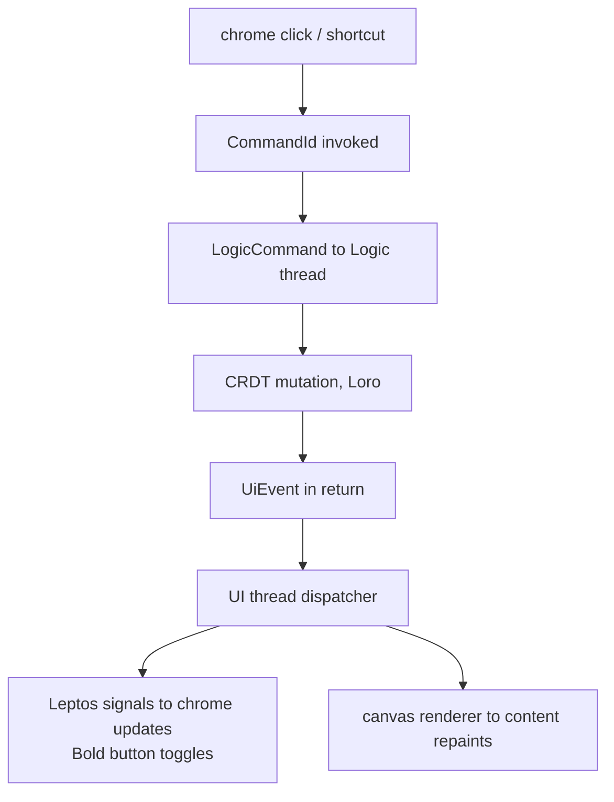

# AMBRE -- SPEC: UI Thread (umbrella -- boundary, crates, commands, tokens)
**Type:** Horizontal (Foundation -- UI Thread)
**Status:** Draft
**Implementation:** implemented

> Umbrella of the **UI thread** (page's main thread). The UI thread has two subsystems, each with its own crate and dedicated spec: the **content** rendered in a wgpu `<canvas>` (`ambre-canvas`, `ambre-spec-canvas.md`) and the Leptos DOM **chrome** (`ambre-chrome`, `ambre-spec-chrome.md`). This document details neither: it fixes what is **cross-cutting** -- the canvas/DOM boundary, the thread's crate map, the shared command model, and the single source of design tokens. Inter-thread transport is in `ambre-spec-architecture.md`.

## 1. OBJECTIVES & CONSTRAINTS

* **Scope:** the **UI thread**-level contract -- boundary between content (canvas) and chrome (DOM), thread crate graph, command registry (shared UI affordance), design token generation. **Out of scope:** the GPU/text pipeline (`ambre-spec-canvas.md`), chrome components/IME/adaptive (`ambre-spec-chrome.md`), business logic (Logic thread), IPC transport (`ambre-spec-architecture.md`).

* **Web-only.** Ambre targets the browser. Native is not a target; a possible desktop goes through **PWA** (installable, offline) or Tauri. This constraint enables a DOM chrome (which does not run in pure native) and the removal of winit (section 6).

* **Thread-level invariants:**
  - **Boundary rule:** the canvas owns content rendering, caret, selections, and content hit-testing; the DOM owns everything else (chrome, modals, menus, panels) and its own focus/a11y (section 2.A).
  - **Single source of UI truth:** the UI thread dispatcher feeds *both* Leptos signals (chrome) and the canvas (content). No duplicated UI state.
  - **The UI thread never blocks** (it runs on the page's main thread): `try_send`/`try_recv` toward the Logic thread.
  - **No network, crypto, or persistence outbound flows** in the UI thread: chrome invokes `CommandId` which produce `LogicCommand` (`flume` channels). Sole exception: font loading (same origin), canvas side.
  - **WebGL2-compatible by default:** stay within the common WebGPU/WebGL2 subset (no compute, no storage buffers) -- see `ambre-spec-canvas.md`.

---

## 2. TECHNICAL DESIGN & STATE

### A. Canvas / DOM Boundary

| Zone | Technology | Spec |
|:---|:---|:---|
| High-frequency content (grid, body text, whiteboard) | wgpu Canvas (`ambre-canvas`) | `ambre-spec-canvas.md` |
| Chrome (menus, toolbars, dialogs, panels, palette, toasts, tooltips) | Leptos DOM (`ambre-chrome`) | `ambre-spec-chrome.md` |

Static DOM composed *around* a canvas costs one layout pass; the compositor then recomposes already rasterized layers at zero cost per frame. The only sensitive case is floating UI **anchored to content that pans/zooms** (selection toolbar on Toile): a DOM element **transform-synced** each frame.

**Communication (the only two channels across the boundary):**
- **Canvas -> DOM** via **signals**: the wgpu handler detects an event (for example right-click), computes position, triggers a Leptos signal that opens a DOM context menu at the coordinates.
- **DOM -> Canvas** via **commands**: a button invokes a `CommandId` -> `LogicCommand` -> mutation -> `UiEvent` -> repaint (section 2.C).

The only DOM element living *above* the canvas is the transparent input `<textarea>` (keyboard/IME/clipboard, detailed in `ambre-spec-chrome.md`).

### B. Crate Map (UI thread)

Boundaries guaranteed by the crate graph, single binary. Rule: *app-specific -> app crate* (monolith `logic` + `ui` + `chrome`); *shared -> upstream framework crate from apps*.

```
# Shared framework (UI thread), upstream of apps
ambre-commands/   CommandId/Command/CommandState/CommandSource, keybindings.
                  Zero UI dependency (leaf). Depended on by apps AND ambre-chrome.
ambre-draw/       DrawSurface trait. Impls: WgpuSurface (screen), KrillaSurface (PDF).
ambre-canvas/     Canvas render runtime: WgpuSurface/QuadRenderer/GlyphAtlas,
                  TextCache, bootstrap_gpu/start_raf_loop, generated theme.rs. wgpu/
                  parley/swash + accesskit (scoped to content). No app dependency.
                  (FrameHost + AppView enum live in ambre-app, downstream of apps.)
ambre-chrome/     Shared, app-agnostic Leptos chrome toolkit: AppShell,
                  CommandPalette, Dialog/Menu/Toolbar/Toast/ContextMenu/Sidebar/
                  StatusBar, shared text-format controls (ColorPopover, FontPicker,
                  FontSizeSelect, FormatToggle, Debouncer) reused across apps'
                  formatting UIs, keybinding manager. Depends on leptos +
                  ambre-commands.

# Application crates (monolith: logic + ui + chrome)
ambre-trame/      logic   : *State + handlers (Logic thread)
ambre-prose/      ui      : *View (AppView variant), content on ambre-canvas (UI thread)
ambre-toile/      chrome  : SPECIFIC Leptos components, on ambre-chrome
ambre-murmure/    commands: Command via ambre-commands (CommandSource)

# Launcher
ambre-app/        cdylib : mounts Leptos AppShell, creates flume channels, spawns
                  Logic/Sync, bootstraps canvas + injects active view.
```

The launcher also owns the **`/` route home screen** (sign-in + document list, app-agnostic over every `DocType`): a DOM overlay on top of the persistent canvas. Visual + interaction contract in `ambre-spec-chrome.md section 2.G`; the E2E-encrypted document name model it displays (`name_enc` / `DocumentSummary.name`) in `ambre-spec-architecture.md section 3`.

The **shared** lives in `ambre-canvas` (renderer) and `ambre-chrome` (toolkit); an app's **specific** (Trame formula bar, cell format dialog, `TrameView`...) lives in the app crate, built on top. Two pure crates per stack (`ambre-canvas` wgpu, `ambre-chrome` leptos) keep the renderer independent of Leptos.

### C. Command Model -- everything is a command

Menus, toolbar buttons, keyboard shortcuts, context menus, command palette are *views* of a **single command registry** -- which keeps chrome manageable with 5 apps x ~200 commands. Types live in the **`ambre-commands`** crate (leaf, framework-agnostic):

```rust
// ambre-commands/src/lib.rs

/// Stable namespaced identifier, for example "prose.format.bold".
pub struct CommandId(pub &'static str);

pub struct Command {
    pub id: CommandId,
    pub title: fn(&Locale) -> String,           // i18n label
    pub icon: Option<IconId>,
    pub default_keybinding: Option<KeyBinding>,  // for example Ctrl+B
    pub category: CommandCategory,               // palette grouping / tabs
}

/// Runtime state, derived from app state on each query.
pub struct CommandState { pub enabled: bool, pub visible: bool, pub toggled: bool }

pub trait CommandSource {
    fn commands(&self) -> &[Command];
    fn state(&self, id: CommandId, ctx: &AppContext) -> CommandState;
    fn invoke(&self, id: CommandId, ctx: &mut AppContext);
}
```

- Each app implements `CommandSource` and registers its commands. Chrome **does not know about apps**: it displays commands and their state (same dependency inversion as the `AppView` enum on the rendering side).
- The keybinding manager is a `HashMap<KeyBinding, CommandId>`. A menu is a list of `CommandId`; a ribbon would be a tree of `CommandId` grouped by `category`.
  - **Shared keymap rules (X26).** The `Ctrl`/`Cmd` fold (a `KeyBinding` matches interchangeably on macOS `Cmd` and other-platform `Ctrl`) and multi-chord commands (redo = `Ctrl+Shift+Z` **and** `Ctrl+Y`) are decided **once** here, so every app behaves identically instead of each folding modifiers and binding redo its own way. Tracked in the cross-app factoring Story (`ambre-roadmap.md`).
- `Command`/`CommandId` (`ambre-commands`) is a **UI affordance**; `AppCommand`/`LogicCommand` (`ambre-bus`) is the **IPC payload**. An invoked `Command` *produces* a `LogicCommand` -- distinct layers.

**Data flow (unidirectional, Elm-like):**



### D. Design Tokens (single source)

Single source `tokens.ron` -> `build.rs` generates `theme.css` (CSS custom properties for DOM chrome) **and** `theme.rs` (Rust constants for drawing themed content in the canvas). Single source -> canvas/DOM consistency **by construction**. The dark/light switch toggles the CSS variable set and the constant canvas set (repaint `dirty`). Catalog: surfaces, accent, menus, inputs, statuses (success/warning/error/info), spacings (`xs/sm/md/lg`), `border_radius`, font sizes (`body/small/heading`).

> **Consumption** on the canvas side is in `ambre-spec-canvas.md section F`; **adaptive breakpoints** and the per-mode adaptation table (chrome side) are in `ambre-spec-chrome.md`.

### E. Clipboard model (shared across apps)

One clipboard model for **every** editor (Trame, Toile, Prose, ...): the build is
**Logic-authoritative**, the UI carries only the selection, and there is **no best-effort
viewport limit**. The transport across the `FrameHost <-> AppView` seam (and, serialized, across
the OS clipboard) is the app-agnostic `ClipboardBlob { text: String, ambre: Option<Vec<u8>> }`
(`ambre-bus`): `text` is the `text/plain` mirror for cross-app paste; `ambre` is the opaque,
app-specific payload (postcard of the active app's typed clipboard payload) under the private
`application/x-ambre` MIME type. Each app (de)serializes its own payload behind these bytes.

**Copy flow (lazy-authoritative + activation-window write):** a native `copy`/`cut` event calls
`view.clipboard_write(cut) -> CopyOutcome`:

- `Text(String)` -- a synchronous in-cell / inline text selection: the host `setData`s it now.
- `Deferred` -- the view emitted the authoritative copy command to Logic and remembers `cut`;
  the host `prevent_default()`s and does **not** `setData` (so the browser does not clobber the
  OS clipboard with empty content).
- `Nothing` -- nothing selected; the browser default proceeds.

Logic builds the full payload from the whole CRDT (never culled) and replies (for example
`ToileEvent::Clipboard` / `TrameEvent::Clipboard`). The view drains it in `update()`, serializes
a `ClipboardBlob`, keeps it **in memory** for a full-fidelity same-tab paste, and marks it
pending. Right after `view.update()`, the host calls `view.poll_clipboard()`; a `Some(blob)`
result is written to the OS clipboard via `navigator.clipboard.write`. This runs ~one frame
(~16 ms) after the keypress -- still inside the transient user-activation window the async
Clipboard API requires. Rationale (and the rejected prepare-ahead / prepare-on-modifier /
promise-in-`ClipboardItem` alternatives) is in the plan; `text/plain` is reliable everywhere,
the custom type is best-effort (Firefox may drop it), and same-tab paste never depends on it.

**Paste flow:** the host decodes the OS clipboard into a `ClipboardBlob` and calls
`view.paste_clipboard(blob)`; the view prefers its in-memory blob when the OS `text/plain`
mirror still matches it (proof the OS clipboard holds our own last copy), else decodes
`blob.ambre` into its typed payload. **Cut** is each app's own policy (Toile emits
`DeleteElements` right after the copy command; Trame keeps its marching-ants delete-on-paste).

**Chords (X16).** Copy / cut / paste are shared `CommandId`s in the keyboard pipe: both the modern
`Ctrl+C` / `Ctrl+X` / `Ctrl+V` **and** the legacy `Ctrl+Insert` / `Shift+Insert` / `Shift+Delete`
map to the same three intents, handled once here, in every app (the legacy set is ergonomic for a
left-hander driving the mouse left-handed).

> **Follow-up -- cross-app rich paste.** Today `blob.ambre` is each app's own opaque payload, so a
> paste **across** apps falls back to `text`. A shared interchange format above these payloads --
> letting a Trame range become a Prose table, or a Toile object a Prose image -- is a future goal
> tracked in the cross-app factoring Story (`ambre-roadmap.md`).

---

## 3. SECURITY & CONFIDENTIALITY (ZERO-KNOWLEDGE)

The UI thread is a pure presentation layer. ZK audit carried by the two sub-specs; at the thread level:
- **No outbound flows** outside the WASM process: chrome invokes `CommandId` -> `LogicCommand` (`flume` channels); content comes from the Logic thread. Sole exception: same-origin font `fetch`, canvas side.
- **No direct persistence**: UI states (panel ratios, expansions) are sent up to the Logic thread, which decides.

---

## 4. QUALITY & PERFORMANCE

Testability and frame budgets are defined **per sub-spec**: render pipeline and frame budget in `ambre-spec-canvas.md section 4-5`; chrome components, IME cycle, and Prose frame in `ambre-spec-chrome.md section 4-5`. The only **cross-cutting** test is the end-to-end command: click -> `CommandId` -> `LogicCommand` -> `UiEvent` -> chrome toggle (Leptos signals) **and** canvas repaint.

---

## 6. REJECTED ARCHITECTURAL DECISIONS (UI model level)

> **Content rendering** rejections (Vello, `vello_hybrid`, Canvas 2D, DOM-for-content): `ambre-spec-canvas.md section 6`. **Chrome** rejections (ribbon, egui look, reimplemented `<dialog>`, CSS Anchor): `ambre-spec-chrome.md section 6`. Below, the rejections that define the **hybrid UI model** itself.

- **100% canvas UI (homemade widget framework)**: catching up to Masonry (~29 widgets + focus + IME + theming) represents ~2 years solo without matching DOM ARIA a11y, and canvas a11y via AccessKit already reconstructs a hidden DOM tree. The "no HTML/CSS overhead" argument is false for static DOM composed with a canvas (the compositor recomposes rasterized layers at zero cost per frame).
- **Xilem / Masonry for chrome**: Xilem is alpha, Masonry's web backend is not a Linebender priority, and `xilem_web` is a separate DOM backend. Even with `vello_hybrid` (which would lift the compute overhead), we would bet the chrome on experimental libs whose focus is not the web, and run two renderers or rewrite content on Vello.
- **winit**: in web-only, indirection without benefit and event ownership conflict with DOM. Events captured directly via `web-sys` (boundary section 2.A).
- **WebGPU-only**: staying WebGL2-compatible widens the target (institutional fleets) at no cost.
- **Pure native (winit + wgpu + canvas chrome)**: out of scope (web-only; possible desktop via PWA/Tauri).

---

## 7. INTEGRATION PLAN (ROADMAP)

> Detailed backlog of this spec; cross-cutting scheduling (milestones) lives in `specs/ambre-roadmap.md`.

Per-subsystem detail is in each sub-spec; at the thread level:

- **UI P0 -- Content (canvas):** GPU pipeline, `FrameHost`/`AppView`, fonts, Trame grid at 60+ FPS. **Done** -- see `ambre-spec-canvas.md section 7` (`CANVAS P0`).
- **UI P1 -- Chrome foundation:** create `ambre-commands` (registry) and `ambre-chrome` (Leptos toolkit), slim `ambre-canvas` to render runtime, Leptos app shell + `<canvas>` cell, winit-free bootstrap, **one end-to-end command**. Prerequisite: validate Leptos under `+atomics`/`shared-memory` build + nightly `build-std`. Detail in `ambre-spec-chrome.md section 7` (`CHROME P1`).
- **UI P2+ -- Input/IME, WYSIWYG, adaptive, tokens, a11y:** `ambre-spec-chrome.md section 7` (`CHROME P2`/`P3`).
