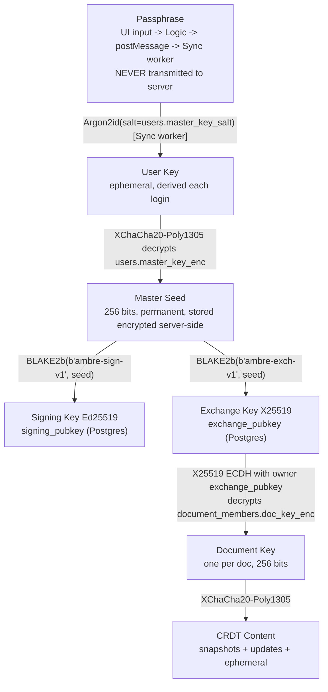

# AMBRE -- FEATURE: THE ZERO-KNOWLEDGE BOUNDARY

**Type:** Horizontal (framework)

> What the relay is allowed to learn, and what it must never be able to learn. One line runs through
> the whole product: the server stores what a user writes and can read none of it.

This document owns the boundary itself. Each side refines it on its own terms -- `SYNC-*` on the
client, `SRV-*` on the relay -- and neither restates it here.

---

## 1. CONTRACT

The only mandatory read. Grammar and status values are normative in `ambre-spec-template.md`. The
prefix is `ZK`, and it belongs to this document alone: a rule that constrains one component carries
that component's prefix instead.

| ID | Kind | Statement (RFC 2119) | Sources | Mechanism | Gap | Status |
|---|---|---|---|---|---|---|
| `ZK-001` | `INV` | No CRDT payload MUST leave the client unless it has been AEAD-sealed with a `DocumentKey`. | README pillar "E2EE"; `ambre-spec-sealed-envelope.md` | `ambre_sync::seal_tests::a_payload_frame_built_outside_the_seal_never_reaches_the_socket` -- the socket send refuses a payload frame the pipeline did not seal; type-level -- a storage upload takes a `SealedBlob` alone, built by the pipeline, which `ambre_sync::pipeline::tests::a_blob_bound_for_storage_is_sealed` opens back | none | verified |
| `ZK-002` | `INV` | No symmetric key material MUST be nameable in a wire type. | README pillar "Zero-Knowledge" | crate-graph -- `ambre-protocol` depends on `ambre-core` alone among the workspace crates; cargo-deny -- `deny.toml` refuses any dependant of `ambre-crypto` outside `ambre-sync`, the call worker `ambre-call` and `ambre-logic`, so the edit that would make a key type nameable in `ambre-protocol` fails CI | none | verified |
| `ZK-003` | `INV` | Passphrase-to-key derivation (Argon2id) MUST run client-side only. | `ambre-spec-session.md`, `SRV-030`; this spec section 2 | cargo-deny -- `deny.toml` bans `argon2` outside `ambre-crypto`, and the CI `deny` job fails the manifest that declares it | none | verified |
| `ZK-004` | `INV` | The server process MUST NOT link a crate able to decrypt a document payload, derive a shared secret, or reconstruct a split secret. | this spec section 2; `ambre-spec-server.md`, `SRV-012` | cargo-deny -- the capability bans on `chacha20poly1305`, `x25519-dalek`, `argon2`, `ambre-crypto` and `loro`, run by the CI `deny` job. The three unused declarations that violated this were dropped from `ambre-server` | none | verified |
| `ZK-041` | `INV` | The relay MUST NOT depend on the crate of an application: `ambre-trame`, `ambre-toile`, `ambre-prose` or `ambre-murmure`. | this spec section 2; `ZK-004` | cargo-deny -- `deny.toml` bans each of the four crates outside `ambre-logic` and `ambre-app`, and the CI `deny` job fails the manifest that declares one. A trial dependency of `ambre-server` on each crate fails `just deny` with `error[banned]` | none | verified |
| `ZK-005` | `INV` | Presence and cursor data MUST be sealed with the `DocumentKey`, exactly like a delta. | `ambre-spec-sealed-envelope.md` | `ambre_sync::pipeline::tests::roundtrip_ephemeral` -- it seals an ephemeral and opens it, so an unsealed one fails the assertion | none | verified |
| `ZK-006` | `INV` | Logs and tracing spans MUST NOT carry ciphertext or plaintext payloads -- identifiers, lengths and sequence numbers only. | `ambre-spec-server.md`, `SRV-001`; audit `C1` | type-level -- the relay holds every payload in an `ambre_server::payload::Payload`, which has no `Debug` and no `Display` (`ambre-spec-server.md`, `SRV-001`); `ambre_protocol::messages::validate_tests::a_message_debug_form_prints_no_byte_of_its_ciphertext` -- a wire message prints each ciphertext as its length; `ambre_core::envelope::tests::a_ciphertext_debug_prints_no_byte` -- a `Payload<Ciphertext>` prints its length and none of its bytes; ci-gate -- the rustc driver of `crates/ambre-primitives`, run by `just primitives` in the CI `lint` job, refuses a payload or a byte buffer formatted by a log line of the relay, under any name (`SRV-170`), and a log line in a relay file that reads a payload's bytes or takes a ciphertext whole (`ambre_primitives::driver::wiring::a_payload_under_a_neutral_name_is_refused_in_a_log_line`) | none | verified |
| `ZK-037` | `INV` | A showcase bundle MUST reach the browser's download path alone: no frame of the relay MUST carry it. | this spec section 2, the showcase bundle; `3-Toile/features/ambre-spec-toile-import-export.md section 3`; `TOILE-IO-096` | `ambre_toile::logic::state::export::showcase_tests::a_showcase_page_reaches_the_download_path_alone` -- the export answers one display event and no delta, no presence sample and no request for the Sync worker | none | verified |
| `ZK-017` | `INV` | The debug form of a sealed envelope MUST print its ciphertext length and none of its bytes. | `ZK-006`; audit `C1` | `ambre_crypto::tests::an_envelope_debug_form_prints_no_byte_of_it` | none | verified |
| `ZK-029` | `INV` | A metric label of the relay or the SFU MUST NOT carry the identifier of a document, a user, a call or a connection. | this spec section 2; `ZK-006` | type-level -- a metric of `ambre-metrics` takes a label value from a `Label` alone: a closed `enum` whose variants each spell one `StaticKey<LabelValues>`, a constant. Each metric holds one series per variant from its start, so no runtime value reaches a label and the count of series is fixed; cargo-deny -- `deny.toml` grants `ambre-metrics` to the relay and the SFU alone; `ambre_server::metrics::tests::the_scrape_answers_the_text_format_under_closed_labels_alone` -- every label value of a scrape is the spelling of a variant, and the count of series is the one of the start; `ambre_sfu::serve::tests::the_metrics_answer_on_their_own_port_under_closed_labels_alone` -- the same over the SFU, and no pseudonym of a seated participant appears | none | verified |
| `ZK-030` | `INV` | A log line of the relay or the SFU at the info level or above MUST NOT carry the identifier of a document, a user or a call. | this spec section 2; `ZK-006` | ci-gate -- the rustc driver of `crates/ambre-primitives`, run by `just primitives` in the CI `lint` job, reads the type of each value a log macro of `ambre-server` or `ambre-sfu` formats or records, the outermost macro naming the level. Above `debug` and `trace`, it refuses an `Id` of the core, a UUID, a pseudonym, a room of the SFU, a store key, a broadcast topic or an object key. It finds one bare, wrapped, or held by a field of a type of the workspace, such as an error (`ambre_primitives::driver::wiring::an_identifier_at_the_info_level_and_an_address_at_any_level_are_refused_in_a_log_line`) | none | verified |
| `ZK-031` | `INV` | A log line or a metric of the relay or the SFU MUST NOT carry the full address of a client. | this spec section 2; `ZK-006` | ci-gate -- the rustc driver of `crates/ambre-primitives`, run by `just primitives` in the CI `lint` job, reads the type of each value a log macro of `ambre-server` or `ambre-sfu` formats or records, at every level. It refuses a socket address or an IP address of the toolchain, bare, wrapped, or held by a field of a type of the workspace (`ambre_primitives::driver::wiring::an_identifier_at_the_info_level_and_an_address_at_any_level_are_refused_in_a_log_line`); type-level -- a metric label is a closed `enum` (`ZK-029`), so no address reaches a metric; `ambre_server::metrics::tests::the_scrape_answers_the_text_format_under_closed_labels_alone` -- every label value of a scrape is the spelling of a variant; `ambre_sfu::serve::tests::the_metrics_answer_on_their_own_port_under_closed_labels_alone` -- the same over the SFU, and no address of a seated participant appears | none | verified |
| `ZK-007` | `INV` | What a sealed envelope shows the relay MUST be limited to `{document_id, pub_key, key_id, snapshot_id, snapshot horizon, clock, log head, log entry, counter, nonce, commitment tag, signature, parent snapshot proof, parent clocks}`. Beyond it, the relay learns only `{seq, blob size, timestamp, source IP}`. The snapshot horizon is a `seq` the relay already records with the snapshot. | this spec section 2, the boundary table and its accepted leak | `ambre_protocol::tests::the_relay_reads_only_the_listed_fields` -- it destructures every envelope without `..`, so a new field fails to compile until a writer weighs it here | none | verified |
| `ZK-008` | `INV` | A presigned S3 URL MUST be issued only after the ACL check. | `ambre-spec-object-store.md`, `SRV-002` | `ambre_server::routes::tests::handler_tests::a_presigned_url_is_signed_only_after_the_access_check` -- an outsider is refused all four URLs, and a viewer both uploads | none | verified |
| `ZK-009` | `INV` | The two key-derivation domains MUST stay frozen at `ambre-sign-v1` and `ambre-exch-v1`, one context each. | this spec section 2; derived | `ambre_crypto::tests::derived_keys_match_the_frozen_domains` -- it pins the key pair one seed derives under each domain, so a renamed domain fails it | none | verified |
| `ZK-010` | `INV` | A passphrase MUST cross the client bus in a type that wipes its own bytes when it is dropped. | README pillar "Zero-Knowledge"; audit `H4`, `H5` | type-level -- `RestCommand::Unlock`, `SetupAccount`, `ChangePassphrase` and `RecoverAccount` carry `ambre_core::Confidential<Passphrase>`, and the recovery words a `Confidential<RecoveryWords>`. Each holds an `ambre_core::Secret`, which wipes its value when the last owner drops it, so a plain `String` on that path does not compile; `ambre_core::secret::tests::a_secret_wipes_its_value_once_when_it_drops`; `::a_shared_secret_wipes_when_its_last_owner_drops`; `::a_confidential_value_wipes_once_when_its_last_owner_drops` | none | verified |
| `ZK-011` | `INV` | The Master Seed MUST be moved and never copied: a path MUST NOT leave a second copy behind. | this spec section 2; derived | type-level -- `MasterSeed` holds an `ambre_core::Secret`, which implements no `Clone`, so a duplicate is a compile error rather than a review finding. The `compile_fail` doctests of `ambre_core::secret` show a derived `Clone` refused. The recovery words are spelled in place inside a `Confidential<RecoveryWords>`, so no bare copy of the seed is left; `ambre_crypto::tests::the_recovery_words_spell_the_seed_in_bip39_words` | none | verified |
| `ZK-012` | `INV` | A passphrase MUST NOT appear in a request the client sends to the relay. | README pillar "Zero-Knowledge"; audit `N4` | ci-gate -- the rustc driver of `crates/ambre-primitives`, run by `just primitives` in the CI `lint` job, reads each field of a type of `ambre-sync` that derives `Serialize`, with its type resolved. It refuses a field named for a passphrase or a password, a field whose type holds a `Confidential` or a `Secret` under any alias, and a string literal of the worker that spells such a key, a macro-written one included (`ambre_primitives::driver::wiring::a_passphrase_under_an_alias_or_a_macro_key_is_refused_in_a_request`) | none | verified |
| `ZK-035` | `INV` | The client MUST NOT seal the Master Seed for storage under a passphrase whose strength estimate falls under the floor of 48 bits. | README pillar "Zero-Knowledge"; this spec section 2, the strength floor | type-level -- `MasterSeed::wrap_for_storage` takes a `SealingKey`, which `ambre_crypto::passphrase::derive_sealing_key` alone builds, from a `ChosenPassphrase` that `ChosenPassphrase::check` alone builds, and the unlock key opens a seed but seals none; `ambre_crypto::strength::tests::a_known_weak_password_is_refused_with_its_weakness`; `::three_diceware_words_fall_under_the_floor_and_four_reach_it`; `::any_four_distinct_diceware_words_reach_the_floor`; `::any_three_diceware_words_fall_under_the_floor`; `::a_random_password_of_enough_characters_reaches_the_floor`; `ambre_sync::integration::a_setup_under_the_strength_floor_is_refused_before_any_key_exists` -- the worker creates no account and sends no frame | none | verified |
| `ZK-036` | `INV` | A refusal under the strength floor MUST carry the weakness that dominated the estimate as its only content. | this spec section 2, the strength floor; `ZK-035` | type-level -- `ambre_bus::AuthFailure::WeakPassphrase` holds an `ambre_core::PassphraseWeakness`, a fieldless enum, so no figure of the estimate is representable; `ambre_crypto::strength::tests::a_known_weak_password_is_refused_with_its_weakness`; `ambre_sync::integration::a_setup_under_the_strength_floor_is_refused_before_any_key_exists` -- the weakness is the one event the worker sends; `ambre_sync::auth::set_up_keys_tests::a_weak_setup_passphrase_draws_its_weakness_alone` -- the same on the setup of a signed-in account | none | verified |
| `ZK-042` | `INV` | A passphrase change or an account recovery MUST refuse a new passphrase whose strength estimate falls under the floor of `ZK-035`. | this spec section 2, the strength floor; `ZK-035`; `ZK-036` | `ambre_sync::integration::a_passphrase_change_under_the_strength_floor_is_refused`; `::a_recovery_under_the_strength_floor_is_refused` -- the weakness is the one event the worker sends, and no frame leaves; `::a_change_or_a_recovery_above_the_strength_floor_draws_no_refusal` -- a strong passphrase passes the floor | none | verified |
| `ZK-043` | `INV` | The recovery words MUST spell the Master Seed as 24 BIP39 English words with their checksum, and a recovery MUST refuse a phrase with an unknown word or a bad checksum before it derives any key. | README pillar "Zero-Knowledge"; this spec section 2, the recovery words | `ambre_crypto::keys::recovery::tests::the_recovery_words_match_the_bip39_vectors` -- the official 24-word vectors, both ways; `::any_seed_round_trips_through_its_recovery_words`; `::the_word_list_is_the_bip39_english_list` -- the SHA-256 digest of the list is pinned; `::a_mistyped_recovery_word_is_refused`; `::a_recovery_phrase_with_a_bad_checksum_is_refused`; `::a_recovery_phrase_of_the_wrong_length_is_refused`; `ambre_sync::integration::a_recovery_with_a_mistyped_word_or_a_bad_checksum_is_refused` -- the refusal is the one event the worker sends, and no frame leaves | none | verified |
| `ZK-013` | `INV` | The relay MUST see no field of an ephemeral beyond `document_id`, `pub_key`, `key_id` and `counter`. | `ambre-spec-broadcast.md`, `SRV-050` | `ambre_protocol::tests::the_relay_reads_only_the_listed_fields` -- the ephemeral public data destructures to exactly these four fields | none | verified |
| `ZK-014` | `INV` | A presigned S3 URL MUST expire within 15 minutes. | `ambre-spec-object-store.md`, `SRV-052` | `ambre_server::s3::tests::a_presigned_url_never_outlives_fifteen_minutes` -- a configured lifetime of one day signs both URLs for 900 s | none | verified |
| `ZK-015` | `INV` | What the relay learns of a Murmure channel MUST be limited to `{the documents of the channel and their kind, which documents are spaces, the space of the channel, its public flag, the state of each segment with its close time, its finalization time, its finalize lease and the horizon and identifier of its final snapshot, whether a rotation retired its key, the segment each amendments document amends, the identifier of the root message of each thread, the retention duration of the space, the read cursor of each member}`. | this spec section 2; `5-Murmure/ambre-spec-murmure-schema.md` | `ambre_server::db::channels::tests::the_channel_tables_hold_only_what_the_relay_may_learn` -- database tier | none | verified |
| `ZK-016` | `INV` | What the relay learns for a push notification MUST be limited to `{the push subscription of each device, the notification level of each member per channel, the members or the channel a message names}`. | this spec section 2; `5-Murmure/features/ambre-spec-murmure-notifications.md` | not built | unbuilt -- lands with the `Push notifications` Story (`ambre-roadmap.md` E5) | unimplemented |
| `ZK-018` | `INV` | What the relay learns of a user in the clear MUST be limited to `{the address and whether a provider verified it, the display name, the avatar picture, the provider and its subject, the two public keys}`. | this spec section 2; `ambre-spec-session.md section 3`; `ambre-spec-profile.md section 3` | `ambre_server::db::users::tests::the_account_table_holds_only_what_the_relay_may_learn` -- database tier, and beside these fields it finds only the identifier the relay mints and the sealed key material | none | verified |
| `ZK-019` | `INV` | Every secret of the workspace that the key separation lists -- a key, a seed, a passphrase, a session token, a bearer credential -- MUST be held in an `ambre_core::Secret`, which wipes its value when it is dropped and whose debug form prints no byte and no length of it. The one exception is a foreign key type that wipes itself in its own `Drop`: `ed25519_dalek::SigningKey`, which the Sync worker, the relay's `JwtSeed` and the relay's admission key of a call hold, and `x25519_dalek::StaticSecret`. A copy that a foreign call takes is that crate's to wipe: `jsonwebtoken`'s `EncodingKey` keeps the PKCS#8 bytes of the relay's signing key unwiped for the life of the process, and the OIDC client takes `String` copies of the client secret, the PKCE verifier and the code. | this spec section 2, the key separation | type-level -- each secret type of the list is a newtype over `Secret` or `Arc<Secret<T>>`, and only the Secret module may name the `zeroize` crate (`ARCH-046`), so no type wipes itself another way; `ambre_core::secret::tests::a_secret_prints_neither_its_bytes_nor_its_length`; `::a_secret_wipes_its_value_once_when_it_drops`; `::a_shared_secret_wipes_when_its_last_owner_drops`; `::a_failed_fill_wipes_the_partial_value`; `::a_secret_is_zeroize_on_drop`; `::a_credential_prints_no_byte_and_compares_in_constant_time`; `::a_cloned_access_token_is_the_same_wrapper`; `ambre_crypto::tests::a_shared_secret_is_wiped_and_never_printed`; `::a_stored_seed_opens_under_its_user_key_and_its_aad_alone`; `ambre_server::jwt::tests::a_jwt_seed_is_wiped_and_never_printed`; `ambre_server::secrets::tests::an_oidc_secret_prints_nothing_and_reaches_the_provider_whole`; `::a_seed_text_prints_nothing` | none | verified |
| `ZK-020` | `INV` | A type that holds a `Secret` directly MUST NOT be copied, serialized, compared with `==` or displayed except by code that reads the value through `expose`. Two secrets MUST be compared in constant time. A type that holds a newtype with a serde form or a `Clone` of its own -- `Confidential<K>` and the bearer credentials -- derives it through that newtype; that door is `ARCH-047`'s. | this spec section 2, the key separation | type-level -- `Secret` implements no `Clone`, `Serialize`, `Deserialize`, `PartialEq`, `Hash`, `Ord` or `Display`, so a derive of one on a type that holds it does not compile. Three `compile_fail` doctests of `ambre_core::secret` show a derived `Clone`, `Serialize` and `PartialEq` refused, and a derived `Debug` compiles and prints `Secret([REDACTED])`. A hand-written impl reads `expose`, which `ARCH-045` keeps in `ambre-crypto`, the Secret module and the relay's secrets module. Equality is `subtle::ConstantTimeEq`; `ambre_core::secret::tests::a_secret_has_no_display_clone_serialize_or_partial_eq`; `::equality_is_constant_time_and_reads_every_byte`; `::expose_reads_the_value_and_clone_secret_copies_it`; `::a_credential_prints_no_byte_and_compares_in_constant_time` | none | verified |
| `ZK-021` | `INV` | What the SFU learns of a call MUST be limited to `{the header and the extensions of each packet, the key identifier and the counter of each chunk, its clear prefix, the size of each chunk, padded for audio alone, and the time of each packet, a padding packet of the congestion control included, the session descriptions, the network addresses, the layer requests, the pseudonymous identifier of each participant}`. | this spec section 2; `ambre-spec-call-media.md section 3` | `ambre_belt::murmure::tests::three_clients_decode_each_others_sealed_audio_through_the_sfu` -- browser tier, under Chrome and under Firefox: a member whom the keys exclude still receives what the SFU forwards, and decodes none of it; `ambre_call::tests::a_chunk_leaves_the_worker_sealed_under_the_sender_key_or_not_at_all` -- a client sends no chunk it did not seal. The identity half is `ZK-023` | none | verified |
| `ZK-022` | `INV` | What the relay learns of a call MUST be limited to `{the channel of the call, the public key, the sender index and the signed join of each participant, the instants of each join and leave, the start and the end of the call, the size of each wrap it forwards}`, and none of it MUST outlive the last socket of the call by more than the time to live of `ambre-spec-budgets.md section 1`. | this spec section 2; `ambre-spec-call-media.md section 3` | `ambre_server::ws::handler::call::tests::the_state_of_a_call_holds_only_what_the_relay_may_learn` -- database tier: beside these fields, the state of a call in the ephemeral store holds only the room pseudonym the relay draws and the next sender index; `ambre_server::ws::handler::call::tests::nothing_of_a_call_outlives_its_time_to_live_without_a_heartbeat` -- no key outlives the time to live; `ambre_server::ws::handler::call::tests::no_table_of_the_relay_schema_holds_a_call` -- no table holds a call; `ambre_protocol::tests::the_relay_reads_only_the_listed_fields_of_a_call_frame` -- each call frame destructures to the channel, the opaque signed join, the sender index a wrap is for and the opaque wrap; `ambre_server::ws::handler::call::tests::a_wrap_reaches_its_recipient_alone_on_the_call_socket` -- database tier | none | verified |
| `ZK-023` | `INV` | The SFU MUST learn a call and each participant of it under pseudonyms the relay draws: one per call, one per join, and one per member of the call, which no other call shares. It MUST NOT learn the channel, the call identifier, a user or a public key. | this spec section 2; `ambre-spec-call-media.md section 3`, signalling; `ZK-021` | `ambre_protocol::tests::an_admission_names_the_call_and_the_participant_by_pseudonyms_alone` -- the admission destructures to the three pseudonyms, the sender index of the seat and an expiry. Each key identifier the SFU forwards shows it that index already (`ZK-021`, `CALL-116`); `ambre_server::ws::handler::call::tests::a_member_joins_under_pseudonyms_the_relay_draws_per_join` -- database tier: two joins of one member share the room and the member pseudonym and no participant, two members share no member pseudonym, and no admission holds the user, the key, the call or the channel; `ambre_sfu::serve::tests::a_socket_is_served_on_a_signed_admission_alone` -- the SFU serves a signed admission alone, and the TURN credential names the pseudonym; `ambre_server::ws::handler::call::tests::an_admission_never_verifies_under_the_session_key` -- database tier: the admission key is never the access-token key, so the SFU verifies no session | none | verified |
| `ZK-024` | `INV` | What the relay learns from an ask of who is in a call MUST be limited to `{the asking session, the call and the channel it names, the instant of the ask}`, and the relay MUST NOT store any of it. | this spec section 2; `ambre-spec-call-media.md section 3`, the roster; `5-Murmure/features/ambre-spec-murmure-calls.md section 3` | `ambre_server::ws::handler::call::tests::an_ask_changes_nothing_of_the_store` -- database tier: the ask writes nothing to the store; type-level -- `crate::routes::calls::RosterQuery` holds the channel alone, and the path the call | none | verified |
| `ZK-025` | `INV` | A mute MUST NOT show the relay or the SFU anything that a silence of the same sender does not show. | this spec section 2; `ambre-spec-call-media.md section 3`, mute; `ZK-021` | `ambre_belt::murmure::tests::a_call_from_the_header_of_a_direct_message_mutes_and_hangs_up` -- browser tier, under Chrome and under Firefox: the chunks of Ada keep their size and their rate across the mute (`CALL-075`). From the live window to the end of the unmute window, each page samples its padding every 100 ms. Each gap between two probes of Ada is at least half the probing interval of Bob, who never mutes, and no gap or edge exceeds one and a half intervals. Where Bob never pads, Ada never pads. `ambre_belt::murmure::tests::a_probe_the_mute_adds_breaks_the_cadence`, `::a_probe_the_mute_removes_breaks_the_cadence` and `::a_sender_out_of_phase_with_the_witness_shows_no_mute` hold that bound on host. The half that no frame names a mute is `ZK-034` | none | verified |
| `ZK-034` | `INV` | A frame of the call socket or of the socket of the SFU MUST NOT name a mute. | this spec section 2; `ZK-025` | type-level -- `ambre_bus::SyncCommand` has no variant for a mute, so no frame of either socket names one | none | verified |
| `ZK-026` | `INV` | A device identifier or a device label MUST NOT leave the page: no worker, relay or SFU receives one. | this spec section 2, the devices of a call; `ambre-spec-call-media.md section 3`, devices | type-level -- `Opaque<DeviceIds>` and `Opaque<DeviceLabels>` have no serde form, as two `compile_fail` doctests of the call devices module of `ambre-murmure` show; `ambre_belt::murmure::tests::a_member_changes_its_microphone_during_a_call_with_no_gap` -- browser tier, under Chrome and under Firefox: no message the page posts to a worker or a port carries the identifier or the label of the chosen microphone | none | verified |
| `ZK-027` | `INV` | A volume of a participant or a gain of the microphone MUST NOT reach the relay or the SFU. | this spec section 2, the volumes of a call; `ambre-spec-call-media.md section 3`, the volumes and the gain; `ZK-021` | structural -- no command of the bus and no frame of a socket carries a volume or a gain, which the page keeps in the local storage alone; `ambre_belt::murmure::tests::a_participant_turned_down_stays_silent_from_slot_to_slot` -- browser tier, under Chrome and under Firefox: setting a volume posts no message to a worker or a port; `ambre_belt::murmure::tests::a_gain_set_by_hand_scales_the_sound_at_one_rate` -- browser tier, under Chrome and under Firefox: a gain changes neither the rate nor the size of the chunks the SFU reads | none | verified |
| `ZK-028` | `INV` | The size of a sealed video chunk MUST be the size of the chunk the encoder wrote, plus a fixed overhead. | this spec section 2, the video of a call; `ambre-spec-call-media.md section 3`, the chunk format; `ZK-021` | `ambre_crypto::call::tests::the_seal_of_a_vp8_chunk_keeps_its_prefix_and_adds_a_fixed_overhead` -- the sealed size is the clear size and the 33 bytes of `VIDEO_OVERHEAD`, for any chunk up to 2 000 bytes | none | verified |
| `ZK-032` | `INV` | A share of the screen MUST NOT reach the relay. | this spec section 2, the screen of a call; `ambre-spec-call-media.md section 3`, the screen | `ambre_sync::call_link::tests::a_share_start_reaches_the_sfu_alone_and_never_the_relay` -- the one frame of a start goes to the socket of the SFU, and none to the call socket of the relay; `ambre_belt::murmure::tests::a_member_shares_its_screen_and_a_later_share_takes_it_over` -- browser tier, under Chrome and under Firefox: Ada's share posts one start of no field to the Sync worker, and nothing else but the roster ask | none | verified |
| `ZK-033` | `INV` | What the SFU learns of a share MUST be limited to `{the participant who shares, the instant each share starts, the time of each chunk of its screen, the size of each chunk}`. | this spec section 2, the screen of a call; `ambre-spec-call-media.md section 3`, the screen; `ZK-021` | `ambre_crypto::call::tests::a_screen_chunk_is_sealed_under_the_key_identifier_of_the_screen` -- the clear prefix alone stays clear, and the sealed size is the clear size and the fixed overhead; `ambre_belt::murmure::tests::a_member_shares_its_screen_and_a_later_share_takes_it_over` -- browser tier, under Chrome and under Firefox: Bob decodes the screen through the transform of his screen slot alone | none | verified |
| `ZK-038` | `INV` | Two release builds of one commit, each from a clean tree in its own directory, MUST give the same client digest. | this spec section 2, the code the relay serves; README pillar "Zero-Knowledge" | ci-gate -- `scripts/client_digest.py`, run by `just client-build` on two runners in two paths of different depth in the CI `reproducible` job, and by `just client-compare` in `reproducible-compare`. `scripts/test_client_digest.py` changes one byte and finds another digest | none | verified |
| `ZK-039` | `INV` | The release of a tag MUST publish the client digest of its commit and the manifest that digest covers. | this spec section 2, the code the relay serves; `ZK-038` | ci-gate -- the `client-digest` job of `.github/workflows/release.yml` runs `just reproducible` on the tag and attaches both files to its release. It fails, and publishes nothing, when the two builds differ | none | verified |
| `ZK-040` | `INV` | The page a deployment serves MUST be the build whose client digest the release of its commit publishes. | this spec section 2, the code the relay serves; `ZK-039` | human-review -- `b2sum -l 256 -c ambre-client.manifest` over a copy of the files the deployment serves | unheld -- `deployment` -- a browser runs whatever the origin serves and compares it with no digest. A relay can serve another page to one user alone, and an audit of the page it serves to everyone else never reads it | human-review |
| `ZK-044` | `INV` | What the SFU learns of a choice of videos MUST be limited to `{the senders each receiver chose, by their sender index, the one it marks large, the instant of each choice}`. | this spec section 2, the choice of videos of a call; `ambre-spec-call-media.md section 3`, the choice of videos; `ZK-021` | type-level -- `ambre_protocol::signaling::VideoChoice` holds the sender indexes and the large one alone, and the SFU reads it on its own socket; `ambre_sync::call_link::tests::a_choice_of_videos_reaches_the_sfu_alone_and_never_the_relay` -- the relay reads none of it | none | verified |

* **Budget.** the four crypto rows of `ambre-spec-budgets.md section 1`: the outbound seal, the
  inbound open, the full round trip and the snapshot compression. `criterion` measures all four in
  `ambre-crypto/benches`, which no CI job runs.
* **Boundary.** this document **is** the boundary. Every other document either refines one of these
  rows on its own side, or answers `none` and says why.
* **Verification.** 42 `verified`, 1 `human-review`, 1 `unimplemented`. Every row is an `INV`. This
  document owns no gesture, so it declares no operation table, and each rule binds the boundary at
  every instant.

  The structural rows hold because the crate graph, `deny.toml` and the type system refuse what
  they forbid. No key type is nameable on the wire, no `argon2` sits outside `ambre-crypto`, no decrypting
  crate is linked into the relay. No presence sample leaves unsealed, no passphrase sits in a type
  that does not wipe itself, and no seed is copied. Every secret sits in one wrapper that wipes it,
  prints nothing of it and copies it only on request (`ZK-019`, `ZK-020`).

  The rules stated as an absence hold too. The socket refuses a payload the seal did not build
  (`ZK-001`), and a test destructures every envelope field by field (`ZK-007`). An outsider gets no
  presigned URL (`ZK-008`), and a vector pins the two derivation domains (`ZK-009`). A gate refuses
  a passphrase field in a request type (`ZK-012`). A passphrase an offline guess finds seals no
  seed, because the sealing key takes a passphrase the floor admitted (`ZK-035`). A showcase page, the
  one plaintext exit, answers the download path and no frame (`ZK-037`).

  No payload reaches a log line. The client's envelope prints no byte (`ZK-017`), and a wire
  message prints each ciphertext as its length. The relay holds every payload in a type a log
  cannot name (`ZK-006`).

  The observability stack keeps no part of the membership graph. A log line or a metric leaves
  the relay for a store that keeps it longer than the relay does. An identifier there copies who
  works with whom out of the boundary this document rules. A metric label names no document, no
  user, no call and no connection (`ZK-029`). A log line at the info level names none of them
  either (`ZK-030`), and no client address appears whole (`ZK-031`).

  Two release builds of one commit give one client digest, and a tag publishes it (`ZK-038`,
  `ZK-039`). Whether a deployment serves that build stays a check by hand (`ZK-040`).

  `ZK-013` and `ZK-014` are what the split of two conjunctions exposed. Neither half had a
  mechanism, and the row each sat in read as covered because its other half was.

---

## 2. MODEL

**CRDT containers.** none. The boundary constrains what leaves the client; it stores nothing itself.

**What the relay sees.**

| Component | Data seen by server | Never seen |
|-----------|----------------------------|-------------|
| `ambre-server` | `document_id`, `pub_key` (Ed25519), `clock`, `seq`, `snapshot_id`, `key_id`, `nonce` | CRDT content, Document Key, Master Seed, User Key, passphrase |
| `ambre-server`, per update | the head of the membership log the author of the update read (`SYNC-207`), and the entry that head names (`SYNC-218`) | anything else about that author's view of the log |
| `ambre-server`, per key link | the head of the membership log the rotator read (`SYNC-204`) | the key the link seals |
| `ambre-sfu` | the set of `ZK-021`, each participant under the pseudonyms of `ZK-023`, who shares a screen and when (`ZK-033`), and whose video each receiver chose (`ZK-044`) | the audio and video of a call, every sender key, the channel, the user and the key of a participant |

**The showcase bundle.** A board exported as a showcase page leaves the boundary in the clear,
for anyone who holds the file. It is the one path out of an application that carries content
without a seal, and it happens on its own gesture alone. The entry that offers it says that the
page is not encrypted and readable by anyone (`TOILE-IO-096`).

The page reaches the download path
of the browser, and never the Sync worker or the relay (`ZK-037`). The pillar binds the relay, and
the page never reaches it. The page carries the picture alone, and no board state
(`TOILE-IO-018`, `TOILE-IO-137`).

**A call in a channel.** The call message and its end are sealed segment deltas (`ZK-001`). The
relay keeps no record that a call ended, so it holds no call history of a channel past the time to
live of `ZK-022`. An ask of who is in a call reads the seats the relay holds already, and the
relay stores nothing of the ask (`ZK-024`). The ask rides the tick of a shown channel, whose
watching sample already tells the relay that the session shows that channel.

**A mute.** A muted sender sends silence, at the rate and the size of any other chunk. The SFU
reads the audio level of silence, as for a member who stays quiet. No frame of the call socket or
of the socket of the SFU names a mute (`ZK-025`, `ZK-034`). The browser also pads the uplink to
probe it, with packets that carry no chunk. That padding follows the congestion control, muted or
not, so its time is transport metadata that `ZK-021` admits.

**The padding of a probe.** On 2026-11-16, the belt read Firefox 160 under `ZK-025`. Firefox
probes the audio sender once every 5 s. Each probe fills its cluster with queued chunks first, then
pads the rest. So one probe holds one to four packets with no payload, and two senders probe at
their own phases. Hence a count of padding packets in a window of a few seconds differs between two
senders, mute or not.

A mute could show one probe more or one probe less. A probe more splits one
interval, and one part is at most half an interval. A probe less leaves a gap of two intervals. So
`ZK-025` holds the gaps between the probes of the sender to half an interval of a witness.

**The devices of a call.** The page reads the list of microphones and speakers from the browser.
An identifier is stable per site, and the labels name the brand and the model of each device. So
the list nearly names a machine. The page keeps the choice in the storage of the browser. No worker
receives an identifier or a label, so no frame of either socket can carry one (`ZK-026`).

**The volumes of a call.** A member sets a volume for each other participant, and the gain of its
microphone. The page keeps each volume in the storage of the browser, by member, and applies it to
an audio element. No command of the bus carries a volume or a gain, so no frame of either socket
can carry one. The sender sends at a constant rate. So a gain moves the audio level of its packets
alone, as a louder or a quieter voice does (`ZK-027`).

**The video of a call.** A video chunk is not padded. Its size follows the encoder: a still picture
writes small chunks, motion writes large ones, and a keyframe writes the largest. So the SFU learns
how much each picture of a sender changed, and never what it shows. The seal adds a fixed overhead
alone, so a chunk tells the SFU nothing beyond what the encoder wrote (`ZK-028`). The clear prefix
holds the keyframe bit and, on a keyframe, the size of the picture, which the SFU needs to switch a
layer (`ZK-021`).

**The screen of a call.** A share sends one more track, and its chunks follow the rule of a video
chunk (`ZK-028`). The page marks the start of a share with a frame of no field on the socket of the
SFU, which the relay never carries. So the relay learns nothing of a share. The SFU learns which
participant shares and when, from that frame, the second video section of its offer and its
packets. Its word to a former sharer that a later share took the screen tells that member what the
screen slot shows it.

The SFU also learns the size and the time of each chunk of the screen, and never what the screen
shows (`ZK-032`, `ZK-033`). A screen holds text. So the size and the timing of its chunks tell the
SFU when the member types or scrolls, and no word of it.

**The choice of videos of a call.** A receiver names the senders whose video it wants, on the
socket of the SFU alone. So the SFU learns who watches whom, under the sender indexes it sees in
each key identifier already (`ZK-021`). It also learns whom each receiver shows large, and when a
choice changes, as a page switch does. The relay learns nothing of a choice (`ZK-044`). The SFU
needs the choice to forward a sender who does not speak, so the choice cannot stay on the client.

**The cast of a scenario.** Every scenario table of the corpus draws its actors from this list, so
a reader knows who is hostile from the name alone.

| Name | Role | Holds |
| :--- | :--- | :--- |
| Alice, Bob, Carol | honest members | their own keys and the document key |
| Mallory | a malicious member: forges, replays and rewrites with a legitimate key | her own keys and the document key |
| Eve | a passive attacker on the network | the ciphertext in transit, and nothing to open it |
| the relay | honest but curious: routes and stores as asked, and reads all it can | the set of `ZK-007`, and nothing to open a payload |

A scenario row where Mallory acts is an attack. Its outcome column says what stops her.

**Accepted leak, and what is not accepted.**

* **Accepted:** the relay infers that a client with a given public key modified a given document at
  a given instant. That is the metadata of the table above, read as a pattern.
* **Accepted:** the membership graph. The relay knows which public keys are members of which
  document, readers included. For a Murmure channel, that graph shows who talks with whom.
  * The relay needs the graph to route a wire message and to refuse a non-member.
  * A subscription reveals the graph anyway, so a sealed membership list would hide nothing.
  * The leak stops at the graph. A document identifier is a UUID v7 minted on the client: a
    timestamp and random bits, never derived from a name.
  * A member row carries only what access control and the unwrap read. That is the member, the
    role, the wrapped document key and the inviter whose exchange key wrapped it.
  * The inviter column tells the relay who invited whom. The unwrap needs the inviter's exchange
    key, so that edge of the graph is accepted too.
  * The signed membership log repeats that graph with a signature on each act, so a client can check
    it (`SYNC-132`). It teaches the relay nothing it did not hold.
* **Accepted, for a Murmure channel only:** the grouping of its documents and the few facts the
  relay needs to finalize and to expire them (`ZK-015`). It also learns which locked segment was
  amended, since it keeps one amendments document per segment (`SRV-202`). It flags the segments
  a rotation of `meta` left open, a fact its key links already hold (`SRV-147`). It learns which
  documents are spaces, which a channel of the space would teach it anyway (`SRV-216`). The relay
  never learns the kind of an update: the activity summary is sealed (`SYNC-113`).
* **Accepted, for an account:** the address, the display name and the avatar picture, in the clear
  (`ZK-018`). The relay shows a member list to its members, and the picture is one the user chose
  to show. It serves a picture only to a user who shares a document with its owner (`PROFILE-009`).
* **Accepted, for a push notification only:** the level of each member per channel, and who a
  message names. Web Push requires a visible notification for every push, so the relay must choose
  who to wake (`ZK-016`).
* **Not accepted, and stated as a defect:** a media blob's address, which is a hash of its
  plaintext, and its media type (`ambre-spec-media.md`, `SYNC-050`, `SYNC-053`).
* **Accepted, and not a leak:** a key identifier. It is a hash of a random 256-bit key. It tells the
  relay when a document rotated, which it already knows, and nothing of the key (`SYNC-115`).
* **Accepted:** the log head an update carries (`SYNC-206`), and the entry it names (`SYNC-218`).
  The relay sees the head of the log the author of the update read, and the last entry of that
  log. It stores that log already, so both tell it only how far the author had read when it wrote
  (`SYNC-207`).

**Static verification, mechanised in `deny.toml`.** Each ban lists the crates that may depend
directly on the banned crate. `ambre-server` is in none of these lists:

| Banned crate | Direct dependants it admits |
| :--- | :--- |
| `ambre-trame`, `ambre-toile`, `ambre-prose`, `ambre-murmure` | `ambre-logic`, `ambre-app` (`ZK-041`) |
| `ambre-crdt` | the four application crates |
| `loro` | `ambre-crdt`, `ambre-logic` and the four application crates |
| `ambre-bus` | the client crates and the belt |
| `ambre-crypto` | `ambre-sync`, `ambre-logic`, `ambre-call` (`ZK-002`) |
| `argon2` | `ambre-crypto` (`ZK-003`) |
| `chacha20poly1305` | `ambre-crypto`, and `dimpl`, the DTLS of the SFU (`ZK-004`) |
| `x25519-dalek` | `ambre-crypto`, `ambre-sync`, `dimpl` (`ZK-004`) |

The relay takes `ed25519-dalek` directly, for signatures alone (`SRV-012`). Every `ciphertext` in
`ambre-protocol` is an opaque `Vec<u8>`.

**Key separation.**

* Every secret is a domain newtype over `ambre_core::Secret<T>`. The keys are `MasterSeed`,
  `UserKey`, `DocumentKey`, `StoreKey`, `FileKey` and `SharedSecret`. The shared text and bytes
  are one generic `Confidential<K>` over the markers `Passphrase`, `RecoveryWords`, `Plaintext`
  and the relay's `OidcSecret`. The relay's `SeedText` and the SFU's `TurnSecret` hold a text.
* The bearer credentials are one generic `Credential<K>`. Its markers are `AccessToken`,
  `RefreshToken`, `PresignedUrl`, `OidcCode`, `OidcState`, `CallAdmission` and `TurnPassword`.
* The relay's `JwtSeed` holds a boxed `ed25519_dalek::SigningKey`, which wipes itself, decoded from
  the `SeedText` inside `Secret::try_filled`. The admission key of a call is a second one, from
  `CALL_ADMISSION_SEED`, and never the access-token key. The newtype keeps the name and the meaning, and
  `Secret` carries the hygiene (`ZK-019`, `ZK-020`):
  * the value sits in a `Box`, so a move copies no byte of it, and it is wiped on drop;
  * its debug form is `Secret([REDACTED])`, with no length, and it has no `Display`;
  * it has no `Clone`, no serde, no `PartialEq`, `Hash` or `Ord`. A value two owners share is an
    `Arc<Secret<T>>`, wiped when the last owner drops it. `clone_secret` is the one explicit copy;
  * two secrets compare in constant time through `subtle`'s `ConstantTimeEq`. `subtle` is pure
    Rust and already sat in the tree under the RustCrypto stack;
  * a value is built in place with `Secret::filled` or `Secret::try_filled`, so no copy of the
    value itself is left on the stack. A primitive may still leave its own working state there:
    the Blake2b state and the 64-byte digest of a key derivation are not wiped. `clone_secret`
    passes its copy through one stack temporary, which is not wiped either;
  * `expose` reads the value in `ambre-crypto`, in the Secret module, and in the `src/secrets/`
    of the relay and of the SFU alone (`ARCH-045`, `ARCH-048`). A crate outside them calls a
    typed method:
    `MasterSeed::recovery_words`, `MasterSeed::from_recovery_words`, `MasterSeed::open_from_storage`,
    `Credential<AccessToken>::present_bearer`, `Confidential<RecoveryWords>::present_words`,
    `Confidential<Plaintext>::with_plaintext`,
    `Confidential<Plaintext>::into_plaintext`, `seal_row` and `seal_file`. A sink that lends the text to one
    foreign call is named in the file of that call alone (`ARCH-049`). Only the Secret module names
    `zeroize` (`ARCH-046`). Code outside it that wipes a buffer does so through `Secret::wipe`.
* The access token of `WsClientMsg::Authenticate` is the one secret `ambre-protocol` carries. It
  travels through the one hand-written serde of `Credential<K>`, which a marker admits by an
  `impl WireCredential` line. One that crosses the bus or the store does so through the
  hand-written serde of its newtype, never a derive (`ARCH-047`). `Confidential<K>` has one such
  serde form too, which a marker admits by an `impl WireConfidential` line. That trait is sealed,
  so the relay's `OidcSecret` has no serde form.
* The Logic to Sync `postMessage` hop carries **decrypted** deltas. That internal boundary is accepted,
  because a structured clone stays inside the user's own browser process. The Main instance compiles
  no cryptography. So the master seed, the user key and each document key live in the Sync worker's
  memory alone. During a call, the call worker also holds the sender keys of that call. The Sync
  worker hands them over a port of the two workers, never through the Main instance (`CALL-064`).
* Presence and cursor samples are sealed before they leave, exactly like a delta (`ZK-005`).

**The primitives** execute in the two workers that consume `ambre-crypto` (`ARCH-004`):

| Worker | Primitives |
| :--- | :--- |
| the Sync worker | XChaCha20-Poly1305 for AEAD, Ed25519 for signatures, X25519 for key agreement. BLAKE2b for derivation and hashing, Argon2id for the passphrase, HMAC-SHA256 for the commitment tag. X25519 and HKDF-SHA256 to wrap a sender key of a call |
| the call worker, during a call | HKDF-SHA256 to derive a chunk key from a sender key, ChaCha20-Poly1305 to seal and open a chunk (`CALL-003`) |

`deny.toml` admits a third dependant, `ambre-logic`, for one hash of its host-only fixtures. That
use holds no cipher and no key.

**The key hierarchy.** The four Postgres columns it ends in -- `master_key_enc`, `master_key_salt`,
`doc_key_enc` and `org_master_key_enc` -- are opaque blobs to the relay (`ambre-spec-server.md`,
`ambre-spec-session.md`, `ambre-spec-organizations.md`).



Both derivations truncate a 512-bit BLAKE2b digest to 32 bytes, and the two domain strings are the
only thing that separates them. They are a frozen constant, not a name: change one and every account
that already exists derives a different key pair, which is `ZK-009`.

```rust
pub struct MasterSeed(Secret<[u8; 32]>); // wiped on drop, not Clone
impl MasterSeed {
    pub fn derive_signing_key(&self) -> ed25519_dalek::SigningKey;
    pub fn derive_exchange_key(&self) -> x25519_dalek::StaticSecret;
    pub fn recovery_words(&self) -> Confidential<RecoveryWords>; // 24 BIP39 words
    pub fn from_recovery_words(words: &Confidential<RecoveryWords>)
        -> Result<MasterSeed, RecoveryWordsRefusal>;
}
```

**The recovery words.** The 24 words spell the Master Seed itself (`ZK-043`). They take the mapping
between entropy and words of BIP39, and nothing else of it:

* the 256 bits of the seed and the first 8 bits of their SHA-256 digest make 264 bits;
* each word carries 11 bits, as its index in the BIP39 English list of 2 048 words;
* the BIP39 step from a phrase to a seed, PBKDF2 over the words, is not used. The key hierarchy
  above derives from the seed the words spell.

The list is a data file of `ambre-crypto`, `src/keys/bip39-english.txt`, copied verbatim from
`bitcoin/bips`, `bip-0039/english.txt`. A test pins its SHA-256 digest,
`2f5eed53a4727b4bf8880d8f3f199efc90e58503646d9ff8eff3a2ed3b24dbda`. No crate is added: `sha2` already
sits in `ambre-crypto`, and a BIP39 crate would bring its PBKDF2 step and its other lists. A reader
matches a word without regard to ASCII case. It refuses a phrase of another length, an unknown word
and a bad checksum. Each refusal comes before the seed leaves `ambre-crypto`, so a refused phrase
derives no key.

**The re-seal of a recovery.** A recovery writes the seed the words spell back to the relay,
sealed under the new passphrase (`ambre-spec-sync.md`, `SYNC-248`). The Sync worker takes three
steps, and a refusal at one step writes nothing:

1. It holds the strength floor on the new passphrase (`ZK-042`), then reads the words (`ZK-043`).
2. It reads the master material of the account. It compares the signing key the seed derives with
   the key the relay holds, and refuses words of another seed (`ambre-spec-sync.md`, `SYNC-249`).
   The re-seal moves no public key, so a foreign seed would leave the account unopenable.
3. It seals the seed under a fresh salt, as the setup does. It sends the sealed seed, the salt and
   a proof to the re-seal route, and the seed never leaves the worker (`ambre-spec-sync.md`,
   `SYNC-250`). The signing key of the seed signs the proof over the new seal and the salt of the
   seal it read (`SYNC-254`). The relay writes only under that key, over that seal
   (`ambre-spec-session.md`, `SRV-278`, `SRV-279`).

**The re-seal of a passphrase change.** A passphrase change writes the same seed back to the
relay, sealed under the new passphrase (`ambre-spec-sync.md`, `SYNC-251`). It takes the route and
the seal of a recovery, in three steps, and a refusal at one step writes nothing:

1. It holds the strength floor on the new passphrase (`ZK-042`).
2. It reads the master material of the account and opens the seed under the current passphrase,
   as the unlock does. A current passphrase that does not open it is refused
   (`ambre-spec-sync.md`, `SYNC-252`).
3. It seals the seed under a fresh salt and sends the sealed seed, the salt and the proof of a
   recovery (`ambre-spec-sync.md`, `SYNC-253`, `SYNC-254`).

**The strength floor.** The relay stores the salt and the Master Seed sealed under the passphrase,
so the relay, or a thief of its database, can guess offline. Argon2id prices each guess, and the
client refuses a new passphrase that too few guesses find (`ZK-035`, `ZK-036`). A setup, a
passphrase change and a recovery each take the floor (`ZK-042`). The arithmetic below sets
the floor on 2026-11-14.

| Step | Figure | Why |
|---|---|---|
| One guess | one Argon2id v1 derivation: 64 MiB, 3 passes, 1 lane | the cost of `crates/ambre-crypto/src/passphrase.rs`, which a guess cannot skip |
| Memory moved per guess | about 0.6 GB | each pass reads two blocks and writes one over the 64 MiB array |
| One GPU | 1 000 guesses per second | a card with 1 TB/s of memory bandwidth, the RTX 4090 class, tops out near 1 700. A published run of eight RTX 5090 cards read about 490 per second in all (Specops, 2025). The figure takes the bound, rounded down |
| The attacker | 100 GPUs for one year: about 3.2 x 10^12 guesses, 2^41.5 | a farm a company or a criminal group rents, not a state |
| The floor | 48 bits: 2^48, about 2.8 x 10^14 guesses | the farm covers 1/89 of that space in a year. It finds the passphrase with a probability near 1 %, and needs 44 years on average |

The floor admits four words drawn from the EFF list of 7 776 words (51.7 bits), and refuses three
(38.8 bits). It admits eight random printable characters (52.4 bits), and refuses seven (45.9).

**The estimator** lives in `crates/ambre-crypto/src/strength.rs`, in the Sync worker. It reads the
passphrase where `expose` may read it, and only a refusal leaves the worker: the weakness that
dominated the estimate, never the figure. It splits the text into runs of letters, digits,
symbols and separators, and adds the bits of each run:

| Run | Bits |
|---|---|
| a password of a short list of common ones, case and digit-for-letter substitutions folded | log2 of its rank, plus one |
| one character said again, or a row of the alphabet, the digits or a keyboard | the first character, plus log2 of the length |
| letters that read as words: a vowel in four, no five consonants in a row | 2.5 per letter, at most 13 per nine letters, one word at least: nine is the longest word of the EFF list |
| other letters | 4.7 per letter |
| digits | 3.32 per digit; 7.2 for a year, 15.2 for a date |
| symbols | 5.04 per symbol |
| a separator | 2 the first time, 0 after |
| a run the text holds earlier | 1 |

A capital costs one bit, and a run that the text holds earlier costs one bit. The model credits a
word with a draw from a list of 8 192 words, whatever its length. So it never credits a phrase with
more than a word-list attack needs, and its errors fall on the side of a refusal. Four short words
of four letters each fall under the floor, and so do four words with no separator between them. A
fifth word lifts either.

**A document's name is content.** It is sealed under that document's key like any other payload, so
the relay stores an opaque blob and never a title. The write path seals it in the Sync worker. The
read path returns it beside the caller's wrapped key, so a never-opened document still shows its
name. A document created with no name has none rather than a placeholder. The rules are
`SYNC-067` and `SYNC-042`; the display is `ambre-spec-launcher.md`.

**The code the relay serves.** Every row above assumes that the page runs the code of the source.
The operator serves that page, and a changed page reads every key it unwraps. So anyone rebuilds
the page from one commit and gets the same bytes (`ZK-038`).

The manifest lists one BLAKE2b-256
digest per served file, and the client digest is the digest of the manifest. The release of a tag
publishes both (`ZK-039`). An auditor compares a deployment with the manifest through `b2sum`.

The limit that remains is `ZK-040`. A browser checks no digest before it runs a page, and the page
cannot check itself: the check would be code of the same origin. A relay can therefore serve a
changed page to one chosen user, and no audit of the page the others receive finds it. Only a
check outside the origin closes that gap, for example a browser extension or a signed web bundle.

**Code.** `crates/ambre-crypto/src/keys.rs` for the hierarchy, `crates/ambre-crypto/src/aead.rs`
and `commitment.rs` for the seal, `deny.toml` for the capability bans.

---

## 3. SURFACE

The boundary has no control of its own. What a user meets is what it costs them.

| Trigger | Behaviour |
|---|---|
| signing in | the passphrase is typed once, derived in the Sync worker, and never sent |
| a first invitation | the recipient's key fingerprint is shown for an out-of-band check (`ambre-spec-key-verification.md`) |
| account setup with a weak passphrase | the setup is refused before any key exists, and the refusal names why: a common password, a repetition, a sequence or too few words (`ZK-035`) |
| a passphrase change or a recovery with a weak new passphrase | the request is refused before the current passphrase or the recovery words are read, with the same words as at setup (`ZK-042`) |
| account setup | 24 BIP39 recovery words are shown once: they are the Master Seed, and the only path back after a forgotten passphrase |
| a recovery with a mistyped word, a wrong word count or a bad checksum | the recovery is refused before any key is derived, and the refusal names which of the three (`ZK-043`) |
| a recovery with the words of another account | the recovery is refused, and the account keeps its sealed seed (`ambre-spec-sync.md`, `SYNC-249`) |
| a recovery that succeeds | the new passphrase unlocks the account from then on (`ambre-spec-sync.md`, `SYNC-248`) |
| a passphrase change with a wrong current passphrase | the change is refused, and the account keeps its sealed seed (`ambre-spec-sync.md`, `SYNC-252`) |
| a passphrase change that succeeds | the new passphrase unlocks the account from then on, and the old one no longer does (`ambre-spec-sync.md`, `SYNC-251`) |
| losing both the passphrase and the words | the documents are unrecoverable, unless an organization holds the escrow (`ambre-spec-organizations.md`) |

---

## 4. REJECTED ALTERNATIVES

| Decision | Rejected alternative | Why not |
| :--- | :--- | :--- |
| The relay is blind by capability, not by discipline | a code-review rule stating that the server must not decrypt | a rule a reviewer must remember is a rule that fails on a busy day. `deny.toml` refuses the dependency itself, so re-granting the relay the power to decrypt becomes a reviewable edit of one file instead of one silent line in a manifest |
| One key per document, wrapped per member | a per-user key index held server-side | it makes the relay the authority on who may read what, which is the property being removed. Wrapping the document key for each member's exchange key keeps the relay a carrier |
| The plaintext delta crosses the worker boundary | sealing on the Logic thread, so that no plaintext ever crosses a `postMessage` | it means compiling cryptography into the Main instance, which puts the keys in the same memory as the renderer and the page. A structured clone stays in the user's own process, so the hop costs a copy and buys key isolation |
| The metadata pattern is an accepted leak, written down | claiming the relay learns nothing at all | it would make the pillar unfalsifiable: a relay that routes must know who writes where and when. `ZK-007` exists to bound that set rather than to refuse it |
| The membership graph is an accepted leak | hiding membership from the relay, through a fan-out by the sender or anonymous credentials | the relay then has no subscription check and no targeted push, and each message costs one send per member. A document suite gains too little for that cost, so the graph is written down instead |
| The media address is a defect, not a second accepted leak | widening the whitelist of `ZK-007` to cover the address | the address is a hash of plaintext, so it answers "does this document contain this file" for any file the relay already holds. That is a capability, not metadata, and accepting it would put a capability inside a list that bounds metadata |
| The escrow is opt-in and organization-scoped | a platform-wide key escrow for account recovery | a recovery path an owner can use without the member's consent is a second key holder, so it may exist only where an organization already claims that authority, and never for a personal account |
| The strength floor is a compact estimator in the Sync worker | the `zxcvbn` crate, with its dictionaries | on 2026-11-14, `zxcvbn` 3.1.1 alone, built for `wasm32-unknown-unknown` at `opt-level = "z"` with LTO, weighed 2 381 053 raw bytes and 871 859 gzip bytes. The ceiling of the whole Sync worker is 1 310 000 raw bytes (`ambre-spec-budgets.md section 5`) The compact model refuses what a word-list attack finds, and costs a few kilobytes |
| The estimator ships in the first download | a word list fetched on demand, as a converter module is | an account setup happens once per account. A fetch path, a module and its failure would buy a finer estimate of a rule whose errors already fall on the side of a refusal |
| The floor refuses; the cost of Argon2id stays fixed | a higher work factor in its place | the work factor is paid on a phone at every unlock. A four-character passphrase stays within reach of a farm at any cost a phone pays |
| The client estimates | an estimate on the relay | the relay would read the passphrase, which `ZK-012` forbids |
| The floor counts bits | a minimum length alone | twenty times the same letter passes a length rule and falls to the first guess |
| A key identifier is accepted in the `ZK-007` set | keeping every key identifier sealed | the relay could then neither refuse an envelope under a stale key nor keep the links of a key chain in order |
| The log head of an update is public and signed | sealing the head inside the ciphertext | a hidden rotation leaves the member without the new key, so a head sealed under it is the one head that member cannot read (`SYNC-207`) |

---

## 5. NOT BUILT, AND NOT YET RULED

* **The passphrase is copied into a transient buffer.** It crosses the bus in a self-wiping type
  (`ZK-010`), and the switchboard then postcard-encodes it into an ordinary buffer for
  `postMessage`. That buffer is not wiped, and no type stops it.
* **The membership graph has no whitelist.** `ZK-007` covers the sealed envelopes alone. The member
  row adds a role and an inviter. The relay reads the role and serves the inviter for the unwrap. A
  row must name the membership graph as a separate accepted set.

---

## 6. WHAT THIS DOCUMENT DOES NOT OWN

| Question | Owner |
|---|---|
| How a payload is sealed, and what the envelope carries | `ambre-spec-sealed-envelope.md` |
| Who holds a document key, and how it is wrapped for a member | `ambre-spec-membership.md` |
| What a revoke re-keys, and in what order | `ambre-spec-key-rotation.md` |
| How a passphrase becomes a session | `ambre-spec-session.md` |
| What the relay stores, and what it refuses | `ambre-spec-server.md` |
| How a key fingerprint is shown and pinned | `ambre-spec-key-verification.md` |
| Who may recover a member's key inside an organization | `ambre-spec-organizations.md` |
| The threads, the queues and the crate graph that carry the separation | `ambre-spec-architecture.md` |
| What each budget of the workspace is | `ambre-spec-budgets.md` |
