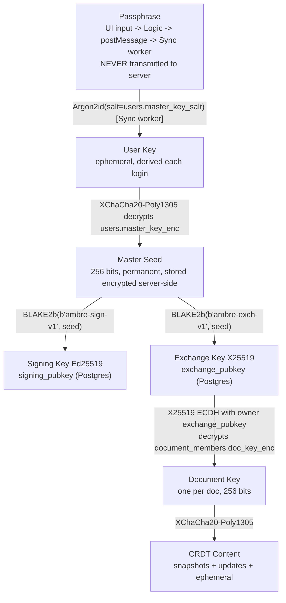

# AMBRE -- FEATURE: THE ZERO-KNOWLEDGE BOUNDARY

**Type:** Horizontal (framework)
**Implementation:** partial -- the capability bans, the key hierarchy, the sealed paths and the
envelope whitelist ship. The log discipline is held by review alone.

> What the relay is allowed to learn, and what it must never be able to learn. One line runs through
> the whole product: the server stores what a user writes and can read none of it.

This document owns the boundary itself. Each side refines it on its own terms -- `SYNC-*` on the
client, `SRV-*` on the relay -- and neither restates it here.

---

## 1. CONTRACT

The only mandatory read. Grammar and status values are normative in `ambre-spec-template.md`. The
prefix is `ZK`, and it belongs to this document alone: a rule that constrains one component carries
that component's prefix instead.

| ID | Kind | Statement (RFC 2119) | Sources | Mechanism | Gap | Status |
|---|---|---|---|---|---|---|
| `ZK-001` | `INV` | No CRDT payload MUST leave the client unless it has been AEAD-sealed with a `DocumentKey`. | README pillar "E2EE"; `ambre-spec-sealed-envelope.md` | `ambre_sync::seal_tests::a_payload_frame_built_outside_the_seal_never_reaches_the_socket` -- the socket send refuses a payload frame the pipeline did not seal; type-level -- a storage upload takes a `SealedBlob` alone, built by the pipeline, which `ambre_sync::pipeline::tests::a_blob_bound_for_storage_is_sealed` opens back | none | verified |
| `ZK-002` | `INV` | No symmetric key material MUST be nameable in a wire type. | README pillar "Zero-Knowledge" | crate-graph -- `ambre-protocol` depends on `ambre-core` alone; cargo-deny -- `deny.toml` refuses any dependant of `ambre-crypto` outside `ambre-sync` and `ambre-logic`, so the edit that would make a key type nameable fails CI | none | verified |
| `ZK-003` | `INV` | Passphrase-to-key derivation (Argon2id) MUST run client-side only. | `ambre-spec-session.md`, `SRV-030`; this spec section 2 | cargo-deny -- `deny.toml` bans `argon2` outside `ambre-crypto`, and the CI `deny` job fails the manifest that declares it | none | verified |
| `ZK-004` | `INV` | The server process MUST NOT link a crate able to decrypt a document payload, derive a shared secret, or reconstruct a split secret. | this spec section 2; `ambre-spec-server.md`, `SRV-012` | cargo-deny -- the capability bans on `chacha20poly1305`, `x25519-dalek`, `argon2`, `ambre-crypto` and `loro`, run by the CI `deny` job. The three unused declarations that violated this were dropped from `ambre-server` | none | verified |
| `ZK-005` | `INV` | Presence and cursor data MUST be sealed with the `DocumentKey`, exactly like a delta. | `ambre-spec-sealed-envelope.md` | `ambre_sync::pipeline::tests::roundtrip_ephemeral` -- it seals an ephemeral and opens it, so an unsealed one fails the assertion | none | verified |
| `ZK-006` | `INV` | Logs and tracing spans MUST NOT carry ciphertext or plaintext payloads -- identifiers, lengths and sequence numbers only. | `ambre-spec-server.md`, `SRV-001`; audit `C1` | type-level -- the relay holds every payload in a `Payload`, which has no `Debug` and no `Display` (`ambre-spec-server.md`, `SRV-001`); `ambre_protocol::messages::validate_tests::a_message_debug_form_prints_no_byte_of_its_ciphertext` -- a wire message prints each ciphertext as its length; ci-gate -- `scripts/crate_boundaries.py` refuses a log line in a relay file that reads a payload's or a ciphertext's bytes | none | verified |
| `ZK-017` | `INV` | The debug form of a sealed envelope MUST print its ciphertext length and none of its bytes. | `ZK-006`; audit `C1` | `ambre_crypto::tests::an_envelope_debug_form_prints_no_byte_of_it` | none | verified |
| `ZK-007` | `INV` | What a sealed envelope shows the relay MUST be limited to `{document_id, pub_key, key_id, snapshot_id, clock, counter, nonce, commitment tag, signature, parent snapshot proof, parent clocks}`. Beyond it, the relay learns only `{seq, blob size, timestamp, source IP}`. | this spec section 2, the boundary table and its accepted leak | `ambre_protocol::tests::the_relay_reads_only_the_listed_fields` -- it destructures every envelope without `..`, so a new field fails to compile until a writer weighs it here | none | verified |
| `ZK-008` | `INV` | A presigned S3 URL MUST be issued only after the ACL check. | `ambre-spec-object-store.md`, `SRV-002` | `ambre_server::routes::tests::handler_tests::a_presigned_url_is_signed_only_after_the_access_check` -- an outsider is refused all four URLs, and a viewer both uploads | none | verified |
| `ZK-009` | `INV` | The two key-derivation domains MUST stay frozen at `ambre-sign-v1` and `ambre-exch-v1`, one context each. | this spec section 2; derived | `ambre_crypto::tests::derived_keys_match_the_frozen_domains` -- it pins the key pair one seed derives under each domain, so a renamed domain fails it | none | verified |
| `ZK-010` | `INV` | A passphrase MUST cross the client bus in a type that wipes its own bytes when it is dropped. | README pillar "Zero-Knowledge"; audit `H4`, `H5` | type-level -- `RestCommand::Unlock`, `SetupAccount`, `ChangePassphrase` and `RecoverAccount` carry `ambre_core::Passphrase`, and the recovery words a `SecretString`. Each holds an `ambre_core::Secret`, which wipes its value when the last owner drops it, so a plain `String` on that path does not compile; `ambre_core::secret::tests::a_secret_wipes_its_value_once_when_it_drops`; `::a_shared_secret_wipes_when_its_last_owner_drops` | none | verified |
| `ZK-011` | `INV` | The Master Seed MUST be moved and never copied: a path MUST NOT leave a second copy behind. | this spec section 2; derived | type-level -- `MasterSeed` holds an `ambre_core::Secret`, which implements no `Clone`, so a duplicate is a compile error rather than a review finding. The `compile_fail` doctests of `ambre_core::secret` show a derived `Clone` refused. The recovery words are spelled in place inside a `SecretString`, so no bare copy of the seed is left; `ambre_crypto::tests::the_recovery_words_spell_the_seed_in_hex` | none | verified |
| `ZK-012` | `INV` | A passphrase MUST NOT appear in a request the client sends to the relay. | README pillar "Zero-Knowledge"; audit `N4` | ci-gate -- `scripts/crate_boundaries.py`, run by `just crate-boundaries` in the CI `lint` job, refuses a serialized struct of the worker crates that names a passphrase field or carries a `Secret` type | none | verified |
| `ZK-013` | `INV` | The relay MUST see no field of an ephemeral beyond `document_id`, `pub_key`, `key_id` and `counter`. | `ambre-spec-broadcast.md`, `SRV-050` | `ambre_protocol::tests::the_relay_reads_only_the_listed_fields` -- the ephemeral public data destructures to exactly these four fields | none | verified |
| `ZK-014` | `INV` | A presigned S3 URL MUST expire within 15 minutes. | `ambre-spec-object-store.md`, `SRV-052` | `ambre_server::s3::tests::a_presigned_url_never_outlives_fifteen_minutes` -- a configured lifetime of one day signs both URLs for 900 s | none | verified |
| `ZK-015` | `INV` | What the relay learns of a Murmure channel MUST be limited to `{the documents of the channel and their kind, which documents are spaces, the space of the channel, its public flag, the state of each segment with its close time, its finalization time, its finalize lease and the horizon and identifier of its final snapshot, whether a rotation retired its key, the segment each amendments document amends, the identifier of the root message of each thread, the retention duration of the space, the read cursor of each member}`. | this spec section 2; `5-Murmure/ambre-spec-murmure-schema.md` | `ambre_server::db::channels::tests::the_channel_tables_hold_only_what_the_relay_may_learn` -- database tier | none | verified |
| `ZK-016` | `INV` | What the relay learns for a push notification MUST be limited to `{the push subscription of each device, the notification level of each member per channel, the members or the channel a message names}`. | this spec section 2; `5-Murmure/features/ambre-spec-murmure-notifications.md` | not built | unbuilt -- lands with the `Push notifications` Story (`ambre-roadmap.md` E5) | unimplemented |
| `ZK-018` | `INV` | What the relay learns of a user in the clear MUST be limited to `{the address and whether a provider verified it, the display name, the avatar picture, the provider and its subject, the two public keys}`. | this spec section 2; `ambre-spec-session.md section 3`; `ambre-spec-profile.md section 3` | `ambre_server::db::users::tests::the_account_table_holds_only_what_the_relay_may_learn` -- database tier, and beside these fields it finds only the identifier the relay mints and the sealed key material | none | verified |
| `ZK-019` | `INV` | Every secret of the workspace -- a key, a seed, a passphrase, a session token -- MUST be held in an `ambre_core::Secret`, which wipes its value when it is dropped and whose debug form prints no byte and no length of it. | this spec section 2, the key separation | type-level -- each secret type of the workspace is a newtype over `Secret` or `Arc<Secret<T>>`, and only the Secret module may name the `zeroize` crate (`ARCH-046`), so no type wipes itself another way; `ambre_core::secret::tests::a_secret_prints_neither_its_bytes_nor_its_length`; `::a_secret_wipes_its_value_once_when_it_drops`; `::a_shared_secret_wipes_when_its_last_owner_drops`; `::a_failed_fill_wipes_the_partial_value`; `::a_secret_is_zeroize_on_drop`; `ambre_crypto::tests::a_shared_secret_is_wiped_and_never_printed` | none | verified |
| `ZK-020` | `INV` | A type that holds a `Secret` MUST NOT be copied, serialized, compared with `==` or displayed except by code that reads the value through `expose`. Two secrets MUST be compared in constant time. | this spec section 2, the key separation | type-level -- `Secret` implements no `Clone`, `Serialize`, `Deserialize`, `PartialEq`, `Hash`, `Ord` or `Display`, so a derive of one on a type that holds it does not compile. Three `compile_fail` doctests of `ambre_core::secret` show a derived `Clone`, `Serialize` and `PartialEq` refused; a derived `Debug` compiles and prints `Secret([REDACTED])`. A hand-written impl reads `expose`, which `ARCH-045` keeps in `ambre-crypto` and the Secret module. Equality is `subtle::ConstantTimeEq`; `ambre_core::secret::tests::a_secret_has_no_display_clone_serialize_or_partial_eq`; `::equality_is_constant_time_and_reads_every_byte`; `::expose_reads_the_value_and_clone_secret_copies_it` | none | verified |

* **Budget.** the four crypto rows of `ambre-spec-budgets.md section 1`: the outbound seal, the
  inbound open, the full round trip and the snapshot compression. `criterion` measures all four in
  `ambre-crypto/benches`, which no CI job runs.
* **Boundary.** this document **is** the boundary. Every other document either refines one of these
  rows on its own side, or answers `none` and says why.
* **Verification.** 19 `verified`, 1 `unimplemented`. Every row is an `INV`. This document owns no
  gesture, so it declares no operation table, and each rule binds the boundary at every instant.

  Six rows hold, and they hold because the crate graph, `deny.toml` and the type system can refuse
  them. No key type is nameable on the wire, no `argon2` sits outside `ambre-crypto`, no decrypting
  crate is linked into the relay. No presence sample leaves unsealed, no passphrase sits in a type
  that does not wipe itself, and no seed is copied. Every secret sits in one wrapper that wipes it,
  prints nothing of it and copies it only on request (`ZK-019`, `ZK-020`).

  What is loose is every rule stated as an absence. `ZK-001` covers the nominal path and forbids no
  unsealed send. `ZK-007` is a whitelist with no natural test. `ZK-008` has no test for the refusal
  a non-member must get. `ZK-009` is a constant no vector pins. `ZK-012` holds by the absence of a
  field nothing guards.

  No payload reaches a log line. The client's envelope prints no byte (`ZK-017`), and a wire
  message prints each ciphertext as its length. The relay holds every payload in a type a log
  cannot name (`ZK-006`).

  `ZK-013` and `ZK-014` are what the split of two conjunctions exposed. Neither half had a
  mechanism, and the row each sat in read as covered because its other half was.

---

## 2. MODEL

**CRDT containers.** none. The boundary constrains what leaves the client; it stores nothing itself.

**What the relay sees.**

| Component | Data seen by server | Never seen |
|-----------|----------------------------|-------------|
| `ambre-server` | `document_id`, `pub_key` (Ed25519), `clock`, `seq`, `snapshot_id`, `key_id`, `nonce` | CRDT content, Document Key, Master Seed, User Key, passphrase |

**The cast of a scenario.** Every scenario table of the corpus draws its actors from this list, so
a reader knows who is hostile from the name alone.

| Name | Role | Holds |
| :--- | :--- | :--- |
| Alice, Bob, Carol | honest members | their own keys and the document key |
| Mallory | a malicious member: forges, replays and rewrites with a legitimate key | her own keys and the document key |
| Eve | a passive attacker on the network | the ciphertext in transit, and nothing to open it |
| the relay | honest but curious: routes and stores as asked, and reads all it can | the set of `ZK-007`, and nothing to open a payload |

A scenario row where Mallory acts is an attack. Its outcome column says what stops her.

**Accepted leak, and what is not accepted.**

* **Accepted:** the relay infers that a client with a given public key modified a given document at
  a given instant. That is the metadata of the table above, read as a pattern.
* **Accepted:** the membership graph. The relay knows which public keys are members of which
  document, readers included. For a Murmure channel, that graph shows who talks with whom.
  * The relay needs the graph to route a wire message and to refuse a non-member.
  * A subscription reveals the graph anyway, so a sealed membership list would hide nothing.
  * The leak stops at the graph. A document identifier is a UUID v7 minted on the client: a
    timestamp and random bits, never derived from a name.
  * A member row carries only what access control and the unwrap read. That is the member, the
    role, the wrapped document key and the inviter whose exchange key wrapped it.
  * The inviter column tells the relay who invited whom. The unwrap needs the inviter's exchange
    key, so that edge of the graph is accepted too.
  * The signed membership log repeats that graph with a signature on each act, so a client can check
    it (`SYNC-132`). It teaches the relay nothing it did not hold.
* **Accepted, for a Murmure channel only:** the grouping of its documents and the few facts the
  relay needs to finalize and to expire them (`ZK-015`). It also learns which locked segment was
  amended, since it keeps one amendments document per segment (`SRV-202`). It flags the segments
  a rotation of `meta` left open, a fact its key links already hold (`SRV-147`). It learns which
  documents are spaces, which a channel of the space would teach it anyway (`SRV-216`). The relay
  never learns the kind of an update: the activity summary is sealed (`SYNC-113`).
* **Accepted, for an account:** the address, the display name and the avatar picture, in the clear
  (`ZK-018`). The relay shows a member list to its members, and the picture is one the user chose
  to show. It serves a picture only to a user who shares a document with its owner (`PROFILE-009`).
* **Accepted, for a push notification only:** the level of each member per channel, and who a
  message names. Web Push requires a visible notification for every push, so the relay must choose
  who to wake (`ZK-016`).
* **Not accepted, and stated as a defect:** a media blob's address, which is a hash of its
  plaintext, and its media type (`ambre-spec-media.md`, `SYNC-050`, `SYNC-053`).
* **Accepted, and not a leak:** a key identifier. It is a hash of a random 256-bit key. It tells the
  relay when a document rotated, which it already knows, and nothing of the key (`SYNC-115`).

**Static verification, mechanised in `deny.toml`.** `ambre-server` imports no type from
`ambre-trame`, `ambre-bus` or `ambre-crypto`; it imports `ed25519-dalek` directly. Every
`ciphertext` in `ambre-protocol` is an opaque `Vec<u8>`.

**Key separation.**

* Every secret is a domain newtype over `ambre_core::Secret<T>`: `MasterSeed`, `UserKey`,
  `DocumentKey`, `StoreKey`, `FileKey`, `SharedSecret`, `SecretToken`, `Passphrase`, `SecretString`,
  `SecretBytes` and the relay's `JwtSeed`. The newtype keeps the name and the meaning, and `Secret`
  carries the hygiene (`ZK-019`, `ZK-020`):
  * the value sits in a `Box`, so a move copies no byte of it, and it is wiped on drop;
  * its debug form is `Secret([REDACTED])`, with no length, and it has no `Display`;
  * it has no `Clone`, no serde, no `PartialEq`, `Hash` or `Ord`. A value two owners share is an
    `Arc<Secret<T>>`, wiped when the last owner drops it. `clone_secret` is the one explicit copy;
  * two secrets compare in constant time through `subtle`'s `ConstantTimeEq`. `subtle` is pure
    Rust and already sat in the tree under the RustCrypto stack;
  * a value is built in place with `Secret::filled` or `Secret::try_filled`, so no unwiped copy
    is left on the stack;
  * the value is read through `expose` in `ambre-crypto` alone (`ARCH-045`). A crate outside it
    calls a typed method there: `MasterSeed::recovery_words`, `SecretToken::present`,
    `seal_row` and `seal_file`. Only the Secret module names `zeroize` (`ARCH-046`).
* No secret is serialized into `ambre-protocol`. One that crosses the bus or the store does so
  through the hand-written serde of its newtype, never a derive.
* The Logic to Sync `postMessage` hop carries **decrypted** deltas. That internal boundary is accepted,
  because a structured clone stays inside the user's own browser process. The Main instance compiles
  no cryptography, so the keys live only in the Sync worker's own memory.
* Presence and cursor samples are sealed before they leave, exactly like a delta (`ZK-005`).

**The primitives** all execute in the Sync worker, the sole consumer of `ambre-crypto`.
XChaCha20-Poly1305 for AEAD, Ed25519 for signatures, X25519 for key agreement. BLAKE2b for
derivation and hashing, Argon2id for the passphrase, HMAC-SHA256 for the commitment tag.

**The key hierarchy.** The four Postgres columns it ends in -- `master_key_enc`, `master_key_salt`,
`doc_key_enc` and `org_master_key_enc` -- are opaque blobs to the relay (`ambre-spec-server.md`,
`ambre-spec-session.md`, `ambre-spec-organizations.md`).



Both derivations truncate a 512-bit BLAKE2b digest to 32 bytes, and the two domain strings are the
only thing that separates them. They are a frozen constant, not a name: change one and every account
that already exists derives a different key pair, which is `ZK-009`.

```rust
pub struct MasterSeed(Secret<[u8; 32]>); // wiped on drop, not Clone
impl MasterSeed {
    pub fn derive_signing_key(&self) -> ed25519_dalek::SigningKey;
    pub fn derive_exchange_key(&self) -> x25519_dalek::StaticSecret;
    pub fn recovery_words(&self) -> SecretString; // the seed in lowercase hex
}
```

**A document's name is content.** It is sealed under that document's key like any other payload, so
the relay stores an opaque blob and never a title. The write path seals it in the Sync worker. The
read path returns it beside the caller's wrapped key, so a never-opened document still shows its
name. A document created with no name has none rather than a placeholder. The rules are
`SYNC-067` and `SYNC-042`; the display is `ambre-spec-launcher.md`.

**Code.** `crates/ambre-crypto/src/keys.rs` for the hierarchy, `crates/ambre-crypto/src/aead.rs`
and `commitment.rs` for the seal, `deny.toml` for the capability bans.

---

## 3. SURFACE

The boundary has no control of its own. What a user meets is what it costs them.

| Trigger | Behaviour |
|---|---|
| signing in | the passphrase is typed once, derived in the Sync worker, and never sent |
| a first invitation | the recipient's key fingerprint is shown for an out-of-band check (`ambre-spec-key-verification.md`) |
| account setup | 24 recovery words are shown once: they are the Master Seed, and the only path back after a forgotten passphrase |
| losing both the passphrase and the words | the documents are unrecoverable, unless an organization holds the escrow (`ambre-spec-organizations.md`) |

---

## 4. REJECTED ALTERNATIVES

| Decision | Rejected alternative | Why not |
| :--- | :--- | :--- |
| The relay is blind by capability, not by discipline | a code-review rule stating that the server must not decrypt | a rule a reviewer must remember is a rule that fails on a busy day. `deny.toml` refuses the dependency itself, so re-granting the relay the power to decrypt becomes a reviewable edit of one file instead of one silent line in a manifest |
| One key per document, wrapped per member | a per-user key index held server-side | it makes the relay the authority on who may read what, which is the property being removed. Wrapping the document key for each member's exchange key keeps the relay a carrier |
| The plaintext delta crosses the worker boundary | sealing on the Logic thread, so that no plaintext ever crosses a `postMessage` | it means compiling cryptography into the Main instance, which puts the keys in the same memory as the renderer and the page. A structured clone stays in the user's own process, so the hop costs a copy and buys key isolation |
| The metadata pattern is an accepted leak, written down | claiming the relay learns nothing at all | it would make the pillar unfalsifiable: a relay that routes must know who writes where and when. `ZK-007` exists to bound that set rather than to refuse it |
| The membership graph is an accepted leak | hiding membership from the relay, through a fan-out by the sender or anonymous credentials | the relay then has no subscription check and no targeted push, and each message costs one send per member. A document suite gains too little for that cost, so the graph is written down instead |
| The media address is a defect, not a second accepted leak | widening the whitelist of `ZK-007` to cover the address | the address is a hash of plaintext, so it answers "does this document contain this file" for any file the relay already holds. That is a capability, not metadata, and accepting it would put a capability inside a list that bounds metadata |
| The escrow is opt-in and organization-scoped | a platform-wide key escrow for account recovery | a recovery path an owner can use without the member's consent is a second key holder, so it may exist only where an organization already claims that authority, and never for a personal account |
| A key identifier is accepted in the `ZK-007` set | keeping every key identifier sealed | the relay could then neither refuse an envelope under a stale key nor keep the links of a key chain in order |

---

## 5. NOT BUILT, AND NOT YET RULED

* **The passphrase is copied into a transient buffer.** It crosses the bus in a self-wiping type
  (`ZK-010`), and the per-frame relay then postcard-encodes it into an ordinary buffer for
  `postMessage`. That buffer is not wiped, and no type stops it.
* **The membership graph has no whitelist.** `ZK-007` covers the sealed envelopes alone. The member
  row adds a role and an inviter. The relay reads the role and serves the inviter for the unwrap. A
  row must name the membership graph as a separate accepted set.

---

## 6. WHAT THIS DOCUMENT DOES NOT OWN

| Question | Owner |
|---|---|
| How a payload is sealed, and what the envelope carries | `ambre-spec-sealed-envelope.md` |
| Who holds a document key, and how it is wrapped for a member | `ambre-spec-membership.md` |
| What a revoke re-keys, and in what order | `ambre-spec-key-rotation.md` |
| How a passphrase becomes a session | `ambre-spec-session.md` |
| What the relay stores, and what it refuses | `ambre-spec-server.md` |
| How a key fingerprint is shown and pinned | `ambre-spec-key-verification.md` |
| Who may recover a member's key inside an organization | `ambre-spec-organizations.md` |
| The threads, the queues and the crate graph that carry the separation | `ambre-spec-architecture.md` |
| What each budget of the workspace is | `ambre-spec-budgets.md` |
