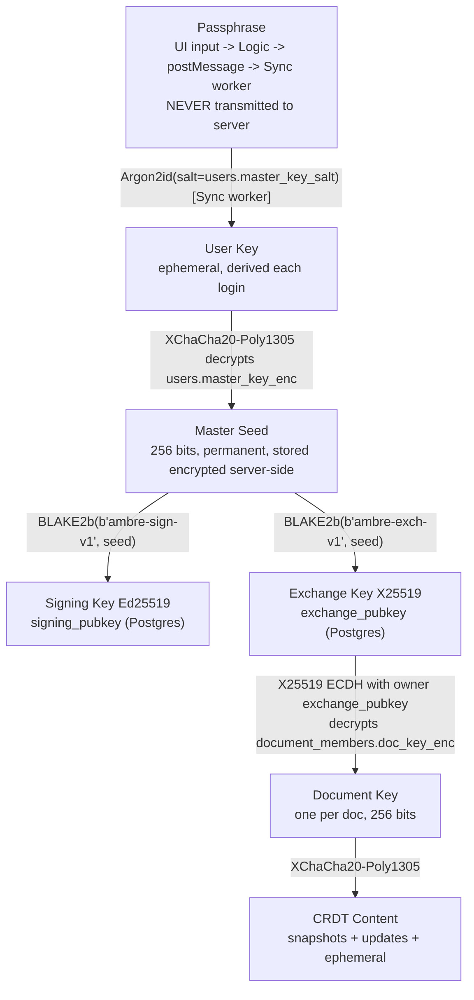

# AMBRE -- FEATURE: THE ZERO-KNOWLEDGE BOUNDARY

**Type:** Horizontal (framework)
**Implementation:** partial -- the capability bans, the key hierarchy and the sealed paths ship; the
whitelist and the log discipline are held by review alone.

> What the relay is allowed to learn, and what it must never be able to learn. One line runs through
> the whole product: the server stores what a user writes and can read none of it.

This document owns the boundary itself. Each side refines it on its own terms -- `SYNC-*` on the
client, `SRV-*` on the relay -- and neither restates it here.

---

## 1. CONTRACT

The only mandatory read. Grammar and status values are normative in `ambre-spec-template.md`. The
prefix is `ZK`, and it belongs to this document alone: a rule that constrains one component carries
that component's prefix instead.

| ID | Statement (RFC 2119) | Sources | Verification | Status |
|---|---|---|---|---|
| `ZK-001` | No CRDT payload MUST leave the client unless it has been AEAD-sealed with a `DocumentKey`. | pillar "E2EE"; `ambre-spec-sealed-envelope.md` | the nominal path only (`ambre_sync::pipeline::tests::roundtrip_update_small`); nothing forbids an unsealed send | unverified |
| `ZK-002` | No symmetric key material MUST be nameable in a wire type. | pillar "Zero-Knowledge" | crate graph: `ambre-protocol` depends on `ambre-core` alone; `deny.toml` refuses any dependant of `ambre-crypto` outside `ambre-sync` / `ambre-logic`, so the edit that would make a key type nameable fails CI | verified |
| `ZK-003` | Passphrase-to-key derivation (Argon2id) MUST run client-side only. | `ambre-spec-session.md`, `SRV-030`; this spec section 2 | `deny.toml` bans `argon2` outside `ambre-crypto`; CI job `deny` | verified |
| `ZK-004` | The server process MUST NOT link a crate able to decrypt a document payload, derive a shared secret, or reconstruct a split secret. | this spec section 2; `ambre-spec-server.md`, `SRV-012` | `deny.toml` capability bans (`chacha20poly1305`, `x25519-dalek`, `argon2`, `ambre-crypto`, `loro`), CI job `deny`. The three unused declarations that violated this (`chacha20poly1305`, `x25519-dalek`, `sharks`) were dropped from `ambre-server` | verified |
| `ZK-005` | Presence and cursor data MUST be sealed with the `DocumentKey`; the relay MUST see only `document_id`, `pub_key` and `counter`. | `ambre-spec-sealed-envelope.md`; `ambre-spec-broadcast.md`, `SRV-050` | `ambre_sync::pipeline::tests::roundtrip_ephemeral`; `ambre_server::ws::handler::message::ephemeral_binding_tests::forged_author_key_writes_no_presence` | verified |
| `ZK-006` | Logs and tracing spans MUST NOT carry ciphertext or plaintext payloads -- identifiers, lengths and sequence numbers only. | `ambre-spec-server.md`, `SRV-001`; audit `C1` | none: the guarantee is a comment in `s3.rs` plus reviewer attention | human-review |
| `ZK-007` | What the relay may learn MUST be limited to `{document_id, pub_key, clock, seq, snapshot_id, nonce, blob size, timestamp, source IP}`; anything outside that set is a leak. | this spec section 2, the boundary table and its accepted leak | none. A whitelist has no natural test -- candidate for an `insta` snapshot over the `WsClientMsg` / `WsServerMsg` shapes | unverified |
| `ZK-008` | A presigned S3 URL MUST be issued only after the ACL check, and MUST expire within 15 minutes. | `ambre-spec-object-store.md`, `SRV-002`, `SRV-052` | the lifetime is one operational figure with a 900 s default and no upper bound enforced; no test asserts a non-member is refused a URL | unverified |
| `ZK-009` | The two key-derivation domains MUST stay frozen at `ambre-sign-v1` and `ambre-exch-v1`, one context each. | this spec section 2; derived | `ambre_crypto::tests::derive_keys_deterministic` proves the derivation is deterministic and that the two domains are independent. It pins **no vector**: a renamed domain keeps the test green and gives every existing account a different key pair | unverified |
| `ZK-010` | A passphrase MUST cross the client bus in a type that wipes its own bytes when it is dropped. | pillar "Zero-Knowledge"; audit `H4`, `H5` | type-level: `RestCommand::Unlock`, `SetupAccount`, `ChangePassphrase` and `RecoverAccount` carry `SecretBytes`, a `Zeroizing` newtype, so a plain `Vec<u8>` on that path does not compile | verified |
| `ZK-011` | The Master Seed MUST be moved and never copied: no path may leave a second copy behind. | this spec section 2; derived | type-level: `MasterSeed` derives no `Clone`, so a duplicate is a compile error rather than a review finding | verified |
| `ZK-012` | A passphrase MUST NOT appear in a request the client sends to the relay. | pillar "Zero-Knowledge"; audit `N4` | none. Neither the client request type nor the relay one declares a passphrase field, so the rule holds by absence, and nothing fails the day a writer adds one back | unverified |

* **Budget.** the four crypto rows of `ambre-spec-budgets.md section 1` -- the outbound seal, the
  inbound open, the full round trip and the snapshot compression -- all measured by `criterion` in
  `ambre-crypto/benches`, which no CI job runs.
* **Boundary.** this document **is** the boundary. Every other document either refines one of these
  twelve rows on its own side, or answers `none` and says why.
* **Verification.** 6 `verified`, 5 `unverified`, 1 `human-review`. What holds is what the crate
  graph, `deny.toml` and the type system can refuse: a key type nameable on the wire, `argon2`
  outside `ambre-crypto`, a decrypting crate linked into the relay, an unsealed presence frame, a
  passphrase in a type that does not wipe itself, a copied seed. What is loose is every rule stated
  as an absence -- `ZK-001` covers the nominal path and forbids no unsealed send, `ZK-007` is a
  whitelist with no natural test, `ZK-008` has no test for the refusal a non-member must get,
  `ZK-009` is a constant no vector pins, `ZK-012` holds by the absence of a field nothing guards,
  and `ZK-006` is a comment plus reviewer attention.

---

## 2. MODEL

**CRDT containers.** none. The boundary constrains what leaves the client; it stores nothing itself.

**What the relay sees.**

| Component | Data seen by server | Never seen |
|-----------|----------------------------|-------------|
| `ambre-server` | `document_id`, `pub_key` (Ed25519), `clock`, `seq`, `snapshot_id`, `nonce` | CRDT content, Document Key, Master Seed, User Key, passphrase |

**Accepted leak, and what is not accepted.**

* **Accepted:** the relay infers that a client with a given public key modified a given document at
  a given instant. That is the metadata of the table above, read as a pattern.
* **Not accepted, and stated as a defect:** a media blob's address, which is a hash of its
  plaintext, and its media type (`ambre-spec-media.md`, `SYNC-050`, `SYNC-053`).

**Static verification, mechanised in `deny.toml`.** `ambre-server` imports no type from
`ambre-trame`, `ambre-bus` or `ambre-crypto`; it imports `ed25519-dalek` directly. Every
`ciphertext` in `ambre-protocol` is an opaque `Vec<u8>`.

**Key separation.**

* `DocumentKey` and `MasterSeed` are `ZeroizeOnDrop` and are never serialized into `ambre-protocol`
  or `ambre-bus`.
* The Logic to Sync `postMessage` hop carries **decrypted** deltas. That internal boundary is
  accepted: a structured clone stays inside the user's own browser process, and the Main instance
  compiles no cryptography, so the keys live only in the Sync worker's own memory.
* Presence and cursor frames are sealed before they leave, exactly like a delta (`ZK-005`).

**The primitives**, all executed in the Sync worker, the sole consumer of `ambre-crypto`:
XChaCha20-Poly1305 for AEAD, Ed25519 for signatures, X25519 for key agreement, BLAKE2b for
derivation and hashing, Argon2id for the passphrase, HMAC-SHA256 for the commitment tag.

**The key hierarchy.** The four Postgres columns it ends in -- `master_key_enc`, `master_key_salt`,
`doc_key_enc` and `org_master_key_enc` -- are opaque blobs to the relay (`ambre-spec-server.md`,
`ambre-spec-session.md`, `ambre-spec-organizations.md`).



Both derivations truncate a 512-bit BLAKE2b digest to 32 bytes, and the two domain strings are the
only thing that separates them. They are a frozen constant, not a name: change one and every account
that already exists derives a different key pair, which is `ZK-009`.

```rust
pub struct MasterSeed([u8; 32]); // ZeroizeOnDrop, not Clone, 24 BIP39 words
impl MasterSeed {
    pub fn derive_signing_key(&self) -> ed25519_dalek::SigningKey;
    pub fn derive_exchange_key(&self) -> x25519_dalek::StaticSecret;
    pub fn recovery_bytes(&self) -> &[u8; 32];
}
```

**A document's name is content.** It is sealed under that document's key like any other payload, so
the relay stores an opaque blob and never a title. The write path seals it in the Sync worker, the
read path returns it beside the caller's wrapped key so a never-opened document still shows its
name, and a document created with no name has none rather than a placeholder. The rules are
`SYNC-067` and `SYNC-042`; the display is `ambre-spec-launcher.md`.

**Code.** `crates/ambre-crypto/src/keys.rs` for the hierarchy, `crates/ambre-crypto/src/aead.rs`
and `commitment.rs` for the seal, `deny.toml` for the capability bans.

---

## 3. SURFACE

The boundary has no control of its own. What a user meets is what it costs them.

| Trigger | Behaviour |
|---|---|
| signing in | the passphrase is typed once, derived in the Sync worker, and never sent |
| a first invitation | the recipient's key fingerprint is shown for an out-of-band check (`ambre-spec-key-verification.md`) |
| account setup | 24 recovery words are shown once: they are the Master Seed, and the only path back after a forgotten passphrase |
| losing both the passphrase and the words | the documents are unrecoverable, unless an organization holds the escrow (`ambre-spec-organizations.md`) |

---

## 4. DECISIONS

| Decision | Rationale | Rejected alternative |
|---|---|---|
| The relay is blind by capability, not by discipline | a rule a reviewer must remember is a rule that fails on a busy day. `deny.toml` refuses the dependency itself, so re-granting the relay the power to decrypt becomes a reviewable edit of one file instead of one silent line in a manifest | a code-review rule stating that the server must not decrypt |
| One key per document, wrapped per member | a per-user index of document keys makes the relay the authority on who may read what, which is the property being removed. Wrapping the document key for each member's exchange key keeps the relay a carrier | a per-user key index held server-side |
| The plaintext delta crosses the worker boundary | the alternative is compiling cryptography into the Main instance, which puts the keys in the same memory as the renderer and the page. A structured clone stays in the user's own process, so the hop costs a copy and buys key isolation | sealing on the Logic thread, so that no plaintext ever crosses a `postMessage` |
| The metadata pattern is an accepted leak, written down | a relay that routes must know who writes where and when. Claiming otherwise would make the pillar unfalsifiable, and `ZK-007` exists to bound the set rather than to deny it | claiming the relay learns nothing at all |
| The media address is a defect, not a second accepted leak | it is a hash of plaintext, so it answers "does this document contain this file" for any file the relay already holds. That is a capability, not metadata, and it is stated as failing rather than accepted | widening the whitelist of `ZK-007` to cover the address |
| The escrow is opt-in and organization-scoped | a recovery path that an owner can use without the member's consent is a second key holder, so it exists only where an organization already claims that authority, and never for a personal account | a platform-wide key escrow for account recovery |

---

## 5. NOT BUILT, AND NOT YET RULED

* **Nothing refuses an unsealed send.** `ZK-001` is covered on the nominal path by one round-trip
  test. A new call site that posts a payload without passing the pipeline compiles and ships.
* **The whitelist has no test.** `ZK-007` names nine fields and nothing compares them to what the
  wire types actually carry. A snapshot over `WsClientMsg` and `WsServerMsg` is the candidate
  mechanism and does not exist.
* **The derivation domains are pinned by nothing.** `ZK-009` is a constant with no golden vector, so
  the failure it guards against is silent and total: every account keeps its seed and loses its
  keys.
* **The passphrase is copied into a transient buffer.** It crosses the bus in a self-wiping type
  (`ZK-010`), and the per-frame relay then postcard-encodes it into an ordinary buffer for
  `postMessage`. That buffer is not wiped, and no type stops it.
* **The log rule is a comment.** `ZK-006` rests on one comment in `s3.rs` and on reviewer attention.
  No lint refuses a payload in a span field.
* **The presigned URL has no upper bound.** `ZK-008` states 15 minutes; the code carries a 900 s
  default that a deployment may raise, and no test asserts a non-member is refused.
* **No rule covers what the relay may keep after a delete.** The rows are `SRV-017` and `SRV-057`,
  and until they move, a deleted document leaves its sealed objects in storage.

---

## 6. WHAT THIS DOCUMENT DOES NOT OWN

| Question | Owner |
|---|---|
| How a payload is sealed, and what the envelope carries | `ambre-spec-sealed-envelope.md` |
| Who holds a document key, and how it is wrapped for a member | `ambre-spec-membership.md` |
| What a revoke re-keys, and in what order | `ambre-spec-key-rotation.md` |
| How a passphrase becomes a session | `ambre-spec-session.md` |
| What the relay stores, and what it refuses | `ambre-spec-server.md` |
| How a key fingerprint is shown and pinned | `ambre-spec-key-verification.md` |
| Who may recover a member's key inside an organization | `ambre-spec-organizations.md` |
| The threads, the channels and the crate graph that carry the separation | `ambre-spec-architecture.md` |
| What each budget of the workspace is | `ambre-spec-budgets.md` |
