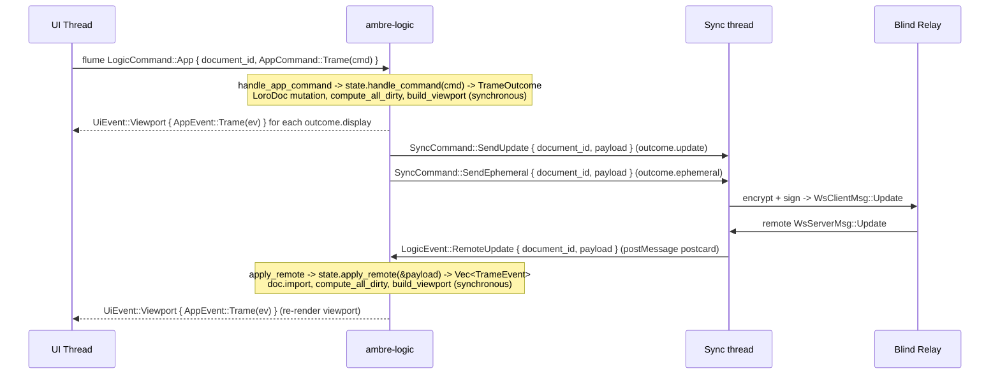

# AMBRE -- SPEC: TRAME LOGIC (Spreadsheet Engine)
**Type:** Vertical (Feature / Application -- Logic)
**Status:** Draft
**Implementation:** partial

> Trame collaborative spreadsheet engine: multi-sheet CRDT state management (`LoroDoc`), incremental formula compilation to bytecode, evaluation via stack VM, two-level dependency graph, synchronous recomputation inside `handle_command`, and production of data-oriented structures for rendering.
>
> **Scope.** The `TrameState` engine running in the Logic thread. Rendering and UI are in
> `trame-ui`, features (sort, filters, conditional formatting, undo/redo, validation) in
> `trame-features`, and xlsx/PDF/CSV interoperability in `trame-interop`.
>
> **State registry.** The Logic thread holds `HashMap<DocumentId, DocState>` with
> `enum DocState { Trame(TrameState), ... }`; dispatch is a `match` on `(DocState, AppCommand)` -- no
> trait object, no `downcast`. `TrameState::handle_command` returns a typed [`TrameOutcome`]; the
> `ambre-logic` dispatcher forwards display events to the UI and CRDT/ephemeral payloads to Sync. The
> `LoroDoc` is instantiated in the Logic thread and never leaves it. See architecture section 6.

---

## 1. OBJECTIVES & CONSTRAINTS

**Scope of this module:**
- Owns the multi-sheet `LoroDoc`
- Incremental compilation of formulas to bytecode (compile once, execute N times)
- Evaluation via stack VM with dynamic cycle detection
- Two-level dependency graph: cell-to-cell + ranges
- Synchronous recomputation of dirty cells inside `handle_command` / `apply_remote` (aligned with the Prose pattern)
- Broken reference detection (`#REF!`)
- Production of `DisplayViewport` for the UI thread
- Export of CRDT deltas to the Sync thread via `SyncCommand::SendUpdate`

**Dependencies:**

| Crate | Role | Rationale |
|---|---|---|
| `ambre-core` | `Uuid`, `DocType` | Shared foundation |
| `ambre-bus` | `AppCommand`/`AppEvent` (incl. `TrameCommand`/`TrameEvent`), `SyncCommand`, `LogicEvent`, `CommandSink` (test seam) | Typed inter-thread data plane + IPC types |
| `ambre-draw` | `DrawSurface` trait, re-exports kurbo/peniko/parley | Shared rendering screen (WgpuSurface) / PDF (KrillaSurface) -- required by architectural convention |
| `loro` | Multi-sheet CRDT | `LoroMovableList` (stable rows/columns), `LoroMap`, `LoroDoc` |
| `petgraph` | Cell-to-cell dependency DAG | Kosaraju SCC, topological sort |
| `nom` | Formula parser | Pure Rust, `no_std`, Excel-compatible syntax |
| `flume` | Logic<->Sync channels (prod) + native test bridges | The Logic dispatcher forwards `SyncCommand`s on a bare `flume::Sender`; tests use the `CommandSink` seam (`MockSyncHandle`) |
| `postcard` | Serialization of `TrameCommand` / `TrameEvent` / `DisplayViewport` | Compact, consistent with inter-thread IPC protocol |
| `rstar` | Floating objects R-tree | O(log n) viewport culling |

> **`ruzstd` absent** -- compression delegated to the Sync thread.
> **Rayon absent (MVP)** -- incremental recomputation O(dirty) is sufficient. Planned Phase 3+.

**Invariants:** prefix `TRAME` (the engine). Sibling specs reserve `TRAME-UI`, `TRAME-FEAT` and `TRAME-IO`. Grammar, falsifiability test and status values are normative in `ambre-spec-architecture.md section 4` ("Invariants (normative)"); the cross-spec roll-up is `ambre-spec-testing.md section 7`.

| ID | Statement (RFC 2119) | Sources | Verification | Status |
|---|---|---|---|---|
| `TRAME-001` | The `LoroDoc` MUST NOT leave the Logic thread; it exits only as bytes, through `export_updates` / `export_snapshot`. | section 1 Scope; architecture section 6 | type-level: `TrameState.doc` is private and **no public signature in `ambre-trame` names `LoroDoc`**; both exits return `Vec<u8>` | verified |
| `TRAME-002` | Dirty recomputation MUST complete synchronously inside `handle_command` / `apply_remote`; the returned outcome carries every resulting display event. | section 1; section 8 | type-level: `handle_command` returns `TrameOutcome` by value and the crate has no async path; `ambre_trame::logic::tests::group7::apply_remote_batch_emits_single_datareset_with_full_state` | verified |
| `TRAME-003` | A row's or column's identity MUST be a minted `Uid` carried as the `LoroMovableList` element's **value**, never its position. | section 2.A | `ambre_trame::model::sheet_index::tests::build_maps_positions_to_stable_ids`, `::apply_move_row_permutes_order_and_reindexes`, `::cell_key_is_fixed_length_and_stable` | verified |
| `TRAME-004` | A sort MUST be a pure permutation of the row order (`rows_{sheet}.mov`); it MUST NOT rewrite a cell. | section 2.A; section 12 | `ambre_trame::logic::tests::group3::sort_range_ascending_moves_whole_rows`, `group4::sort_range_multi_already_sorted_emits_no_delta`, `group2::move_row_carries_cells_and_formula_follows_data` | verified |
| `TRAME-005` | A single-cell reference MUST follow its row through a sort or a move; a range MUST remain a positional block. | section 3.A "Cells follow, ranges are blocks"; section 12 | `ambre_trame::logic::tests::group4::sort_range_formulas_follow_data`, `::sort_range_sum_block_is_stable_under_internal_sort` | verified |
| `TRAME-006` | A reference past the used range MUST compile to a `Virtual` axis and read `Empty`, never an error. | section 3.A; section 5 | `ambre_trame::formula::compile::tests::ref_beyond_used_range_is_virtual`, `ambre_trame::formula::vm::tests::push_cell_virtual_beyond_used_range_reads_empty` | verified |
| `TRAME-007` | A reference whose `Bound` `Uid` is absent from the `SheetIndex` MUST evaluate to `#REF!`, and every operator MUST propagate that error. | section 5 | `ambre_trame::formula::vm::tests::push_cell_deleted_bound_yields_ref_error`, `::every_operator_propagates_an_operand_error`, `::unary_not_propagates_an_operand_error`, `::eval_range_over_cell_cap_yields_ref_error` | verified |
| `TRAME-008` | A row or column delete MUST propagate `#REF!` to every formula that referenced the deleted line. | section 5 "Propagation after delete_row/delete_col" | none, and the code does the **opposite**: the delete path reseeds and re-binds every formula from its raw text, so the reference lands positionally on the shifted grid. `ambre_trame::logic::tests::group2::formula_reference_is_positional_after_delete` asserts `=A2` reads **empty** after deleting row 1. `TRAME-007`'s VM primitive is unreachable from this path | unverified |
| `TRAME-009` | Deleting a sheet MUST break its cross-sheet references (`#REF!`); a rename or a reorder MUST NOT. | section 2.D; section 12 | `ambre_trame::logic::tests::group1::cross_sheet_reference_survives_rename_and_breaks_on_delete`, `group3::cross_sheet_reference_converges_across_peers_on_rename`, `::rename_sheet_keeps_id_and_cells`, `ambre_trame::formula::parser::tests::deleted_sheet_id_yields_broken_ref` | verified |
| `TRAME-010` | Computed values MUST NOT enter the CRDT: only the raw `v` is shared and each peer recomputes independently. | section 1; section 2.B | none. `ambre_trame::logic::tests::group1::sum_over_plain_literals_survives_reseed` covers recompute-after-reseed; **nothing asserts the absence of computed values from the document**, which is the half a remote peer depends on | unverified |
| `TRAME-011` | Only cells whose raw text changed MUST be recompiled. | section 4.C | `ambre_trame::formula::cache::tests::stale_cell_recompiled`, `::not_stale_no_recompile`, `::non_formula_clears_cache` | verified |
| `TRAME-012` | A cyclic formula MUST be rejected with its culprit cells named; evaluation MUST NOT hang. | section 4.D | `ambre_trame::formula::dag::tests::static_cycle_detected`, `::cycle_detection_kosaraju_returns_culprits`, `::self_reference_rejected`, `::rejected_cycle_leaves_no_stale_range_deps` | verified |
| `TRAME-013` | Parser, compiler and VM MUST be total: no input produces a panic, every failure is a `CellValue::Error`. | section 4.B; section 4.D | `ambre_trame::formula::prop_tests::parser_never_panics_on_arbitrary_text`, `::parser_never_panics_on_formula_noise`, `::compile_emits_balanced_bytecode`, `::vm_is_total_and_deterministic` (proptest) | verified |
| `TRAME-014` | Aggregate functions MUST be exact and order-independent over their range. | section 4.A | `ambre_trame::formula::prop_tests::sum_is_exact_and_order_independent`, `::engine_sum_matches_naive_sum`, `::product_is_order_independent`, `::average_times_count_equals_sum`, `::min_max_bound_every_element` (proptest) | verified |
| `TRAME-015` | Two peers exchanging the same operations in any interleaving MUST converge to the same document. | section 12; architecture section 4 "CRDT convergence" | `ambre_trame::logic::convergence_tests::two_peers_converge_under_interleaved_ops` (proptest), `ambre_trame::logic::tests::group3::two_peers_converge_via_mock_sync` | verified |
| `TRAME-016` | A cell's whole style MUST be a single LWW register; concurrent restyles MUST NOT blend per attribute. | section 2.B; section 11 bis.F; section 12 | `ambre_trame::logic::convergence_tests::concurrent_whole_cell_style_edits_do_not_blend_across_containers`, `::subset_style_edit_does_not_tear_a_whole_cell_rewrite`, `logic::tests::group1::bold_stays_on_the_cell_not_the_selection` | verified |
| `TRAME-017` | Every mutating `TrameCommand` handler MUST end with `doc.commit()`, so that one command is one undo item. | section 8 "Command Dispatch and Synchronous Recalculation" | `ambre_trame::logic::tests::group2::batch_write_is_one_undo_item`, `::filtered_column_edit_is_one_undo_item`, `group1::selection_style_is_a_single_undo`, `group6::replace_all_rewrites_and_undoes_as_one_group` | verified |
| `TRAME-018` | Undo MUST revert local operations only, never a remote peer's. | section 8; `trame-features` (undo/redo) | `ambre_trame::logic::tests::group2::undo_local_only_not_remote`, `::undo_insert_row_rebuilds_sheet_index`, `::undo_stack_cleared_on_doc_close` | verified |
| `TRAME-019` | A merge MUST be refused locally while a covered cell is non-empty, and an unmerge MUST restore every covered value. | section 6 "Data is Never Destroyed" | `ambre_trame::logic::tests::group2::merge_rejected_when_covered_cell_non_empty`, `::merge_marks_master_span_and_blanks_covered`, `::unmerge_restores_covered_cells`, `group3::concurrent_value_under_merge_is_masked_then_restored` | verified |
| `TRAME-020` | A merge-masked cell MUST NOT participate in any computation, on any sheet, whichever tab is active. | section 6 "DAG and Masked Cells"; section 11 bis.E | `ambre_trame::logic::tests::group3::masked_cell_excluded_across_sheets_regardless_of_active_tab` | verified |
| `TRAME-021` | A formula result MUST NOT depend on view state (active sheet, filter, hidden rows). | section 11 bis.E; section 12 | `ambre_trame::logic::tests::group5::shared_filter_does_not_affect_sum`, `group3::masked_cell_excluded_across_sheets_regardless_of_active_tab` | verified |
| `TRAME-022` | A workbook MUST always hold at least one sheet. | section 2.D | partial: `ambre_trame::logic::tests::group3::delete_last_sheet_rejected` covers the **local** guard only. Two peers concurrently deleting the two last sheets still converge to a sheet-less workbook; section 2.D's deterministic re-insertion rule is decided, not implemented, and has no 2-peer regression test | unverified |
| `TRAME-023` | The incrementally maintained `SheetIndex` MUST equal a from-scratch rebuild after any sequence of structural operations. | section 2.C | none. Per-operation unit tests only (`ambre_trame::model::sheet_index::tests::apply_insert_and_delete_row_shift_positions`, `::apply_move_row_permutes_order_and_reindexes`). The equivalence property exists on the Toile index and not here, though this is the cache invariant the whole engine rests on | unverified |
| `TRAME-024` | `ambre-trame` MUST contain no `unsafe`. | README pillar "Security" | measured zero `unsafe` in the crate, but no `#![forbid(unsafe_code)]` on its root -- a claim, not a mechanism (architecture section 4 ladder) | unverified |

> **Invariant coverage.** 19 `verified`, 5 `unverified`, 0 `human-review`, 0 `qa-manual`. The five gaps are `TRAME-008` (the spec asserts a `#REF!` propagation the delete path prevents), `TRAME-010`, `TRAME-022`, `TRAME-023` and `TRAME-024`; each is reported in `ambre-spec-testing.md section 7`.
---

## 2. MULTI-SHEET CRDT MODEL

### A. Own stable uids carried as `LoroMovableList` values

Positional addressing (`"R{row}C{col}"`) is **rejected**: inserting a row at position 5 would invalidate all keys `R5C*..RnC*` -> O(n) CRDT operations.

**Decision: each row and column carries an own stable `Uid` that *we* mint, stored as the
*value* of an element in a `LoroMovableList` (`rows_{sheet}` / `cols_{sheet}`).** A `Uid` is
`{peer: u64, counter: u32}`, rendered `"{peer:016x}_{counter:08x}"`, where `peer` is the document
`PeerID` and `counter` a per-session monotonic counter. Inserting a row = 1 CRDT operation
(push/insert one uid value). No cell key is invalidated.

> **Why the value, not the Loro element id.** `LoroMovableList::mov` reassigns the moved element's
> op id, so a cell keyed by that slot id is orphaned by every reorder. The uid as the element's
> *value* is move-invariant: a `mov` shuffles the values, each carried uid is untouched, and every
> `"{row_uid}:{col_uid}"` cell key keeps resolving. This is what lets a sort be a pure order
> permutation (section 12, section 13).

**Convergence of minting.** Two peers concurrently inserting a row each mint a distinct uid (their
`PeerID` differs), so both rows survive and `LoroMovableList` orders them canonically -- no shared
counter, no LWW collision (section 13).

**Key format in `LoroMap("cells_{sheet}")` -- fixed-length 51 chars** (16 + `_` + 8 per side, joined by `:`):
```
"{row_peer:016x}_{row_ctr:08x}:{col_peer:016x}_{col_ctr:08x}"
```

#### The pinned-`PeerID` constructor (`TrameState::with_peer`)

`TrameState::new()` draws a random `PeerID`, which every uid carries into the document content -- so
the same command sequence run twice yields two different documents. Correct for a live client, fatal
for a reproducible one, so the engine exposes a second constructor:

```rust
impl TrameState {
    /// A workbook whose `PeerID` and commit clock are pinned: `set_peer_id(peer)`
    /// and `set_record_timestamp(false)`, both applied before the implicit-sheet
    /// scaffolding commit so that op is attributed to `peer` too.
    pub fn with_peer(peer: u64) -> Self;
}
```

**Not for a live document.** Two concurrent writers sharing a `PeerID` mint colliding `OpID`s and
corrupt the history. This constructor is for single-owner, offline, host-side reproduction (a fixture
generator, `ambre-spec-fixtures.md` I1, or a deterministic test); client code calls `new()`. It is
ungated engine API; the fixture machinery that consumes it is gated (`fixtures section I4`).

### A bis. Dense over used range -- reconciliation with the virtual 100k grid

The grid is virtual at `TOTAL_ROWS = 100_000`; the `rows_/cols_` `LoroMovableList`s are dense only
over the used range `[0..hwm]` (high-water mark). Beyond it a row/column is virtual: no element, no
storage; a read returns the generated label, a write materializes up to that index. List index ==
grid position, so resolving `A5` is a direct `row_by_pos[5]` lookup.

**Materialization cap.** A write extending the used range by more than `ROW_MATERIALIZE_CAP`
(= 10 000) rows past the high-water mark is rejected (dropped, warning surfaced), bounding the
"single value far down" case. Columns are bounded by `TOTAL_COLS = 1000`. The truly-sparse run-length
alternative is rejected (section 13).

### B. CRDT Schema

> **As-built vs target.** Cell values are stored flat in `cells_{sheet_id}`; the `{v,t,s}` sub-map
> below is the target, not built. A cell's style is one register **per cell**, not per attribute:
> `cellstyle_{sheet_id}` maps `"{row_uid}:{col_uid}"` to the whole `StyleRecord` (bold/italic plus
> `CellStyle`) postcard-encoded into a binary LWW register. This is the convergence invariant
> (section 11 bis.F) and the cross-app "style as one LWW register" pattern (architecture section 2.D),
> which Toile's element `"style"` register also follows. The shared `styles` dictionary and the `"s"`
> indirection are a deduplication optimization, deferred behind a benchmark (section 11 bis.F).

`LoroDoc` root:

- `"workbook"` (LoroMap) -- `{name, author, created}`
- `"sheet_order"` (LoroMovableList) -- `[sheet_id, ...]`, reorderable
- `"sheets"` (LoroMap):
  - `"{sheet_id}"` (LoroMap) -- `{name: LoroText, hidden: bool, tab_color: u32}`
- `"rows_{sheet_id}"` (LoroMovableList) -- each element VALUE = a row's own uid (move-invariant)
- `"cols_{sheet_id}"` (LoroMovableList) -- same for columns
- `"cells_{sheet_id}"` (LoroMap) -- sparse, key = `"{row_uid}:{col_uid}"`:
  - `"{uid}:{uid}"` (LoroMap):
    - `"v"` (LoroText) -- raw value ("42", "=SUM(A1:A10)", "text")
    - `"t"` (String) -- `"n" | "s" | "b" | ""`
    - `"s"` (String) -- style_id
- `"col_widths_{sheet_id}"` (LoroMap) -- `{col_uid: f64}`
- `"row_heights_{sheet_id}"` (LoroMap)
- `"merges_{sheet_id}"` (LoroMap) -- `{"{row_uid}:{col_uid}": "{row_uid_end}:{col_uid_end}"}`
- `"styles"` (LoroMap) -- shared style dictionary, target dedup deferred (section 11 bis.F); for example `"style_007"` -- `{bold, italic, underline, font, size, fg, bg, fmt, halign, valign, wrap, border}`. As-built: one register per cell (`cellstyle_{sheet_id}` below).
- `"cellstyle_{sheet_id}"` (LoroMap) -- `{"{row_uid}:{col_uid}": Binary(postcard(StyleRecord{bold,italic,CellStyle}))}`
- `"named_ranges"` (LoroMap) -- `{"TOTAL": {sheet_id, range}}`
- `"media"` (LoroMap) -- `{hash_blake2b: {dims, anchor, mime}}`

Features (defined in spec-ambre-trame-features.md):

- `"filters_{sheet_id}"` (LoroMap) -- active shared filter `{col_uid, kind, values/condition}`
- `"filter_hidden_{sheet_id}"` (LoroMap) -- `{row_uid: bool}`, rows hidden by the filter
- `"cond_formats_{sheet_id}"` (LoroList) -- conditional formatting rules `[{range, priority, rule, style}]`
- `"validations_{sheet_id}"` (LoroMap) -- data validations `[{kind, params, on_invalid, message}]`
- `"protections_{sheet_id}"` (LoroMap) -- range protection (Post-MVP) `[{owner, allowed, description}]`
- `"page_setup_{sheet_id}"` (LoroMap) -- persisted print/page format, shared like Sheets: `{orientation, paper_size, margins{t,r,b,l}, scale, fit_to_page, print_gridlines, print_headers}`

> **Page setup is persisted state, not an export parameter (X67/X68).** `"page_setup_{sheet_id}"`
> converges across peers and survives a session (the Google Sheets model). `orientation` (Portrait |
> Landscape) is a first-class field, not derived from paper dimensions; PDF export reads this
> container (`trame-interop`). As-built the MVP still passes an ephemeral `PdfPageSetup`; migrating it
> here is a deferred Story (`ambre-roadmap.md` E6) and bumps `SCHEMA_VERSION`.

> **Deferred -- cell comments / notes.** The MVP schema has no anchored-comment container, a known
> parity gap with Prose's `annots` subsystem (`prose-features` P-68 / P-69). When built, a note
> anchors on the move-invariant `(row_uid, col_uid)` pair and reuses the Prose orphan-handling model
> on a bound-line delete. Deferred Story `ambre-roadmap.md` E6.

> **Media resolution reuses the shared flow, not a Trame copy.** The `"media"` container above
> holds only the CRDT metadata (`{hash_blake2b: {dims, anchor, mime}}`). Resolving a hash to
> pixels goes through the **Foundation media flow** owned by `ambre-sync`
> (`RestCommand::DownloadMedia` -> `RestEvent::MediaDownloaded`, addressed by `content_hash`;
> `ambre-spec-sync.md`), and the Logic-thread side mirrors Prose exactly: a `MediaState`
> lifecycle (`prose-features` P-65) feeding a bounded `media_cache` LRU (P-66). Trame MUST NOT
> reinvent a private download/cache. The wiring is a deferred Trame code Story
> (`ambre-roadmap.md` E6, "Trame feature-parity gaps"); only the container is MVP.

### C. SheetIndex -- Bidirectional O(1) Cache

The `Vec`s are dense over the used range (`len == hwm`, section 2.A bis), so `resolve` is a direct
O(1) lookup and memory is proportional to real sheet size. `row_by_pos[i]` is the `Uid` carried by
the element at position `i` (its value, parsed with [`parse_uid`]). Because the uid is
move-invariant, a `rows_{sheet}.mov` permutes `row_by_pos` and every cell key still resolves -- the
single primitive behind sort (section 12).

```rust
pub struct SheetIndex {
    row_by_pos: Vec<Uid>,
    col_by_pos: Vec<Uid>,
    row_to_pos: HashMap<Uid, usize>,
    col_to_pos: HashMap<Uid, usize>,
}

impl SheetIndex {
    /// O(N_used) reconstruction at load (N_used = materialized rows + cols, not 100k).
    /// Reads each element's uid VALUE in list order.
    pub fn build(rows: &LoroMovableList, cols: &LoroMovableList) -> Self { /* ... */ }

    /// Incremental O(N) update for shifts
    /// Phase 2: order-statistic tree for O(log N)
    pub fn apply_insert_row(&mut self, pos: usize, id: Uid) { /* ... */ }
    pub fn apply_delete_row(&mut self, pos: usize) -> Uid   { /* ... */ }

    /// Permute the row order to mirror a `mov(from, to)` (sort, reorder).
    pub fn apply_move_row(&mut self, from: usize, to: usize) { /* ... */ }

    /// Position pair -> uid pair. `None` in virtual space (past the used range).
    pub fn resolve(&self, row: usize, col: usize) -> Option<(Uid, Uid)> { /* ... */ }

    /// Used for #REF! detection
    pub fn contains_row(&self, id: &Uid) -> bool { self.row_to_pos.contains_key(id) }
    pub fn contains_col(&self, id: &Uid) -> bool { self.col_to_pos.contains_key(id) }

    /// Bijective base-26 (A..Z, AA..), the spreadsheet convention: 0 -> "A",
    /// 26 -> "AA". Round-trips with `letter_to_index`.
    pub fn col_letter(index: usize) -> String   { /* ... */ }
    pub fn letter_to_index(s: &str) -> usize    { /* ... */ }
}
```

### D. Sheet Lifecycle (create / rename / reorder / delete)

A workbook is a set of sheets ordered by `sheet_order` (a `LoroMovableList` of stable `sheet_id`s).
Each command below is a small, convergent CRDT mutation that rewrites no other sheet:
[`CreateSheet`](#8-interface-contract-api) / `RenameSheet` / `MoveSheet` / `DeleteSheet` (section 9).

> **Sheet identity is a stable `sheet_id`, never the display name.** Formulas depend on `sheet_id`;
> the name is a mutable label resolved at parse time. Rename and reorder never invalidate a
> reference (the section 2.A principle applied to sheets); only **delete** removes an id, and only
> delete can produce a cross-sheet `#REF!`.

**`sheet_id` generation.** The implicit first sheet keeps the constant
[`DEFAULT_SHEET`](../../crates/ambre-trame/src/logic.rs) `"s0"` so two fresh states merge cleanly.
Every explicit sheet gets a peer-scoped `"{peer:016x}_{counter:08x}"`, so concurrent "add a sheet"
mints two distinct ids -- both survive, no LWW on a shared id (section 13).

#### Create

```
sheets.insert(sheet_id, {name, hidden: false, tab_color})   // metadata
sheet_order.push(sheet_id)                                  // 1 LoroMovableList op
// cells_{id} / rows_{id} / cols_{id} are created lazily on first write.
```

Convergence: concurrent creates append two distinct ids; `LoroMovableList`
orders them canonically. The local engine assigns the new sheet a `u16` index at
the next reseed (its empty cell set needs no recompute). Reply:
`TrameEvent::SheetList` so the tab strip refreshes.

#### Rename

```
sheets.get(sheet_id).set("name", new_name)   // LWW on the name field only
```

The `sheet_id` is untouched, so every cross-sheet reference keeps resolving -- no formula is
recompiled. The formula-bar text is reconstructed from `sheet_id -> current name`, so a rename
immediately shows the new qualifier (`Data!A1` for a once-typed `Sheet2!A1`). Concurrent renames
resolve by LWW on the `name` field.

> **As-built gap.** This needs the compiled dependency to carry the `sheet_id` and the raw text to
> re-render through the current `sheet_id -> name` map. The MVP engine re-parses raw text by display
> name on reseed, so until id-persistence lands a rename breaks a cross-sheet reference (section 14).

#### Reorder (move)

```
sheet_order.mov(from_index, to_index)   // 1 LoroMovableList move op
```

Pure presentation: `sheet_order` drives only the tab strip and the local `u16` index, never
resolution (references are by `sheet_id`). No recompute. `MoveSheet` issues one `mov`; concurrent
moves converge through `LoroMovableList`'s canonical ordering.

#### Delete

```
sheet_order.delete(index, 1)
sheets.delete(sheet_id)
// drop per-sheet containers: cells_{id}, rows_{id}, cols_{id},
// cellstyle_{id}, merges_{id}, and the feature maps of trame-features.
```

- **Cross-sheet `#REF!`.** A formula whose `sheet_id` is gone resolves to `BrokenRef` (the section 5
  mechanism on the sheet axis: absence in the `sheet_id -> u16` map, no bytecode patching). Delete
  marks every dependent formula dirty (full reseed, the `u16` remap shifts indices) and recomputes
  to `#REF!`.
- **A workbook always keeps >= 1 sheet.** Deleting the last sheet is rejected locally
  (`TrameEvent::Error`) -- the as-built guarantee. The decided rule for the concurrent case (deletes
  converging to an empty `sheet_order`) is deterministic re-insertion of the lowest-sorting
  `sheet_id`, identical on every peer (section 12). Not yet implemented: the concurrent rule needs a
  2-peer regression test (section 14) before it is relied on.
- **Active sheet deleted:** the active sheet switches to the previous tab, or the first remaining.

**Engine impact.** Create/move/rename need at most a `SheetList` refresh; only delete forces a reseed
+ recompute (`u16` remap + `#REF!` propagation), the structural-op reseed path of section 8.

---

## 3. TWO-LEVEL DEPENDENCY GRAPH

### Problem of Ranges in `petgraph`

`=SUM(A1:A100)` represented by 100 edges in `petgraph`:
- Memory explosion on entire columns
- O(n) updates on each row insert

**Solution: two separate structures.**

### A. Range Types

**Two reference representations.** The `nom` parser produces positional refs (`CellRef`, `RangeDep`,
typed `A1` / `A1:B10`). Compilation resolves them against the per-sheet `SheetIndex` into the
uid-anchored engine forms below (`CellId` / `RangeId`), which key the bytecode, dependency graph,
cache and VM. Binding `A1` to the row/column `Uid` is what makes a reference follow the data
(section 4.B, section 12).

**Bound vs virtual axes (`AxisId`).** Within the used range a single-cell reference binds to the
row/column `Uid`. Beyond it a virtual position has no `Uid` (section 2.A bis), so the reference keeps
the grid position it was typed at and reads `Empty` until that line is materialized (a re-edit then
re-binds it). This models `=A100` on a 10-row sheet.

**Cells follow, ranges are blocks.** Only single-cell references bind to a `Uid` and follow their
row through a sort (section 12). A range compiles with `Virtual` (positional) endpoints, so it
denotes a rectangular region, not a set of specific rows: sorting inside `SUM(A1:A3)` reorders the
same three values and leaves the block total intact (Excel/Sheets behaviour; uid-bound endpoints
could invert the rectangle, section 13). A range never `#REF!`s on a row delete -- it shifts
positionally.

```rust
pub enum AxisId {
    /// Bound to a materialized row/column `Uid`. #REF! once that id is deleted.
    Bound(Uid),
    /// A virtual position beyond the used range; stays positional, reads Empty.
    Virtual(u32),
}

pub struct CellId {           // engine-side (uid-anchored) cell identity
    pub sheet: u16,           // local engine sheet index
    pub row:   AxisId,
    pub col:   AxisId,
}

pub struct RangeId {          // engine-side (uid-anchored) range identity
    pub sheet:     u16,
    pub row_start: RangeEndpoint,
    pub row_end:   RangeEndpoint,
    pub col_start: RangeEndpoint,
    pub col_end:   RangeEndpoint,
}

pub enum RangeEndpoint {
    /// Bounded endpoint -- stable via the axis `AxisId`. #REF! if a bound id is deleted.
    Specific(AxisId),
    /// Unbounded range: entire column (A:A) or entire row (1:1). Reserved; the
    /// MVP parser never emits it.
    EntireAxis,
}

impl RangeId {
    /// True when the cell falls inside the range on **both** axes. Each axis is
    /// tested independently against its endpoints, resolved through the index.
    pub fn contains(&self, row: Uid, col: Uid, index: &SheetIndex) -> bool { /* ... */ }

    /// Resolves endpoints to positions for iteration. `entire` is the position an
    /// `EntireAxis` bound takes (0 for a start, axis_len-1 for an end). Returns
    /// None only when a `Specific(Bound(_))` endpoint is no longer in the index
    /// (-> #REF!); a `Specific(Virtual(p))` keeps position `p` even past the
    /// used range (the caller clamps iteration to the materialized cells).
    pub fn row_range(&self, index: &SheetIndex) -> Option<(usize, usize)> { /* axis resolve */ }
    pub fn col_range(&self, index: &SheetIndex) -> Option<(usize, usize)> { /* axis resolve */ }

    /// Resolve one endpoint to a position: `EntireAxis` -> `entire`,
    /// `Bound(uid)` -> its index or `None` (-> #REF!), `Virtual(p)` -> `p`.
    fn endpoint_pos(ep: &RangeEndpoint, entire: usize, pos: impl Fn(&Uid) -> Option<usize>)
        -> Option<usize> { /* ... */ }
}
```

### B. DependencyGraph

```rust
pub struct DependencyGraph {
    /// Level 1: cell-to-cell dependencies (cycles detected statically)
    cell_dag:    petgraph::stable_graph::StableGraph<CellId, ()>,
    cell_to_node: HashMap<CellId, petgraph::graph::NodeIndex>,

    /// Level 2: range dependencies (cycles detected dynamically)
    range_deps:  HashMap<CellId, Vec<RangeId>>,

    /// Reverse index: local sheet index -> [(formula, RangeId)]
    /// MVP: linear scan O(n). Phase 2: 2D interval tree.
    range_index: HashMap<u16, Vec<(CellId, RangeId)>>,
}

impl DependencyGraph {
    /// Rebuild `formula_cell`'s edges, reject a static cycle, reindex its ranges.
    pub fn update(
        &mut self,
        formula_cell:   CellId,
        new_cell_deps:  Vec<CellId>,
        new_range_deps: Vec<RangeId>,
    ) -> Result<(), CycleError> { /* ... */ }

    /// Every cell to mark dirty after `changed` is written.
    pub fn collect_dirty(&self, changed: CellId, index: &SheetIndex) -> HashSet<CellId> { /* ... */ }

    /// The culprits of a static cycle: the first strongly connected component of
    /// the cell DAG with more than one node (Kosaraju), mapped back to `CellId`s.
    fn find_cycle_cells(&self) -> Vec<CellId> { /* ... */ }
}
```

`update` (`ambre-trame/src/formula/dag.rs`): (1) replace the cell's outgoing `cell_dag`
edges with `new_cell_deps`; (2) if `cell_dag` is now cyclic, roll the edges back and return
`CycleError(find_cycle_cells())`; (3) drop the cell's old `range_index` / `range_deps` entries and
reinsert `new_range_deps`, keyed by sheet. One formula edit is one `update`.

`collect_dirty` walks two levels: (1) a DFS of `cell_dag` descendants from `changed`; (2) for every
range dependency whose rectangle contains `changed` (only a fully bound cell can, a virtual one is
skipped), add the dependent formula and DFS its descendants too. The union is the dirty set
recomputed synchronously (section 8).

---

## 4. BYTECODE VM & INCREMENTAL COMPILATION

### A. Instruction Set

```rust
#[derive(Clone)]
pub enum Op {
    // Pile
    PushNum(f64),
    PushStr(String),
    PushBool(bool),
    PushEmpty,

    // References -- verify SheetIndex (broken ref) and eval_stack (dynamic cycle)
    PushCell(CellId),
    EvalRange(RangeId),     // iterates range -> pushes Vec<CellValue> for functions

    // Binary operations
    Add, Sub, Mul, Div, Pow,
    Eq, Ne, Lt, Le, Gt, Ge,
    Concat,                 // &

    // Unary operations
    Neg, Not,

    // Appel de fonction : n_args valeurs sur la pile
    CallFn { name: String, n_args: u8 },

    // Push a compile-time error (parse failure, unknown name, unresolved
    // cross-sheet `#REF!`) so evaluation yields it directly. Emitted by
    // `compile()` (see `formula/compile.rs`).
    PushError(FormulaError),
}

pub struct CellBytecode {
    pub ops:        Vec<Op>,
    pub cell_deps:  Vec<CellId>,    // extracted at compilation -> DependencyGraph update
    pub range_deps: Vec<RangeId>,
}
```

### B. AST -> Bytecode Compilation

`compile(&Expr) -> Vec<Op>` is a post-order walk of the AST (`ambre-trame/src/formula/compile.rs`):

* a **literal** emits its `Push*`, an unrepresentable one emits `PushEmpty`;
* a **cell reference** is bound against the current `SheetIndex` and emits `PushCell(CellId)`; a **range** binds the same way and emits `EvalRange(RangeId)` -- binding at compile time is what makes references survive a sort (`TRAME-005`);
* a **binary operation** emits its operands then the operator, which is what keeps the stack balanced (`TRAME-013`);
* a **function call** emits every argument then `CallFn { name, n_args }`.

`SheetRef` and `Name` never reach this walk: `parser::resolve_refs` rewrites them into a `CellRef`/`Range` beforehand, or into `Op::PushError` for an undefined name or a deleted target. The arm exists anyway, guarded by a `debug_assert!` and degrading to `PushEmpty` -- a blank value, never a panic (`TRAME-013`).


**A1 -> CellId Resolution:** compilation receives the current `SheetIndex` (per sheet). `A1` (col=A->0, row=1->index 0) is resolved against the index to the `Uid`s currently at those positions, producing a stable `CellId { sheet, row: AxisId::Bound(uid), col: AxisId::Bound(uid) }`. The reference then **binds to those rows/columns**, surviving inserts, deletes, and reorders -- after a sort it still points at the same physical cells (now elsewhere), which is the section 12 "references follow the data" guarantee. A position *beyond* the used range (for example `A100` on a 10-row sheet) has no `Uid`, so it compiles to `AxisId::Virtual(pos)` and reads `Empty` until that line is materialized (section 3.A).

### C. Bytecode Cache and Incremental Compilation

```rust
pub struct BytecodeCache {
    entries: HashMap<CellId, CellBytecode>,
    stale:   HashSet<CellId>,   // raw changed -> recompilation needed
}

impl BytecodeCache {
    pub fn invalidate(&mut self, cell: CellId) { self.stale.insert(cell); }

    /// Recompiles if stale. Called just before compute_cell(). `indices` lets
    /// compilation bind every positional `A1` to its row/column `AxisId`.
    pub fn recompile_if_stale(
        &mut self,
        cell:    CellId,
        raw:     &str,
        indices: &HashMap<u16, SheetIndex>,
        deps:    &mut DependencyGraph,
        ctx:     &dyn FormulaCtx,
    ) { /* ... */ }
}
```

`recompile_if_stale` (`ambre-trame/src/formula/cache.rs`) returns at once unless `cell` is stale.
A non-formula (`raw` without a leading `=`) drops any cached bytecode and clears the cell's deps. A
formula is parsed against its `SheetIndex` and compiled; `deps.update` then either stores the
bytecode or, on a `CycleError`, drops the entry so `compute_cell` reports the cycle. A parse error
also drops the entry and surfaces in `compute_cell`. Only a raw-text change marks a cell stale
(`TRAME-011`).

### D. Stack VM with Dynamic Cycle Detection

```rust
/// Shared context for an entire recomputation cycle.
pub struct EvalContext<'a> {
    /// Cells currently being evaluated -- dynamic cycle detection
    /// (ranges, named ranges, cross-sheet, any cycle not visible in cell_dag)
    eval_stack: HashSet<CellId>,

    /// Results already computed in this cycle -- avoids redundant recomputation
    resolved:   HashMap<CellId, CellValue>,

    indices: &'a HashMap<u16, SheetIndex>,
    bc:      &'a BytecodeCache,
    cache:   &'a HashMap<CellId, CellValue>,
}

impl<'a> EvalContext<'a> {
    /// Cycle guard, memo, dispatch. See below.
    pub fn eval_cell(&mut self, cell: CellId) -> CellValue { /* ... */ }
    fn execute(&mut self, bc: &CellBytecode) -> CellValue  { /* ... */ }
    fn eval_range(&mut self, dep: &RangeId) -> Vec<CellValue> { /* ... */ }
}
```

**`eval_cell`** -- three steps, in order: a cell already on `eval_stack` returns `CircularReference` (this is the *dynamic* cycle detection, catching what the static `cell_dag` cannot see: ranges, named ranges, cross-sheet); a cell already in `resolved` returns its memo; otherwise the cell is pushed on the stack, evaluated (literal read when it has no bytecode, `execute` when it has), popped, and memoised.

**`execute`** -- a stack machine over `bc.ops`. Each `Push*` pushes its value; `PushCell` recurses through `eval_cell`; an operator pops its operands and pushes the result; `CallFn` pops `n_args` and pushes the return. Every failure is a `CellValue::Error` pushed like any other value, so an error propagates through the operators above it rather than aborting -- which is what makes the VM total (`TRAME-007`, `TRAME-013`). The result is the top of the stack, `Empty` if it is empty.

**`eval_range`** -- resolve both endpoint pairs against the sheet index; a missing `Bound` endpoint returns a single `BrokenRef` for the whole range. Then walk the **logical** span row-major, preserving its shape for `VLOOKUP`/`INDEX`: a position past the materialized range reads `Empty`, a materialized one normalises to its `(row_uid, col_uid)` and recurses through `eval_cell`, so cycle detection covers ranges too.


---

## 5. BROKEN REFERENCES (`#REF!`)

A reference is broken when a `Bound` `Uid` is no longer in the `SheetIndex` -- the
row or column has been deleted. (A `Virtual` axis is never broken: it reads
`Empty`, since it never referred to materialized data.)

**Detection at evaluation:**
- `Op::PushCell(r)` -> resolving `AxisId::Bound(uid)` finds no position -> `BrokenRef`
- `Op::EvalRange(dep)` -> `dep.row_range(idx)` returns `None` when a `Specific(Bound(id))` endpoint is missing -> `BrokenRef`

**Propagation after delete_row/delete_col:**

A row/column delete shifts every following position, so the MVP takes the
structural-reseed path (`logic/structural.rs`): the removed line's cells and
formatting are purged, the `SheetIndex` is rebuilt, and the positional formula
engine is reseeded (`reseed_engine`) -- every formula is re-bound against the new
order and recomputed. A formula that referenced the deleted `Uid` finds no
position in the rebuilt `SheetIndex` and evaluates to `BrokenRef`.

> **Incremental path (Phase 4, section 11 bis.A).** The reseed is the current
> implementation; the target is to drive deletion from the Loro list diff and mark
> only the dependents of the deleted `Uid` dirty (via `collect_dirty`), avoiding the
> O(document) reseed.

No bytecode patching -- the `AxisId::Bound(uid)` values in `CellId` and `RangeId` remain, absence in `SheetIndex` triggers `BrokenRef` at evaluation.

> **Divergence (`TRAME-008`), as measured 2026-08.** The paragraph above is the intent; the code does the
> opposite and the suite says so. The reseed re-binds every formula **from its raw text**, so `=A2` after
> deleting row 1 recompiles against the *new* order and reads the shifted (empty) cell rather than
> `#REF!` -- `logic::tests::group2::formula_reference_is_positional_after_delete` asserts exactly that and
> is green. The `BrokenRef` primitive is real and tested at the VM level
> (`formula::vm::tests::push_cell_deleted_bound_yields_ref_error`, `TRAME-007`), it is simply
> **unreachable from the delete path**: nothing survives the reseed still holding the deleted `Uid`.
> Today `#REF!` on a delete is reachable only for a **sheet** delete (`TRAME-009`) and for an off-grid
> shift during paste/fill (`formula::shift`). Deciding between the two behaviours -- positional like
> Excel, or uid-broken like section 12's "Delete + Reinsert" -- is a product decision this spec has not made;
> it currently claims one and ships the other.

---

## 6. CELL MERGES

### CRDT Storage

```
"merges_{sheet_id}" (LoroMap) -- LWW
  key   = "{row_uid}:{col_uid}"       (master cell = top-left corner)
  value = "{row_uid_end}:{col_uid_end}"  (bottom-right corner)
```

### Client-side rule: merge blocked if covered cell is non-empty

Before applying a merge locally (`TrameCommand::MergeCells`), the Logic thread checks that all covered cells (excluding the master) are empty in `LoroMap`. If a covered cell is non-empty or contains a formula, the merge is **rejected locally** with `TrameEvent::MergeRejected`. This is Excel and Google Sheets behavior. This rule only applies to local actions -- it cannot prevent a concurrent conflict.

### Overlap Validation

LWW Loro resolves overlapping merge conflicts deterministically. Validation after each remote import: detection of cells covered by multiple merges -> the merge with the most recent `ListItemID` (Loro order) wins, the other is removed.

### Concurrent Conflict Strategy: Data is Never Destroyed

**Scenario:** Alice sends `MergeCells(R3C2:R4C2)` when `R3C2` is empty on her side. Bob simultaneously sends `SetCellText(R3C2, "=SUM(...)")`. Both deltas converge -- result: `R3C2` is both a merge master AND non-empty in `LoroDoc`.

This conflict is unavoidable in collaborative CRDT. Rejecting Bob's delta would break convergence. **Strategy: the merge masks covered values without destroying them.**

```rust
/// Field of TrameState -- lid_keys of covered non-empty cells.
masked_cells: HashSet<String>,
```

`detect_and_handle_merge_conflicts(sheet)` walks every merge on the sheet and, for each covered cell that still carries a raw value, inserts its key into `masked_cells` and emits `TrameEvent::MergeConflictDetected { master_cell, covered_cell }`. A masked cell is excluded from the DAG feed, not displayed and not computed for as long as the merge is active -- uniformly on every sheet, not only the active one (`TRAME-020`). The returned events join `TrameOutcome.display` on the local path and the `Vec<TrameEvent>` of `apply_remote` on the remote one.

**Guaranteed behavior:**
- Bob's value exists in `LoroDoc` -- not erased, not corrupted.
- It is invisible as long as Alice's merge is active (`masked_cells`).
- If the merge is removed -> removal from `masked_cells`, `bytecode.invalidate()`, dirty propagation -> the value immediately reappears.
- All clients converge to the same state: masking is deterministic (based solely on `merges_{sheet}` and the presence of `raw` in `LoroMap`).
- No corrective mutation generated: no risk of a second round of conflicts.

### DAG and Masked Cells

Cells in `masked_cells` are excluded from the `DependencyGraph` and `formula_cache`. They do not participate in any computation while masked. When the mask is lifted (merge split), `bytecode.recompile_if_stale()` and `deps.update()` are called normally.

### DisplayCell

```rust
// Master cell
DisplayCell { is_merged: true, merge_span: Some((col_span, row_span)), .. }
// Covered cells (empty or masked) -- UI thread does not render them
DisplayCell { is_merged: true, merge_span: None, display_text: String::new(), .. }
```

---

## 7. INTERNAL STATE

> **No Sync handle inside the state.** `TrameState` holds **no** `sync_tx` / `Box<dyn CommandSink>`. CRDT and ephemeral payloads leave the state as fields of the [`TrameOutcome`] returned by `handle_command`; the `ambre-logic` dispatcher is the single place that forwards them to the Sync thread (on a bare `flume::Sender<SyncCommand>`). The `document_id` is owned by the registry key, not by the state, so it is not a field here either.

```rust
pub struct TrameState {
    doc:           LoroDoc,
    active_sheet:  SheetId,
    sheet_indices: HashMap<SheetId, SheetIndex>,
    deps:          DependencyGraph,
    bytecode:      BytecodeCache,
    formula_cache: HashMap<CellId, CellValue>,
    dirty:         HashSet<CellId>,
    float_objects: rstar::RTree<FloatObject>,
    /// Cache name -> SheetId for resolving cross-sheet references
    /// in formulas (for example Sheet2!A1). Updated on each CreateSheet/RenameSheet/DeleteSheet.
    sheet_name_to_id: HashMap<String, SheetId>,
    viewport:      Viewport,
    tx_version:    u64,
    /// Last CRDT version vector exported to Sync -- produces incremental deltas
    /// via `ExportMode::Updates` in `handle_command`.
    last_exported_vv: VersionVector,
    /// Cells covered by a merge but non-empty (masked, not destroyed)
    masked_cells:  HashSet<String>,
    /// Undo/Redo local -- scope = session document ouverte
    undo_manager:  loro::UndoManager,
    /// Canonical identifier for the current user (received via LogicEvent::SessionReady,
    /// which carries `user_id: UserId`). Stable per-user -- not pub_key, which changes
    /// on key rotation.
    my_user_id:    UserId,
}

// Engine-side, uid-anchored cell identity (the compiled form of a positional
// `CellRef`). `AxisId::Bound(uid)` inside the used range follows the data;
// `AxisId::Virtual(pos)` past it stays positional and reads Empty (section 3.A).
#[derive(Debug, Clone, Copy, PartialEq, Eq, Hash)]
pub struct CellId { pub sheet: u16, pub row: AxisId, pub col: AxisId }

/// Our own, move-invariant row/column identity (section 2.A). Minted as
/// `{peer = document PeerID, counter = per-session monotonic}`, stored as the
/// value of an element in the `rows_/cols_` `LoroMovableList`.
#[derive(Debug, Clone, Copy, PartialEq, Eq, Hash)]
pub struct Uid { pub peer: u64, pub counter: u32 }

impl Uid {
    pub fn to_key_part(&self) -> String { format!("{:016x}_{:08x}", self.peer, self.counter) }
}

#[derive(Debug, Clone)]
pub enum CellValue {
    Number(f64),
    Text(String),
    Boolean(bool),
    Error(FormulaError),
    Empty,
    Range(Vec<CellValue>), // VM internal type only -- never in formula_cache
}

#[derive(Debug, Clone, Serialize, Deserialize)]
pub enum FormulaError {
    CircularReference,
    BrokenRef,
    ParseError(String),
    DivisionByZero,
    TypeError,
    InvalidRef(String),
    NameNotFound(String),
    NumError,
    NaError,
}
```

---

## 8. INTERFACE CONTRACT (API)

### `TrameState` -- typed inherent methods (dispatched by `ambre-logic`)

`TrameState` exposes plain inherent methods and holds no transport handle of its own. The `ambre-logic` dispatcher owns the registry, routes by `document_id`, calls these methods, and forwards the results over the typed channels. Dirty recomputation (P4) runs synchronously at the end of each `handle_command` / `apply_remote`. No custom loop, no `setTimeout(0)`.

The state's surface (see `ambre-trame/src/logic.rs`):

```rust
// ambre-trame/src/logic.rs
use ambre_bus::{TrameCommand, TrameEvent};

impl TrameState {
    /// Process a UI command. Returns a typed `TrameOutcome`:
    ///   - `display`   : Vec<TrameEvent>  -> UI Thread (UiEvent::Viewport)
    ///   - `update`    : Option<Vec<u8>>  -> Sync (SyncCommand::SendUpdate)
    ///   - `ephemeral` : Option<Vec<u8>>  -> Sync (SyncCommand::SendEphemeral)
    /// A single command can yield several display events (for example ViewportData +
    /// DataReset). Loro mutation + dirty propagation + compute_all_dirty()
    /// all run synchronously here before the outcome is returned.
    pub fn handle_command(&mut self, cmd: TrameCommand) -> TrameOutcome { /* section 8 dispatch */ }

    /// Apply a remote CRDT delta (decrypted by Sync). Imports into LoroDoc,
    /// rebuilds the derived caches, runs compute_all_dirty(), and returns the
    /// viewport/conflict events for the UI. No sync payload leaves here -- a
    /// remote import is never re-broadcast.
    pub fn apply_remote(&mut self, payload: &[u8]) -> Vec<TrameEvent> { /* import + recompute */ }

    /// Apply a remote ephemeral (presence) payload -> a single `RemoteCursors` event
    /// carrying the WHOLE current peer set (`Vec<RemoteCursorPayload>`), like Prose.
    /// The author identity is the **Sync-resolved `from_user_id`** (spoof-proof,
    /// `ambre-spec-sync.md section 3`): the peer-authored payload carries only the `CellAnchor`
    /// and a self-asserted, cosmetic `display_name` -- never a `user_id`. The method
    /// updates this peer's entry in the ephemeral presence table, then rebuilds the full
    /// set: each `CellAnchor` is resolved to a current `(row, col)` through the
    /// `SheetIndex`, its `color` is `ambre_draw::peer::peer_color(user_id)`, and a peer
    /// whose anchor no longer resolves is dropped from the set (P-26 mirror). The UI
    /// replaces its cursors wholesale, so a departed peer disappears on its own.
    pub fn apply_ephemeral(&mut self, from_user_id: UserId, payload: &[u8]) -> Vec<TrameEvent> { /* cursors */ }

    /// Export a full CRDT snapshot (compaction / `SnapshotNeeded` -> `SendSnapshot`).
    pub fn export_snapshot(&self) -> Vec<u8> { self.doc.export(ExportMode::Snapshot) }
}
```

**Production dispatch (`ambre-logic::LogicState`).** The generic dispatcher is the single place that touches the transport -- the state never does; `document_id` filtering is the registry lookup, not an `if document_id != self.doc_id` inside the state. Its routing is normative in `ambre-spec-architecture.md sec.4` ("Logic thread dispatch") and is not re-specified here. The Trame-specific contract it rests on:

- A local `TrameCommand` yields a `TrameOutcome`; the dispatcher explodes it -- `display` -> `UiEvent::Viewport`, `update` -> `SyncCommand::SendUpdate`, `ephemeral` -> `SyncCommand::SendEphemeral`.
- A remote `RemoteUpdate`/`RemoteSnapshot` routes to `apply_remote`, whose `TrameEvent`s become `UiEvent::Viewport`; the import is never re-broadcast.
- `SnapshotNeeded` -> `export_snapshot()` -> `SyncCommand::SendSnapshot`. Persistence is server-side only: there is no per-change local-persist path (local IndexedDB durability is deferred Epic `E5`, architecture sec.4).
- `SessionReady` / `ConnectionStatus` / `SyncWarning` are handled by `LogicState`, not `TrameState`.

### Command Dispatch and Synchronous Recalculation

`handle_command(TrameCommand) -> TrameOutcome` is a `match` over the command, and every mutating arm follows the same four steps (`ambre-trame/src/logic/commands.rs`):

1. **mutate** the `LoroDoc` (and end with `doc.commit()` -- `TRAME-017`);
2. **invalidate** the bytecode of the touched cells;
3. **collect the dirty set** through the dependency graph and recompute it, synchronously (`TRAME-002`);
4. **return** a `TrameOutcome`: the display events, the incremental delta as `update`, presence as `ephemeral`. The state never names `SyncCommand` -- the `ambre-logic` dispatcher turns `update` into `SyncCommand::SendUpdate`.

Two shapes worth naming:

* **`ScrollViewport`** is P1: no mutation, no `update`, recompute the dirty cells inside the new window and answer with one viewport.
* **`SetCellText`** is P2: the full four steps, and it emits a fresh viewport **only if** the recompute touched the visible window. The UI has already updated its cache optimistically, so there is no edit ack (`TRAME-UI-010`).

`Undo` / `Redo` drive the `UndoManager` then rebuild the derived caches. Feature and interop commands fall through to their own handlers.

**`compute_all_dirty`** walks the dependency DAG in topological order and evaluates each dirty cell through a fresh `EvalContext`, writing results into `formula_cache`. It is synchronous and unbatched: recomputing 10 000 cells fits the P95 mobile target of section 11 (< 50 ms), and the occasional lag only shows on a large remote batch -- the same trade-off Prose makes with full pagination.


> **One command, one undo item (`TRAME-017`).** Loro groups every mutation since the last commit
> into one `UndoManager` item, so each mutating handler ends with `self.doc.commit()`. A cell edit
> commits on cell exit (`TrameCommand::CommitEdit` or a delay), not per keystroke, so the whole edit
> is one undo item.

### Priorities and Budgets

| Priority | Task | Trigger | Behavior |
|:---|:---|:---|:---|
| **P1** | Scroll | `ScrollViewport` | `compute_all_dirty()` synchronous. Padding 20-100 rows depending on velocity. `DisplayViewport` immediate with `is_dirty=true` on pending cells if recomputation is not finished (theoretical case Phase 2). |
| **P2** | Input / Structure | `SetCellText`, `SetCellsBatch`, `InsertRow` and so on | Loro mutation -> dirty propagation -> `compute_all_dirty()` synchronous -> `ViewportData` (+ `DataReset` when the region changed). |
| **P3** | Remote import | `LogicEvent::RemoteUpdate` | `doc.import()` -> diff -> dirty -> `compute_all_dirty()` synchronous -> `ViewportData`. **As-built:** the MVP routes every remote batch through a full engine reseed (O(document)), a known divergence from this diff-driven target that breaks the <=50 ms budget at 100k cells -- tracked as Phase 4 debt (section 11 bis.A). |

**Anti-flickering:** `tx_version` incremented on each `DisplayViewport`. UI thread drops `version < last_processed`.

### Optional Phase 2 -- Asynchronous P4 Yield

Recomputing 10k cells takes < 50 ms (target), blocking the Logic thread so P1 (scroll) messages
accumulate. This lag is rare (a large `RemoteUpdate` during active scroll) and accepted for the MVP.
If Phase 2 benchmarks show a real problem on mobile, a yield mechanism fits without touching the
typed data plane or the `DocState` registry:

- `compute_all_dirty()` becomes `compute_dirty_batch(N)`, returning a boolean `more_dirty`.
- On `more_dirty`, `handle_command` adds `TrameEvent::ComputePending` to `TrameOutcome.display`.
- The `ambre-logic` dispatcher re-enqueues a `TrameCommand::ContinueDirtyCompute` so pending P1/P2
  commands drain first.
- The `DisplayViewport` is sent with `is_dirty=true` on cells not yet recomputed.

This mechanism is **additive** -- it does not change `TrameState`'s method signatures or the `DocState` dispatch. It adds two variants (`TrameCommand::ContinueDirtyCompute`, `TrameEvent::ComputePending`) specific to Trame.

---

## 9. DATA-ORIENTED STRUCTURES (UI Thread)

> **Typed data plane (no postcard on the UI<->Logic hop):** `TrameCommand` and `TrameEvent` travel
> as Rust values inside `AppCommand::Trame` / `AppEvent::Trame` over the `flume` channels (shared
> memory, not serialized; architecture section 2/section 6). postcard is reserved for the Logic<->Sync
> hop and real network bytes.

> **Canonical definitions live in `ambre-bus::app::trame`** (`command`/`event`.rs; value types in the
> sibling `style`/`clipboard`/`features` modules). This section mirrors that surface; the code is
> authoritative. `TrameCommand`/`TrameEvent`/`DisplayCell` derive only `Debug, Clone` -- no `serde`,
> they never cross the wire. The value types they carry do derive `Serialize`/`Deserialize` (postcard
> into the clipboard payload and the CRDT style register).

The viewport reply is the `TrameEvent::ViewportData` struct-variant (below); there
is no separate `DisplayViewport` type on the bus -- the Logic thread builds the
variant's fields (`cells` / `col_widths` / `row_heights`) directly. `DisplayCell`
is flat and data-oriented:

```rust
#[derive(Debug, Clone, Default)]
pub struct DisplayCell {
    pub row: u32,
    pub col: u32,
    pub text: String,                    // formula result or raw string
    pub raw: String,                     // raw CRDT text (formula bar); == text for plain cells
    pub bold: bool,
    pub italic: bool,
    pub underline: bool,
    pub strikethrough: bool,
    pub h_align: HAlign,
    pub v_align: VAlign,
    pub wrap: bool,
    pub fg: Option<u32>,                 // 0xRRGGBB, None = theme default
    pub bg: Option<u32>,                 // 0xRRGGBB, None = transparent
    pub font: Option<String>,
    pub size: Option<u16>,
    pub borders: Borders,
    pub is_merged: bool,                 // master or covered cell (section 6)
    pub merge_span: Option<(u32, u32)>,  // Some((col_span,row_span)) on the master only
    pub is_filtered: bool,               // row hidden by the active shared filter (features section 1.A)
}

/// Resolved cell style sent to the UI thread (projection of the "styles" LoroMap).
/// The UI renders it; it never edits it directly -- every change goes through
/// `TrameCommand::SetCellStyle`. The `fmt` choice drives `display_text` formatting,
/// computed 100% in the Logic thread (the UI computes nothing).
#[derive(Serialize, Deserialize, Clone, PartialEq)]
pub struct CellStyle {
    pub bold:      bool,
    pub italic:    bool,
    pub underline: bool,
    pub font:      Option<String>,    // None = default family
    pub size:      Option<f32>,       // None = default 11.0
    pub fg_color:  Option<Color>,
    pub bg_color:  Option<Color>,
    pub fmt:       NumberFormat,
    pub h_align:   HAlign,            // Auto | Left | Center | Right
    pub v_align:   VAlign,            // Top | Middle | Bottom
    pub wrap:      bool,             // automatic line wrapping
    pub border:    Borders,
}

/// Number/value display format. The value -> `display_text` conversion is done in the
/// Logic thread. The UI only *selects* the format (toolbar) via `SetCellStyle`.
#[derive(Serialize, Deserialize, Clone, PartialEq)]
pub enum NumberFormat {
    General,
    Number     { decimals: u8, thousands: bool },
    Currency   { decimals: u8, code: CurrencyCode },   // EUR, USD, GBP, ...
    Percent    { decimals: u8 },
    Scientific { decimals: u8 },
    Fraction   { denom: FractionDenom },   // Halves | Quarters | Eighths | upto N significant digits
    Date(DatePattern),    // Iso | LocaleShort | LocaleLong
    Time(TimePattern),    // Hm | Hms
    Text,                 // force raw text, no numeric/date auto-cast
    Custom(String),       // Excel-style format code, for example "#,##0.00;[Red](#,##0.00)"
}
// "Special" (zip code, phone, SSN) is expressed via `Custom(..)`, not a US-centric variant.
// Target (X41): locale-driven formatting (`thousands`, decimal separator, `Locale*` patterns)
// reads the document-carried `meta.lang`, not the local machine, so collaborators match.

/// Partial style update -- only `Some(..)` fields are applied. A toolbar control
/// sets a single field at a time (for example toggle bold -> patch { bold: Some(true), .. }).
#[derive(Serialize, Deserialize, Clone, Default)]
pub struct StylePatch {
    pub bold:      Option<bool>,
    pub italic:    Option<bool>,
    pub underline: Option<bool>,
    pub font:      Option<Option<String>>,
    pub size:      Option<Option<f32>>,
    pub fg_color:  Option<Option<Color>>,
    pub bg_color:  Option<Option<Color>>,
    pub fmt:       Option<NumberFormat>,
    pub h_align:   Option<HAlign>,
    pub v_align:   Option<VAlign>,
    pub wrap:      Option<bool>,
    pub border:    Option<Borders>,
}

// `Color`, `HAlign`, `VAlign`, `Borders`, `CurrencyCode`, `DatePattern`, `TimePattern`, `FractionDenom`
// are defined in `ambre-trame/src/style.rs` and implement Serialize/Deserialize so
// they travel in `DisplayCell` / `TrameCommand` via postcard.

/// UI thread -> Logic thread. Canonical definition in
/// `ambre-bus::app::trame::command`. Positions are **grid positions** (`u32`); the
/// Logic thread resolves them against the tracked selection / active sheet and the
/// per-sheet `SheetIndex`. Parameterless "intent" variants carry no geometry -- the
/// Logic thread resolves it from the selection kept current by `SetActiveCell`.
#[derive(Debug, Clone)]
pub enum TrameCommand {
    // -- Grid & navigation (local view state) ----------------------------
    ScrollViewport { version: u64, row_start: u32, row_end: u32, col_start: u32, col_end: u32 },
    SetActiveCell  { row: u32, col: u32, anchor_row: u32, anchor_col: u32 },
    ActivateSheet  { sheet_id: String },

    // -- Cell input & edit grouping --------------------------------------
    SetCellText  { row: u32, col: u32, text: String },   // empty text clears the cell
    SetCellsBatch { cells: Vec<(u32, u32, String)> },    // one undo group (fill / range clear)
    CommitEdit,                                          // seal the open edit's undo group

    // -- Structure (grid positions) --------------------------------------
    InsertRow { at: u32 }, DeleteRow { at: u32 },
    InsertColumn { at: u32 }, DeleteColumn { at: u32 },
    MoveRow { from: u32, to: u32 }, MoveColumn { from: u32, to: u32 },
    ResizeCol { version: u64, sheet_id: String, col: u32, width_px: f32 },
    ResizeRow { version: u64, sheet_id: String, row: u32, height_px: f32 },

    // -- Merges ----------------------------------------------------------
    MergeCells { row: u32, col: u32, row_end: u32, col_end: u32 },
    UnmergeCells { row: u32, col: u32 },

    // -- Parameterless structural intents (context menu / toolbar) --------
    InsertRowAbove, InsertRowBelow, InsertColLeft, InsertColRight,
    DeleteSelectedRows, DeleteSelectedCols,
    MergeSelection, UnmergeActive,
    SortSelectionAsc, SortSelectionDesc, SortSheetAsc, SortSheetDesc,
    SortSelectionMulti { sort_keys: Vec<SortKey>, has_header: bool },
    RequestActiveColumnValues, RequestSelectionStats, CopyRange,
    ApplyFilterToActiveColumn { kind: FilterKind }, ClearActiveFilter,

    // -- Formatting ------------------------------------------------------
    SetCellStyle { patch: StylePatch },   // applied to the tracked selection

    // -- Clipboard / autofill --------------------------------------------
    PasteRange { target_row: u32, target_col: u32, payload: ClipboardPayload },
    PasteText  { text: String },                          // literal, at active cell
    PasteClipboardAtActive { payload: ClipboardPayload }, // styled, reindexed, at active cell
    FillRange  { sheet_id: String, src: GridRange, dest: GridRange, mode: FillMode },

    // -- Find & replace (whole-document scan, Logic-side) ----------------
    // Target state -- this stateless whole-grid re-scan is superseded by the shared
    // session-based Find/Replace crate (Prose's match-list + live cursor model), consumed
    // by Prose, Trame, Toile and Murmure. See the cross-app factoring Story
    // (`ambre-roadmap.md`, X8/X9/X11).
    FindNext   { query: String, match_case: bool, whole_cell: bool },
    ReplaceAll { query: String, replacement: String, match_case: bool,
                 whole_cell: bool, in_formulas: bool, all_sheets: bool },
    ReplaceOne { query: String, replacement: String, match_case: bool,
                 whole_cell: bool, in_formulas: bool },

    // -- Undo / Redo -----------------------------------------------------
    Undo, Redo,

    // -- Named ranges ----------------------------------------------------
    DefineName { name: String, reference: String },
    DeleteName { name: String },

    // -- Sheets (lifecycle, section 2.D) ----------------------------------------
    CreateSheet { name: String },
    RenameSheet { sheet_id: String, name: String },
    MoveSheet   { sheet_id: String, to_index: u32 },
    DeleteSheet { sheet_id: String },

    // -- Sort (ranged) ---------------------------------------------------
    SortRange { sheet_id: String, row_start: u32, row_end: u32, col_start: u32,
                col_end: u32, sort_col: u32, ascending: bool, has_header: bool },

    // -- Shared filter ---------------------------------------------------
    ApplyFilter { sheet_id: String, col: u32, kind: FilterKind },
    ClearFilter { sheet_id: String },

    // -- CSV interop (interop MVP) ---------------------------------------
    ImportCsv { data: Vec<u8>, delimiter: Option<u8>, has_header: bool,
                target_sheet_id: Option<String>, start_row: u32, start_col: u32 },
    ExportActiveSheetCsv,
    ExportCsv { sheet_id: String, delimiter: Option<u8>, range: Option<GridRange> },

    // -- Deferred feature surface (present in the enum, handlers stubbed) --
    // personal filter views / multi-col sort -> Phase 2; cond. formatting &
    // validation -> Phase 2/3; range protection -> Post-MVP.
    SaveFilterView { name: String, sheet_id: String, filter_col: u32, kind: FilterKind },
    ActivateFilterView { view_id: String },
    SortRangeMulti { sheet_id: String, row_start: u32, row_end: u32, col_start: u32,
                     col_end: u32, sort_keys: Vec<SortKey>, has_header: bool },
    AddCondFormat    { sheet_id: String, range: GridRange, rule: CondFormatKind,
                       style: CondStyle, priority: i64 },
    UpdateCondFormat { sheet_id: String, id: String, range: GridRange,
                       rule: CondFormatKind, style: CondStyle, priority: i64 },
    RemoveCondFormat { sheet_id: String, id: String },
    AddValidation    { sheet_id: String, range: GridRange, kind: ValidationKind,
                       on_invalid: ValidationOnInvalid, message: String },
    RemoveValidation { sheet_id: String, range: GridRange },
    SetProtection    { sheet_id: String, range: GridRange,
                       allowed_user_ids: Vec<UserId>, description: String },
    RemoveProtection { sheet_id: String, range: GridRange },
}

/// **Not yet on the bus (planned surface).** xlsx import/export
/// (`ImportXlsx`/`ExportXlsx`), PDF export (`ExportPdf`), collaborative-cursor
/// presence (`UpdateCursor` + `TrameEvent::RemoteCursors`, ephemeral plane), and
/// the sync `RequestSnapshot` are described by `trame-interop` / section 7-section 8 as design
/// targets but are **not** in the `ambre-bus` `TrameCommand` today. They join the
/// enum when their handlers land.

/// **Note:** `FilterKind`, `SortKey`, `CondFormatKind`, `CondStyle`,
/// `ValidationKind`, `ValidationOnInvalid`, `GridRange`, `StylePatch`,
/// `NumberFormat`, `ClipboardPayload`, `FillMode`, `HAlign`, `VAlign`, `Borders`
/// are defined in `ambre-bus::app::trame::{style,clipboard,features}` and derive
/// `Serialize`/`Deserialize` (postcard for the clipboard payload and the CRDT
/// style register). `UserId` comes from `ambre-core`. The `TrameCommand` /
/// `TrameEvent` enums themselves derive only `Debug, Clone`.

/// Logic thread -> UI thread. Canonical definition in
/// `ambre-bus::app::trame::event`. Grid positions (`u32`) throughout; a mutating
/// command that changes the visible region rides alongside a `DataReset` so the UI
/// re-fetches. `#REF!`/parse errors are not a distinct event -- they surface as the
/// affected cell's displayed text inside `ViewportData`.
#[derive(Debug, Clone)]
pub enum TrameEvent {
    // -- Engine / viewport -----------------------------------------------
    ViewportData { version: u64, row_start: u32, col_start: u32,
                   cells: Vec<DisplayCell>, col_widths: Vec<f32>, row_heights: Vec<f32> },
    DataReset,                                           // re-fetch the visible region
    SelectRange { r1: u32, c1: u32, r2: u32, c2: u32 }, // for example after unmerge
    StyleApplied { style: CellStyle, bold: bool, italic: bool, merged: bool, numeric: bool },
    SheetList { sheets: Vec<(String, String)>, active: String },
    MergeRejected { reason: String },
    MergeConflictDetected { master_row: u32, master_col: u32, covered_row: u32, covered_col: u32 },
    UndoState { can_undo: bool, can_redo: bool },
    // `code` is a machine-readable discriminant from a typed `TrameError`, `message` its
    // human-readable rendering -- so a host branches on the code, never parses the string.
    // Mirrors Prose's `Error { code: u16, message }` mapped from a typed `ProseError`.
    // Target state -- as-built is `Error { message }` (no code); see the Prose-vs-Trame
    // parity-gap Story (`ambre-roadmap.md`, X56).
    Error { code: u16, message: String },

    // -- Sort / filter / stats -------------------------------------------
    SortComplete,
    FilterApplied { hidden_row_count: u32, col: u32 },
    FilterCleared,
    ColumnValues { col: u32, values: Vec<String> },
    SelectionStats { sum: f64, avg: f64, count: u64, count_num: u64, min: f64, max: f64 },

    // -- Find & replace / clipboard --------------------------------------
    FindResult { matches: Vec<(u32, u32)>, active: Option<usize> },
    ReplaceDone { replaced: u32 },
    PasteRejected { reason: String },
    // Both flavors of the shared `ClipboardBlob` (`ambre-spec-ui.md`): `ambre` is the
    // full-fidelity styled payload (postcard-encoded `ClipboardPayload`) for same-app paste,
    // `text` is the `text/plain` mirror a foreign app receives. Mirrors Prose's
    // `ProseEvent::Clipboard { text, ambre }`; the host writes both to the OS clipboard.
    // Target state -- as-built is `Clipboard(ClipboardPayload)` (no text mirror); see the
    // Prose-vs-Trame parity-gap Story (`ambre-roadmap.md`, X2).
    Clipboard { text: String, ambre: Vec<u8> },

    // -- Deferred feature surface (emitted once handlers land) ------------
    FilterViewSaved { view_id: String },
    CondFormatsUpdated { version: u64 },
    ValidationError   { version: u64, row: u32, col: u32, message: String },
    ValidationWarning { version: u64, row: u32, col: u32, message: String },
    ProtectionDenied  { version: u64, row: u32, col: u32, description: String },
    ProtectionViolationWarning { row: u32, col: u32, from_user_id: UserId, description: String },

    // -- Interop (CSV MVP) -----------------------------------------------
    ImportComplete { sheet_id: String, rows: u32, cols: u32 },
    ExportComplete { filename: String, data: Vec<u8> },
}

> **Planned presence surface (not yet on the bus).** The cursor types below and the `UpdateCursor` /
> `RemoteCursors` pair are the design target for ephemeral presence, not yet in `ambre-bus`. They
> land with `apply_ephemeral`.

/// Peer-authored `Ephemeral` wire payload. Carries ONLY the cell position + a
/// self-asserted, cosmetic display name. It deliberately does NOT carry a `user_id`:
/// the canonical identity is the Sync-resolved `from_user_id` delivered out-of-band on
/// `LogicEvent::RemoteEphemeral` (a peer cannot forge another user's id,
/// `ambre-spec-sync.md section 3`).
/// Move-invariant cell anchor for presence -- the spreadsheet analog of Prose's
/// `CursorPosition` (`prose-logic`). It carries the row and column **uids**
/// (`Uid = {peer, counter}`, section 2.A), NOT raw row/col indices, so a remote cursor
/// follows its cell through concurrent row/column inserts, deletes and sorts
/// instead of jumping. A `Uid` is globally unique and portable across peers (like a
/// Loro `TreeID`), so it means the same thing on every replica with no remapping.
#[derive(Serialize, Deserialize)]
pub struct CellAnchor {
    pub sheet_id: SheetId,
    pub row_uid:  Uid,
    pub col_uid:  Uid,
}
// Best-effort presence rule (the mirror of Prose's P-26): if a remote `CellAnchor`'s
// `sheet_id`, `row_uid` or `col_uid` resolves to no live sheet/row/column -- the
// authoring peer's structural delta has not landed yet, or the row/column was
// deleted -- the remote cursor is silently dropped (no error). It reappears on its
// own once the delta lands and the uids resolve again.

#[derive(Serialize, Deserialize)]
pub struct PresencePayload {
    pub anchor:       CellAnchor,
    pub selection:    Option<(CellAnchor, CellAnchor)>,  // top-left, bottom-right corners
    pub display_name: String,   // self-asserted, cosmetic (never trusted for identity)
}

/// Logic -> UI event payload, ONE per live remote peer. Assembled in `apply_ephemeral`
/// from the trusted `from_user_id` + the wire `PresencePayload`; `user_id` is set to
/// `from_user_id` and is NEVER read from the peer payload. `color` is
/// `ambre_draw::peer::peer_color(user_id)` -- the one shared cross-app peer color,
/// never a per-app hash. `row`/`col` are the `CellAnchor` uids RESOLVED to the peer's
/// current grid position by the Logic thread against its `SheetIndex`; a cursor whose
/// anchor no longer resolves is dropped, not sent.
pub struct RemoteCursorPayload {
    pub user_id:      UserId,
    pub display_name: String,
    pub color:        u32,
    pub sheet_id:     SheetId,
    pub row:          u32,
    pub col:          u32,
    pub selection:    Option<(u32, u32, u32, u32)>,
}
```

> **Note.** The whole presence set travels as `TrameEvent::RemoteCursors { cursors:
> Vec<RemoteCursorPayload> }`, rebuilt on every change (like Prose). The UI replaces its set
> wholesale, so a departed peer drops with no separate removal path. Only the wire
> `PresencePayload` needs `serde` (postcard in the `Ephemeral` bytes); `TrameEvent` derives only
> `Debug, Clone`.

### Shared Rendering Module -- `ambre-trame/src/render.rs`

Rendering functions are parameterized on the `DrawSurface` trait (`ambre-draw`), so the same code
serves screen (`WgpuSurface`, UI thread) and PDF export (`KrillaSurface`, Logic thread, lazy-loaded).
They live in `ambre-trame`, not a separate UI crate.

```rust
// ambre-trame/src/render.rs
use ambre_draw::DrawSurface;

/// Draw a viewport's cells onto any surface (fill, text, borders).
pub fn draw_cells_on<S: DrawSurface>(surface: &mut S, vp: &DisplayViewport, layout: &GridLayout) { /* ... */ }

pub fn draw_grid_lines_on<S: DrawSurface>(surface: &mut S, layout: &GridLayout) { /* ... */ }
pub fn draw_col_headers_on<S: DrawSurface>(surface: &mut S, layout: &GridLayout) { /* ... */ }
pub fn draw_row_headers_on<S: DrawSurface>(surface: &mut S, layout: &GridLayout) { /* ... */ }
```

`draw_cells_on` iterates `vp.cells`, skips a merge-covered cell (`is_merged` with no `merge_span`),
resolves each cell rectangle through `layout`, and emits the same fill, glyph, and border calls on
either surface. The UI thread instantiates `WgpuSurface` and calls these in its
`requestAnimationFrame` loop; the Logic thread instantiates `KrillaSurface` for PDF export
(`TrameCommand::ExportPdf`).

### Data Flow



---

## SECURITY & CONFIDENTIALITY (ZERO-KNOWLEDGE)

### Boundary Audit

Every outbound flow the Logic thread produces, and where its content is sealed.

| Flow | Data | Encryption |
|------|------|------------|
| Logic -> Sync (`SyncCommand::SendUpdate`) | Raw Loro delta plaintext (domain bytes; the state never names the transport) | XChaCha20-Poly1305 + Ed25519 in `ambre-sync`, before `WsClientMsg::Update` reaches the Blind Relay (see section 9 data flow) |
| Logic -> Sync (`SyncCommand::SendSnapshot`) | Raw Loro snapshot plaintext (`export_snapshot()`) | Sealed in `ambre-sync` on the same path |
| Logic -> Sync (`SyncCommand::SendEphemeral`) | Serialized `PresencePayload` (sheet id, row, column, self-asserted `display_name`; no `user_id`) | Sealed in `ambre-sync` -> `Ephemeral.ciphertext`; `from_user_id` added by Sync on the inbound path |
| Logic -> UI (`TrameEvent`) | `DisplayCell`, viewport, `RemoteCursors` -- shared WASM memory | No process boundary; no exposure outside the browser process |

`ambre-trame` never contacts the network, never imports `ambre-crypto`, and never
sends plaintext to `ambre-server`. The `document_id` is added by the `ambre-logic`
dispatcher, not by `TrameState`. No plaintext leaves the Logic thread except as
domain bytes bound for the Sync thread, which seals them.

### Cryptography

This audit identifies the flows only. The proof that the seal is correct
(XChaCha20-Poly1305, Ed25519, local key management) belongs to the Sync and crypto
specs in `1-Foundations/`; it MUST NOT be re-derived here.

---

## 10. QUALITY & TESTABILITY

> Transverse test architecture: `ambre-spec-architecture.md section 4`. **What this engine
> guarantees, and what verifies each guarantee, is the table in section 1** -- the only list of tests
> this spec keeps, because it is the only one joined to a claim.

* **Tiers.** **host** for the whole engine (`just test-native`): `TrameState`, the formula pipeline, the CRDT model and the render feed are pure Rust with no `cfg(wasm32)` gate. **wasm** covers the DOM chrome only and is specified in `trame-ui`. No **db** tier.
* **Seams.** `CommandSink` / `MockSyncHandle` for the Logic<->Sync boundary; `TrameState::with_peer` for a pinned `PeerID` and clock (`ambre-spec-fixtures.md section 2`); `RecordingSurface` (`ambre-draw`, feature `testing`) for the render feed. Isolated, headless, no live network.
* **Mandatory belts.** An increment lands with these or it does not land:
  * **CRDT convergence** -- two peers, `proptest`-generated interleavings, identical documents (`TRAME-015`).
  * **Formula properties** -- totality over arbitrary input, exactness and order independence over generated ASTs (`TRAME-013`, `TRAME-014`).
  * **Cache vs rebuild** -- the incremental `SheetIndex` against a from-scratch rebuild (`TRAME-023`; **not written yet**, the one mandatory belt this engine is missing).
* **Benchmarks.** None today. The seven budgets of section 11 are unfalsifiable prose until a `criterion` bench exists per budgeted operation (architecture section 4, mechanism ladder); `ambre-crypto` is the only crate in the workspace carrying one.
* **Definition of Done.** An increment is `[x]` only when the mandatory belts above are green in CI **and** no invariant in section 1 is left without a `Status`. A new guarantee arrives as a row in section 1, never as a paragraph here.

---

## 11. PERFORMANCE & RESOURCES

| Operation | Target | Note |
|---|---|---|
| P1 response (scroll -> `DisplayViewport`) | < 15 ms | |
| P2 response (`SetCellText` -> viewport) | < 5 ms | Recompile bytecode + update DAG |
| P3 import (`doc.import` 1 KB) | < 2 ms | |
| P4 batch (50 cells) | < 1 ms | |
| 10k-cell DAG recomputation | < 50 ms | |
| SheetIndex rebuild 10k rows | < 10 ms | At load time |
| `range_index` scan (MVP, 1k range formulas) | < 1 ms | Phase 2: interval tree |

**Memory:** `LoroDoc` < 10 MB / 100k cells ; DAG + cache < 50 MB / 100k formula cells.

---

## 11 bis. SCALING & CONSISTENCY DEBT (2026-07 ARCHITECTURE REVIEW)

> Findings of the 2026-07-09 architecture review. The identity layer (`Uid` / `SheetIndex` /
> `AxisId`, section 2-section 3) is sound. Findings A-D are recomputation strategies fixable without a
> format migration; E and F have landed. Open items are Phase 4 Stories in section 14 (Epic `E5`).

### A. Incremental remote apply (kill the O(document) reseed)

**Divergence from section 8.** The P3 table (section 8, Priorities and Budgets) prescribes
`doc.import() -> diff -> dirty -> compute_all_dirty()`. The implementation instead routes every
remote batch through `reseed_after_merge` -> `reseed_engine` (`logic/sync.rs`, `logic/sheets.rs`),
which does `engine.reset()` and re-parses/recompiles **every formula of every sheet**. The same
full reseed runs on undo/redo, sheet rename, define/delete name, and sheet switch/delete. In
active collaboration each peer keystroke costs O(total cells) on the receiver -- incompatible with
the <= 50 ms client processing budget (`README.md` "Performance Targets") at the 100k-cell target.

**Target design (restores section 8 P3).** Drive the apply path from Loro's subscription diff events:
- changed `cells_{sheet}` keys -> `engine.on_cell_changed` per touched cell (existing entry point);
- `rows_/cols_{sheet}` list diffs -> the incremental `SheetIndex::apply_insert/delete/move_*`
  methods (already implemented, section 2.C);
- derived caches (merges, formatting, metrics, filter) rebuilt only for the containers that
  actually changed.

The full reseed remains the fallback for snapshot import (`import_snapshot`) and for any diff the
incremental path cannot classify. Second step (separate story item): shrink the per-batch
`TrameEvent::DataReset` to an invalidated-range event so the UI stops re-fetching the whole
viewport on every remote batch; `DataReset` stays as the fallback.

### B. Cached `SheetIndices` (divergence from section 7)

The section 7 state sketch carries a persistent `sheet_indices: HashMap<SheetId, SheetIndex>`. The
implementation instead rebuilds on **every call** to `engine_indices()` (`logic/cells.rs`): the
active sheet's index is cloned and every non-active sheet's index is reconstructed by reading its
full Loro lists. `engine_indices()` runs per `write_cell` (per cell inside `SetCellsBatch`), per
`finish_cell_writes`, and per `ScrollViewport` -- a scroll frame on sheet 1 rebuilds sheet 2's
50k-row index. This threatens the P1 < 15 ms budget on any multi-sheet document.

**Target.** Materialize `SheetIndices` as state with per-sheet invalidation (structural op or
import on that sheet), the active entry sharing the maintained `Self::index` by borrow, not clone.
Engine call sites take the cached map by reference.

### C. Stable engine sheet indices (de-pin the active sheet from 0)

The active sheet is pinned to local engine index 0 (`rebuild_sheet_maps`), so `ActivateSheet`
remaps every `CellId.sheet` and forces a full `reseed_engine`: switching a tab costs O(all cells).
This couples a *view* state (which sheet is displayed) to engine identity.

**Target.** Intern sheet indices per session at first sight, stable for the document lifetime.
A sheet switch then rebuilds only the active-sheet display caches (formatting, merges, metrics,
filter) -- no engine reset. The `CellRef::new` sheet-0 convenience is retired in favor of the
explicit index the call sites already carry.

### D. Dependency-graph and engine micro-fixes

| Finding | Fix |
|---|---|
| `DependencyGraph::remove` rebuilds the whole `cell_to_node` map per removal; its comment claims `StableGraph` may reindex on removal -- it never does (that is the `Stable` guarantee). | Drop the O(N) rebuild; remove the map entry only. |
| Static cycle check runs `is_cyclic_directed` on the **whole** graph per formula edit: O(V+E) per keystroke. | Targeted check: a new cycle exists iff `formula_cell` is reachable from one of its newly added deps (DFS bounded to the affected region). |
| `compute_all_dirty` walks a `Topo` over the **entire** DAG and skips non-dirty nodes: O(all formula cells) per recompute, on every scroll. | Topological order restricted to the dirty closure (Kahn over the dirty set's induced subgraph). |
| Dead tail loop in `compute_all_dirty` re-inserts values already in the cache (no-op). | Delete. |
| `formula_cache: RefCell<HashMap<...>>` -- interior mutability is no longer needed (results are staged in a `Vec` before write-back). | Plain field + disjoint borrows, per the section 7 sketch. |

### E. View-independent merge masking -- LANDED

`masked_cells` is derived per sheet from `merges_{sheet}` at feed time (`masked_cells_for`,
`logic/merges.rs`) and excluded uniformly on every sheet, so a conflicted masked cell reads
identically whichever tab is active (section 6). Verified as `TRAME-020` / `TRAME-021` (section 1).

### F. Consolidate the per-cell style fan-out -- LANDED

A cell's style used to scatter across up to 11 per-sheet LWW registers, which tore border colour (a
concurrent edit could keep one peer's presence with another's colour) and dropped colour-only or
font-only cells on reload. It is now one register per cell (`cellstyle_{sheet}`, whole `CellStyle`
postcard-encoded, `logic/styles.rs`); `set_cell_style` writes the selection and commits once (one
delta, one undo item). Concurrency is whole-cell last-writer-wins, never a per-attribute blend
(`TRAME-016`, section 12). Verified by `concurrent_whole_cell_style_edits_do_not_blend_across_containers`
and `subset_style_edit_does_not_tear_a_whole_cell_rewrite` (`logic/convergence_tests.rs`).

**Still out of scope.** The shared `styles` dictionary and the `"s"` indirection are a deduplication
optimization with a real cost: Loro does not garbage-collect orphaned entries, so it needs a
reclamation policy plus a dereference per read. Deferred until benchmarks justify it (section 14
Phase 3). The `{v,t,s}` sub-map falls under the same rule.

---

## 12. ASSUMED SEMANTIC DIFFERENCES WITH EXCEL

Trame is not a semantic clone of Excel. These differences are intentional, motivated by the
collaborative CRDT model, and must be communicated to users coming from Excel.

### References After Structural Operations

**Excel:** inserting a row at position 3 implicitly rewrites `=SUM(A1:A10)` to `=SUM(A1:A11)`. This rewriting is performed by the Excel engine at the time of the operation.

**Trame:** references are stable `Uid` values. Inserting a row within the range `A1:A10` naturally includes the new row in the computation (it lands positionally between the endpoints), without any rewriting. The formula references the same physical rows + the new row inserted within the range.

**Visible difference:** if the user inserts a row **outside** the range (before A1 or after A10), Excel does not modify the formula. Trame does not either -- identical behavior. The difference is only visible for insertions **within** the range, where Trame naturally includes the new row while Excel must rewrite.

**Why this is correct for a CRDT:** Excel's implicit rewriting is a non-idempotent operation. If Alice and Bob each simultaneously insert a row in the same range, two concurrent rewrites produce an inconsistent state. The `Uid` model avoids this problem.

### References After Sort

**Excel:** after a sort, absolute references (`$A$1`) do not move, relative references (`A1`) move with the data.

**Trame:** a sort is a **pure permutation of the row order** (`rows_{sheet}.mov`, section 2.A) -- it never rewrites a cell. Cells are keyed by their move-invariant row/column `Uid`, so the data follows the reorder for free, and every reference, being a `Uid` too, **follows the same physical rows**. `=SUM(A1:A10)` after sort still references the same 10 physical rows, now in a different order. Behavior equivalent to Excel absolute references (`$A$1`).

**Visible difference:** if the user expected a formula referencing "row 3" to point to "what is now in third position after the sort", Trame does not do this. This is a choice consistent with the CRDT model.

### References After Delete + Reinsert

**Excel:** if a row is deleted then reinserted at the same position, Excel can find the cell "by position" in some cases.

**Trame:** reinsertion mints a new `Uid`. The old `Uid` no longer exists in the `SheetIndex`. Any formula that referenced the old id produces `#REF!` -- even if a new row is inserted at the same visual position. The user must retype or copy the formula to point it to the new `Uid`.

**Why this is correct:** deletion is an explicit intent. Finding "by position" after delete+reinsert is a fragile heuristic, especially in collaborative mode where the position may have changed between the two operations on different clients. `#REF!` is the correct information: the referenced cell no longer exists.

### Cross-Sheet References After Sheet Operations

**Excel:** renaming a sheet rewrites the name token in every dependent formula; deleting a sheet leaves `#REF!`.

**Trame:** cross-sheet references depend on the stable `sheet_id` (section 2.D), not the display name. **Rename** therefore changes nothing in the dependency graph -- the formula keeps computing and only its *displayed* qualifier follows the new name. **Reorder** is pure presentation and never touches a reference. **Delete** is the sole sheet operation that removes a `sheet_id`, so it is the only one that yields a cross-sheet `#REF!`, by the same absence-triggers-broken-ref rule as a deleted row (section 5).

**Why this is correct for a CRDT:** Excel's rename-rewrite is the same non-idempotent rewrite hazard as its row-insert rewrite (section 12, "References After Structural Operations"). Binding to `sheet_id` makes rename and reorder convergent and reference-preserving, leaving `#REF!` to mean exactly one thing: the target no longer exists.

### Concurrent Cell Formatting

**Excel / Google Sheets:** both are server-authoritative (a central server linearizes every op), so they can merge concurrent formatting of the same cell at a fine grain. Sheets in particular tends toward per-attribute merge (Alice bolds while Bob recolours -> both stick); Excel co-authoring is coarser and can escalate a same-cell conflict to a manual merge pane.

**Trame:** a cell's whole style is **one CRDT register** (`cellstyle_{sheet}`, section 2.B / section 11 bis.F), so concurrent restyles of the same cell resolve by **whole-cell last-writer-wins**: the converged cell carries the style *one* peer wrote, never a per-attribute blend. This is atomic **per cell, not per selection** -- a `SetCellStyle` over a range writes each cell's register independently, so two concurrent restyles of *overlapping, differently-shaped* selections can leave the overlap split cell-by-cell between the two writers (each cell still internally consistent). Applying the style again reconciles it.

**Why this is correct for a blind relay:** per-attribute merge is only cheap with a server that
orders content; Ambre's blind relay never sees plaintext, so the only ordering is per-register LWW.
Faking per-attribute merge means the multi-register fan-out section 11 bis.F removed. A finer model,
if ever justified, is a nested per-cell `LoroMap`, never the flat fan-out.

---

## 13. REJECTED ARCHITECTURAL DECISIONS

| Alternative | Rejected because |
|---|---|
| **Positional addressing `R{row}C{col}`** | Row insert = O(n) CRDT ops. `LoroMovableList` = 1 op. |
| **Sparse run-length rows + order-statistic tree** | Stores only non-empty rows with a shared `gap_before` counter to avoid materializing empty rows. **Not convergent:** two concurrent inserts that split the same gap both `set` the shared counter -> LWW keeps one -> absolute numbering of every following row corrupts identically on all replicas. Dense-over-used-range (each row = its own element, no shared counter) is convergent and intent-preserving; the tree would only speed the query, not remove the hazard. A `ROW_MATERIALIZE_CAP` bounds the memory cost the sparse model aimed to avoid. |
| **Loro slot/cursor id (`ListItemId`) as the row/column identity** | The element's op id (`get_cursor(pos).id`) looks stable, but `LoroMovableList::mov(from, to)` **reassigns the moved element's op id** to the move op. Every cell keyed by that slot id is orphaned on the first reorder, so a sort could only be done by rewriting cell contents (see next row). We instead mint our **own** `Uid` and store it as the element's *value*, which `mov` leaves untouched (section 2.A). (This reverses the earlier "Loro already gives stable ids, a UUID is redundant" call: it holds for insert/delete but **not** for `mov`.) |
| **Sort by rewriting cell contents into fixed row slots** | A workaround for the slot-id hazard above: keep the row slots fixed and copy values/formatting into sorted order. It is O(cells) not O(rows), churns the CRDT (every moved cell is a write that replicates and lands on the undo stack), and **breaks id-based references** (a reference to "the row that moved" stays pinned to the now-overwritten slot -> positional, not the section 12 follow-the-data ideal). The owned-uid model makes sort a single `mov` permutation instead. |
| **Uid-bound *range* endpoints (ranges follow the data like cells)** | A range bound to two row `Uid`s breaks under a sort: the endpoints reorder independently and can cross, inverting the rectangle (`SUM(A1:A3)` over a sorted block collapses to `0`). A rectangle cannot follow a non-contiguous set of rows. Ranges are compiled with **positional** (`Virtual`) endpoints -- a region/block -- so an internal sort leaves the block and its total intact (Excel/Sheets behavior). Only single-cell references bind to a `Uid` and follow the data (section 3.A, section 12). |
| **`{client_hex}{counter_hex}` format without fixed width** | Ambiguous without separator. Fixed encoding `{peer:016x}_{ctr:08x}` chosen (shared by `Uid` and `sheet_id`). |
| **100 petgraph edges for a range** | Memory explosion + O(n) updates on insert. Separate `range_deps`. |
| **Interval tree 2D (MVP)** | Premature. Linear scan sufficient for < 1k formulas with ranges. Phase 2. |
| **Direct AST evaluation** | Re-parse on each recomputation. Bytecode = compile once, eval N times. |
| **Computed values in Loro** | Pointlessly replicated. Each client recomputes from `raw`. |
| **Loro for formula cycle detection** | Loro DAG manages CRDT causal order, orthogonal to formula dependencies. |
| **Rayon (MVP)** | 4th Web Worker context unjustified before 100k cells. Phase 3+. |
| **Per-attribute style merge (one CRDT register per style attribute)** | Splitting a cell's style over many registers (the old `format_`/`style_`/`fgcolor_`/... fan-out) to let concurrent edits of different attributes both survive. Only cheap with a server that orders content (Google Sheets); on a blind relay it forces per-register LWW with **no** cross-register atomicity -> whole-cell edits tear (border presence vs colour) and colour/font-only cells were lost on reload (section 11 bis.F). Replaced by one whole-cell register with whole-cell LWW (section 12, "Concurrent Cell Formatting"). A finer model, if justified, is a nested per-cell `LoroMap`, not a flat fan-out. |

---

## 14. ROADMAP

> Tracked as Stories of Epic **E3** (and the engine core, already delivered under **E1**) in
> `specs/ambre-roadmap.md`.

**Phase 0 -- Core standalone**
- [~] Multi-sheet `LoroDoc`, per-sheet CRDT schema (section 2.B). Structural foundation landed;
  `cond_formats`/`validations`/`protections` await their Phase 2 / Post-MVP features. **Open (why
  `[~]`):** the `{v,t,s}` sub-map and the shared `styles` dictionary are unbuilt -- values are flat
  in `cells_{sheet}` and style is one register per cell (section 11 bis.F). Both are deferred behind a
  benchmark and block nothing.
- [x] Bidirectional `SheetIndex` (dense over used range) + `sheet_name_to_id`
- [x] `nom` parser: arithmetic, `CellRef`, bounded `Range` (`A1:B10`), functions, cross-sheet refs. `EntireAxis` (A:A / 1:1) reserved but not parsed (Phase 3).
- [x] Bytecode VM: full `Op` set, `compile()`, `execute()`, `EvalContext`
- [x] Two-level `DependencyGraph` + `collect_dirty`
- [x] Cycles: static Kosaraju + dynamic `eval_stack`
- [x] `#REF!` detection via `SheetIndex.contains_*`
- [x] `TrameCommand` / `TrameEvent` consolidated enums (section 9)
- [x] Unit + property tests + postcard round-trip

**Phase 1 -- Logic Thread Integration** *(Epic `E3`)*
- [x] Logic-thread command dispatch (`handle_command` -> `TrameOutcome`, section 8)
- [x] Synchronous recomputation `compute_all_dirty()` in each handler
- [x] `DisplayViewport` + anti-flickering (`tx_version`)
- [x] Insert/delete rows/columns: one `LoroMovableList` op + reseed; delete purges the line's cells
- [x] Merges: `merges_{sheet}` LWW map, non-empty rejection, masked covered cells, conflict detection on import; merges follow their cells across structural ops
- [x] View-independent merge masking (section 11 bis.E)
- [x] Shared rendering module `ambre-trame/src/render.rs` (`GridLayout` + `draw_*_on<S>`, `DrawSurface`-generic)
- [x] `MockSyncHandle` for controller tests (via `CommandSink`)
- [x] Undo/Redo via Loro `UndoManager`; implicit materialization committed under an excluded origin so undo reverts only the value
- [x] Own-uid cell model (section 2.A) + id-based engine (section 3, section 12): sort is a pure `mov` permutation preserving the uid-anchored bytecode; single-cell references follow the data, ranges stay positional blocks
- [x] Manual cell formatting (`SetCellStyle` + `StylePatch`); `display_text` formatting per `NumberFormat` in the Logic thread
- [x] Clipboard paste (`PasteRange` + `ClipboardPayload`): relative-formula reindexing + styles; `PasteRejected` on protected range
- [x] Autofill (`FillRange` + `FillMode`): copy or series increment
- [x] Find & replace (`ReplaceAll` / `FindNext`): full-document scan
- [x] Selection aggregates (`RequestSelectionStats` -> `SelectionStats`)
- [x] Column/row resize (`ResizeCol` / `ResizeRow`): per-axis LWW maps + variable-metrics `GridLayout` *(promoted from Phase 2)*
- [x] Multi-column sort (`SortRangeMulti`): same pure `mov` permutation, lexicographic over `sort_keys` *(promoted from Phase 2)*
- [x] CRDT convergence property-test (`TRAME-015`): 2-peer interleaved ops, identical converged documents. **DoD:** required for the MVP to be tested.

**Phase 2 -- Core features (~50 functions)**
- [x] SUM, AVERAGE, MIN, MAX, COUNT, IF, AND, OR *(plus ABS, COUNTA, CONCATENATE, LEFT, RIGHT, MID, LEN, LOWER, UPPER, NOT, POWER, ROUND, SQRT, TRIM -- 22 implemented)*
- [x] VLOOKUP, INDEX, MATCH, IFERROR, SUMIF, COUNTIF *(2D `RangeValue` added to `CellValue::Range` so lookups can address cells by row/col; criteria parser for SUMIF/COUNTIF) (Epic `E3`)*
- [x] TEXT, CONCAT *(`CONCAT`/`CONCATENATE` already present; `TEXT` minimal numeric formatting: decimals + thousands grouping) (Epic `E3`)*
- [x] TODAY, NOW, DATE, YEAR, MONTH, DAY *(Excel serial numbers, epoch 1899-12-30; evaluation clock threaded through `EvalContext::now_serial` -> `call_builtin`, sourced from `functions::now_serial()` (js-sys on wasm, std::time native)) (Epic `E3`)*
- [x] INT, MOD, ROUNDUP, ROUNDDOWN, CEILING, FLOOR, PRODUCT, SUMPRODUCT, MEDIAN, COUNTBLANK, XOR, ISBLANK, ISNUMBER, PROPER, SUBSTITUTE, REPT, FIND, VALUE *(first MVP extension batch; all single-result, no dynamic arrays) (Epic `E3`)*
- [x] **Second MVP batch -- core Excel coverage (~113 built-ins total):** *(Epic `E3`)*
  - Financial: PMT, FV, PV, RATE, NPER, NPV, IRR *(annuity formulas with Excel sign convention; RATE/IRR via Newton-Raphson, `#NUM!` on non-convergence)*
  - Conditional aggregation: SUMIFS, COUNTIFS, AVERAGEIF, AVERAGEIFS *(multi-criteria reuse the SUMIF/COUNTIF `Criterion` parser; ranges paired by index)*
  - Statistics: STDEV, VAR (sample, `n-1`), LARGE, SMALL, RANK, MODE
  - Math: TRUNC, SIGN, SUMSQ, EXP, LN, LOG, LOG10, PI, SIN, COS, TAN, RADIANS, DEGREES
  - Logic/info: IFS, SWITCH, ISERROR, ISNA, IFNA, ISTEXT, ISEVEN, ISODD, TRUE, FALSE
  - Text: SEARCH, REPLACE, EXACT, TEXTJOIN, CHAR, CODE
  - Date/time: TIME, HOUR, MINUTE, SECOND, WEEKDAY, EDATE, EOMONTH
  - Lookup/reference: HLOOKUP, CHOOSE, ROWS, COLUMNS, ROW, COLUMN. **Context note:** `ROW()`/`COLUMN()` need the evaluating cell's position, threaded into `call_builtin` via `FnCtx` (`EvalContext::current_pos`, set in `eval_cell` from the cell's `SheetIndex` position -- same pattern as `now_serial`). Only the **no-argument** form is supported; the reference form (`ROW(A1)`) and `OFFSET`/`INDIRECT` need reference-preserving compilation (args are pre-evaluated to values, losing the reference identity) and are **deferred to Phase 3**.
- [x] Named ranges (`named_ranges` LWW map, `DefineName`/`DeleteName`) and cross-sheet references, resolved by a context-aware `resolve_refs` pass against a `FormulaCtx`.
- [x] Sheet lifecycle `CreateSheet` / `RenameSheet` / `MoveSheet` / `DeleteSheet` + `ActivateSheet` (section 2.D); `SheetList` refreshes the tab strip. **Still open:** the last-sheet-deletion guard is local only; the concurrent-deletion rule is decided (section 2.D) but needs a 2-peer regression test (Phase 3).
- [x] Cross-sheet references bound to `sheet_id`: the CRDT `v` is canonicalized to an id-qualified form (`#s0!A1`) at edit time and the formula bar reconstructs the name, so rename/reorder preserve references and delete yields `#REF!` (section 2.D, section 12). **Deferred:** xlsx/CSV interop must map `#id <-> name` (interop spec).

**Phase 3 -- Optimization & Completion**
- [ ] `SheetRangeIndex` interval tree 2D if benchmarks justify it
- [ ] Floating objects R-tree
- [ ] `compute_all_dirty` benchmarks on mobile hardware -- if > 50 ms P95, implement the asynchronous P4 yield (`ContinueDirtyCompute` / `ComputePending`, see section 8 optional Phase 2)
- [ ] **Concurrent last-sheet-deletion convergence (section 2.D):** implement the decided deterministic re-insertion rule (the first-sorting `sheet_id` is re-inserted identically on every peer when converging deletes empty `sheet_order`), gated by a 2-peer convergence regression test. Today only the **local** last-sheet guard ships.
- [ ] **`RangeEndpoint::EntireAxis` (`A:A` / `1:1`) parsing:** the type variant is reserved but the MVP parser never emits it; wire whole-column/row range parsing + evaluation (section 4.B, section 9).
- [ ] Advanced functions: XLOOKUP, LAMBDA, dynamic arrays
- [ ] Reference-preserving functions: `ROW(reference)`/`COLUMN(reference)`, OFFSET, INDIRECT *(require the compiler/VM to pass reference identity, not the pre-evaluated value, into the call; the no-arg `ROW()`/`COLUMN()` already ship in Phase 2)*
- [ ] Rayon for independent DAG branches
- [ ] `SheetIndex` O(log N) for shifts
- [ ] PDF export driving `ambre_pdf::KrillaSurface` (shared crate) from the Trame PDF pipeline in `ambre-trame/src/export_pdf.rs` (lazy-loaded)
- [ ] 1M-cell benchmarks

**Phase 4 -- Scaling & consistency debt (2026-07 architecture review, section 11 bis)**

> Tracked as the "Trame scaling & consistency debt" Story of Epic **E5** in
> `specs/ambre-roadmap.md`. Ordered by impact; A/B unblock the collaboration and P1 budgets.

- [ ] **Incremental remote apply (section 11 bis.A):** Loro subscription diffs drive `on_cell_changed` +
  incremental `SheetIndex` maintenance + targeted derived-cache rebuilds; full reseed demoted to
  the snapshot-import / unclassifiable-diff fallback. Restores the section 8 P3 contract.
- [ ] **Invalidated-range display events (section 11 bis.A, step 2):** replace the per-remote-batch
  `TrameEvent::DataReset` with a ranged invalidation; `DataReset` stays as fallback.
- [ ] **Cached `SheetIndices` with per-sheet invalidation (section 11 bis.B):** stop rebuilding non-active
  indices and cloning the active one on every `write_cell` / `finish_cell_writes` /
  `ScrollViewport`. Restores the section 7 state shape.
- [ ] **Stable engine sheet indices (section 11 bis.C):** de-pin the active sheet from local index 0;
  `ActivateSheet` rebuilds display caches only, no engine reset.
- [ ] **Engine micro-fixes (section 11 bis.D):** O(1) `DependencyGraph::remove` (fix the false StableGraph
  reindex comment), targeted cycle check instead of whole-graph `is_cyclic_directed`,
  dirty-subgraph topological recompute, delete the dead write-back loop, drop the `formula_cache`
  `RefCell`.
- [x] **Consolidate the per-cell style fan-out (section 11 bis.F):** DONE. One `cellstyle_{sheet}`
  register per cell, one commit per selection. The shared `styles` dictionary and the `{v,t,s}`
  sub-map stay deferred behind a benchmark.

> **View-independent merge masking (section 11 bis.E)** is a correctness defect, not scaling debt, so it
> is tracked as an **E3 / Phase 1** Story (see the Phase 1 list above), not in this phase.
