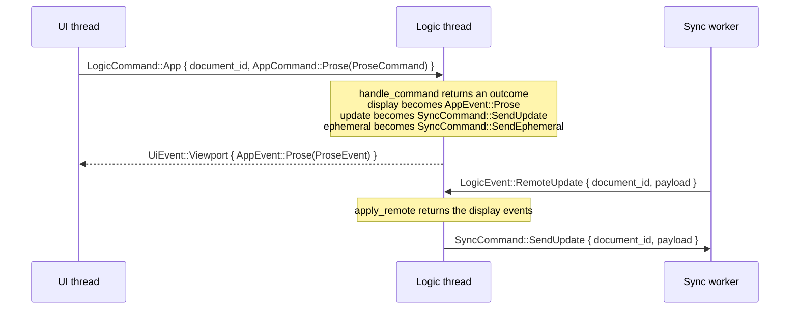

# AMBRE -- FEATURE: THE PROSE ENGINE

**Type:** Vertical (feature)
**Implementation:** design-only

> An author types a word and every collaborator reads it. One thread holds the document, writes the
> change, and answers with the pages the screen shows. The other thread paints that answer and owns
> nothing else.

The engine is `ProseState`, alone in the Logic thread. Every Prose feature reaches the document
through it, so the state, the two planes and the seam are one document and not three.

---

## 1. CONTRACT

The only mandatory read. Stated in user terms: no container, no type, no function. Grammar and
status values are normative in `ambre-spec-template.md`.

### 1.1 The state

| ID | Kind | Statement (RFC 2119) | Sources | Mechanism | Gap | Status |
|---|---|---|---|---|---|---|
| `PROSE-001` | `INV` | The document CRDT MUST NOT leave the Logic thread; it exits only as bytes. | this spec section 3; `ambre-spec-architecture.md section 2` | not built | unbuilt -- lands with the `ARCH P2` Story (`ambre-roadmap.md` E5) | unimplemented |
| `PROSE-003` | `INV` | Exported deltas MUST be treated as opaque bytes: `ambre-prose` MUST NOT inspect them after serialization. | this spec section 3 | not built | unbuilt -- lands with the `ARCH P2` Story (`ambre-roadmap.md` E5) | unimplemented |
| `PROSE-024` | `INV` | A command handler MUST NOT send on a channel: it returns an outcome, and the Logic dispatcher fans it out. | this spec section 3; `ambre-spec-message-bus.md` | not built | unbuilt -- lands with the `ARCH P2` Story (`ambre-roadmap.md` E5) | unimplemented |
| `PROSE-025` | `INV` | `ambre-prose` MUST NOT contact the network. | this spec section 3 | not built | unbuilt -- lands with the `ARCH P2` Story (`ambre-roadmap.md` E5) | unimplemented |
| `PROSE-043` | `INV` | `ambre-prose` MUST NOT depend on `ambre-crypto` or `ambre-sync`. | this spec section 1 | not built | unbuilt -- lands with the `ARCH P2` Story (`ambre-roadmap.md` E5); `deny.toml` already bans `ambre-crypto` outside `ambre-sync`/`ambre-logic`, so this half is held before the crate exists | unimplemented |
| `PROSE-026` | `INV` | `ambre-prose` MUST contain no `unsafe`. | README pillar "Security" | not built | unbuilt -- lands with the `ARCH P2` Story (`ambre-roadmap.md` E5); `#![forbid(unsafe_code)]` on the crate root makes it compiler-held from day one | unimplemented |
| `PROSE-FEAT-005` | `INV` | A feature MUST NOT write to the document directly: every mutation MUST reach it through the engine's one command entry point. | this spec section 3 | not built | unbuilt -- lands with the `ARCH P2` Story (`ambre-roadmap.md` E5) | unimplemented |
| `PROSE-FEAT-006` | `INV` | Text offsets MUST be counted in Unicode graphemes, never in Rust `char`s, wherever they address a position in the document. | this spec section 3 | not built | unbuilt -- lands with the `ARCH P2` Story (`ambre-roadmap.md` E5), and **the rule contradicts the plane it constrains**: section 3.B declares the same offsets to be code points, which is what a Rust `char` is. Section 6 carries the gap | unimplemented |
| `PROSE-044` | `INV` | The page layout, the media cache and the local history MUST be derived or session state: none of them MUST enter the document. | this spec section 3 | not built | unbuilt -- lands with the `ARCH P2` Story (`ambre-roadmap.md` E5) | unimplemented |
| `PROSE-004` | `CONC` | After convergence, a cursor expressed as a `loro::Cursor` MUST resolve to the same absolute position on every peer. | this spec section 3 | not built | unbuilt -- lands with the `ARCH P2` Story (`ambre-roadmap.md` E5) | unimplemented |
| `PROSE-IO-042` | `IO` | A document re-imported from its own snapshot MUST hold what the document that exported it held. | this spec section 3 | not built | unbuilt -- lands with the `ARCH P2` Story (`ambre-roadmap.md` E5) | unimplemented |
| `PROSE-UI-001` | `INV` | The UI thread MUST hold no document data: only view state and what arrives as an event. | this spec section 3 | not built | unbuilt -- lands with the `ARCH P2` Story (`ambre-roadmap.md` E5) | unimplemented |
| `PROSE-UI-003` | `INV` | The UI thread MUST NOT block on the Logic channel. | this spec section 3; `ambre-spec-architecture.md section 2` | not built | unbuilt -- lands with the `ARCH P2` Story (`ambre-roadmap.md` E5) | unimplemented |
| `PROSE-UI-010` | `INV` | The scroll position and the selection MUST stay local: neither MUST enter the document. | this spec section 3 | not built | unbuilt -- lands with the `ARCH P2` Story (`ambre-roadmap.md` E5) | unimplemented |
| `PROSE-UI-015` | `INV` | `ambre-prose`'s UI module MUST contain no `unsafe`. | README pillar "Security" | not built | unbuilt -- lands with the `ARCH P2` Story (`ambre-roadmap.md` E5) | unimplemented |

### 1.2 Do one thing to the document

| ID | Kind | Statement (RFC 2119) | Sources | Mechanism | Gap | Status |
|---|---|---|---|---|---|---|
| `PROSE-045` | `PRE` | Every offset a command carries MUST address the body text of the block the command names. | this spec section 3 | not built | unbuilt -- lands with the `ARCH P2` Story (`ambre-roadmap.md` E5) | unimplemented |
| `PROSE-046` | `POST` | A command MUST answer with one outcome carrying every display event it produced, the delta it exported and the presence frame it built. | this spec section 3 | not built | unbuilt -- lands with the `ARCH P2` Story (`ambre-roadmap.md` E5) | unimplemented |
| `PROSE-023` | `POST` | The confirmed-change event of a local command MUST carry the delta that command exported, never a re-export of the current state. | this spec section 3 | not built | unbuilt -- lands with the `ARCH P2` Story (`ambre-roadmap.md` E5) | unimplemented |
| `PROSE-047` | `FRAME` | A command that does not mutate the document MUST NOT produce a delta. | this spec section 3 | not built | unbuilt -- lands with the `ARCH P2` Story (`ambre-roadmap.md` E5) | unimplemented |

### 1.3 Take in a change from a collaborator

| ID | Kind | Statement (RFC 2119) | Sources | Mechanism | Gap | Status |
|---|---|---|---|---|---|---|
| `PROSE-048` | `POST` | The confirmed-change event of a remote change MUST carry the payload that arrived, never a re-export of the current state. | this spec section 3 | not built | unbuilt -- lands with the `ARCH P2` Story (`ambre-roadmap.md` E5) | unimplemented |
| `PROSE-049` | `FRAME` | A remote change MUST NOT be re-broadcast. | this spec section 3; `ambre-spec-delta-order.md` | not built | unbuilt -- lands with the `ARCH P2` Story (`ambre-roadmap.md` E5) | unimplemented |

### 1.4 Hand a change to the Sync worker

| ID | Kind | Statement (RFC 2119) | Sources | Mechanism | Gap | Status |
|---|---|---|---|---|---|---|
| `PROSE-050` | `POST` | An export MUST read from the last exported version vector. | this spec section 3; `ambre-spec-delta-order.md` | not built | unbuilt -- lands with the `ARCH P2` Story (`ambre-roadmap.md` E5) | unimplemented |
| `PROSE-098` | `POST` | An export MUST advance the last exported version vector. | this spec section 3; `ambre-spec-delta-order.md` | not built | unbuilt -- lands with the `ARCH P2` Story (`ambre-roadmap.md` E5) | unimplemented |
| `PROSE-051` | `POST` | A second export from the same version vector MUST yield the same bytes: an extra call MUST NOT truncate the stream. | this spec section 3; `ambre-spec-delta-order.md` | not built | unbuilt -- lands with the `ARCH P2` Story (`ambre-roadmap.md` E5) | unimplemented |
| `PROSE-052` | `FRAME` | Exporting MUST NOT write to the document. | this spec section 3 | not built | unbuilt -- lands with the `ARCH P2` Story (`ambre-roadmap.md` E5) | unimplemented |

### 1.5 Answer a request for the whole document

| ID | Kind | Statement (RFC 2119) | Sources | Mechanism | Gap | Status |
|---|---|---|---|---|---|---|
| `PROSE-053` | `POST` | A snapshot MUST be the CRDT's own bytes and nothing else: no layout, no cache, no session state. | this spec section 3 | not built | unbuilt -- lands with the `ARCH P2` Story (`ambre-roadmap.md` E5) | unimplemented |
| `PROSE-054` | `FRAME` | Answering with a snapshot MUST NOT write to the document and MUST NOT advance the export cursor. | this spec section 3; `ambre-spec-delta-order.md` | not built | unbuilt -- lands with the `ARCH P2` Story (`ambre-roadmap.md` E5) | unimplemented |

### 1.6 Take in a whole document

| ID | Kind | Statement (RFC 2119) | Sources | Mechanism | Gap | Status |
|---|---|---|---|---|---|---|
| `PROSE-055` | `POST` | An imported snapshot MUST replace the document whole. | this spec section 3 | not built | unbuilt -- lands with the `ARCH P2` Story (`ambre-roadmap.md` E5) | unimplemented |
| `PROSE-056` | `FRAME` | Importing a snapshot MUST NOT produce a delta. | this spec section 3 | not built | unbuilt -- lands with the `ARCH P2` Story (`ambre-roadmap.md` E5) | unimplemented |

### 1.7 Take in a peer's cursor

| ID | Kind | Statement (RFC 2119) | Sources | Mechanism | Gap | Status |
|---|---|---|---|---|---|---|
| `PROSE-057` | `FAIL` | A remote position naming a block this peer has not received, or one already tombstoned, MUST resolve to nothing and the cursor MUST be dropped rather than raised. | this spec section 3; `ambre-spec-presence.md` | not built | unbuilt -- lands with the `ARCH P2` Story (`ambre-roadmap.md` E5) | unimplemented |
| `PROSE-058` | `FRAME` | Applying a presence frame MUST NOT touch the document, its history or the export cursor. | this spec section 3; `ambre-spec-presence.md` | not built | unbuilt -- lands with the `ARCH P2` Story (`ambre-roadmap.md` E5) | unimplemented |

### 1.8 Take in a decrypted picture

| ID | Kind | Statement (RFC 2119) | Sources | Mechanism | Gap | Status |
|---|---|---|---|---|---|---|
| `PROSE-059` | `POST` | A decrypted picture MUST be cached under the content hash it arrived with. | this spec section 3 | not built | unbuilt -- lands with the `ARCH P2` Story (`ambre-roadmap.md` E5) | unimplemented |
| `PROSE-060` | `POST` | What the picture is shown in MUST be invalidated when it arrives. | this spec section 3 | not built | unbuilt -- lands with the `ARCH P2` Story (`ambre-roadmap.md` E5) | unimplemented |
| `PROSE-061` | `FRAME` | A picture arriving MUST NOT write to the document and MUST NOT produce a delta. | this spec section 3 | not built | unbuilt -- lands with the `ARCH P2` Story (`ambre-roadmap.md` E5) | unimplemented |

### 1.9 Send a command from the UI thread

| ID | Kind | Statement (RFC 2119) | Sources | Mechanism | Gap | Status |
|---|---|---|---|---|---|---|
| `PROSE-UI-002` | `POST` | Every mutation MUST leave the UI thread as a command. | this spec section 3 | not built | unbuilt -- lands with the `ARCH P2` Story (`ambre-roadmap.md` E5) | unimplemented |
| `PROSE-UI-149` | `FAIL` | A full Logic channel MUST drop the command rather than hold the frame. | this spec section 3; `ambre-spec-architecture.md section 2` | not built | unbuilt -- lands with the `ARCH P2` Story (`ambre-roadmap.md` E5) | unimplemented |
| `PROSE-UI-150` | `FRAME` | The draft echo a send paints MUST NOT reach the wire. | this spec section 3 | not built | unbuilt -- lands with the `ARCH P2` Story (`ambre-roadmap.md` E5) | unimplemented |

### 1.10 Fan one answer out

| ID | Kind | Statement (RFC 2119) | Sources | Mechanism | Gap | Status |
|---|---|---|---|---|---|---|
| `PROSE-062` | `POST` | One outcome MUST reach the destinations it names: the display events to the UI thread, the delta and the presence frame to the Sync worker. | this spec section 3; `ambre-spec-message-bus.md` | not built | unbuilt -- lands with the `ARCH P2` Story (`ambre-roadmap.md` E5) | unimplemented |
| `PROSE-063` | `FRAME` | Fanning an outcome out MUST NOT let a connection change, a sharing change or a revoked member reach the document state. | this spec section 3; `ambre-spec-membership.md` | not built | unbuilt -- lands with the `ARCH P2` Story (`ambre-roadmap.md` E5) | unimplemented |

* **Budget.** four rows of `ambre-spec-budgets.md section 1` -- the local text insert with its
  exported delta, the snapshot export, the page-layout handoff, and the shared `doc.import()` row.
  None has a benchmark, and the crate that would run one does not exist.
* **Boundary.** none of its own. `PROSE-025` bans a network call from `ambre-prose` and refuses it
  a dependency on `ambre-crypto` or `ambre-sync`. This crate holds no key and opens no
  socket. Its one outbound flow that is not the sealed document is the picture blob
  (`features/ambre-spec-prose-images.md`).
* **Verification.** 39 `unimplemented`, nothing else -- the honest shape for a crate that is a
  `lib.rs`. Two are compiler-held the day it exists; two more are properties over a
  generated command stream. One gap is disagreement, not absence: with section 3.B,
  `PROSE-FEAT-006` states two units for one offset, so whichever is built the other row goes red.

---

## 2. WHAT EACH USER SEES

Two peers, one document. Nothing resolves yet, so the last column names the row each scenario rests
on rather than a test.

| Alice does | Bob does | The document holds | Each user sees | Test |
|---|---|---|---|---|
| types in a paragraph | types in the same paragraph at the same moment | both insertions, neither interleaved into the other | the same sentence on both screens | none -- `PROSE-089` |
| types before Bob's caret | reads | the insertion | Bob's caret still on the character it was on, pushed along by the text | none -- `PROSE-004` |
| pastes ten pages | scrolls | the whole paste as one confirmed change | the same page count on both screens, once both have measured | none -- `PROSE-023` |
| opens the document offline, types, reconnects | edited the same paragraph meanwhile | both edits, in either arrival order | one paragraph on both screens | none -- `PROSE-089` |
| moves her caret | reads | nothing: a caret is never written | Bob's screen shows Alice's caret, and the history does not | none -- `PRESENCE-011`, `PROSE-058` |
| scrolls to page 40 | stays on page 1 | nothing: a scroll is never written | each reader where they were | none -- `PROSE-UI-010` |

Convergence rests on rules the format owns. A block is named by a minted `TreeID` and never by a
slot (`PROSE-085`). A body is a sequence CRDT and not a register (`PROSE-002`, `PROSE-089`). An
empty tree deterministically re-grows one root block (`PROSE-094`). Two peers holding the same
operations hold the same document, and `ambre-spec-prose-schema.md section 1` is where each rule
sits.

---

## 3. MODEL

**Containers.** Declared in `ambre-spec-prose-schema.md section 3` and cited from there by name.
This document restates no part of the format. Three functions are the whole of the engine's access
to it. One opens a leaf block's body, and one counts a list item's ancestors because a depth is
never stored (`PROSE-005`). The third answers the expansion policy of a mark key (`PROSE-007`) and
is total over every key (`PROSE-090`).

```rust
// ambre-prose/src/doc.rs
pub fn get_block_text(doc: &LoroDoc, id: &TreeID) -> LoroText;

// ambre-prose/src/features/list.rs
pub fn compute_depth(tree: &LoroMovableTree, item_id: &TreeID) -> u8;

// ambre-prose/src/mark.rs
pub fn expand_type_for(mark_key: &str) -> ExpandType;
```

**Dependencies** the engine pulls into `ambre-prose`:

| Crate | Role | Rationale |
|---|---|---|
| `loro` | the single-document CRDT | `LoroMovableTree` for the block hierarchy, `LoroText` for a body, `LoroMap` for the registers, `UndoManager` for the local history |
| `parley` | the typographic layout the Logic thread measures with | pagination needs line breaking and glyph metrics, not just the run types `DrawSurface` exposes, so the dependency is direct and not through `ambre-draw` |
| `ambre-core` | the identity and document types | `Uuid`, `DocType`, reached through the `ambre-bus` re-export |
| `ambre-bus` | the typed IPC shapes | the two planes of sections 3.B and 3.C, and the envelopes that carry them |
| `ambre-draw` | the `DrawSurface` trait and the geometry re-exports | one page-drawing path for the screen and for the exported page (`features/ambre-spec-prose-pdf-export.md`) |
| `postcard` | the presence frame alone | the only Prose value serialized for the wire; a CRDT delta is already bytes |
| `serde` | the derives that frame needs | on the wire types of section 3.D, and on nothing that travels between the two threads |
| `unicode-segmentation` | grapheme counting | `PROSE-FEAT-006`, whose unit section 6 records as contested |
| `thiserror` | the typed engine error | mapped onto the one error event of section 3.C |

**There is no dependency graph.** A block carries its own content and derives from no other block, so
a write invalidates nothing but the layout of what it touched. That is the whole difference from a
spreadsheet, and it is why a document converges on its raw state alone. What a change does cost is a
re-measurement, which is pagination's and bounded there
(`features/ambre-spec-prose-pagination.md`).

### A. The state

`ProseState` is a value in the Logic thread's registry, `enum DocState { Prose(ProseState), .. }`,
reached by a match on the document id. It holds **no transport handle**: what must reach another
thread leaves as a return value (`PROSE-024`).

| Group | What it holds | Rebuilt |
|---|---|---|
| the document | the CRDT, private, named by no public signature (`PROSE-001`) | never: it is the source of truth |
| the layout | the page layout and the version that stamps it (`features/ambre-spec-prose-pagination.md`) | on a change that moves text, incrementally from the first dirty page |
| the tracking flag | whether an edit becomes a suggestion (`features/ambre-spec-prose-track-changes.md`) | per session, never shared |
| the media cache | decrypted picture bytes by content hash, bounded (`features/ambre-spec-prose-images.md`) | from the download route; it dies with the session |
| the local history | the undo manager, opened over the document (`features/ambre-spec-prose-undo.md`) | never: it dies with the session |
| the sync cursor | the last version vector exported to Sync | advanced after every export |

```rust
// ambre-prose/src/logic.rs

pub struct ProseState {
    doc:              LoroDoc,
    undo_manager:     loro::UndoManager,
    layout:           Option<PageLayout>,
    layout_version:   u64,
    tracking:         bool,
    media_cache:      HashMap<String, Vec<u8>>,
    last_exported_vv: VersionVector,
}

/// What a content command returns. The Logic dispatcher explodes it: the display events
/// become `AppEvent::Prose`, the delta becomes `SyncCommand::SendUpdate`, the presence
/// frame becomes `SyncCommand::SendEphemeral` under the document id Logic holds.
pub struct ProseOutcome {
    pub display:   Vec<ProseEvent>,
    pub update:    Option<Vec<u8>>,
    pub ephemeral: Option<Vec<u8>>,
}

impl ProseState {
    /// The one entry point a mutation reaches the document through (`PROSE-FEAT-005`).
    /// One command may answer with several display events -- the confirmed change, the new
    /// layout and the reshaped runs after a keystroke -- and with one delta.
    pub fn handle_command(&mut self, command: ProseCommand) -> ProseOutcome;

    /// A remote delta or a remote snapshot, routed here by document id.
    pub fn apply_remote(&mut self, payload: &[u8]) -> Vec<ProseEvent>;

    /// A remote presence frame. The author is the **Sync-resolved `from_user_id`**, never
    /// read from the payload (`PRESENCE-003`, `ambre-spec-membership.md`).
    pub fn apply_ephemeral(&mut self, from_user_id: UserId, payload: &[u8]) -> Vec<ProseEvent>;

    /// Answered on a snapshot request; the bytes are sealed by `ambre-sync`.
    pub fn export_snapshot(&self) -> Vec<u8>;

    pub fn import_snapshot(&mut self, snapshot: &[u8]) -> Result<(), ProseError>;

    /// A decrypted picture arrived on its own Logic route: cache it, invalidate what showed it.
    pub fn on_media_downloaded(&mut self, content_hash: String, data: Vec<u8>) -> Vec<ProseEvent>;
}
```

**The delta is a cursor, not a drain.** The export reads from the last exported version vector and
then advances it. Exporting twice from the same vector yields the same bytes, and the stream cannot
be truncated by an extra call. It is the mechanism `features/ambre-spec-trame-engine.md` already
uses, so both applications have one delta model on the shared engine.

**The state never sees a queue.** `ProseState` names no sender, no `SyncCommand` and no incoming
event type. The generic dispatcher in `ambre-logic` routes what arrives to the four content methods
above and fans the outcome back out (`PROSE-024`). A connection change, a sharing change or a
revoked member is not document content and never reaches this state at all.

### B. What a command carries

The plane the UI thread writes on. Values move by `flume`, so no shape below derives `serde`.

> **The offset unit.** Every `pos`, every `range` and every `(TreeID, u32)` endpoint below is an
> offset into the target block's body text. That is the unit Loro indexes a text container and a
> cursor with. The plane declares it a **Unicode code point**; `PROSE-FEAT-006` requires a **grapheme**,
> and the view's own hit-test answers **UTF-8 bytes**. The three do not agree, and section 6 carries
> the gap: nothing in the corpus states the conversion the ten editing documents each perform.

```rust
// ambre-prose/src/events.rs -- the content plane, in `ambre-bus`. Move on `flume`, no serde.
#[derive(Debug, Clone)]
pub enum ProseCommand {
    Noop,

    // -- Text editing (`features/ambre-spec-prose-text-editing.md`) --
    InsertText    { block_id: TreeID, pos: u32, text: String },
    DeleteText    { block_id: TreeID, range: (u32, u32) },
    /// One arbitrary, possibly cross-block, selection deleted in one command. The endpoints
    /// arrive in either order and the dispatcher normalizes them; it is also the single join
    /// primitive (`PROSE-037`, `PROSE-039`). A content mark fully covered goes with the text;
    /// a partially covered comment, suggestion or footnote follows the orphan rule.
    DeleteRange   { anchor: (TreeID, u32), focus: (TreeID, u32) },
    /// The inverse of the join case above (`PROSE-038`).
    SplitBlock    { block_id: TreeID, pos: u32 },

    // -- Inline marks (`features/ambre-spec-prose-inline-styles.md`) --
    /// `value` is the mark's payload, always a String: the key, its value grammar and its
    /// canonical form are the registry of `ambre-spec-prose-schema.md section 3` (`PROSE-008`),
    /// which interop parses and emits unchanged. `None` clears the value for a key whose
    /// presence alone is meaningful.
    ApplyMark     { block_id: TreeID, range: (u32, u32), key: String, value: Option<String> },
    RemoveMark    { block_id: TreeID, range: (u32, u32), key: String },
    ClearInlineMarks { block_id: TreeID, range: (u32, u32) },

    // -- Block structure --
    /// `init` is a typed per-type initializer: it carries the attributes the block type needs
    /// at creation, so no handler invents a default a follow-up command must correct. A type
    /// with a richer creation surface keeps its own command below.
    InsertBlock   { parent_id: Option<TreeID>, after_id: Option<TreeID>,
                    init: BlockInit, style_id: Option<String> },
    DeleteBlock   { block_id: TreeID },
    MoveBlock     { block_id: TreeID, new_parent: Option<TreeID>, after_id: Option<TreeID> },
    SetBlockStyle { block_id: TreeID, style_id: String },
    /// `features/ambre-spec-prose-headings.md`; the level is clamped to 1..=6.
    SetHeadingLevel { block_id: TreeID, level: u8 },
    SetCodeLang     { block_id: TreeID, lang: String },
    /// The command is coarse and the storage is per property: the handler writes only what
    /// changed (`PROSE-FEAT-025`, `features/ambre-spec-prose-inline-styles.md`).
    SetParagraphStyle { block_id: TreeID, style: ParagraphStyle },

    // -- Lists (`features/ambre-spec-prose-lists.md`) --
    InsertListItem { parent_id: Option<TreeID>, after_id: Option<TreeID>, style: ListStyle },
    SetListStyle   { block_id: TreeID, style: ListStyle },
    IndentList     { block_id: TreeID },
    UnindentList   { block_id: TreeID },

    // -- Tables (`features/ambre-spec-prose-tables.md`) --
    InsertTableRow   { table_id: TreeID, after_row: Option<TreeID> },
    DeleteTableRow   { row_id: TreeID },
    /// `width_pt` is the new column's width; `None` takes the document default
    /// (`PROSE-FEAT-044`).
    InsertTableCol   { table_id: TreeID, after_col: u32, width_pt: Option<f32> },
    DeleteTableCol   { table_id: TreeID, col_index: u32 },
    ResizeTableCol   { table_id: TreeID, col_index: u32, width_pt: f32 },
    MergeTableCells  { table_id: TreeID, start: (u32, u32), end: (u32, u32) },
    UnmergeTableCell { cell_id: TreeID },
    SetCellStyle     { cell_id: TreeID, bg: Option<u32>, valign: Option<VAlign>,
                       border: Option<CellBorder>, padding_pt: Option<f32> },
    SetTableStyle    { table_id: TreeID, style: TableStyle },

    // -- Table of contents (`features/ambre-spec-prose-table-of-contents.md`) --
    InsertToc       { parent_id: Option<TreeID>, after_id: Option<TreeID>,
                      max_level: u8, numbered: bool },
    UpdateTocConfig { block_id: TreeID, max_level: u8, numbered: bool },

    // -- Pictures (`features/ambre-spec-prose-images.md`) --
    InsertImage      { parent_id: Option<TreeID>, after_id: Option<TreeID>,
                       content_hash: String, alt: String, width_px: u32, height_px: u32 },
    /// `lock_aspect` keeps the intrinsic ratio; the dispatcher validates and clamps
    /// (`PROSE-FEAT-058`, `PROSE-FEAT-059`).
    ResizeImage      { block_id: TreeID, width_px: u32, height_px: u32, lock_aspect: bool },
    SetImageAlign    { block_id: TreeID, align: ImageAlign },
    SetImageAlt      { block_id: TreeID, alt: String },
    SetImageCaption  { block_id: TreeID, caption: String },
    /// Ask again for a blob whose download failed for good; the reader's own gesture is the
    /// only path back (`PROSE-FEAT-057`).
    RetryImageLoad   { block_id: TreeID },

    // -- Headers and footers (`features/ambre-spec-prose-headers-footers.md`) --
    // Each band is an ordinary block with a stable id in `meta`, so every text command above
    // targets it directly and no band-specific variant exists.
    SetHeaderEnabled      { enabled: bool },
    SetFooterEnabled      { enabled: bool },
    /// `target` names the regular band or the first page's own (`PROSE-FEAT-067`).
    InsertHeaderField     { field: HeaderField, target: HfTarget, pos: u32 },
    InsertFooterField     { field: HeaderField, target: HfTarget, pos: u32 },
    SetDifferentFirstPage { enabled: bool },

    // -- Comments (`features/ambre-spec-prose-comments.md`) --
    /// The author and the peer are stamped by the dispatcher from the session identity,
    /// never carried here (`PROSE-FEAT-077`).
    AddComment       { block_id: TreeID, range: (u32, u32), text: String },
    /// Reopens a resolved thread as a side effect (`PROSE-FEAT-079`).
    ReplyToComment   { comment_id: Uuid, text: String },
    ResolveComment   { comment_id: Uuid },
    /// The explicit reopen, with no reply added (`PROSE-FEAT-079`).
    ReopenComment    { comment_id: Uuid },
    DeleteComment    { comment_id: Uuid },
    /// Deleting the opening reply deletes the thread (`PROSE-FEAT-081`).
    DeleteReply      { comment_id: Uuid, reply_id: Uuid },
    EditCommentReply { comment_id: Uuid, reply_id: Uuid, new_text: String },

    // -- Track changes (`features/ambre-spec-prose-track-changes.md`) --
    EnableTrackChanges   { enabled: bool },
    AcceptSuggestion     { suggestion_id: Uuid },
    RejectSuggestion     { suggestion_id: Uuid },
    AcceptAllSuggestions,
    RejectAllSuggestions,

    // -- Footnotes and cross references --
    InsertFootnote  { block_id: TreeID, pos: u32, note_text: String },
    EditFootnote    { footnote_id: Uuid, new_text: String },
    DeleteFootnote  { footnote_id: Uuid },
    /// The reference stores the target's `TreeID` inside the mark's record
    /// (`ambre-spec-prose-schema.md section 3`): the CRDT identity survives a move and a
    /// concurrent edit, so a live reference is never stale. Interop maps it to the foreign
    /// format's own anchor and back (`features/ambre-spec-prose-cross-references.md`).
    InsertCrossRef  { block_id: TreeID, pos: u32, target_block_id: TreeID, kind: CrossRefKind },

    // -- Find and replace (`features/ambre-spec-prose-find-replace.md`) --
    FindStart  { query: FindQuery },
    FindNext,
    FindPrev,
    FindClose,
    ReplaceOne { replacement: String },
    ReplaceAll { replacement: String },

    // -- Spell check (`features/ambre-spec-prose-spell-check.md`) --
    SetSpellCheckLang     { lang: String },
    AcceptSpellSuggestion { block_id: TreeID, range: (u32, u32), replacement: String },
    /// Writes the reader's own dictionary, never the document.
    AddToDictionary       { word: String },

    // -- Clipboard (`features/ambre-spec-prose-clipboard.md`) --
    /// Build the full-fidelity payload from the selection; the answer is the clipboard event.
    CopySelection { anchor: (TreeID, u32), focus: (TreeID, u32) },
    /// Paste an opaque Ambre payload back into the document.
    PasteRich     { block_id: TreeID, pos: u32, payload: Vec<u8> },

    // -- Interoperability (`features/ambre-spec-prose-import-export.md`) --
    ImportDocument { format: ImportFormat, data: Vec<u8> },
    ExportDocument { format: ExportFormat, options: ExportOptions },

    // -- Presence (`1-Foundations/ambre-spec-presence.md`) --
    /// The handler builds the wire frame of section 3.D and returns it as the outcome's
    /// ephemeral half. No user id is ever put on the wire.
    UpdateCursor { pos: CursorPosition },

    // -- Local history (`features/ambre-spec-prose-undo.md`) --
    // Applied to the document by the undo manager; the delta it produces is broadcast like
    // any other mutation.
    Undo,
    Redo,
}

/// The typed initializer for `InsertBlock`. Each variant carries exactly the creation
/// attributes of its block type, so the handler writes the node's attribute map
/// (`ambre-spec-prose-schema.md section 3`) with no stringly-typed path and no corrective
/// follow-up command.
#[derive(Debug, Clone)]
pub enum BlockInit {
    Paragraph,
    /// The level is mandatory at creation, 1..=6.
    Heading   { level: u8 },
    /// An empty language reads as plain.
    CodeBlock { lang: String },
    HRule,
    PageBreak,
}
```

### C. What the answer carries

One enum, and every Logic-to-UI event is a variant of it. A second enum would put a document fact in
two places and leave the dispatch with a hole. `PROSE-UI-001` bans the second model on the other
side.

```rust
// ambre-prose/src/events.rs -- the content plane, in `ambre-bus`. Move on `flume`, no serde.
#[derive(Debug, Clone)]
pub enum ProseEvent {
    // -- Engine --
    /// The confirmed change, local or imported. The bytes are the ones applied, never a
    /// re-export (`PROSE-023`).
    DocUpdated    { delta: Vec<u8> },
    /// The layout after a change. `version` lets the view drop an older one
    /// (`PROSE-UI-016`, `features/ambre-spec-prose-page-rendering.md`).
    LayoutUpdated { layout: PageLayout, first_dirty_page: u32, version: u64 },
    /// Pre-shaped runs for the blocks that moved, aligned with the layout above
    /// (`features/ambre-spec-prose-page-rendering.md section 2` declares the run).
    RunsUpdated   { runs: Vec<(TreeID, Vec<ParleyRunData>)>, version: u64 },
    /// The whole live peer set, replaced rather than merged (`PRESENCE-009`).
    RemoteCursors { cursors: Vec<RemoteCursor> },
    /// The clipboard payload built from the selection: a plain-text mirror and the opaque
    /// Ambre bytes. The host performs the write (`features/ambre-spec-prose-clipboard.md`).
    Clipboard     { text: String, ambre: Vec<u8> },

    // -- Features --
    TocUpdated       { toc: TableOfContents },
    WordCountUpdated { count: WordCount },
    FindResults      { matches: Vec<FindMatch>, current: usize },
    FindUpdated      { current: usize },
    SpellErrors      { block_id: TreeID, errors: Vec<SpellError> },
    /// A concurrent edit left a cell covered by a merge while it still holds content: masked,
    /// not destroyed (`features/ambre-spec-prose-tables.md`).
    MergeConflictDetected { cell_id: TreeID },

    // -- Interoperability --
    ImportCompleted { report: ConversionReport },
    ImportProgress  { percent: u8 },
    /// `mime` is the media type of `data`, so the view has one download path for every
    /// format (`PROSE-IO-020`).
    ExportReady     { format: ExportFormat, data: Vec<u8>, mime: &'static str,
                      report: ConversionReport },
    ExportProgress  { percent: u8 },

    // -- Failure --
    Error { code: u16, message: String },
}
```

> **The conversion report carries no `serde`**, like every other payload above. It is a plain owned
> value that moves to the UI thread. An import or an export is a local Logic-thread operation
> whose bytes cross the wire as the document, never as the report. Persisting one later is a mirror
> type in the interop module, not a derive on this plane.

### D. What Prose puts on the wire

Two shapes, and they are the only Prose values that carry `serde`: they are the presence frame the
Sync worker seals and sends. The event payload built from an arriving frame carries none.

```rust
/// Where a caret is, in the document's own coordinates. A `TreeID` is `(PeerID, Counter)`,
/// globally unique and portable, so the same value means the same place on every replica
/// and postcard round-trips it with no custom logic.
#[derive(Debug, Clone, Serialize, Deserialize)]
pub struct CursorPosition {
    pub block_id: TreeID,
    pub offset:   u32,
    pub anchor:   Option<(TreeID, u32)>,
}

/// The peer-authored frame. Position and a self-asserted, cosmetic name -- and deliberately
/// no user id: the canonical identity is the Sync-resolved one delivered out of band, so a
/// peer cannot forge another user's (`PRESENCE-002`, `PRESENCE-003`).
#[derive(Debug, Clone, Serialize, Deserialize)]
pub struct PresencePayload {
    pub position:     CursorPosition,
    pub display_name: String,
}

/// What the view is handed. No serde: it moves by value.
#[derive(Debug, Clone)]
pub struct RemoteCursor {
    pub user_id:      UserId,
    pub display_name: String,
    pub color:        peniko::Color,
    pub position:     CursorPosition,
}
```

A remote position naming a block this peer has not received yet, or one already tombstoned, resolves
to nothing and the cursor is silently dropped. It reappears when the delta lands. That is presence's
best-effort rule (`PRESENCE-008`), and the anchor above is the whole of what Prose keeps of it. It
names identities and never positions, which is `PRESENCE-007`.

### E. The data flow

Typed values by move on `flume` between the UI and the Logic threads -- shared memory, no
serialization on either side of that hop. The dispatcher routes by document id and explodes what the
state returns.



### F. What is persisted

A snapshot is the CRDT's own bytes and nothing else: no layout, no cache, no session state. It is
compressed and encrypted by `ambre-sync` on the way out (`ZK-001`) and re-imported whole on the way
in. The format the disk holds is the one `ambre-spec-prose-schema.md` declares, and the file
container is `ambre-spec-docfile.md section 3`.

### G. What the UI thread holds

View state, and no document content (`PROSE-UI-001`). Each field is owned by the feature document its
comment names; the engine declares the struct and the rule, never the field's behaviour.

```rust
// ambre-prose/src/ui/state.rs

pub struct ProseUiState {
    // Handed over by the Logic thread
    layout:          PageLayout,
    /// Rebuilt from `layout` on every layout event (`features/ambre-spec-prose-viewport.md`).
    page_column:     PageColumn,
    /// An older layout is dropped (`features/ambre-spec-prose-page-rendering.md`).
    layout_version:  u64,
    /// Shaped runs per block, bounded (`features/ambre-spec-prose-page-rendering.md`).
    run_cache:       RunCache,
    /// The whole live peer set, replaced on each event (`PRESENCE-009`).
    remote_cursors:  Vec<RemoteCursor>,
    toc:             TableOfContents,
    /// At resolved positions (`features/ambre-spec-prose-comments.md`).
    comments:        Vec<UiComment>,
    /// At resolved positions (`features/ambre-spec-prose-track-changes.md`).
    suggestions:     Vec<UiSuggestion>,
    /// Per block (`features/ambre-spec-prose-spell-check.md`).
    spell_errors:    HashMap<TreeID, Vec<SpellError>>,

    // Local, and never sent
    /// Scroll offset, size and zoom (`features/ambre-spec-prose-viewport.md`).
    viewport:        Viewport,
    /// The caret, the selection, the drag anchor and the armed autoscroll velocity
    /// (`features/ambre-spec-prose-selection.md`).
    cursor:          Option<TextCursor>,
    selection:       Option<TextSelection>,
    drag_anchor:     Option<(TreeID, u32)>,
    autoscroll_v:    Option<f32>,
    /// The optimistic echo (`features/ambre-spec-prose-text-editing.md`).
    draft_buffer:    DraftBuffer,
    toolbar:         ToolbarState,
    slash_menu:      Option<SlashMenuState>,
    ruler:           RulerState,
    /// The open thread and the panel's own scroll
    /// (`features/ambre-spec-prose-comments.md section 6`: nothing declares it).
    comment_panel:   CommentPanelState,
    scroll_velocity: f32,
}
```

**Where each fact lives.** One source of truth; every other layer is a projection of it.

| Kind | Examples | Source of truth | Synchronized |
|---|---|---|---|
| a document mutation | text, marks, moves, pictures | the CRDT, in the Logic thread | yes |
| shared metadata | comments, suggestions, named styles, the bands, the table-of-contents settings | the CRDT, in the Logic thread | yes |
| a local view | scroll, selection, caret, the draft echo, the open menu, the visible bar | `ProseUiState`, in the UI thread | no |
| derived state | the layout, the run cache, the table of contents, the word count | the Logic thread, recomputed from the CRDT | no |
| local history | the undo stack | the Logic thread, for this session | no |

Two consequences are worth stating because a reader expects the opposite. Two collaborators scroll
independently and see the same document (`PROSE-UI-010`). The draft echo is transient UI state
that dies with the tab and never reaches the wire.

**Code:** none. `crates/ambre-prose/src/lib.rs` is seven lines.

---

## 4. SURFACE

The user touches no part of this document directly. What it exposes is the seam: what arrives from
the host, and what the view does with each answer.

**How input reaches the view.** Through the frame host, as a typed input event from the shared
transparent `<textarea>` and the DOM pointer listeners. There is **no `winit`**
(`ambre-spec-ui.md section 4`, `ambre-spec-text-input.md`, `ambre-spec-frame.md section 2`).
Pointer coordinates are CSS pixels relative to the canvas, and a click count separates the single,
the double and the triple click. The dispatcher answers whether the host must swallow the event. The
Prose view is an arm of the frame host's application enum, like Trame's.

| Event | What the view does |
|---|---|
| the confirmed change | clears the draft echo it covers (`features/ambre-spec-prose-text-editing.md`) |
| the layout | rebuilds the page column and marks the frame dirty (`features/ambre-spec-prose-viewport.md`) |
| the shaped runs | fills the run cache for the blocks named (`features/ambre-spec-prose-page-rendering.md`) |
| the peer set | replaces the remote cursors and repaints the overlay (`1-Foundations/ambre-spec-presence.md`) |
| the clipboard payload | hands it to the host, which writes the system clipboard (`features/ambre-spec-prose-clipboard.md`) |
| the table of contents | refreshes the generated block and the outline (`features/ambre-spec-prose-table-of-contents.md`) |
| the word count | feeds the shared status-bar slot (`features/ambre-spec-prose-word-count.md`) |
| the find results, the find cursor | sets the highlight set and reveals the current match (`features/ambre-spec-prose-find-replace.md`) |
| the spelling errors | stores them per block and underlines them (`features/ambre-spec-prose-spell-check.md`) |
| the masked cell | surfaces a non-blocking hint (`features/ambre-spec-prose-tables.md`) |
| an import report, an export payload, either progress | surfaces the count and drives the download (`features/ambre-spec-prose-import-export.md`) |
| the error | logs it and surfaces it |

---

## 5. REJECTED ALTERNATIVES

| Decision | Rejected alternative | Why not |
| :--- | :--- | :--- |
| One state per document, dispatched by a match | a trait object or a boxed `Any` in a registry | it trades the compiler's exhaustiveness for a downcast at every call site. A closed enum of document states means adding Prose adds an arm and no indirection, and a concrete value is what lets a host test build a document, drive it and read the answer with no worker and no browser |
| A handler returns an outcome and sends nothing | injecting an effect sink into the state | it is the trait object the closed enum exists to avoid. A value returned by a plain method is testable with no queue and keeps the state free of a transport handle, so the dispatcher is the single place where a document change becomes traffic |
| Every mutation is a typed command, and there is one entry point | letting a feature module open the CRDT and write to it | it is how the interception rules silently stop holding. One path into the document is one place to intercept it, which is what track changes, undo and the refusal rules all hang off; a second path would have to reimplement each of them |
| The command plane carries no `serde` | serializing every command, as the Sync hop must | it pays the serialization on the hop that must not. The UI and Logic threads share one linear memory, so a value moves between them; deriving serialization on the plane would invite a copy on a hop that has none, and it is the derive that makes a network type by accident |
| A delta is exported from a stored version vector | a single-drain export | its correctness depends on nobody calling it twice. Draining Loro's internal diff is order-fragile: a second call returns empty and silently truncates the stream, forcing every caller to thread the one exported copy by hand; exporting from a stored vector is idempotent, and it is the mechanism `features/ambre-spec-trame-engine.md` already uses -- one delta model for both applications |
| The confirmed-change event carries the bytes that were applied | re-deriving the delta inside the event builder | it is correct only while no remote change is in flight. A re-export of the current state after a remote import is a different set of operations from the one that arrived, and a peer applying it converges to something neither wrote; passing the confirmed bytes in makes the two paths one rule |
| Attributes are typed per block type, never a key-value pair | a generic `SetBlockAttr { key, value }` | it is what every one of the typed commands above replaces. A stringly-typed attribute setter cannot be validated by the compiler, so every wrong key is a runtime defect in a document the user cannot repair; one variant per type costs a line and moves the whole class to compile time |
| A suggestion is a mark, never a branch | a Loro branch per suggestion | forking the whole document per suggestion costs memory proportional to the document times the number of open suggestions. A pair of marks costs the range it covers (`features/ambre-spec-prose-track-changes.md`) |
| The UI thread is handed the layout, never the document | linking the CRDT into the view so it can read what it needs | it is the second model `PROSE-UI-001` exists to forbid. The thread that paints must not hold a second model, and a page layout is a fraction of the document's size; handing the layout also keeps the CRDT off a thread that can block on a frame |
| The presence frame carries no user id | trusting the author field of the frame | it makes impersonation a matter of editing a payload. A peer that asserts its own identity can assert anyone's; the frame carries a position and a cosmetic name, and the canonical identity is the one Sync resolved on the inbound path (`PRESENCE-002`, `PRESENCE-003`) |

---

## 6. NOT BUILT, AND NOT YET RULED

* **Nothing exists.** `crates/ambre-prose/src/lib.rs` is seven lines, so the state, the two planes and
  the seam are a design, and all fourteen rows above are `unimplemented`.
* **A position is counted three ways, and one of the three is a rule of this document.** The plane of
  section 3.B declares every offset a Unicode code point. `PROSE-FEAT-006` requires a grapheme, and
  names a Rust `char`, a code point, as what it must never be. The view's hit-test answers
  UTF-8 byte ranges, because that is what the shaped run joins glyphs to
  (`features/ambre-spec-prose-page-rendering.md section 2`). Every editing document converts between
  a view unit and a command unit, and none can say what the conversion is
  (`features/ambre-spec-prose-text-editing.md section 6`). Two of the three claims are normative and
  contradict each other, so choosing a unit is a design decision that lands with `ARCH P2`.
* **The typed engine error is declared nowhere, and the event that carries it is untyped.** The
  dependency table asks `thiserror` for a `ProseError`, one signature returns it, and no document
  writes its variants. The event plane offers a numeric code and a message, which names neither the
  command that failed nor a reason. Five features record the same absence: the styles, the lists,
  the tables, the bands and the comments. Each was written against a refusal event this
  plane does not declare. It lands with the
  `A refused command names what it refused` Story (`ambre-roadmap.md` E5).
* **Three commands were declared by a feature and by no plane.** The spell checker's language,
  accept and dictionary commands are stated in `features/ambre-spec-prose-spell-check.md` and were
  absent from the plane; they are declared in section 3.B now. The plane's own error path for a
  refused one is the gap above.
* **Nothing states what the engine does with a command it cannot honour.** A malformed range, a
  block id that resolves to nothing, a nesting rule broken by a move (`PROSE-040`): each feature
  states its own refusal. No rule of this document says whether a refused command leaves the
  document untouched, or whether it produces an outcome at all. Nothing says whether the undo stack
  sees it.
* **Nothing rules on the export cursor when an export fails.** The cursor is advanced after every
  export, and no rule of this document says whether a failed export advances it too. The
  operations of that range would then never be offered again.
* **A dropped command leaves no trace.** A full Logic queue drops the mutation, and nothing
  says whether the drop is logged, surfaced or counted. An edit the user made is lost silently.
* **The remote path has no batch.** A run of deltas arriving together is applied one at a time, so
  the layout is rebuilt once per delta. Trame and Toile each carry a row for the amortized path,
  and this document declares no batch entry point to hold one.
* **The priority scheduler that defers a long shaping pass is named and never designed.**
  `ambre-spec-budgets.md section 2` sends a monster paragraph's shaping through a P1-P4
  scheduler in the Logic thread. No document declares what those four levels are, what preempts
  what, or how a deferred pass reports back. Pagination assumes the split
  (`features/ambre-spec-prose-pagination.md`) and cannot state its cost without it.
* **No budget is measured.** Not one of the Prose rows of `ambre-spec-budgets.md` has
  a benchmark. Every figure the four bullets above rest on is a claim about a number nothing
  weighs. Giving the budgets a mechanism is its own Story
  (`ambre-roadmap.md`, "The performance budgets given a mechanism").
* **The engine has no test seam yet, and the shape of one is already decided.** Trame drives its
  Logic-to-Sync boundary through a mock sink, and Toile asserts on the returned outcome instead.
  That is stronger, because the value is the contract and a test that reads it cannot miss a send.
  Prose returns an outcome by the same design and will be tested the same way. The mock seam three
  dying specs named for this application is not what it needs.
