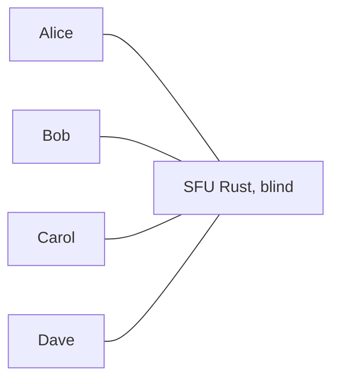
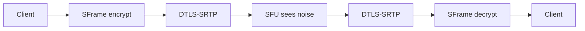

# AMBRE -- APP: RENDEZ-VOUS (VIDEO & SYNCHRONOUS COLLABORATION)

**Type:** Sketch (an application that has not started)
**Implementation:** design-only

> A sketch, and not a specification: what Rendez-Vous would be, written before a crate exists. It
> declares no contract row, so it binds nothing and no rule is cited from it. The WebRTC engine,
> encrypted signaling, and context sharing.

## 1. VISION & FLOW
Rendez-vous transforms Ambre into a living meeting space. Unlike Zoom or Teams, video is not an isolated window, but a layer (overlay) superimposed on your Trame, Prose, or Toile documents.
- **Protocol:** WebRTC (P2P for small groups, selective SFU for large ones).
- **Security:** Stream encryption (SRTP) with key exchange via the Murmure channel.

---

## 2. CORE FEATURES

### A. Multi-modal Communication
* **HD Audio/Video:** Dynamic bitrate management (Simulcast) to adapt to connections.
* **Spatial Audio:** In Toile, participant volume depends on their proximity on the board.
* **"Circle" Mode:** Floating video bubbles to work while maintaining visual contact.

### B. Context Sharing ("Multi-Follow")
* **Presenter Follow:** One click to sync the scroll, zoom, and cursor of all participants on the active document.
* **Native Co-Browsing:** No screen video stream sharing (heavy), instead sharing Loro CRDT state for perfect local rendering.
* **Shared Note-taking:** An integrated mini Prose editor for live meeting notes.

### C. Session Management
* **Lobby / Waiting Room:** Cryptographic verification of guests via PKI before entry.
* **Local Recording:** Client-side mixing and recording to guarantee Zero-Knowledge.

---

## 3. TECHNICAL ARCHITECTURE

### Topology: SFU (Selective Forwarding Unit)

Each participant sends 1 stream; the SFU forwards it to N-1 peers. The SFU NEVER decrypts.

No mesh (explodes at 4+ participants), no MCU (incompatible with E2EE). The SFU routes encrypted streams without touching them -- consistent with the "blind server" model.

### Dual encryption layer

1. **DTLS-SRTP (transport):** hop-by-hop encryption client<->SFU. The SFU decrypts transport to route.
2. **SFrame (RFC 9605, content):** E2EE encryption of the media frame before sending. The SFU sees the SFrame header (routing) but the payload is opaque.

### Client pipeline

Client (browser, WASM + Web APIs):

| Stage | Technology |
|---|---|
| Capture | getUserMedia (browser API, unavoidable) |
| Encoding/Decoding | WebCodecs API (native browser codecs) |
| Audio processing | Web Audio API (echo cancel, noise suppression) |
| E2EE encryption | SFrame in Rust/WASM (full control) |
| Control | Rust/WASM logic (UI, signaling, state) |
| Transport | WebRTC via web-sys bindings + RTCRtpScriptTransform |

SFU server (100% Rust):

| Stage | Technology |
|---|---|
| Signaling | Axum WebSocket |
| Media routing | str0m (webrtc-rs) |
| TURN/STUN | coturn or Rust equivalent |
| Recording | Not possible E2E (by design), or opt-in client-side |

### Key management

Meeting Key = Document Key from a crypto standpoint. Generated by the creator, distributed via participants' X25519 public keys. Mandatory rotation on every join/leave for forward secrecy (same flow as Document Key rotation in section 6).

### SFU -- operation

- **Selective routing:** if Bob turns off his camera, the SFU stops forwarding video streams to him
- **Simulcast:** client encodes 2-3 qualities (720p, 360p, 180p), SFU selects based on receiver bandwidth
- **Bandwidth estimation:** monitoring packet loss/latency via RTCP, automatic switch to lower quality
- **Temporal layers:** VP8/VP9 encoded in layers (7.5/15/30 fps), SFU can drop high layers without touching packets

### Rendez-Vous tech stack

| Component | Choice | Maturity | Risk |
|-----------|-------|----------|--------|
| SFU server | **str0m** (webrtc-rs) | Medium | High |
| Video codec | **VP8/VP9** via libvpx (binding) | Good | Medium |
| Audio codec | **Opus** via opus-rs (binding) | Good | Medium |
| Echo cancel / Noise suppression | Binding **WebRTC audio processing** (C++) | Weak in pure Rust | Very high |
| E2EE media | **SFrame** (RFC 9605) | Recent spec | Medium |
| Signaling | **Axum WebSocket** (existing) | Good | Low |

### Video rendering in WASM

The UI framework (wgpu + Parley/Swash) supports GPU video texture rendering. The challenge is the `VideoFrame -> GPU texture` bridge in WASM.

**Approach 1 -- CPU Transfer (MVP):** pixel extraction via `VideoFrame.copyTo()` -> RGBA buffer in WASM -> upload as GPU texture. Involves one CPU->GPU copy per frame per participant. At 30 fps x 9 participants at 360p ~ 240 MB/s of copies. Feasible but not optimal.

**Approach 2 -- Direct GPU texture (optimization):** direct upload via WebGPU `copyExternalImageToTexture()` or WebGL `texImage2D(target, ..., videoFrame)` without CPU copy. Requires access to the global renderer's wgpu context.

**Fallback:** if the WASM bridge is too slow, render video tiles in `<canvas>` HTML elements overlaid on the renderer canvas (UI managed by the framework, video managed by the browser).

**VideoTile widget** to build:

| Component | Exists | Effort | Difficulty |
|---|---|---|---|
| VideoTile (displays a texture in a quad) | ~partial (Video widget) | 1 wk | Low |
| Bridge VideoFrame -> GPU Texture | No | 1-2 wk | Medium |
| Adaptive grid layout (1->4->9->16 tiles) | No | 1-2 wk | Medium |
| Tile overlays (name, mute icon, reactions) | No | 1 wk | Low |
| Multi-texture management (N participants x 30 fps) | No | 1 wk | Medium-high |

**Critical POC:** display a local `getUserMedia` stream in a WASM widget, measure framerate and CPU/GPU, test with 4 then 9 textures at 30 fps. This POC must be done **before** any video development.

### 4-tier roadmap

| Tier | Content | Solo effort | With Claude |
|------|---------|-------------|-------------|
| Tier 0 -- MVP | E2E audio/video, basic grid, mute, screen sharing, chat, noise suppression | 10-14 wk | 4-5 wk |
| Tier 1 -- Daily | Blur/virtual background, speaker view, reactions, moderation, captions, simulcast | 8-10 wk | 3-4 wk |
| Tier 2 -- Competitive | Breakout rooms, polls, local recording, waiting room, multi-share | 8-12 wk | 3-4 wk |
| Tier 3 -- Differentiator | Real-time translation, AI summary, transcription, native presentations, immersive mode | 12-18 wk | 4-6 wk |
| **Total Phase 6** | | **38-54 wk** | **14-19 wk** |

### Unique differentiators vs Zoom/Meet

- **Verifiable and auditable E2EE:** open source, SFrame, blind server
- **Live collaborative editing during meetings:** spreadsheet/doc opened live in the meeting, real-time CRDT editing (meeting<->document link via signaling `DocumentAttached`)
- **Native Toile:** same CRDT module integrated directly into video
- **Native Scene:** GPU-rendered slides, not a compressed video stream
- **Meeting thread = messaging:** persistent, searchable, E2EE chat
- **Local AI summary:** Whisper + LLM client-side, never plaintext on server
- **Total sovereignty:** self-hostable, European cloud, zero US dependencies

## 4. USER INTERFACE (UX)
* **GPU Overlay:** Video streams are textures injected into the rendering pipeline (wgpu + Parley/Swash). Allows applying vector masks or transformations on video windows.
* **Picture-in-Picture (PiP):** Keep video active even when switching system apps.

---

## 5. INTELLIGENCE (LOGIC WORKER)
* **Noise Reduction:** Audio processing via RNNoise (WASM) to suppress keyboard noise/clicks.
* **Live Transcription:** Using Whisper (WASM/WebGPU) locally to transcribe without data leaks.

---

## 6. REJECTED TECHNICAL CHOICES
* **Centralized Signaling:** Rejected in favor of signaling via Loro deltas (Zero-Knowledge).
* **Jitsi / Twilio SDK:** Rejected (Incompatible with the Zero-DOM rendering engine).